# BẢN KIỂM TOÁN TOÀN DIỆN GIỚI HẠN & ĐIỂM VƯỚNG MẮC KHOA HỌC: APPLE WATCH RECOVERY SCORE (`recovery_limitation_final.md`)

> **Phiên bản:** `Final Scientific Audit v3.0 (4-Tier Evidence Taxonomy, Zero-Hallucination Verified)`
> **Vai trò biên soạn:** Principal Research Scientist & Quantitative Biometrics Lead
> **Phạm vi đối chiếu:** Kiểm toán toàn bộ các công đoạn từ **Bước 0 đến Bước 7** trong [`recovery_score_final.md`](<file:///d:/Pacen/Sleep,%20Recovery,%20Strain/recovery_score_final.md>), đối chiếu trực tiếp với văn bản gốc trong [`Biometrics_Baseline_Literature/`](<file:///d:/Pacen/Sleep,%20Recovery,%20Strain/Biometrics_Baseline_Literature>), [`Recovery_Score_Papers/`](<file:///d:/Pacen/Sleep,%20Recovery,%20Strain/Recovery_Score_Papers>), [`Banister – Kalman/`](<file:///d:/Pacen/Sleep,%20Recovery,%20Strain/Banister%20%E2%80%93%20Kalman>), [`paper bổ sung/`](<file:///d:/Pacen/Sleep,%20Recovery,%20Strain/paper%20b%E1%BB%95%20sung>), [`bổ sung baseline và sleep/`](<file:///d:/Pacen/Sleep,%20Recovery,%20Strain/b%E1%BB%95%20sung%20baseline%20v%C3%A0%20sleep>), [`Bổ sung step 3 in recovery score miu và std baseline/`](<file:///d:/Pacen/Sleep,%20Recovery,%20Strain/B%E1%BB%95%20sung%20step%203%20in%20recovery%20score%20miu%20v%C3%A0%20std%20baseline>), [`recovery_evidence_gap_and_simplification.md`](<file:///d:/Pacen/Sleep,%20Recovery,%20Strain/recovery_evidence_gap_and_simplification.md>), và [`Thống kê chỉ số Apple Heath.xlsx`](<file:///d:/Pacen/Th%E1%BB%91ng%20k%C3%AA%20ch%E1%BB%89%20s%E1%BB%91%20Apple%20Heath.xlsx>).
>
> **Lưu ý tách biệt tài liệu Kỹ thuật & Code:** Toàn bộ phần triển khai mã nguồn Python (`apple_watch_recovery_engine.py`), giới hạn API HealthKit và danh sách sai lệch code cần vá **đã được tách riêng** sang [`recovery_code_implementation_and_bugs.md`](<file:///d:/Pacen/Sleep,%20Recovery,%20Strain/recovery_code_implementation_and_bugs.md>) để tài liệu này tập trung 100% vào giới hạn khoa học, toán học, sinh lý học và pháp lý của thuật toán.

---

## 0. TÓM TẮT ĐIỀU HÀNH & HỆ THỐNG PHÂN TẦNG 4 MỨC BẰNG CHỨNG (`4-TIER EVIDENCE TAXONOMY`)

Một hệ thống chấm điểm Phục hồi (`Recovery Score`) trên thiết bị đeo thương mại chỉ trung thực về mặt khoa học khi tách bạch rõ ràng 4 tầng bằng chứng từ định lý toán học / kiểm chuẩn trực tiếp trên phần cứng mục tiêu cho tới các giả định nội suy kỹ thuật (`Heuristics`). Toàn bộ biến đầu vào, hàm quy đổi điểm thành phần (`Sub-scores`), trọng số tĩnh/động, cổng phạt (`Gates`), ngưỡng cắt (`Thresholds`) và tham số thống kê (`Statistics`) trong [`recovery_score_final.md`](<file:///d:/Pacen/Sleep,%20Recovery,%20Strain/recovery_score_final.md>) được phân loại theo **04 Mức Bằng Chứng**:

| Mức Bằng Chứng | Ký hiệu Nhãn | Định nghĩa Khoa học & Tiêu chuẩn Kiểm chứng | Quy tắc Xử lý Trong Đặc tả & Sản phẩm |
| :---: | :---: | :--- | :--- |
| **MỨC 1** | 🟢 **`[Mức 1 — Chứng minh Định lượng / Toán học / Kiểm chuẩn Apple Watch]`** | Đã có bài báo bình duyệt chứng minh **hàm toán học / tham số số học cụ thể**, định lý thống kê/đo lường chuẩn mực (`Shrout & Fleiss 1979`, `Hopkins 2000`, `Gelman BDA3`, `OECD 2008`, `Särkkä 2013`), đồng thuận lâm sàng (`Task Force 1996`, `NSF Ohayon 2017`, `Watson 2015`, `AHA LE8 Lloyd-Jones 2022`), hoặc nghiên cứu kiểm chuẩn trực tiếp trên **Apple Watch** (`Lambe 2026`, `O'Grady 2024`, `Bonneval 2025`, `Schyvens 2025`, `Robbins 2024`, `Miller 2022`, `AHMS Feb 2026`, `Alavi 2022`). | **Giữ làm xương sống bất biến**; mọi con số đều phải gắn nhãn `[Device State]` và không được trộn số liệu giữa các thiết bị. |
| **MỨC 2** | 🔵 **`[Mức 2 — Có Cơ sở Định tính / Thứ bậc]`** *($A = f(B, C, D)$ hoặc $w_B > w_C > w_D$)* | Đã có bài báo bình duyệt (`Peer-Reviewed`) chứng minh biến mục tiêu **phụ thuộc vào các thành phần nào** hoặc **biến nào quan trọng hơn biến nào** (ví dụ `Doherty 2025/2026`: $\text{HRV} > \text{RHR} > \text{Sleep}$; `Windred 2024`: $\text{SRI} > \text{TST}$; `Williams 2017b`: tương tác $\text{ACWR} \times \text{Low HRV}$), **NHƯNG chưa có bài báo công bố công thức đóng hay bộ hằng số số học cụ thể**. | Giữ **cấu trúc / thứ bậc / chiều hướng** làm nền lý luận; phần **hằng số cụ thể** đánh dấu rõ ràng để hiệu chuẩn theo `Phần II` của [`recovery_score_final.md`](<file:///d:/Pacen/Sleep,%20Recovery,%20Strain/recovery_score_final.md>) hoặc chuyển sang cờ nhị phân `Lean V1`. |
| **MỨC 3** | 🟡 **`[Mức 3 — Ngoại suy Thiết bị Khác / Bằng sáng chế]`** | Tham số hoặc cấu trúc phương trình chỉ mới được kiểm chứng trên **thiết bị đeo khác** (`WHOOP`, `Oura Ring`, `Polar Vantage V2 / H10 ECG`, `Fitbit`, `Pixel Watch 3`, `Empatica E4`, `Holter ECG`, `Lab PSG`) hoặc trích xuất từ **Bằng sáng chế WHOOP** (`P01: US20240252121A1`, `P02: US9750415B2`, `P03: US11574722`, `P04: US20170188847A1`, `P05/P06: US10182726B2`), **chưa có kiểm chứng độc lập trên Apple Watch**. | Cho phép dùng làm Proxy tạm thời (`Cross-Device Proxy`) hoặc tùy chọn UX, nhưng **bắt buộc hiệu chỉnh theo đặc tính nhiễu của Apple Watch** (giãn phương sai cho `SDNN`, bỏ `Deep/REM`, tách $\mu_{\text{between}}$ khỏi $\sigma_{\text{within}}$). |
| **MỨC 4** | 🔴 **`[Mức 4 — Heuristic / Giả định Kỹ thuật Chưa Có Nguồn Backup]`** | Các hằng số cụ thể (như `0.65/0.20/0.15`, hệ số điều biến động `0.20/0.60/0.50` hoặc $\beta_i, \delta_i$, Sigmoid `k=1.40, Z_0=-0.50`, `0.85/0.15`, độ dốc/sàn `M_SleepGate, M_Vitals, M_Strain`, `Target Strain 6 + 13×(R/100)^0.85`, `+5% / Strain 16.0`, `α_anom = 0.01`, $\kappa_0 = 4.0$) **chưa có bài báo khoa học hay bằng sáng chế nào chứng minh con số tối ưu**. | **Điểm vướng mắc (`Stuck Point`) cốt lõi**: Đóng gói rõ dưới dạng Phương án tùy chọn (`Options`), tách bạch khỏi `Mức 1/2`, hoặc thay thế bằng `Lean V1` (`0` tham số tự chế) cho tới khi có dữ liệu dọc hiệu chuẩn. |

```mermaid
flowchart LR
    subgraph P1["BƯỚC 0–1: ĐẦU VÀO & PHẦN CỨNG APPLE WATCH"]
        I1["SDNN Wake MAPE 28.88% (O'Grady 2024)<br/>Sleep RMSSD LoA ±55.2ms (Miller 2022)"]
        I2["Sleep Staging 3-Axis Accel<br/>Deep MAPE 160.65% (Schyvens 2025), ICC 0.13 (Robbins 2024)"]
        I3["SpO2 LoA ±4.0..5.9% (Windisch 2023)<br/>0 Validation cho RR & WristTemp (Lambe 2026)"]
        I4["HealthKit Traps: iOS 27 Cutoff,<br/>RHR Deletion, Low Power, Compaction"]
    end
    subgraph P2["BƯỚC 2–5: BASELINE, SUB-SCORES & GATES"]
        M1["Cold-Start Priors<br/>(ICC Decomp & Delta ρ_sat)"]
        M2["Sub-score Mapping (Bước 4–5)<br/>(Sigmoid vs Probit vs Sleep/Strain Sub-formulas)"]
        M3["Sleep Efficiency Paradox<br/>(Banks 2010: 4h Sleep -> 93% SE)"]
        M4["Gates & Thresholds (Bước 5C)<br/>(Mức 1–2 Nguyên lý vs Mức 4 Hằng số)"]
    end
    subgraph P3["BƯỚC 6–7 & PHÁP LÝ: HỢP NHẤT, PHÂN VÙNG & SaMD"]
        O1["Dictatorship & Compensability<br/>(OECD 2008 / Sobol 1993 / Munda 2005b)"]
        O2["Dynamic Weighting (Phương án 6B)<br/>(Mức 2 Lý do vs Mức 4 Tham số β, δ)"]
        O3["Readiness Evidence Reality<br/>(Doherty 2026: ICC=0.04, RPS tệ hơn)"]
        O4["SaMD / FDA 01/2026 / App Store 5.1.3<br/>& GDPR / MHMDA / COPPA"]
    end
    P1 --> P2 --> P3
```

---

## 1. ĐIỂM VƯỚNG MẮC VỀ LỰA CHỌN BIẾN ĐẦU VÀO & GIỚI HẠN PHẦN CỨNG / ĐO LƯỜNG (`BƯỚC 0 & BƯỚC 1`)

### 1.1. Bảng Kiểm Toán Toàn Diện Các Biến Đầu Vào, Bộ Lọc Tín Hiệu & Phương Pháp Trích Xuất (`Bước 0–1`)

| Bước Pipeline | Biến / Công đoạn (`HKIdentifier` & Dòng Excel) | Phân loại Bằng chứng | Phần ĐÃ có cơ sở khoa học & Reference cụ thể (`[Device State]`) | Phần CÒN THIẾU / Điểm Nghẽn (`Stuck Point`) & Rủi ro Sai lệch | Hướng Xử lý / Khả năng Bỏ–Tắt trong `recovery_score_final.md` |
| :---: | :--- | :---: | :--- | :--- | :--- |
| **Bước 1 (`1.3`)** | **`HRV RMSSD` ban đêm** (`HeartbeatSeries` `R052` / `iOS 27 RMSSD` `R221`) | 🟢 **Mức 1** *(sinh lý)* + 🟡 **Mức 3** *(ngủ AW)* | - **Sinh lý:** [Task Force (1996)](<file:///d:/Pacen/Sleep,%20Recovery,%20Strain/Banister%20%E2%80%93%20Kalman/b%E1%BB%95%20sung/Malik%20%20Task%20Force%20(1996).PDF>), [Plews (2013)](<file:///d:/Pacen/Sleep,%20Recovery,%20Strain/Banister%20%E2%80%93%20Kalman/Plews2013_TrainingAdaptationHRV_SportsMed.pdf>), [Nuuttila (2022, Table 3)](<file:///d:/Pacen/Sleep,%20Recovery,%20Strain/Banister%20%E2%80%93%20Kalman/b%E1%BB%95%20sung/Reliability%20and%20Sensitivity%20of%20Nocturnal%20Heart%20Rate%20and%20Heart-Rate%20Variability%20in%20Monitoring%20Individual%20Responses%20to%20Training%20Load.pdf>) (`FULL LnRMSSD CV=2.1%, HRV ICC=0.92–0.96` `[Holter]`), [Nuuttila (2024a, *Sports Med. - Open* 10:120)](<file:///d:/Pacen/Sleep,%20Recovery,%20Strain/Recovery_Score_Papers/GR01_Nuuttila2024_SportsMedOpen_s40798-024-00779-5.pdf>) (`SleepFull CV=4.2±1.7%` `[Polar]`) & [Nuuttila (2024b, *EJSC* PMC11235883)](<file:///d:/Pacen/Sleep,%20Recovery,%20Strain/Banister%20%E2%80%93%20Kalman/Nuuttila2024_MonitoringFatigueState_EJSC_PMC11235883.pdf>). - **Apple Watch:** [Miller et al. (2022, Table 6)](<file:///d:/Pacen/Sleep,%20Recovery,%20Strain/Recovery_Score_Papers/S16_Miller2022_PMC9412437.pdf>) (`[AW S6 Sleep]`, $N=53$): **`RMSSD ICC=0.67, bias=-9.6±28.1 ms, LoA=±55.2 ms`**; [Hernando et al. (2018)](<file:///d:/Pacen/Sleep,%20Recovery,%20Strain/Recovery_Score_Papers/R24_Hernando2018_PMC6111985.pdf>) (`[AW S1 Wake]`, `RR ICC=0.989`); [Apple HR Accuracy Study (09/2026)](<file:///d:/Pacen/Sleep,%20Recovery,%20Strain/Biometrics_Baseline_Literature/Heart_Rate_Accuracy_Study_2026.pdf>) xác nhận **Series 12 & Ultra 4** bổ sung **`Recovery HRV (RMSSD)`**. | 1. Mẫu `HeartbeatSeries` ban đêm trên Watch `< S12` lấy thưa (`3–8` cụm/đêm), hay đứt đoạn (`precededByGap`). 2. `95% LoA = ±55.2 ms` (`Miller 2022`) rất rộng nếu không lọc ngoại tâm thu. 3. `Recovery HRV RMSSD` mới trên `S12/U4` (`R221`) **chưa có kiểm chuẩn độc lập** hay bảng phân vị tuổi $\times$ giới. | **GIỮ LÀM LÕI HẠNG 1 (`Tier 1`).** Tách chuỗi tại `precededByGap`, lọc Kubios (`1A`), gộp phương sai toàn đêm `SleepFull` (`1D`), tách riêng baseline khỏi `SDNN`. Tắt tạm khi thiếu quyền đọc. |
| **Bước 1 (`1.3`)** | **`HRV SDNN` dự phòng** (`R041`) | 🟢 **Mức 1** *(đã đo sai số AW)* | - **Apple Watch Wake:** [O'Grady et al. (2024, *Sensors*, tr. 5–6)](<file:///d:/Pacen/Sleep,%20Recovery,%20Strain/Recovery_Score_Papers/GR03_OGrady2024_Sensors_s24196220.pdf>) (`[AW S9/U2 Breathe 5-min]`, $N=39$): **`bias=-8.31 ms (p=0.025), MAE=20.46 ms, MAPE=28.88%, LoA=-53.8..+37.2 ms`**. - **Apple Watch S6 PRV:** [Bonneval et al. (2025, *Sensors* 25(8):2380, Bảng 2 & 5)](<file:///d:/Pacen/Sleep,%20Recovery,%20Strain/Recovery_Score_Papers/R25_Bonneval2025_PMC12031371.pdf>): `PRV-RR MAPE=1.15%, CCC=0.991`, còn `N-N Average MAPE=31.31–31.41%` (`93.08%` khi nói; **`73–84%` điểm ngoại lai** ở `70–75` tuổi). - **Pixel Watch 3 (`Doherty 2026`):** `+10` Readiness $\leftrightarrow$ `+6.2% RMSSD` vs chỉ `+3.7% SDNN`. | 1. `SDNN` phản ánh hỗn hợp giao cảm–phó giao cảm ([Shaffer & Ginsberg 2017](<file:///d:/Pacen/Sleep,%20Recovery,%20Strain/Biometrics_Baseline_Literature/An%20Overview%20of%20Heart%20Rate%20Variability%20Metrics%20and%20Norms.pdf>)) và nhạy chuyển động. 2. Nếu lấy `s_within` nhiễu (`MAPE 28.88%`) làm mẫu số Z-score sẽ triệt tiêu độ nhạy. 3. Trên `S12/U4`, `SDNN` ghi cả ban ngày làm nhiễu trung vị nếu không lọc khung ngủ. | **CHỈ DÙNG LÀM FALLBACK (`Tier 2` đêm / `Tier 3` Breathe).** Có thể **BỎ HOÀN TOÀN** trên thiết bị đã có `RMSSD` sạch (`S12/U4` hoặc `HeartbeatSeries`). Neo mẫu số `Within-SD` vào PSG sạch (`Herzig 2018 Table 2`) và giãn $\lambda_{\text{wake}} = 1.35$ (`[Mức 4]`) cho `Tier 3`. |
| **Bước 1 (`1.2`)** | **Bộ lọc nhiễu nhịp đập** (`1A Kubios`, `1B Task Force + Orphanidou`, `1C WHOOP 7-beat Bayes`) | 🟢 **Mức 1** (`1A, 1B`) / 🟡 **Mức 3** (`1C`) / 🔴 **Mức 4** *(5 hằng số Bayes)* | - `1A`: [Lipponen & Tarvainen (2019, pp. 173–181, Eqs. 1–13)](<file:///d:/Pacen/Sleep,%20Recovery,%20Strain/Banister%20%E2%80%93%20Kalman/b%E1%BB%95%20sung/Lipponen%20&%20Tarvainen%20(2019).pdf>) (`QD_k`, $\alpha=5.2, c_1=0.13, c_2=0.17$ `[Holter ECG]`); ngưỡng `artefact <= 10%` tham chiếu `Bourdillon et al. (2022 — nguồn ngoài)`. - `1B`: [Task Force (1996)](<file:///d:/Pacen/Sleep,%20Recovery,%20Strain/Banister%20%E2%80%93%20Kalman/b%E1%BB%95%20sung/Malik%20%20Task%20Force%20(1996).PDF>) (`20%`); [Orphanidou et al. (2015, pp. 834, 836)](<file:///d:/Pacen/Sleep,%20Recovery,%20Strain/Recovery_Score_Papers/_Orphanidou%202015_Signal-Quality%20Indices%20for%20the%20Electrocardiogram%20and%20Photoplethysmogram.pdf>) (`10s HR [40,180]`, `gap <= 3s`, `max/min < 2.2`, `PPG r >= 0.86`). - `1C`: [WHOOP P02/P04](<file:///d:/Pacen/Sleep,%20Recovery,%20Strain/Recovery_Score_Papers/P02_WHOOP_US9750415B2.pdf>). | 1. HealthKit **không xuất sóng PPG thô**, nên không tính được tương quan hình thái $\bar{r}_{\text{template}} \ge 0.86$ của `Orphanidou`. 2. Kubios cần `91` nhịp quanh $k$ để ước lượng $\text{QD}_k$ chuẩn, trong khi cụm `HeartbeatSeries` AW thường chỉ dài `30–60` nhịp. 3. Luật `±12 bpm` (`WHOOP`) dễ cắt nhầm người trẻ có loạn nhịp xoang hô hấp (`RSA`) mạnh. | **ƯU TIÊN `1A Kubios`** (thu hẹp cửa sổ $\text{QD}_k$ bằng độ dài phân đoạn nếu $<91$ nhịp) + **3 luật `10s` không cần PPG thô** (`1B`); tránh dùng mặc định `5` hằng số Bayes tự đặt của `1C`. |
| **Bước 1 (`1.3`)** | **Cửa sổ gộp HRV ban đêm** (`1D SleepFull` vs `1E Sleep4h` vs `1F SWS-Weighted`) | 🟢 **Mức 1** (`1D, 1E`) / 🔴 **Mức 4** (`1F` trên AW) | - `1D SleepFull` & `1E Sleep4h`: [Nuuttila (2022, Table 3)](<file:///d:/Pacen/Sleep,%20Recovery,%20Strain/Banister%20%E2%80%93%20Kalman/b%E1%BB%95%20sung/Reliability%20and%20Sensitivity%20of%20Nocturnal%20Heart%20Rate%20and%20Heart-Rate%20Variability%20in%20Monitoring%20Individual%20Responses%20to%20Training%20Load.pdf>) (`FULL CV=2.1%`, `4H CV=2.4%`); [Nuuttila (2024a, *Sports Med. - Open* 10:120)](<file:///d:/Pacen/Sleep,%20Recovery,%20Strain/Recovery_Score_Papers/GR01_Nuuttila2024_SportsMedOpen_s40798-024-00779-5.pdf>) (`Sleep4h CV=4.6±1.8%`, `Sleep4h vs SleepFull Pearson r=0.994`, tương quan đổi HR chạy `r=-0.50, p=0.013`); [Nuuttila (2024b, *EJSC*)](<file:///d:/Pacen/Sleep,%20Recovery,%20Strain/Banister%20%E2%80%93%20Kalman/Nuuttila2024_MonitoringFatigueState_EJSC_PMC11235883.pdf>). - `1F SWS`: [Herzig (2018, Table 3)](<file:///d:/Pacen/Sleep,%20Recovery,%20Strain/Recovery_Score_Papers/GR04_Herzig2018_FrontPhysiol_fphys.2017.01100.pdf>) (`RMSSD ICC=0.84` ở SWS > `0.69` N2 `[Lab PSG]`), [WHOOP P02](<file:///d:/Pacen/Sleep,%20Recovery,%20Strain/Recovery_Score_Papers/P02_WHOOP_US9750415B2.pdf>). | Trên Apple Watch S8, phân loại `AsleepDeep` có **`MAPE = 160.65%`** ([Schyvens 2025](<file:///d:/Pacen/Sleep,%20Recovery,%20Strain/Banister%20%E2%80%93%20Kalman/Schyvens2025_SixWearablesSleepStages_PMC12038347.pdf>)) và **`ICC = 0.13 (NS)`** ([Robbins 2024](<file:///d:/Pacen/Sleep,%20Recovery,%20Strain/papers/open-access/S09_Robbins2024_PMC11511193.pdf>)), đồng thời giấc ngủ `1–3h` không phân đoạn. Dùng `1F` gây thiên lệch chọn mẫu nghiêm trọng. | **BẮT BUỘC CHỌN `1D SleepFull`** (hoặc `1E Sleep4h`); **BỎ `1F` khỏi chế độ mặc định** trên Apple Watch. |
| **Bước 1 (`1.4`)** | **`RHR_night` (`R039` Tier 1), `RHR_day` (`R043` Tier 2), `Sedentary HR` (`R025` Tier 3)** | 🟢 **Mức 1** *(đo chuẩn trên AW)* | - **AW Accuracy:** [Apple HR Accuracy Study (09/2026)](<file:///d:/Pacen/Sleep,%20Recovery,%20Strain/Biometrics_Baseline_Literature/Heart_Rate_Accuracy_Study_2026.pdf>) ($N=1,254$, vượt trội `139/159` phép so sánh); [Lambe et al. (2026, *npj Digit. Med.*)](<file:///d:/Pacen/Sleep,%20Recovery,%20Strain/Banister%20%E2%80%93%20Kalman/AppleWatchAccuracy2025_LivingSystematicReview_PMC12823594.pdf>) (`82` nghiên cứu, HR `bias=-0.27 bpm`, gen-3 `LoA=-3.68..+2.59 bpm`); [Miller (2022)](<file:///d:/Pacen/Sleep,%20Recovery,%20Strain/Recovery_Score_Papers/S16_Miller2022_PMC9412437.pdf>) (`Sleep HR ICC=0.96, bias=+0.5±2.1 bpm`); [O'Grady (2024)](<file:///d:/Pacen/Sleep,%20Recovery,%20Strain/Recovery_Score_Papers/GR03_OGrady2024_Sensors_s24196220.pdf>) (`RHR bias=-0.08 bpm, MAPE=5.91%`). - **Chênh lệch trạng thái:** [AHMS (Feb 11, 2026)](<file:///d:/Pacen/Sleep,%20Recovery,%20Strain/Biometrics_Baseline_Literature/Heart%20Health%20Trends_%20New%20Findings%20from%20the%20Apple%20Heart%20and%20Movement%20Study%20%E2%80%93%20Apple%20Heart%20&%20Movement%20Study.pdf>) (`Table 4 RHR n=207,609` cao hơn `Table 7 10th-pct Sleep HR n=57,582` tới `4.4–8.8 bpm`). | 1. **Trộn định nghĩa:** `RHR_day` (`R043`), `Full-night Median SHR` (`~67 bpm`), và `10th-pct WatchOS Sleep HR` (`55–64 bpm`) nằm ở 3 thang giá trị khác nhau; trộn chung gây nhảy điểm sai. 2. **Mất dữ liệu & xóa ngược:** `Low Power Mode` tắt đo HR ngủ (`R039`), và Apple Watch xóa ngược mẫu `RHR` cũ trong ngày (`R043`). 3. `Tier 3` (`MET < 1.3` + `Steps=0` 10 phút) vẫn chịu nhiễu cà phê/stress tâm lý. | **GIỮ LÀM MỎ NEO TIN CẬY NHẤT (`Core Anchor`)**, nhưng **bắt buộc cách ly 3 đường cơ sở Tier 1 / Tier 2 / Tier 3 độc lập** và đồng bộ xóa ngược qua `HKAnchoredObjectQuery`. |
| **Bước 1 & 5B** | **`TST`, `SE`, `WASO` (`R054`) & `SRI` (Đều đặn ngủ)** | 🟢 **Mức 1** (`TST, SRI` / sai số AW) | - **AW Validation:** [Apple Oct 2025 White Paper](<file:///d:/Pacen/Sleep,%20Recovery,%20Strain/Banister%20%E2%80%93%20Kalman/b%E1%BB%95%20sung/Estimating_Sleep_Stages_from_Apple_Watch_Oct_2025.pdf>) (`Sensitivity 96.8% / Wake Spec 78.9%`); [Robbins (2024)](<file:///d:/Pacen/Sleep,%20Recovery,%20Strain/papers/open-access/S09_Robbins2024_PMC11511193.pdf>) (`n=29` AW S8: `TST ICC=0.85, SE ICC=0.85, WASO ICC=0.72`); [Schyvens (2025)](<file:///d:/Pacen/Sleep,%20Recovery,%20Strain/Banister%20%E2%80%93%20Kalman/Schyvens2025_SixWearablesSleepStages_PMC12038347.pdf>) (`n=20/35` AW S8: `TST +19.60m, MAPE 6.50%`, `WASO -21.23m`, **`SE +4.44%`**, `Wake Spec 52.15%`, mất dữ liệu `42.9%`); [Miller (2022, Table 3–4)](<file:///d:/Pacen/Sleep,%20Recovery,%20Strain/Recovery_Score_Papers/S16_Miller2022_PMC9412437.pdf>) (`TST +39.5±41.5m`, `Wake -38.7±33.2m`, `Wake Sens 26%`). - **SRI:** [Windred (2024)](<file:///d:/Pacen/Sleep,%20Recovery,%20Strain/papers/open-access/S01_Windred2024_PMC10782501.pdf>) (`N=60,977`, `N_min >= 120 h = 5 ngày`); [Phillips (2017)](<file:///d:/Pacen/Sleep,%20Recovery,%20Strain/papers/open-access/S03_Phillips2017_PMC5468315.pdf>) (bội 7 ngày). | 1. Thuật toán Apple chỉ dùng **gia tốc kế 3 trục**, nhận nhầm nằm trằn trọc yên tĩnh là ngủ $\implies$ thổi phồng `TST` và `SE (+4.44%)`, đánh thiếu `WASO (-21.2 đến -38.7 min)`. 2. **Nghịch lý [Banks et al. (2010)](<file:///d:/Pacen/Sleep,%20Recovery,%20Strain/Banister%20%E2%80%93%20Kalman/b%E1%BB%95%20sung/Banks%20et%20al.%20(2010)%20Neurobehavioral%20dynamics%20following%20chronic%20sleep%20restriction%20dose-response%20effects%20of%20one%20to%20three%20nights%20of%20recovery.pdf>):** Ngủ 4h/đêm ép `SE` tăng vọt lên `93.0%`! 3. `SRI` không tính được khi $n < 5$ ngày và mất ổn định nếu quên đeo (tỷ lệ lỗi `42.9%` trong lab Schyvens). | Tách sang **Sleep Score (`5B`)**, chỉ nối `SleepNeed` và `M_SleepGate` sang Recovery. Dịch ngưỡng `SE/WASO` bù sai số AW + chặn trần `Banks 2010` + khóa `SRI` khi $n < 5$. |
| **Bước 1 & 5B** | **`Deep Sleep` & `REM Sleep`** (`R054`) | 🟢 **Mức 1** *(đã chứng minh KHÔNG ĐỦ TIN CẬY trên AW)* | - [Schyvens et al. (2025, *Sleep Advances*)](<file:///d:/Pacen/Sleep,%20Recovery,%20Strain/Banister%20%E2%80%93%20Kalman/Schyvens2025_SixWearablesSleepStages_PMC12038347.pdf>): AW S8 **`Deep bias = -25.20 phút (p=0.001), MAPE = 160.65%`**; **`REM bias = -13.38 phút (p=0.045), MAPE = 52.58%`**. - [Robbins et al. (2024, Table 4)](<file:///d:/Pacen/Sleep,%20Recovery,%20Strain/papers/open-access/S09_Robbins2024_PMC11511193.pdf>): AW S8 **`Deep ICC = 0.13 (-0.24..0.47)` (NS)**, **`REM ICC = 0.37 (0.01..0.64)`**. | Đưa `Deep/REM` vào công thức `S_Sleep` (`17.5%` ở `5B-2`) hay đánh trọng số HRV (`1F`) là đưa nhiễu trắng vào điểm số. Ngoài ra giấc ngủ `1–3h` trên `watchOS 11+` hoàn toàn không có `Deep/REM`. | **LOẠI BỎ KHỎI PHƯƠNG ÁN MẶC ĐỊNH (`5B-1`, `6C`, `1D`).** Chỉ giữ ở `5B-2` như tùy chọn tham khảo kèm cảnh báo đỏ. |
| **Bước 1 & 5C** | **`Respiratory Rate` ban đêm** (`R061`) | 🟢 **Mức 1** *(cảnh báo bệnh lý ở thiết bị khác)* + 🔴 **Mức 4** *(chưa kiểm chuẩn trên AW)* | - **Cảnh báo ốm:** [Mason (2022)](<file:///d:/Pacen/Sleep,%20Recovery,%20Strain/Recovery_Score_Papers/R05_Mason2022_PMC8891385.pdf>), [Natarajan (2021, *npj Digit. Med.*)](<file:///d:/Pacen/Sleep,%20Recovery,%20Strain/B%E1%BB%95%20sung%20step%203%20in%20recovery%20score%20miu%20v%C3%A0%20std%20baseline/Measurement%20of%20respiratory%20rate%20using%20wearable%20devices%20and%20application%20to%20covid.pdf>) (`r=0.9515` vs PSG `[Fitbit]`); [Nuuttila (2025, Table 4)](<file:///d:/Pacen/Sleep,%20Recovery,%20Strain/b%E1%BB%95%20sung%20baseline%20v%C3%A0%20sleep/Monitoring%20Sleep%20and%20Nightly%20Recovery%20with%20Wrist-Wearable%20PPG%20Sensors.pdf>) (`Breathing rate r = 0.52*`). - **Vô ích cho Readiness hàng ngày:** [Doherty (2026)](<file:///d:/Pacen/Sleep,%20Recovery,%20Strain/paper%20b%E1%BB%95%20sung/Associations%20of%20Google%20Pixel%20Watch%203%20Daily%20Readiness%20with%20Autonomic%20Physiology%20and%20Self-Reported%20Wellness%20An%20Exploratory%2014-Day%20Repeated-Measures%20Study.pdf>) (`q=0.440 NS`); [van den Eijnden (2023)](<file:///d:/Pacen/Sleep,%20Recovery,%20Strain/paper%20b%E1%BB%95%20sung/Machine%20Learning%20for%20Postoperative%20Continuous%20Recovery%20Scores%20with%20Data%20from%20Wearables.pdf>) (`r < 0.2`). | [Lambe et al. (2026, *npj Digit. Med.*)](<file:///d:/Pacen/Sleep,%20Recovery,%20Strain/Banister%20%E2%80%93%20Kalman/AppleWatchAccuracy2025_LivingSystematicReview_PMC12823594.pdf>) xác nhận: **Có `0` nghiên cứu độc lập kiểm chuẩn `Respiratory Rate` trên Apple Watch!** Các bản nháp cũ gán nhầm độ tin cậy của Polar/WHOOP cho Apple Watch. | Không đưa vào tổng tuyến tính hàng ngày; chỉ giữ làm kênh phụ trợ phát hiện lệch chuẩn trong cổng `M_Vitals`. |
| **Bước 1 & 5C** | **`Sleeping Wrist Temperature`** (`R063`) | 🟡 **Mức 3** *(Ava/Oura/E4)* + 🔴 **Mức 4** *(AW 0 kiểm chuẩn)* | - [Mason (2022)](<file:///d:/Pacen/Sleep,%20Recovery,%20Strain/Recovery_Score_Papers/R05_Mason2022_PMC8891385.pdf>) (`AUC = 0.819`, bỏ nhiệt độ làm AUC giảm `4.9%`); [Shilaih (2018)](<file:///d:/Pacen/Sleep,%20Recovery,%20Strain/Banister%20%E2%80%93%20Kalman/Shilaih2018_WristTemperatureMenstrualCycle.pdf>) (pha hoàng thể **`+0.33°C`**); [Sides (2023)](<file:///d:/Pacen/Sleep,%20Recovery,%20Strain/Biometrics_Baseline_Literature/Analyzing_physiological_signals_recorded_with_a_we.pdf>) (`ARIMA RMSE = 0.13 ± 0.07°C` `[Empatica E4]`); [Smarr (2020)](<file:///d:/Pacen/Sleep,%20Recovery,%20Strain/B%E1%BB%95%20sung%20step%203%20in%20recovery%20score%20miu%20v%C3%A0%20std%20baseline/T_wrist%20Feasibility%20of%20continuous%20fever%20monitoring%20using%20wearable%20devices.pdf>) (`+0.63 ± 1.0°C` `[Oura]`). | 1. [Lambe et al. (2026)](<file:///d:/Pacen/Sleep,%20Recovery,%20Strain/Banister%20%E2%80%93%20Kalman/AppleWatchAccuracy2025_LivingSystematicReview_PMC12823594.pdf>): **`0` kiểm chuẩn độc lập trên AW**. 2. Phụ thuộc nhiệt độ phòng, chăn và dây đeo (`±1.7°C` giữa người), nên không có `μ_prior` quần thể. 3. Chỉ có trên `S8+/Ultra` khi bật `Sleep Focus`; thiếu dữ liệu chu kỳ (`R152`) sẽ báo sốt giả mỗi pha hoàng thể. | Bỏ `μ_prior` quần thể (`Nhóm B`), tắt khi $n < 3\text{ đêm}$, khóa sàn `0.15°C`, trừ `+0.33°C` pha hoàng thể on-device; đặt `0` phạt nếu thiết bị không có cảm biến. |
| **Bước 1 & 5C** | **`SpO2_night`** (`R059`) | 🟢 **Mức 1** *(đã chứng minh nhiễu quá rộng trên AW)* | - [Windisch et al. (2023)](<file:///d:/Pacen/Sleep,%20Recovery,%20Strain/Biometrics_Baseline_Literature/Accuracy%20of%20the%20Apple%20Watch%20Oxygen%20Saturation%20Measurement%20in%20Adults%20A%20Systematic%20Review.pdf>) ($N=973$, 5 nghiên cứu AW S6): **`95% LoA ±2.7% đến ±5.9%`**. - [Lambe et al. (2026)](<file:///d:/Pacen/Sleep,%20Recovery,%20Strain/Banister%20%E2%80%93%20Kalman/AppleWatchAccuracy2025_LivingSystematicReview_PMC12823594.pdf>): `bias=-0.04%`, **`LoA = -4.00% đến +3.94%`**. - [Gries & Brooks (1996, Table 1)](<file:///d:/Pacen/Sleep,%20Recovery,%20Strain/b%E1%BB%95%20sung%20baseline%20v%C3%A0%20sleep/Normal_Oxyhemoglobin_Saturation_During_Sleep.pdf>) (`PSG`: `20–30y: 96.3±1.0%` $\to$ `>60y: 95.1±2.0%`, `Sat10: 92.8%`). | Sai số phần cứng (`±4%–5.9%`) lớn hơn cả độ sụt sinh lý theo tuổi (`-1.2%`) và mọi ngưỡng phạt `-1.5% / <94%`. Không có trên `Watch SE`, bị giới hạn hiển thị trên máy Mỹ `LW/A, LS/A`. | **LOẠI BỎ KHỎI Z-SCORE & CỔNG PHẠT HÀNG NGÀY.** Chỉ giữ cờ y khoa `GUARD_HYPOXIA_APNEA` khi `< 92%` hoặc giảm `≥ 3%` kéo dài `≥ 2` đêm + `SleepApneaEvent (R062)`. |
| **Bước 1 & 5A** | **`HRR 1-min` (`R040`), `RunningPower/GCT/VO` (`R028,R075,R077`), `VO2Max` (`R044`), `WalkingAsym` (`R081`)** | 🔵 **Mức 2** *(cơ chế)* + 🟡 **Mức 3** *(ngoại suy)* | - `HRR-1`: [van den Eijnden (2023)](<file:///d:/Pacen/Sleep,%20Recovery,%20Strain/paper%20b%E1%BB%95%20sung/Machine%20Learning%20for%20Postoperative%20Continuous%20Recovery%20Scores%20with%20Data%20from%20Wearables.pdf>) (`N=125` BN wearable: `HRR-1 < 12 bpm`, `R=0.85`), [Buchheit (2014)](<file:///d:/Pacen/Sleep,%20Recovery,%20Strain/Recovery_Score_Papers/R15_Buchheit2014_PMC3936188.pdf>). - `VO2Max`: [Lambe (2026)](<file:///d:/Pacen/Sleep,%20Recovery,%20Strain/Banister%20%E2%80%93%20Kalman/AppleWatchAccuracy2025_LivingSystematicReview_PMC12823594.pdf>) (đánh giá thấp VĐV đỉnh cao, giới hạn `[14, 60]`). | **Khuyết hệ thống (`Systematic MNAR`):** - `VO2Max` & `RunningPower/GCT/VO` chỉ đo khi **chạy/đi bộ ngoài trời có GPS** (`dốc < 5%`) $\implies$ người tập gym, bơi, đạp xe bị `100% NULL`. - `HRR 1-min` phụ thuộc tư thế dừng tập và cường độ kết thúc. - `WalkingAsymmetry (R081)` **chỉ iPhone đo**, Apple Watch không đo. | **KHÔNG ĐƯA VÀO LÕI BẮT BUỘC.** `HRR-1` chỉ xem xu hướng dài hạn; `RunningPower/GCT/VO` chỉ bật ở chế độ tùy chọn `Pro Runner` (`λ_ext = 0` mặc định). |

---

## 2. ĐIỂM VƯỚNG MẮC VỀ TRỌNG SỐ KHỞI TẠO & THAM SỐ ĐỘNG (`BƯỚC 2A & BƯỚC 6`)

### 2.1. Kiểm Toán Trọng Số Nền, Trọng Số Khuyết Biến & Cơ Chế Điều Biến Trọng Số Động (`Phương án 6A, 6B, 6C`)

> **Tuyên bố thiết kế về Tham số Động (`Phương án 6B / 6B-Munda`):** Theo định hướng giữ lại tham số động như một phương án tùy chọn (`Optional Dynamic Mode`), bảng dưới đây phân tách rạch ròi giữa **(i) Cơ sở khoa học & lý do cần biến đổi động (`Mức 2`)** và **(ii) Các hằng số số học cụ thể đang thiếu kiểm chứng (`Mức 4 Heuristic`)**.

| Bước Pipeline | Cơ chế Trọng số / Siêu tham số | Phân loại Bằng chứng | Cơ sở Khoa học, Nguồn gốc & Lý do Thiết kế (`References`) | Điểm Vướng Mắc (`Stuck Point`) & Rủi ro Toán học | Hướng Xử lý / Khả năng Thay thế |
| :---: | :--- | :---: | :--- | :--- | :--- |
| **Bước 6 (`6A, 6B`)** | **Trọng số nền Tier 1 (`RMSSD`):** `(0.65, 0.20, 0.15)` | 🔵 **Mức 2** *(thứ bậc)* + 🔴 **Mức 4** *(bộ số cụ thể)* | **Có thứ bậc $\text{HRV} > \text{RHR} > \text{Sleep}$:** [Doherty et al. (2025, Bảng 2 & 4, tr. 133–140)](<file:///d:/Pacen/Sleep,%20Recovery,%20Strain/Recovery_Score_Papers/R23_Doherty2025_teb-2025-0001.pdf>) (`HRV 86% > RHR 79% > Sleep 71–57%`); [Bellenger (2016)](<file:///d:/Pacen/Sleep,%20Recovery,%20Strain/Recovery_Score_Papers/bellenger2016.pdf>), [Nuuttila (2025)](<file:///d:/Pacen/Sleep,%20Recovery,%20Strain/b%E1%BB%95%20sung%20baseline%20v%C3%A0%20sleep/Monitoring%20Sleep%20and%20Nightly%20Recovery%20with%20Wrist-Wearable%20PPG%20Sensors.pdf>) (`ANS charge r=-0.60**` vs `Sleep score r=0.09 NS`); [Lundstrom (2023)](<file:///d:/Pacen/Sleep,%20Recovery,%20Strain/papers/lundstrom-et-al-2023-wearable-technology-metrics-are-associated-with-energy-deficiency-and-psychological-stress-in.pdf>) (`n=23`, `HRV r=-0.46`, `RHR nam r=0.75`). [OECD (2008, Table 40)](<file:///d:/Pacen/Sleep,%20Recovery,%20Strain/paper%20b%E1%BB%95%20sung/oecd%20handbook%20composite%20index.pdf>) chứng minh chọn trọng số là nguồn bất định lớn nhất (`S_T = 0.623`). | 1. **Chưa có bài nào chứng minh bộ 3 số `(0.65, 0.20, 0.15)` là tối ưu**. 2. [Rothschild et al. (2024, *EJAP* `Fig. 4`)](<file:///d:/Pacen/Sleep,%20Recovery,%20Strain/paper%20b%E1%BB%95%20sung/Predicting%20daily%20recovery%20during%20long%E2%80%91term%20endurance%20training%20using.pdf>) ($N=43, 3,572$ ngày) chứng minh **trọng số biến dự báo tốt nhất khác nhau mạnh giữa từng cá nhân**. 3. Vi phạm **Độc tài Phương sai (`Munda 2005b`)**: $w_{\text{HRV}} \ge 0.50 \implies \text{HRV}$ chi phối `>82%` phương sai (`Sobol 1993`). | Khuyến nghị chặn trần $w_{\text{HRV}} \le 0.50$ (`6B-Munda`), dùng **Equal Weights (`6C Lean V1`)** (`Kara 2022`: `107/118 = 91%` chọn EW khi thiếu cơ sở; `Dawes 1979`), hoặc học qua `LMM` (`Phần II`). |
| **Bước 6 (`6A, 6B`)** | **Trọng số nền Tier 2 (`SDNN`) & Tier 3 (`Breathe`):** `(0.55, 0.25, 0.20)` / `(0.45, 0.30, 0.25)` | 🔵 **Mức 2** *(cơ sở hạ HRV)* + 🔴 **Mức 4** *(bộ số)* | [O'Grady (2024)](<file:///d:/Pacen/Sleep,%20Recovery,%20Strain/Recovery_Score_Papers/GR03_OGrady2024_Sensors_s24196220.pdf>) (`SDNN MAPE=28.88%` vs `RHR MAPE=5.91%`); [Doherty (2026, tr. 9)](<file:///d:/Pacen/Sleep,%20Recovery,%20Strain/paper%20b%E1%BB%95%20sung/Associations%20of%20Google%20Pixel%20Watch%203%20Daily%20Readiness%20with%20Autonomic%20Physiology%20and%20Self-Reported%20Wellness%20An%20Exploratory%2014-Day%20Repeated-Measures%20Study.pdf>) (`+10` Readiness $\leftrightarrow$ `+6.2% RMSSD` vs chỉ `+3.7% SDNN`, độ nhạy gấp `~1.7×`) là bằng chứng trực tiếp để hạ trọng số `SDNN` và tăng cho `RHR`. | `RHR` trên Apple Watch chính xác gấp `~5×` `SDNN` (`5.91%` vs `28.88%`), nhưng `0.55` vẫn lớn hơn gấp đôi `0.25` của `RHR`, khiến nhiễu `SDNN` tiếp tục chi phối điểm tổng! | Khi dùng `Tier 2 SDNN`, cân nhắc đặt trọng số `RHR >= HRV` (hoặc `Equal Weights` trên `Z_Auto` kèm giãn $\sigma_{\text{SDNN}}$). |
| **Bước 6 (`6B` — Optional)** | **Tham số Trọng số Động Bất Đối Xứng:** $\tilde{w}_i(t) = \bar{w}_i Q_i [1 + \alpha_i \max(0, -Z_i - \theta_i)]$ (`(0.20, 0.60, 0.50)`, ngưỡng `(-0.50, -0.75)`) hoặc dạng `β, δ` | 🔵 **Mức 2** *(Lý do $Q_i$ & lệch âm)* + 🔴 **Mức 4** *(Hằng số cụ thể)* | - **Cơ sở cần biến đổi động:** (1) *Chất lượng tín hiệu $Q_{\text{HRV}}(t)$*: [Miller (2022)](<file:///d:/Pacen/Sleep,%20Recovery,%20Strain/Recovery_Score_Papers/S16_Miller2022_PMC9412437.pdf>) & [O'Grady (2024)](<file:///d:/Pacen/Sleep,%20Recovery,%20Strain/Recovery_Score_Papers/GR03_OGrady2024_Sensors_s24196220.pdf>) cho thấy mẫu thưa/lúc thức có `LoA` rộng, cần tự giảm trọng số khi $N_{\text{clean}} < 3$; (2) *Khuếch đại lệch âm ($Z_i < 0$)*: Nguyên lý **phi bù trừ cục bộ (`Partial Non-Compensability` / `All-or-none`)** của [Shwartz et al. (2015)](<file:///d:/Pacen/Sleep,%20Recovery,%20Strain/paper%20b%E1%BB%95%20sung/Composite%20Measures%20of%20Health%20Care%20Provider.pdf>) & [OECD (2008)](<file:///d:/Pacen/Sleep,%20Recovery,%20Strain/paper%20b%E1%BB%95%20sung/oecd%20handbook%20composite%20index.pdf>), giúp khi `RHR` tăng vọt (`Alavi 2022`) hay mất ngủ nặng thì kênh đó không bị che mờ bởi kênh khác. | **Limitation cốt lõi của `Phương án 6B`:** 1. **Không có nguồn Public hay Patent** nào chứng minh bộ hệ số `(0.20, 0.60, 0.50)` / `(-0.50, -0.75)` hay `β=(0.30, 0.45, 0.25)`, `δ=(0.35, 0.50, 0.40)`, hay quy chuẩn $(75, 15)$ cho $Z_{\text{Sleep}}$. 2. Hàm $\max(0, \dots)$ tạo **điểm gãy đạo hàm bậc 1 (`Non-differentiable kink`)** tại ngưỡng $-0.50 / -0.75$, gây hiệu ứng phi tuyến chéo qua mẫu số $\sum \tilde{w}_j$ làm điểm khó giải thích với người dùng. 3. Rủi ro cộng tuyến: nếu `HRV` và `RHR` cùng lệch âm, cả hai cùng phình mẫu số rồi triệt tiêu hiệu ứng khuếch đại tương đối. | Giữ `Phương án 6B` làm **tùy chọn động (`Optional`)** nhưng mặc định bật giới hạn trần `6B-Munda` ($w_{\text{HRV}} \le 0.50$); mọi tham số `(α_i, θ_i)` hoặc `(β_i, δ_i)` phải học lại bằng `LMM / Elastic Net` (`Phần II`). |
| **Bước 6 (`6A`)** | **Tái phân bổ khi khuyết biến:** Không ngủ `(0.72, 0.28)`; Không HRV `(0.60, 0.40)`; Chỉ ngủ `× 0.85` | 🔴 **Mức 4** *(Heuristic tỷ lệ)* | [Doherty (2025, Bảng 3)](<file:///d:/Pacen/Sleep,%20Recovery,%20Strain/Recovery_Score_Papers/R23_Doherty2025_teb-2025-0001.pdf>) cho phép chế độ thiếu kênh; [OECD (2008, Table 39–40)](<file:///d:/Pacen/Sleep,%20Recovery,%20Strain/paper%20b%E1%BB%95%20sung/oecd%20handbook%20composite%20index.pdf>) chứng minh *Inclusion/Exclusion* gây biến động thứ hạng lớn (`S_T = 0.214–0.435`). | Toàn bộ cặp số `(0.72, 0.28)`, `(0.60, 0.40)` và trần `0.85` (`Sleep-Only`) đều là nội suy chuẩn hóa lại; khi người dùng chỉ có `Sleep`, `S_Sleep` có tương quan cực kém với biến đổi sinh lý thực (`Nuuttila 2025`: `r=0.09 NS`). | Khi thiếu cả `HRV` lẫn `RHR`, ưu tiên trả trạng thái **`NoData`** (theo chuẩn `recovery_score.md` & `Doherty 2025`) hơn là chấm điểm chỉ từ `Sleep`. |
| **Bước 2 (`2A`)** | **Làm mượt ngắn hạn HRV:** `0.85 LnHRV(t) + 0.15 MA_3(t)` vs `Raw Daily (2B)` vs `MA_7 (2C)` | 🟢 **Mức 1** (`2B, 2C`) / 🔵 **Mức 2** *(ưu tiên gần nhất)* + 🔴 **Mức 4** (`0.85/0.15`) | - `2C (100% MA_7)`: [Plews et al. (2014, Table 2)](<file:///d:/Pacen/Sleep,%20Recovery,%20Strain/Banister%20%E2%80%93%20Kalman/Plews2014_HRVCompliance_IJSPP.pdf>) (`r = 0.72–0.92` với thành tích, vượt giá trị 1 ngày); [Rothschild (2024)](<file:///d:/Pacen/Sleep,%20Recovery,%20Strain/paper%20b%E1%BB%95%20sung/Predicting%20daily%20recovery%20during%20long%E2%80%91term%20endurance%20training%20using.pdf>) (`lag 1–7d` & `7d EWMA`). - `2B (Raw Daily)`: [Vesterinen (2016)](<file:///d:/Pacen/Sleep,%20Recovery,%20Strain/Recovery_Score_Papers/R12_Vesterinen2016_JYX.pdf>), [Doherty (2025, tr. 136)](<file:///d:/Pacen/Sleep,%20Recovery,%20Strain/Recovery_Score_Papers/R23_Doherty2025_teb-2025-0001.pdf>). | 1. Tỷ lệ `0.85 / 0.15` trong `Phương án 2A` hoàn toàn là `Heuristic` (không có trong `Plews 2013/2014`). 2. Ngưỡng cờ `ΔMA_{3,7} < -0.5 SD` (`2A`) cũng chưa có nguồn chứng minh độc lập. | Dùng `2B (Raw Daily)` cho độ nhạy biến cố cấp tính (`Lean V1`), hoặc `2C (MA_7)` cho huấn luyện sức bền dài hạn (`Plews 2014`). |

### 2.2. Ba Nghịch Lý Toán Học & Thực Nghiệm Thực Tế Của Điểm Hợp Nhất Tuyến Tính

1. **Nghịch lý Độc Tài Phương Sai (`Sobol 1993` / `Munda 2005b` — `OECD 2008`):**
   - Trong chỉ số tuyến tính $Y = \sum w_i S_i$, tỷ phần đóng góp phương sai thực tế của kênh thứ $i$ là $S_{\text{Sobol},i} = \frac{w_i^2 \operatorname{Var}(S_i) + \sum_{j \ne i} w_i w_j \operatorname{Cov}(S_i, S_j)}{\operatorname{Var}(Y)}$. Khi đặt $w_{\text{HRV}} = 0.65$ ($w^2 = 0.4225 \gg 0.20^2 = 0.04 \gg 0.15^2 = 0.0225$), `HRV` thực chất chi phối **`>82%` phương sai điểm tổng**, biến hệ thống thành chỉ số đơn biến trá hình của biến nhiễu nhất trên Apple Watch!
2. **Nghịch lý Cộng Tuyến & Bù Trừ Hoàn Toàn (`Debreu 1960` / `Doherty 2025 tr. 140` / `Schöner 2023`):**
   - `HRV` và `RHR` cùng chịu sự chi phối của dây thần kinh phế vị ($r \approx -0.45$ đến $-0.65$), nên cộng trực tiếp không chia $\sqrt{1+\hat{\rho}}$ (`6C`) hay trực giao hóa `Ledoit–Wolf` (`4E`) làm phình phương sai ANS. Đồng thời, tỷ lệ thay thế biên cố định $\text{MRS} = 0.15/0.65 \approx 0.23$ cho phép `HRV` nhích $+23$ điểm che lấp hoàn toàn việc thức trắng đêm ($S_{\text{Sleep}} = 0$).
3. **Bằng Chứng Thực Nghiệm Chống Pha Loãng Điểm Composite (`2023–2026`):**
   - **[Doherty et al. (2026, *Sensors* `26, 7105`)](<file:///d:/Pacen/Sleep,%20Recovery,%20Strain/paper%20b%E1%BB%95%20sung/Associations%20of%20Google%20Pixel%20Watch%203%20Daily%20Readiness%20with%20Autonomic%20Physiology%20and%20Self-Reported%20Wellness%20An%20Exploratory%2014-Day%20Repeated-Measures%20Study.pdf>) ($N = 38$, `410` ngày trên `[Pixel Watch 3]`):** Điểm `Daily Readiness` có **`ICC = 0.04`** (gần như toàn bộ biến thiên là dao động nội cá nhân hàng ngày), tương quan tốt trong cá nhân với sinh lý tự chủ (`+10` Readiness $\leftrightarrow$ **`+6.2% RMSSD` `q<0.001`**, **`+3.7% SDNN` `q=0.001`**, **`-0.99 bpm HR` `q<0.001`**, `RespR q=0.440 NS`), **NHƯNG khi dự báo sức khỏe tự báo cáo ngoài mẫu bằng `Ranked Probability Score (RPS)`, thêm `Daily Readiness` vào mô hình nền KHÔNG cải thiện dự báo** (`Fatigue`: `0.1316 → 0.1340`, `q = 0.144`; `Sleep quality`: `0.1601 → 0.1614`, `q = 0.020` — tăng lỗi dự báo).
   - **[Lundstrom et al. (2023, *Int. J. Sports Sci. Coach.*)](<file:///d:/Pacen/Sleep,%20Recovery,%20Strain/papers/lundstrom-et-al-2023-wearable-technology-metrics-are-associated-with-energy-deficiency-and-psychological-stress-in.pdf>) ($n = 23$ VĐV bơi NCAA):** Điểm tổng hợp `WHOOP Recovery (%)` **không tương quan có ý nghĩa với bất kỳ phân thang Stress/Recovery nào của `RESTQ-52`** (`r = -0.17` đến `+0.20, NS`), trong khi biến gốc **`HRV` (`r = -0.46, p = 0.03` toàn nhóm; `r = -0.72` ở nam)** và **`RHR` (`r = +0.75` ở nam)** lại tương quan rõ rệt!
   - **[Nuuttila et al. (2025, *Sensors* `25, 533`, Table 4)](<file:///d:/Pacen/Sleep,%20Recovery,%20Strain/b%E1%BB%95%20sung%20baseline%20v%C3%A0%20sleep/Monitoring%20Sleep%20and%20Nightly%20Recovery%20with%20Wrist-Wearable%20PPG%20Sensors.pdf>) ($n = 24$):** Thay đổi thành tích chạy 3000m liên hệ mạnh với **`ANS charge` (`r = -0.60**, `p < 0.01`)** và **`Breathing rate` (`r = 0.52*`)**, còn **`Sleep score (1–100)` (`r = 0.09 / 0.10, NS`)** gần như vô ích $\implies$ củng cố nguyên tắc tách trụ của `Lean V1`.

---

## 3. ĐIỂM VƯỚNG MẮC VỀ QUY ĐỔI ĐIỂM THÀNH PHẦN (`SUB-SCORES`) & PHÂN VÙNG (`BƯỚC 4 & BƯỚC 7`)

### 3.1. Bảng Kiểm Toán Các Hàm Quy Đổi Điểm `Z-Score`, Phân Vùng & Mục Tiêu Đầu Ra (`Bước 4 & Bước 7`)

| Bước Pipeline | Công thức / Ngưỡng (`4A–4E`, `7A–7C`) | Điểm tại $Z = 0$ | Phân loại Bằng chứng | Phần ĐÃ có cơ sở khoa học & Reference cụ thể | Phần CÒN THIẾU / Điểm Nghẽn (`Stuck Point`) | Hướng Xử lý / Khả năng Bỏ–Tắt |
| :---: | :--- | :---: | :---: | :--- | :--- | :--- |
| **Bước 4 (`4A`)** | **Logistic Sigmoid Dịch Tâm:** $\frac{100}{1 + \exp(-1.40(Z + 0.50))}$ | **`66.82%`** | 🟡 **Mức 3** *(dạng S từ P02)* + 🔴 **Mức 4** *(k=1.40, Z0=-0.50)* | [Buchheit (2014)](<file:///d:/Pacen/Sleep,%20Recovery,%20Strain/Recovery_Score_Papers/R15_Buchheit2014_PMC3936188.pdf>), [Shwartz (2015)](<file:///d:/Pacen/Sleep,%20Recovery,%20Strain/paper%20b%E1%BB%95%20sung/Composite%20Measures%20of%20Health%20Care%20Provider.pdf>) & [Schöner (2023)](<file:///d:/Pacen/Sleep,%20Recovery,%20Strain/paper%20b%E1%BB%95%20sung/A%20composite%20measure%20for%20patient-reported%20outcomes%20in%20orthopedic%20care%20design%20principles%20and%20validity%20checks.pdf>) ủng hộ dùng `Z-score` (tránh `Min-Max`). [OECD (2008, Table 39–40)](<file:///d:/Pacen/Sleep,%20Recovery,%20Strain/paper%20b%E1%BB%95%20sung/oecd%20handbook%20composite%20index.pdf>) chứng minh hàm chuẩn hóa tác động rất nhỏ lên thứ hạng (`S_T = 0.008–0.021`). | Không có bài Public nào dùng hàm Logistic hay chứng minh `k=1.40, Z_0=-0.50`. Tham số này được chọn thủ công để ép $Z=0$ chạm `~67%` (Vùng Xanh), làm méo phân phối xác suất ở 2 đuôi và triệt tiêu thay đổi khi $\lvert Z\rvert > 2.5$. | Giữ làm `4A` cho UX quen thuộc vùng `67%`, nhưng hiệu chuẩn $(k, Z_0)$ hoặc thay bằng `4C Probit`. |
| **Bước 4 (`4B`)** | **WHOOP Arctan Dịch Tâm:** $100\left(\frac{1}{\pi}\arctan\!\left(\frac{Z+0.50}{1.15}\right)+0.5\right)$ | **`63.05–65.2%`** | 🟡 **Mức 3** (`WHOOP P02/P04`) + 🔴 **Mức 4** *(`1.15, -0.50`)* | Khung `arctan` trích từ [WHOOP P02 (`US9750415B2`)](<file:///d:/Pacen/Sleep,%20Recovery,%20Strain/Recovery_Score_Papers/P02_WHOOP_US9750415B2.pdf>) / [P04](<file:///d:/Pacen/Sleep,%20Recovery,%20Strain/Recovery_Score_Papers/P04_WHOOP_US20170188847A1.pdf>), có đuôi dày $O(1/\lvert Z\rvert)$ ít bão hòa hơn Sigmoid. | Không có kiểm chứng sinh lý Public chứng minh `arctan` hay cặp `(1.15, -0.50)` tối ưu; phụ thuộc bản quyền WHOOP. | Chỉ giữ làm tùy chọn đối chứng `4B` để so sánh với WHOOP. |
| **Bước 4 (`4C`)** | **Gaussian Probit CDF:** $100 \times \Phi(Z)$ (`Lean V1 / HM-SSR`) | **`50.00%`** | 🟢 **Mức 1** (`0` tham số tự do) | Định nghĩa xác suất bách phân vị chính xác ([Gelman BDA3](<file:///d:/Pacen/Sleep,%20Recovery,%20Strain/Banister%20%E2%80%93%20Kalman/Gelman2013_BayesianDataAnalysis3_BDA3.pdf>)), kết hợp Winsorize `±3 SD` ([Shwartz 2015](<file:///d:/Pacen/Sleep,%20Recovery,%20Strain/paper%20b%E1%BB%95%20sung/Composite%20Measures%20of%20Health%20Care%20Provider.pdf>)) hoặc `T-score` ([Schöner 2023](<file:///d:/Pacen/Sleep,%20Recovery,%20Strain/paper%20b%E1%BB%95%20sung/A%20composite%20measure%20for%20patient-reported%20outcomes%20in%20orthopedic%20care%20design%20principles%20and%20validity%20checks.pdf>)). | Trở ngại UX: ngày bình thường ($Z=0$) chỉ hiện `50%` dễ khiến người dùng phổ thông hiểu nhầm là "yếu/trung bình thấp" nếu giao diện không giải thích. | **KHUYẾN NGHỊ MẶC ĐỊNH (`4C`)** kèm nhãn phụ giải thích (*"50% = Đúng mức nền cá nhân"*). |
| **Bước 4 (`4D`)** | **Phân vùng Trực tiếp `SWC`:** $\pm 0.50\,\text{SD}, -1.00\,\text{SD}$ | $Z = 0.0$ | 🟢 **Mức 1** (`Vesterinen 2016`, `Plews 2013`) | [Vesterinen et al. (2016, $N=40$, 8 tuần)](<file:///d:/Pacen/Sleep,%20Recovery,%20Strain/Recovery_Score_Papers/R12_Vesterinen2016_JYX.pdf>), [Kiviniemi et al. (2007)](<file:///d:/Pacen/Sleep,%20Recovery,%20Strain/Banister%20%E2%80%93%20Kalman/Kiviniemi2007_HRVGuidedEnduranceTraining.pdf>) & [Plews (2013)](<file:///d:/Pacen/Sleep,%20Recovery,%20Strain/Banister%20%E2%80%93%20Kalman/Plews2013_TrainingAdaptationHRV_SportsMed.pdf>). | **Đính chính kiểm toán quan trọng:** Trong `Vesterinen 2016`, khác biệt giữa nhóm tập theo HRV vs cố định về `VO2max` (`p=0.48, ES=0.26`) và chạy `3000m` (`p=0.28, ES=0.42`) là **KHÔNG có ý nghĩa thống kê (`NS`)** — lợi ích thực sự đạt ý nghĩa là nhóm `HRV-guided` **tập ít buổi nặng `MOD+HIT` hơn (`13.2±6.0` vs `17.7±2.5`, `p=0.021, ES=0.98`)** mà vẫn tăng tiến tương đương! | Dùng trực tiếp cho VĐV (`Phương án 4D / 7B`) kết hợp **quy tắc 2 ngày liên tiếp** giảm dưới `SWC (-0.5 SD)`. |
| **Bước 4 (`4E`)** | **Chiếu Trực giao `Ledoit–Wolf`:** $z_{\text{net},t}, D_{M,t}$ | `0.0` | 🟢 **Mức 1** *(toán học)* + 🔴 **Mức 4** *(chiều $M \le 4$)* | [Ledoit & Wolf (2004, Sec. 3.3 Eq. 14)](<file:///d:/Pacen/Sleep,%20Recovery,%20Strain/Banister%20%E2%80%93%20Kalman/LedoitWolf2004_WellConditionedCovariance.pdf>) giải quyết cộng tuyến khi gộp nhiều biến; [Cohen et al. (2015, PLoS ONE 10(4):e0122541, pp. 15–16)](<file:///d:/Pacen/Sleep,%20Recovery,%20Strain/Banister%20%E2%80%93%20Kalman/Supplemental_OA/PLOS2015_Cohen_MahalanobisDysregulation.pdf>) cho khoảng cách `Mahalanobis`. | `Cohen (2015, pp. 15–16)` khuyến nghị `10–15` dấu ấn độc lập (`Ye et al., 2026` trong [PMC13160224](<file:///d:/Pacen/Sleep,%20Recovery,%20Strain/Banister%20%E2%80%93%20Kalman/Supplemental_OA/PMC13160224_fullText.xml>) dùng `M=9` chỉ số máu), cho thấy $D_M$ kém ổn định khi số chiều quá nhỏ ($M \le 4$). Apple Watch ban đêm chỉ có `2–4` biến. | Áp sàn co rút $\hat{\delta}_t^* \ge 0.25$ trước khi nghịch đảo $\hat{\mathbf{\Sigma}}_{\text{LW}}^{-1}$ (`Phương án 4E`). |
| **Bước 7 (`7A`)** | **Mốc cắt 3 Vùng `33% / 67%` & Dịch ngưỡng `+5%` khi `PlannedStrain >= 16.0`** | — | 🟡 **Mức 3** (`Doherty 2025` / `P02`) + 🔴 **Mức 4** *(`+5%`, `16.0`)* | [Doherty (2025, Bảng 4)](<file:///d:/Pacen/Sleep,%20Recovery,%20Strain/Recovery_Score_Papers/R23_Doherty2025_teb-2025-0001.pdf>) (`WHOOP 1–33/34–66/67–99%`, `Fitbit 1–29/30–64/65–100%`) và [WHOOP P02 (Cột 30)](<file:///d:/Pacen/Sleep,%20Recovery,%20Strain/Recovery_Score_Papers/P02_WHOOP_US9750415B2.pdf>). | Không có nghiên cứu lâm sàng chứng minh điểm cắt `33% / 67%` là tối ưu trên ROC chấn thương/hiệu suất; cặp số `+5%` và `16.0` hoàn toàn tự đặt. | Bỏ dịch ngưỡng `+5%` ở `V1` (`Lean`); giữ `33/67%` khi dùng `4A` hoặc chuyển sang `SWC` (`7B`) / xác suất hậu nghiệm (`7C`). |
| **Bước 7 (`7A`)** | **Mục tiêu ngày:** `Strain_opt = clip(4.5 + 0.165R - 0.0003R², 4, 18.5)`; `CardioLoad_rec` (`0.35 + 0.0095R`) vs `Google Weekly Target` | — | 🟢 **Mức 1** (`Phillips 2025/2026`) / 🔴 **Mức 4** *(đa thức Strain_opt)* | [Phillips et al. (2025, Eq. 3)](<file:///d:/Pacen/Sleep,%20Recovery,%20Strain/Banister%20%E2%80%93%20Kalman/Phillips2025_AdaptiveCardioLoadTargets_arXiv2508.11613v2.pdf>) & [Phillips et al. (2026, MSSE #487)](<file:///d:/Pacen/Sleep,%20Recovery,%20Strain/Banister%20%E2%80%93%20Kalman/Phillips2026_CardioLoadModifiedTRIMP_Abstract.pdf>) ($N=40,000$): **`CL_WeeklyTarget` ổn định hơn `Daily` (`CV = 23.6%` vs `35.2%`)**, ngưỡng quá tải `1.30×`. | Các hệ số `4.5, 0.165, 0.0003` và `0.35, 0.0095` (hay `6 + 13×(R/100)^0.85` ở bản cũ) đều là `Mức 4 Heuristic`. Bản `Phillips 2025` chưa công bố giá trị số của $\alpha$ và $\text{CL}_{\min}$. | Ưu tiên **Khung Mục tiêu Tuần (`Phillips 2025`)** kèm dải định tính theo vùng (`Nghỉ / Zone 2 / HIIT`) thay vì ép 1 con số mục tiêu ngày chính xác giả tạo. |

---

## 4. ĐIỂM VƯỚNG MẮC CỦA CÁC CÔNG THỨC SUB-SCORE (`5A, 5B`), CỔNG PHẠT (`5C`), BÃO HÒA PHẾ VỊ (`2B`) & `BANISTER–KALMAN` (`6D`)

### 4.1. Kiểm Toán Toàn Bộ Giới Hạn Các Công Thức Thành Phần (`Sub-Scores` Giấc Ngủ `5B` & Tải Vận Động `5A`)

| Bước Pipeline | Công thức Thành phần (`Sub-score / Model`) | Phân loại Bằng chứng | Phần ĐÃ có cơ sở khoa học & Reference cụ thể | Giới hạn & Điểm Vướng Mắc (`Stuck Point`) Cụ thể của Công thức | Hướng Xử lý / Khả năng Bỏ–Tắt |
| :---: | :--- | :---: | :--- | :--- | :--- |
| **Bước 5B (`5B.0`)** | **Nhu cầu ngủ động `SleepNeed(t)`:** $\text{Need}_{\text{base}} + \Delta\text{Need}_{\text{debt}} + \Delta\text{Need}_{\text{strain}} - \Delta\text{Need}_{\text{nap}}$ (`7.75h`, $\lambda=0.25, \gamma=0.75$, `14d`, `Nap <= 1.5h`) | 🔵 **Mức 2** *(4 yếu tố)* + 🟡 **Mức 3** (`WHOOP P01`) + 🔴 **Mức 4** *(tham số)* | - Nền tuổi: [Hirshkowitz (2015)](<file:///d:/Pacen/Sleep,%20Recovery,%20Strain/Banister%20%E2%80%93%20Kalman/Hirshkowitz2015_NSFSleepDurationMethodologySummary.pdf>), [Watson (2015)](<file:///d:/Pacen/Sleep,%20Recovery,%20Strain/Banister%20%E2%80%93%20Kalman/watsonbadr2015consensussleep.pdf>) (`7–9h`). - Nợ ngủ: [Van Dongen (2003)](<file:///d:/Pacen/Sleep,%20Recovery,%20Strain/Banister%20%E2%80%93%20Kalman/VanDongen2003_CumulativeCostWakefulness.pdf>) (`8.16h`), [Kitamura (2016)](<file:///d:/Pacen/Sleep,%20Recovery,%20Strain/b%E1%BB%95%20sung%20baseline%20v%C3%A0%20sleep/Sleep_Estimating%20individual%20optimal%20sleep%20duration%20and%20potential%20sleep%20debt.pdf>) (`OSD=8.41h`, mất `4–9` ngày trả nợ). - Nap: [Ohayon (2017)](<file:///d:/Pacen/Sleep,%20Recovery,%20Strain/Banister%20%E2%80%93%20Kalman/Ohayon2017_NSFSleepQualityRecommendations.pdf>) (`>100'` bất lợi); Strain add-on: [WHOOP P01](<file:///d:/Pacen/Sleep,%20Recovery,%20Strain/Recovery_Score_Papers/P01_WHOOP_US20240252121A1.pdf>). | 1. Các hằng số $\lambda_{\text{debt}}=0.25$, $\gamma_{\text{debt}}=0.75$, giới hạn `2.0h` nợ ngủ, phụ phí tải tập `0.50 × CL/Target` (max `0.75h`) hay `0.05×(Strain-10)` (`0.65h`) và `Nap cap 1.5h` đều là **`Mức 4 Heuristic`**. 2. Nếu bật trừ `Nap` không kiểm tra khung giờ (trước `18:00`), ngủ bù buổi tối dễ phá vỡ áp lực ngủ `Process S`. 3. Khi bị giới hạn lịch sử `iOS 27` ($D_{\text{hist}} < 14$), tính nợ 14 đêm với các đêm thiếu = `0` sẽ thổi phồng `SleepNeed` giả tạo. | Thu nhỏ vòng lặp nợ ngủ về $\min(14, D_{\text{hist}})$; trong `Lean V1`, có thể dùng thẳng ngưỡng mục tiêu cá nhân `OSD/7.5–8.5h` cố định (`0` tham số nợ ngủ tự chế). |
| **Bước 5B (`5B-1, 5B-2`)** | **Điểm Giấc ngủ `S_Sleep`:** `5B-1` (`50% Dur + 30% Reg + 20% Cont`) vs `5B-2` (`40% Dur + 35% Eff/Stages + 25% Reg`) vs `5B-3 Lean` vs `5B-4 Van Dongen` | 🔵 **Mức 2** *(thứ bậc)* + 🔴 **Mức 4** *(trọng số & dốc)* | - Thứ bậc `Duration / Regularity > Continuity > Stages`: [Windred (2024)](<file:///d:/Pacen/Sleep,%20Recovery,%20Strain/papers/open-access/S01_Windred2024_PMC10782501.pdf>), [Phillips (2017)](<file:///d:/Pacen/Sleep,%20Recovery,%20Strain/papers/open-access/S03_Phillips2017_PMC5468315.pdf>), [Ohayon (2017)](<file:///d:/Pacen/Sleep,%20Recovery,%20Strain/Banister%20%E2%80%93%20Kalman/Ohayon2017_NSFSleepQualityRecommendations.pdf>), [Lloyd-Jones (2022 LE8)](<file:///d:/Pacen/Sleep,%20Recovery,%20Strain/papers/open-access/S19_LloydJones2022_PMC10503546.pdf>) (chữ U > 9–10h). | 1. Chính [Ohayon (2017, tr. 16)](<file:///d:/Pacen/Sleep,%20Recovery,%20Strain/Banister%20%E2%80%93%20Kalman/Ohayon2017_NSFSleepQualityRecommendations.pdf>) khẳng định **chưa có công thức gộp `Sleep Quality Index` chuẩn**. 2. Bộ số `(50/30/20)`, dung sai `15'`, suy giảm `60'`, phạt ngủ thừa `15/h`, dịch `SE_poor,AW = 0.78 / WASO_poor = 30m` là `Mức 4` (nội suy bù sai số `Miller 2022 / Schyvens 2025`). 3. `5B-2` bị hỏng nặng do `Deep MAPE = 160.65%`; `5B-4 logit(SE)` mất bảo vệ nếu thiếu chặn trần `Banks (2010)`. 4. `S_reg` bị vô hiệu hóa trong 4 ngày đầu ($n < 5$, thiếu `120 h` của `Windred 2024`). | Mặc định dùng `5B-1` (tái phân bổ `0.70 Dur + 0.30 Cont` khi $n < 5$ + chặn trần `Banks 2010` khi $R_{\text{dur}} < 0.75$), hoặc `5B-3 Lean` (`TST/Need` + 2 cờ NSF); **tắt `5B-2`**. |
| **Bước 5A (`5A-1, 5A-2`)** | **Tải Tim Mạch `Cardio Load` (`5A-1`) vs `Classic Banister TRIMP` (`5A-2`)** | 🟢 **Mức 1** (`Morton 1990`, `Phillips 2025/2026`) + 🔵 **Mức 2** (`30–40%` ramp) | - [Morton et al. (1990, Eq. 3)](<file:///d:/Pacen/Sleep,%20Recovery,%20Strain/Banister%20%E2%80%93%20Kalman/Morton1990_ModelingHumanPerformanceInRunning.pdf>): $b = 1.92$ (nam), $1.67$ (nữ). - [Clarke & Skiba (2013)](<file:///d:/Pacen/Sleep,%20Recovery,%20Strain/Banister%20%E2%80%93%20Kalman/ClarkeSkiba2013_MathematicalModelingPerformance.pdf>): tiền nhân `0.64` (nam) / `0.86` (nữ). - [Phillips et al. (2025, Eq. 1–2)](<file:///d:/Pacen/Sleep,%20Recovery,%20Strain/Banister%20%E2%80%93%20Kalman/Phillips2025_AdaptiveCardioLoadTargets_arXiv2508.11613v2.pdf>): dùng chung $c = 0.64$, cắt dưới `30% HRR`, giảm trọng số `30–40% HRR`, cổng chuyển động. | 1. **Chênh lệch `+34.375%` ở Nữ giới:** `0.86` (`5A-2`) cho điểm nữ cao hơn `0.64` (`5A-1`) đúng `34.375%` tại cùng `%HRR` (chỉ triệt tiêu khi chia tỷ số `ACWR`). 2. **Bẫy `cadence = 0`:** Lọc chuyển động chỉ theo bước chân sẽ xóa tải của đạp xe trong nhà, tập tạ, chèo thuyền, yoga nếu thiếu nhánh `OR t_k in HKWorkout`. 3. `Phillips 2025` chỉ mô tả giảm trọng số `30–40% HRR` bằng lời, không công bố hàm tuyến tính `10×(FHRR - 0.30)`. 4. **Khuếch đại sai số `HR_max` (`Tanaka 2001`: `SEE ±10–12 bpm`):** Lệch `-12 bpm` ở `HR_max` làm phình `TRIMP` hàm mũ `exp(b×FHRR)` lên `1.5–2.2×`! | Chọn **`5A-1` làm chuẩn thống nhất** (gắn `OR workout_active`), ưu tiên `Observed Peak HR` (đã lọc gai nhiễu) thay cho `Tanaka 2001` khi có ≥ 2 buổi gắng sức cao. |
| **Bước 5A (`5A-3, 5A-4, 5A-5`)** | **WHOOP Strain `0–21` (`5A-3`), Fallback `sRPE/Calorie` (`5A-4`) & `Uncoupled ACWR` (`5A-5`)** | 🟡 **Mức 3** (`WHOOP P02/P05`, `Foster 2001`) + 🔴 **Mức 4** *(`{0,1,18,42}`, `η_HIIT`, `κ_kcal=8.5`)* | - [WHOOP P02/P04/P05](<file:///d:/Pacen/Sleep,%20Recovery,%20Strain/Recovery_Score_Papers/P05_WHOOP_Strain_US10182726.pdf>) (`0–21` arctan). - [Foster (2001)](<file:///d:/Pacen/Sleep,%20Recovery,%20Strain/Banister%20%E2%80%93%20Kalman/Foster2001_SessionRPE_MonitoringExerciseTraining.pdf>) (`sRPE = Dur × RPE`). - [Impellizzeri (2020)](<file:///d:/Pacen/Sleep,%20Recovery,%20Strain/Banister%20%E2%80%93%20Kalman/Impellizzeri2020_ACWR_ConceptualIssuesPitfalls.pdf>) (bác bỏ `Coupled ACWR`); [Montmain (2026)](<file:///d:/Pacen/Sleep,%20Recovery,%20Strain/Banister%20%E2%80%93%20Kalman/Supplemental_OA/Montmain2026_ControlTheoryFFM_arXiv2609_26506.pdf>) (`ZOH` chính xác $\tau_i(1-e^{-1/\tau_i})$). | 1. Thang `{0, 1, 18, 42}` (`5A-3`) tạo **bước nhảy gấp 18 lần** tại `50% HRR`; hệ số $\beta_{\text{RPE}} = 0.80 + 0.05\cdot\text{RPE}$, $\eta_{\text{HIIT}} \in \{1.15, 1.25\}$ và `C_scale = 1200` là `Mức 4 Heuristic`. 2. `ActiveEnergy` trên AW có `MAPE` cao (`Lambe 2026`); hệ số `κ_kcal = 8.5` chưa kiểm chuẩn. 3. `Coupled ACWR` bị chặn cứng $\le 4.0$ và có tương quan giả tạo; `ACWR` trong 21 ngày đầu nhảy vọt do mẫu số gần 0. | Dùng `Uncoupled ACWR` (`5A-5`) + khóa khi $n < 21$; `5A-3` chỉ dùng làm lớp UX quy đổi `0–21` (không dùng làm đầu vào `ACWR`). |

### 4.2. Bảng Tách Biệt "Nguyên Lý Bắt Buộc Có Cổng Phạt" (`Mức 1/2`) Và "Công Thức / Hằng Số Cụ Thể" (`Mức 4`) — `Bước 2B, Bước 5C & Bước 6D`

> **Nguyên tắc kiến trúc cốt tử:** Không được vì các hệ số nhân cụ thể (`0.85, 0.70, 0.92`...) là `Mức 4 Heuristic` mà xóa bỏ luôn **cơ chế bảo vệ phi tuyến** (`Mức 1/2`), bởi tổng tuyến tính đơn thuần vi phạm định lý `Debreu (1960)` và gây nguy hiểm an toàn khi người dùng bị sốt nhiễm trùng (nguy cơ viêm cơ tim cấp nếu tập nặng) hoặc kiệt sức do thức trắng đêm.

| Bước Pipeline | Cơ chế Cổng Phạt / Xử lý Nhiễu | Phân loại Bằng chứng | Nguyên lý Khoa học ĐÃ Chứng minh (`Mức 1–2`) | Công thức Cụ thể Đang Stuck ở `Mức 4 Heuristic` & Giới hạn | Giải pháp Trong `recovery_score_final.md` |
| :---: | :--- | :---: | :--- | :--- | :--- |
| **Bước 5C (`5C-1, 5C-3`)** | **Cổng Thiếu Ngủ Cấp Tính (`M_SleepGate` / `GUARD_SEVERE_SLEEP_DEBT`)** | 🟢 **Mức 1** *(nguy cơ thiếu ngủ)* + 🔴 **Mức 4** *(công thức `0.50 + 0.50...`)* | [Belenky (2003)](<file:///d:/Pacen/Sleep,%20Recovery,%20Strain/Banister%20%E2%80%93%20Kalman/b%E1%BB%95%20sung/Belenky%20et%20al.%20(2003),%20Patterns%20of%20performance%20degradation%20and%20restoration%20during%20sleep%20restriction%20and%20subsequent%20recovery%20a%20sleep%20dose-response%20study.pdf>), [Van Dongen (2003)](<file:///d:/Pacen/Sleep,%20Recovery,%20Strain/Banister%20%E2%80%93%20Kalman/VanDongen2003_CumulativeCostWakefulness.pdf>), [Banks (2010)](<file:///d:/Pacen/Sleep,%20Recovery,%20Strain/Banister%20%E2%80%93%20Kalman/b%E1%BB%95%20sung/Banks%20et%20al.%20(2010)%20Neurobehavioral%20dynamics%20following%20chronic%20sleep%20restriction%20dose-response%20effects%20of%20one%20to%20three%20nights%20of%20recovery.pdf>): Ngủ `< 4–5 h` làm suy giảm phản xạ/nhận thức nặng bất kể `HRV`. | Hàm bậc nhất cắt khúc `0.50 + 0.50*(R_dur - 0.35)/0.35` (sàn `0.50`, ngưỡng `0.70`) trong `5C-1` hay mũ `0.30` cũ đều là `Heuristic` chưa có đường cong liều–đáp ứng trên AW. | Cung cấp cả `5C-1` (nhân cổng tỷ lệ tuân thủ `Ebert & Welsch 2004`) và `5C-3 Lean V1` (bật cờ cứng `GUARD_SEVERE_SLEEP_DEBT` khi `TST < 5h`, `SE < 74%`, `WASO > 41m`). |
| **Bước 5C (`5C-1, 5C-2, 5C-3`)** | **Cổng Sinh Tồn & Tiền Triệu Nhiễm Trùng (`M_Vitals`, `NightSignal`, Luteal `+0.33°C`)** | 🟢 **Mức 1** (`NightSignal`, Luteal) + 🔴 **Mức 4** *(mức trừ `0.10, 0.20, 0.07, 0.15`)* | - **Cảnh báo ốm:** [Alavi et al. (2022)](<file:///d:/Pacen/Sleep,%20Recovery,%20Strain/Recovery_Score_Papers/R01_Alavi2022_PMC8799466.pdf>) (*NightSignal* `Apple Watch & Fitbit`: tăng `≥ +3 / +4 bpm` $\ge 2$ đêm); [Mason (2022)](<file:///d:/Pacen/Sleep,%20Recovery,%20Strain/Recovery_Score_Papers/R05_Mason2022_PMC8891385.pdf>) (`2.75 ngày pre-DX`); [Rentería (2024)](<file:///d:/Pacen/Sleep,%20Recovery,%20Strain/Banister%20%E2%80%93%20Kalman/b%E1%BB%95%20sung/Miller%20et%20al.%20(2022)%20Early%20detection%20of%20COVID-19%20using%20continuous%20wrist%20temperature%20and%20heart%20rate%20variability%20monitoring.pdf>). - **Hoàng thể:** [Shilaih (2018)](<file:///d:/Pacen/Sleep,%20Recovery,%20Strain/Banister%20%E2%80%93%20Kalman/Shilaih2018_WristTemperatureMenstrualCycle.pdf>) (`+0.33°C`). | 1. Các mức trừ `0.10, 0.20` (`P_RR`, `P_Temp`), `0.07, 0.15` (`P_NightSignal`) và sàn `0.65` là `Mức 4`. 2. Nhánh `5C-2` đưa `SpO2 <= -2% / <94%` vào phạt 1 đêm bị **vô hiệu hóa bởi `LoA ±4.0..5.9%`** ([Windisch 2023](<file:///d:/Pacen/Sleep,%20Recovery,%20Strain/Biometrics_Baseline_Literature/Accuracy%20of%20the%20Apple%20Watch%20Oxygen%20Saturation%20Measurement%20in%20Adults%20A%20Systematic%20Review.pdf>); [Lambe 2026](<file:///d:/Pacen/Sleep,%20Recovery,%20Strain/Banister%20%E2%80%93%20Kalman/AppleWatchAccuracy2025_LivingSystematicReview_PMC12823594.pdf>)). 3. `NightSignal` không phân biệt được sốt vs uống rượu 2 tối liền. | Loại `SpO2` khỏi cổng phạt 1 đêm; tích hợp máy trạng thái 2 đêm `Alavi 2022` + trừ `+0.33°C` sin theo chu kỳ; trong `5C-3 Lean V1` dùng cờ `GUARD_ILLNESS_PRODROMAL` ép thẳng về Vùng Đỏ. |
| **Bước 5C (`5C-1, 5C-2`)** | **Cổng Quá Tải Tập Luyện (`M_Strain` 1D vs `2D ACWR × HRV`)** | 🔵 **Mức 2** (`Williams 2017b`) + 🔴 **Mức 4** *(`0.92, 0.85, 1.30, 1.50`)* | [Williams et al. (2017b, *JSSM*)](<file:///d:/Pacen/Sleep,%20Recovery,%20Strain/Banister%20%E2%80%93%20Kalman/Williams2017_HRVWorkloadInjuryCrossFit_PMC5721172.pdf>): **`High ACWR` chỉ làm tăng nguy cơ chấn thương khi đi kèm `Low LnRMSSD`** (`RR = 2.61, 90% CI 1.38–4.93, P = 0.009`); nếu `HRV` bình thường/cao thì tải cao là thích nghi tốt. | Nhánh `5C-2` phạt thẳng mỗi khi `Strain > 18` bất kể `HRV` làm phạt nhầm VĐV đang thích nghi; hai hệ số `0.92, 0.85` trong `5C-1` vẫn là `Mức 4`. | Sửa thành **Cổng Tương Tác 2D** (`5C-1`): chỉ kích hoạt khi `ACWR > 1.30` **VÀ** $Z_{\text{HRV}} < -0.50$ (và khóa khi $n < 21$ ngày). |
| **Bước 2B (`2D, 2E, 2F`)** | **Khử Bão Hòa Phó Giao Cảm ($\rho_{\text{sat}} = \frac{\text{LnHRV}\cdot\text{RHR}_{\text{night}}}{60}$)** | 🔵 **Mức 2** *(cơ chế sinh lý)* + 🔴 **Mức 4** *(hằng số cắt & `γ_0..3`)* | [Goldberger (2001)], [Plews (2012/2013 Fig. 4: `3.4–4.4×10⁻³`)](<file:///d:/Pacen/Sleep,%20Recovery,%20Strain/Banister%20%E2%80%93%20Kalman/Plews2013_TrainingAdaptationHRV_SportsMed.pdf>), [Le Meur (2013)](<file:///d:/Pacen/Sleep,%20Recovery,%20Strain/Banister%20%E2%80%93%20Kalman/b%E1%BB%95%20sung/Le%20Meur%20et%20al.%20(2013),%20Evidence%20of%20parasympathetic%20hyperactivity%20in%20functionally%20overreached%20athletes,%20Medicine%20&%20Science%20in%20Sports%20&%20Exercise..pdf>), [Buchheit (2014)](<file:///d:/Pacen/Sleep,%20Recovery,%20Strain/Recovery_Score_Papers/R15_Buchheit2014_PMC3936188.pdf>): Cùng hiện tượng HRV tụt + RHR thấp có thể là **Peak Taper (tốt)** hoặc **NFOR (quá tải)** tùy theo `ACWR`. | 1. Bản nháp `recovery_score (1).md` L266 viết sai công thức thành `LnHRV / RHR` (thiếu `60000/RHR`); ngưỡng cứng `60 bpm` và `-0.50` trong `2E` gây nhảy bậc gián đoạn. 2. Hầu như chỉ xảy ra ở VĐV tim rất chậm ($\le 55\text{ bpm}$); trong `2F`, tham số `(-2.5, 1.2, 1.0, 0.8)` và `0.85` là `Mức 4`. | Khắc phục thiếu tiên nghiệm bằng **Phương pháp Delta** (`Mục 5.3`). Mặc định dùng **`2D` (chỉ bật cờ khi có `ACWR > 1.30`)** hoặc `2F`; **tắt đối với người dùng phổ thông (`RHR > 60 bpm`)**. |

### 4.3. Kiểm Toán 05 Điểm Nghẽn Toán Học – Thực Nghiệm Của Không Gian Trạng Thái `Banister–Kalman (HM-SSR)` (`Bước 4E, 5A-5, 5C-4, 6D`)

| Mã K-Stuck | Bước Pipeline | Thành phần `HM-SSR` (`Mathematical_Design.md`) | Phát hiện Kiểm toán từ Bài báo Gốc trong Kho | Rủi ro Toán học / Sinh lý học | Giải pháp Trong `recovery_score_final.md` |
| :---: | :---: | :--- | :--- | :--- | :--- |
| **`K01`** | **Bước 5A-5** | **Rời rạc hóa phương trình Banister:** $g_t = e^{-1/\tau_1}g_{t-1} + w_t$ | Kiểm tra trực tiếp PDF [Montmain et al. (2026, `arXiv:2609.26506`, Eqs 15–17)](<file:///d:/Pacen/Sleep,%20Recovery,%20Strain/Banister%20%E2%80%93%20Kalman/Supplemental_OA/Montmain2026_ControlTheoryFFM_arXiv2609_26506.pdf>): Nghiệm chính xác khi rời rạc hóa giữ bậc không (`ZOH`, $T=1\text{ d}$) phải nhân thừa số tích phân $\tau_i(1 - e^{-1/\tau_i})$. | Bỏ quên thừa số $\tau_i(1 - e^{-1/\tau_i})$ làm sai lệch tỷ lệ biên độ giữa Fitness ($\tau_1 = 42$) và Fatigue ($\tau_2 = 7$) khoảng `~6%`. | Đưa thừa số chính xác $\gamma_{\text{ZOH},i} = \tau_i(1 - e^{-1/\tau_i})$ vào `Phương án 5A-5` & `Phương pháp 6`. |
| **`K02`** | **Bước 6D** | **Ước lượng tự do ma trận nhiễu $\mathbf{Q}$ của Bộ lọc Kalman** | Kiểm tra trực tiếp Bảng 1–2 & `p. 124` của [Kolossa et al. (2017, *IJCSS* `16(2)`)](<file:///d:/Pacen/Sleep,%20Recovery,%20Strain/Banister%20%E2%80%93%20Kalman/Supplemental_OA/ijcss_2017_Banister_Kalman.pdf>): Khi tối ưu tự do phương sai nhiễu trạng thái mệt mỏi $\sigma_{x_2}^2$ với ràng buộc hộp lỏng ($\sigma_{x_1}^2 < 1000, \sigma_{x_2}^2 < 10^8$), **$\sigma_{x_2}^2$ phát tán lên `99,991` (P4) và `10,000–30,022` (P5, P3) ở Bảng 1**, thậm chí đạt **`35,246,353` (P1) ở Bảng 2 nửa dải**! | Hệ thống 2 trạng thái có tính khả quan sát yếu từ 1 đầu ra; nếu không khóa $\mathbf{Q}$, Kalman Gain $\mathbf{K}_t \to \mathbf{I}$, mất hoàn toàn tác dụng lọc nhiễu! | **Khóa cứng/ràng buộc hộp** $Q_R \in [0.10, 0.50]$ (`0.25`) và $q_1, q_2 \le q_{\max}$, kết hợp cập nhật đối xứng dạng Joseph ([Pei 2019, Sec. 6.3 p. 10](<file:///d:/Pacen/Sleep,%20Recovery,%20Strain/Banister%20%E2%80%93%20Kalman/Supplemental_OA/Pei2019_ElementaryKalmanFilter_arXiv1710_04055.pdf>)). |
| **`K03`** | **Bước 4E & 5C-4** | **Khoảng cách `Mahalanobis` $D_{M,t}$ trên `≤ 4` biến (`HRV, RHR, RR, Temp`)** | [Cohen et al. (2015, PLoS ONE 10(4):e0122541, pp. 15–16)](<file:///d:/Pacen/Sleep,%20Recovery,%20Strain/Banister%20%E2%80%93%20Kalman/Supplemental_OA/PLOS2015_Cohen_MahalanobisDysregulation.pdf>) khuyến nghị `10–15` dấu ấn độc lập (`Ye et al., 2026` trong [PMC13160224](<file:///d:/Pacen/Sleep,%20Recovery,%20Strain/Banister%20%E2%80%93%20Kalman/Supplemental_OA/PMC13160224_fullText.xml>) dùng `M=9` chỉ số máu), cho thấy $D_M$ kém ổn định khi số chiều quá nhỏ ($M \le 4$). | Trên cửa sổ 28 ngày ít biến, $D_{M,t}$ quá nhạy với một điểm nhiễu đơn lẻ làm méo nghịch đảo hiệp phương sai. | Đặt sàn co rút `Ledoit–Wolf` $\hat{\delta}_t^* \ge 0.25$ trước khi nghịch đảo $\hat{\mathbf{\Sigma}}_{\text{LW},t}^{-1}$. |
| **`K04`** | **Bước 4E** *(đã loại bỏ)* | **Chỉ số `DEM` & `CDS = DEM × D_M` trích dẫn `PMC13423176` trong `Mathematical_Design.md` L767** | Kiểm toán toàn văn `Supplemental_OA/PMC13423176_fullText.xml`: Bài báo khảo sát mô phỏng **Nhãn khoa (`Keratoconus`, `Kmax`, `TCT`)**, công thức gốc là **`CDS = DEM × MNR`**, không phải `D_M` và không liên quan wearable! | Trích sai hoàn toàn ngữ cảnh chuyên ngành nếu đưa `DEM/CDS` vào hệ thống thể thao. | **ĐÃ LOẠI BỎ HOÀN TOÀN** `DEM/CDS` khỏi `recovery_score_final.md`. |
| **`K05`** | **Tài liệu nền** *(đã cách ly)* | **Hai file XML nghi vấn Paper-Mill (`PMC12603155` & `PMC13385775`) và nhầm lẫn `PMC13307530`** | `PMC12603155` lộ chuỗi `method.txt` & lệch nội dung; `PMC13385775` lộ `"Personalized CBT-R group"` & phương trình không suy giảm; `PMC13307530` thực chất là nghiên cứu Digital Twin chạy địa hình (*Trail Running*), không phải nghiên cứu ca bệnh sốt xuất huyết. | Sử dụng phương trình/trích dẫn từ đây làm hỏng tính toàn vẹn khoa học của đặc tả. | **Cách ly vĩnh viễn** `PMC12603155`, `PMC13385775` và gỡ bỏ hoàn toàn trích dẫn sai gán cho `PMC13307530`. |

---

## 5. ĐIỂM VƯỚNG MẮC VỀ THAM SỐ BASELINE, KHỞI TẠO NGUỘI (`COLD-START`) & MA TRẬN ĐỘ PHỦ ĐOÀN HỆ (`BƯỚC 3, BƯỚC 5A/5B/6`)

### 5.1. Ma Trận Kiểm Toán Độ Phủ Dữ Liệu Tiên Nghiệm Theo `Tuổi × Giới Tính × Chỉ Số` (`Bước 3`)

Bảng dưới đây tổng hợp toàn bộ bằng chứng tiên nghiệm ($\mu_{\text{prior}}, \sigma_{\text{prior,within}}, \tau_{\text{between}}$) đã được kiểm chứng trực tiếp trên từng bài báo trong kho ([`Biometrics_Baseline_Literature/`](<file:///d:/Pacen/Sleep,%20Recovery,%20Strain/Biometrics_Baseline_Literature>), [`Bổ sung step 3.../`](<file:///d:/Pacen/Sleep,%20Recovery,%20Strain/B%E1%BB%95%20sung%20step%203%20in%20recovery%20score%20miu%20v%C3%A0%20std%20baseline>), [`bổ sung baseline và sleep/`](<file:///d:/Pacen/Sleep,%20Recovery,%20Strain/b%E1%BB%95%20sung%20baseline%20v%C3%A0%20sleep>)), phân rõ các ô đã có chuẩn Apple Watch (`Mức 1`), ngoại suy từ thiết bị khác (`Mức 3`), và phần còn thiếu (`Mức 4`):

| Bước Pipeline | Chỉ số Tiên nghiệm (`Step 3 Prior`) | Phân loại Bằng chứng | Nguồn Đoàn hệ Lớn nhất Hiện có & Reference (`[Device State]`) | Độ phủ `Overall / Sex / Age × Sex` | Điểm Vướng Mắc (`Stuck Point`) khi Áp dụng vào Apple Watch |
| :---: | :--- | :---: | :--- | :--- | :--- |
| **Bước 3 (`3A.2`)** | **Nhịp tim Nghỉ & Ngủ (`μ_prior,RHR`, `μ_prior,SHR`)** | 🟢 **Mức 1** *(`μ` AW)* + 🟡 **Mức 3** *(thiếu `within-SD` AW)* | - [AHMS (Feb 11, 2026)](<file:///d:/Pacen/Sleep,%20Recovery,%20Strain/Biometrics_Baseline_Literature/Heart%20Health%20Trends_%20New%20Findings%20from%20the%20Apple%20Heart%20and%20Movement%20Study%20%E2%80%93%20Apple%20Heart%20&%20Movement%20Study.pdf>) (`[Apple Watch]`): **`Table 4 RHR` ($n = 207,609$)** & **`Table 7 10th-pct WatchOS Sleep HR` ($n = 57,582$, AW S6–10/U1–2, $\ge 7$ đêm)**. - [Empirical Health (2026a)](<file:///d:/Pacen/Sleep,%20Recovery,%20Strain/B%E1%BB%95%20sung%20step%203%20in%20recovery%20score%20miu%20v%C3%A0%20std%20baseline/The%20average%20resting%20heart%20rate%20on%20Apple%20Watch%20is%2064%20bpm%20_%20Empirical%20Health.pdf>) (`64 bpm`, Nam `64`, Nữ `68`). | Phủ kín **`18–19` đến `80–89` tuổi** $\times$ **2 giới** trên Apple Watch. | 1. HTML/PDF `AHMS 2026` chỉ vẽ thanh $\pm 1\text{ s.d.}$ **giữa các cá nhân** trên `Fig. 3 / Fig. 6` (bảng CSV chi tiết đặt tại link ngoài `heart-health-trends-2026-data`), **không tách $\sigma_{\text{within}}$**. 2. `Table 7` dùng **phân vị thứ 10 (`10th-pct` ~`55–64 bpm`)**, thấp hơn **`~4–10 bpm`** so với trung bình cả đêm (`Full-night Mean SHR` $\approx 67\text{ bpm}$ trong [Ultrahuman 2026](<file:///d:/Pacen/Sleep,%20Recovery,%20Strain/b%E1%BB%95%20sung%20baseline%20v%C3%A0%20sleep/What's%20a%20normal%20sleeping%20heart%20rate%20by%20age%20%E2%80%93%20from%20532,000%20Ultrahuman%20users%20_%20Ultrahuman%20Blog.pdf>)). |
| **Bước 3 (`3A.2`)** | **Biến thiên Nội cá thể RHR & SHR (`σ_prior,within`)** | 🟡 **Mức 3** (`Fitbit / PSG`) + 🔴 **Mức 4** *(khuyết theo tuổi AW)* | - [Quer et al. (2020)](<file:///d:/Pacen/Sleep,%20Recovery,%20Strain/B%E1%BB%95%20sung%20step%203%20in%20recovery%20score%20miu%20v%C3%A0%20std%20baseline/Quer%20v%C3%A0%20c%E1%BB%99ng%20s%E1%BB%B1%20(2020)%20RHR%20HRV%20std%20miu.pdf>) (`[Fitbit]`, $N = 92,457$): `within-SD = 3.03 bpm` (Nam `2.90`, Nữ `3.10`, `between-SD = 7.7 bpm`). - [Herzig et al. (2018, Table 2)](<file:///d:/Pacen/Sleep,%20Recovery,%20Strain/Recovery_Score_Papers/GR04_Herzig2018_FrontPhysiol_fphys.2017.01100.pdf>) (`[PSG ECG]`, $N=15$): `Between-Nights SD = 1.91–2.66 bpm`, `ICC = 0.75–0.77`. | `Quer 2020` có theo Giới + xu hướng tuổi định tính (`Fig. 3D`: nữ đỉnh đầu `30s`, hết lệch ở `50t`, thấp nhất `>60t`), **không in bảng số `Within-SD` theo từng thập kỷ**. | Phải ghép $\mu_{\text{between}}$ từ `AHMS 2026` `[AW]` với $\sigma_{\text{within}}$ từ `Quer 2020` `[Fitbit]` / `Herzig 2018` `[PSG]`. Thiếu `Within-SD` thuần túy cho `Sleep HR` trên Apple Watch theo từng thập kỷ. |
| **Bước 3 (`3A.2`)** | **`LnRMSSD` & `LnSDNN` (`μ_prior`, `σ_prior,within`)** | 🟡 **Mức 3** (`ECG / Polar / Fitbit`) + 🟢 **Mức 1** (`AW SDNN` tổng quát) | - [Tegegne et al. (2020, Table 1)](<file:///d:/Pacen/Sleep,%20Recovery,%20Strain/B%E1%BB%95%20sung%20step%203%20in%20recovery%20score%20miu%20v%C3%A0%20std%20baseline/Tegegne%20v%C3%A0%20c%E1%BB%99ng%20s%E1%BB%B1%20(2020)%20HRV%20miu%20std.pdf>) (`10s ECG`, $N=84,772$); [Voss et al. (2015, Table 5 & 7)](<file:///d:/Pacen/Sleep,%20Recovery,%20Strain/B%E1%BB%95%20sung%20step%203%20in%20recovery%20score%20miu%20v%C3%A0%20std%20baseline/Voss%20v%C3%A0%20c%E1%BB%99ng%20s%E1%BB%B1%20(2015)%20HRV%20miu%20std.pdf>) (`5-min ECG`, $N=1,906$); [Natarajan et al. (2020, *Lancet Digit. Health*)](<file:///d:/Pacen/Sleep,%20Recovery,%20Strain/Biometrics_Baseline_Literature/Heart_rate_variability_with_photoplethysmography_i.pdf>) (`Fitbit`, $N=8,203,261$); [Herzig (2018, Table 2–3)](<file:///d:/Pacen/Sleep,%20Recovery,%20Strain/Recovery_Score_Papers/GR04_Herzig2018_FrontPhysiol_fphys.2017.01100.pdf>) (`ln(RMSSD)` `Between-Nights SD = 0.10–0.12`, `ICC=0.69–0.84`; `ln(SDNN) 0.06–0.10`, `ICC=0.33–0.73`); [Nuuttila (2024)](<file:///d:/Pacen/Sleep,%20Recovery,%20Strain/Banister%20%E2%80%93%20Kalman/Nuuttila2024_MonitoringFatigueState_EJSC_PMC11235883.pdf>) (`4.15 ln-ms, CV=4.2±1.7%`); [Empirical Health (2026b)](<file:///d:/Pacen/Sleep,%20Recovery,%20Strain/b%E1%BB%95%20sung%20baseline%20v%C3%A0%20sleep/The%20average%20heart%20rate%20variability%20on%20Apple%20Watch%20is%2036%20ms%20_%20Empirical%20Health.pdf>) (`AW SDNN 36 ms`). | `Tegegne 2020` phủ **`12` nhóm tuổi (`13–75+`)** $\times$ 2 giới trên `ECG`; `Natarajan 2020` phủ `7` nhóm tuổi trên `Fitbit`; **trên AW `RMSSD` ban đêm thiếu 100%**. | **Khoảng trống lớn nhất trên Apple Watch:** Dù [Apple HR Accuracy Study (09/2026)](<file:///d:/Pacen/Sleep,%20Recovery,%20Strain/Biometrics_Baseline_Literature/Heart_Rate_Accuracy_Study_2026.pdf>) xác nhận **S12 & Ultra 4** ra mắt `Recovery HRV (RMSSD)`, chưa có phân vị tuổi $\times$ giới cho `AW RMSSD`. Bản PDF `Empirical Health (2026b)` cảnh báo mốc `36 ms` (`P10–P90: 18–76 ms`) chỉ áp dụng cho **`SDNN`** (gộp ngày+đêm, sai số `MAPE = 28.88%` — `O'Grady 2024`). |
| **Bước 3 (`3A.2`)** | **`RespR_night` (`μ_prior`, `σ_prior,within`)** | 🟢 **Mức 1** *(`μ` AW)* + 🟡 **Mức 3** *(`CoV` Fitbit)* + 🔴 **Mức 4** *(AW `0` val, hổng `≥70t`)* | - [Empirical Health (2026)](<file:///d:/Pacen/Sleep,%20Recovery,%20Strain/recovery_score.md#L308-L317>) (`AW`: `15.97 brpm`, Nam `16.3→14.9`, Nữ `17.6→15.3`). - [Natarajan et al. (2021, *npj Digit. Med.* `4:136`)](<file:///d:/Pacen/Sleep,%20Recovery,%20Strain/B%E1%BB%95%20sung%20step%203%20in%20recovery%20score%20miu%20v%C3%A0%20std%20baseline/Measurement%20of%20respiratory%20rate%20using%20wearable%20devices%20and%20application%20to%20covid.pdf>) (`[Fitbit]`, $N=10,000 + 3,236 + 28$ PSG): tổng `15.4±2.35 min⁻¹`, `14-day Within-CoV = 5.05±2.7%` (Nữ `4.65%→6.14%`, Nam `4.98%→7.41%`). | Phủ **`20–69` tuổi** $\times$ 2 giới trên Fitbit; nhân đúng từng ô $\mu_{\text{age,sex}} \times \text{CoV}_{\text{age,sex}}$ cho dải `Within-SD ≈ 0.77–1.10 brpm`; **hổng hoàn toàn `≥70` tuổi**. | Ngoại suy `CoV` từ thuật toán PPG của Fitbit sang gia tốc kế Apple Watch dù [Lambe (2026)](<file:///d:/Pacen/Sleep,%20Recovery,%20Strain/Banister%20%E2%80%93%20Kalman/AppleWatchAccuracy2025_LivingSystematicReview_PMC12823594.pdf>) xác nhận **`0` nghiên cứu kiểm chuẩn RR trên Apple Watch**. |
| **Bước 3 (`3A.2`)** | **`T_night / T_wrist` (`μ_prior`, `σ_prior,within`)** | 🟡 **Mức 3** *(Nữ trẻ Ava/E4/Oura)* + 🔴 **Mức 4** *(Nam, Tuổi, AW)* | - [Sides et al. (2023)](<file:///d:/Pacen/Sleep,%20Recovery,%20Strain/Biometrics_Baseline_Literature/Analyzing_physiological_signals_recorded_with_a_we.pdf>) (`[Empatica E4]`, $N=15$ nữ): **`ARIMA RMSE = 0.13 ± 0.07 °C`**. - [Smarr et al. (2020)](<file:///d:/Pacen/Sleep,%20Recovery,%20Strain/B%E1%BB%95%20sung%20step%203%20in%20recovery%20score%20miu%20v%C3%A0%20std%20baseline/T_wrist%20Feasibility%20of%20continuous%20fever%20monitoring%20using%20wearable%20devices.pdf>) (`[Oura]`: `31.2 ± 1.7 °C`); [Shilaih (2018)](<file:///d:/Pacen/Sleep,%20Recovery,%20Strain/Banister%20%E2%80%93%20Kalman/Shilaih2018_WristTemperatureMenstrualCycle.pdf>) (`[Ava]`: `35.23–36.04°C`, luteal `+0.33°C`). | Chỉ khảo sát **nữ trẻ có kinh nguyệt**; **hổng 100% Nam giới & theo Tuổi** trên Apple Watch. | Nhiệt độ cổ tay tuyệt đối phụ thuộc nhiệt độ phòng, chăn đắp & độ chặt dây (`σ_between` lớn tới `0.63–1.7°C`), nên **không thể dùng $\mu_{\text{prior}}$ quần thể**. Bắt buộc dùng hiệu chuẩn tương đối sau `≥3–7` đêm và khóa sàn `0.15°C` (`Sides 2023`). |
| **Bước 3 (`3A.2`)** | **`SpO2_night`** | 🟢 **Mức 1** *(`μ` AW & nhiễu)* + 🟡 **Mức 3** *(SD PSG)* | - `Empirical Health`: AW `95.42%` (`80% > 94%`; `18–35→65+`: Nam `96.4%→94.3%`, Nữ `96.4%→94.7%`). - [Gries & Brooks (1996, Table 1)](<file:///d:/Pacen/Sleep,%20Recovery,%20Strain/b%E1%BB%95%20sung%20baseline%20v%C3%A0%20sleep/Normal_Oxyhemoglobin_Saturation_During_Sleep.pdf>) (`PSG`, $N=350$): `Sat50 = 96.5±1.5%` (`20–30y: 96.3±1.0%` $\to$ `>60y: 95.1±2.0%`, `Sat10 = 92.8±2.3%`). - [Windisch (2023)](<file:///d:/Pacen/Sleep,%20Recovery,%20Strain/Biometrics_Baseline_Literature/Accuracy%20of%20the%20Apple%20Watch%20Oxygen%20Saturation%20Measurement%20in%20Adults%20A%20Systematic%20Review.pdf>): AW S6 `95% LoA ±2.7%..±5.9%`. | `Gries & Brooks 1996` có 5 thập kỷ tuổi nhưng thiếu tách Nam/Nữ trong bảng; thiếu hoàn toàn `Within-SD` trên Apple Watch. | Không tính Z-score tiên nghiệm và không đưa vào cổng phạt 1 đêm vì sai số ngẫu nhiên lớn hơn biến động sinh lý. |

### 5.2. Bốn Điểm Vướng Mắc Kỹ Thuật Trong Cập Nhật Đường Cơ Sở (`Bước 3`)

1. **Bẫy gộp chung hằng số co rút $\kappa_0 = 4$ cho cả `HRV` và `RHR` (`[Mức 1]` lý thuyết `Gelman BDA3` vs `[Mức 4]` $\kappa_0=4$):** Tỷ số phương sai $\kappa_{0,i} = \sigma^2_{\text{within},i} / \tau^2_{\text{between},i}$ của `RHR` chỉ là $\approx 0.125$ (`Quer 2020`), trong khi `HRV` là $\approx 0.25\text{–}1.0$. Dùng chung $\kappa_0 = 4$ kéo đường cơ sở `RHR` tuần đầu lệch về trung bình quần thể (`AHMS 2026`), gây thiệt thòi cho người có `RHR` bẩm sinh thấp (`42–48 bpm`).
2. **Bẫy nhầm `Between-SD` thay cho `Within-SD` (`Hopkins 2000` / `Quer 2020`):** Lấy thanh $\pm 1\text{ s.d.}$ giữa người (`7.7–8.5 bpm`) thay cho `within-SD` (`3.03 bpm`) làm mẫu số $Z$-score ở `Days 1–6` sẽ nén biên độ phản ứng của người dùng xuống gần `~2.7 lần`.
3. **Bẫy cắt lịch sử `iOS 27` (`Server Rule R004`):** Nếu người dùng giới hạn quyền đọc chỉ 5 ngày gần đây ($D_{\text{hist}} = 5$), thuật toán phải tự co rút về chế độ `Short-Horizon` với $n = D_{\text{hist}}$ thay vì giả định lịch sử trống là `0` hay chạy nhánh `Days 28+`.
4. **Bẫy nhiễm bẩn đường cơ sở khi ốm dài ngày (`EWMA Baseline Drift`):** Nếu thiếu cổng kiểm tra đêm sạch ($\alpha_{\text{anom}} = 0.01$ khi $|Z_i^{\text{pre}}| > 2.0$ hoặc sốt), sau 4–5 ngày sốt liên tiếp đường cơ sở `RHR` bị kéo tăng theo, khiến ngày thứ 6 dù vẫn đang ốm nhẹ nhưng điểm Recovery lại nhảy về `Green Zone` giả tạo. *(Lưu ý: `α_anom = 0.01` và `2/29` vẫn là tham số `Mức 4 Heuristic`).*

---

### 5.3. Khung Toán Học Bổ Sung Cho Giai Đoạn Đường Cơ Sở (`ICC`, `Empirical Bayes Shrinkage`, Phân Luồng 3 Nhóm & `Delta Method`) — `Bước 2B & Bước 3`

1. **Phân rã Phương sai `ICC` (`[Mức 1]` — [Shrout & Fleiss, 1979](<file:///d:/Pacen/Sleep,%20Recovery,%20Strain/Biometrics_Baseline_Literature/Intraclass%20correlations%20uses%20in%20assessing%20rater%20reliability.%20Psychological%20Bulletin,%2086(2),%20420%E2%80%93428.pdf>); [Hopkins, 2000](<file:///d:/Pacen/Sleep,%20Recovery,%20Strain/Biometrics_Baseline_Literature/Measures%20of%20reliability%20in%20sports%20medicine%20and%20science.pdf>)):**
   $$\text{ICC} = \frac{\sigma_{\text{between}}^2}{\sigma_{\text{between}}^2 + \sigma_{\text{within}}^2}, \qquad \sigma_{\text{total}} = \sqrt{\sigma_{\text{between}}^2 + \sigma_{\text{within}}^2}, \qquad s_{\text{typical}} = \frac{s_{\text{diff}}}{\sqrt{2}}, \qquad L \approx \pm 2.77\,s_{\text{typical}}$$
   Với `RHR` (`Quer 2020`), $\text{ICC} \approx 0.87$; do đó bắt buộc tách $\mu_{\text{between}}$ theo nhân khẩu học nhưng dùng riêng $\sigma_{\text{within}}$ làm mẫu số $Z$-score.
2. **Co ngót `Empirical Bayes` trên Phương Sai Gộp (`[Mức 1]` nguyên lý `Gelman BDA3`):**
   Thay cho phép trung bình tuyến tính SD (vốn vi phạm tính cộng tính của phương sai), dùng phép gộp bình phương phương sai:
   $$\sigma_{\text{eff},i}(t) = \max\!\left(\sigma_{\min,i}, \;\; \sqrt{\mathbb{I}(n \ge 3)\,w_{\text{EB}}(n)\,s_{\text{within},i}^2(n) + \left(1 - \mathbb{I}(n \ge 3)\,w_{\text{EB}}(n)\right)\sigma_{\text{prior,within},i}^2}\right), \qquad w_{\text{EB}}(n) = \frac{n}{n + \kappa_{0,i}}$$
3. **Phân luồng 03 Nhóm Biến Theo `ICC`:**
   - **Nhóm A (`ICC > 0.70` — `LnRMSSD`, `LnSDNN`, `RHR_night`, `RHR_day`):** Cá nhân hóa $\mu_{\text{prior}}$ theo `Tuổi × Giới × Thiết bị`; mượn $\sigma_{\text{prior,within}}$ từ `PSG / Fitbit / Polar`; riêng `SDNN` Apple Watch (`MAPE = 28.88%` `O'Grady 2024`) giữ nguyên $\sigma_{\text{eff}} = \sigma_{\text{prior,within}}$ sạch (`Herzig 2018 Table 2`) trong 6 ngày đầu thay vì trộn phương sai nhiễu.
   - **Nhóm B (`ICC < 0.25` / Bị nhiễu môi trường & Hiệu ứng trần — `T_wrist`, `RespR_night`, `SpO2_night`):** Hủy bỏ $\mu_{\text{prior}}$ quần thể cho `T_wrist` (dùng $\bar{T}_n$ từ $n \ge 1$, tắt $n < 3$, sàn `0.15°C` bảo chứng bởi `Sides 2023` `0.13 ± 0.07°C`, bù `+0.33°C` hoàng thể); hủy bỏ Z-score tham số cho `SpO2_night`.
   - **Nhóm C (Biến Hành vi & Phái sinh — `TST`, `SE`, `WASO`, `SRI`, `ρ_sat`):** Neo mục tiêu `TST` theo chuẩn `NSF (7.0–9.0 h)` thay vì trung bình thiếu ngủ quần thể (`6.65 h`); dịch ngưỡng `SE/WASO` bù AW (`+4.44%` SE / `-21.2..-38.7m` Wake); khóa `SRI` khi $n < 5$ ngày (`< 120 h`); dùng **Phương pháp Delta** cho $\rho_{\text{sat}}$.
4. **Phương Pháp Delta Taylor Bậc Nhất Cho $\rho_{\text{sat}}$ (`[Mức 1]` toán học / `[Mức 4]` mặc định $\rho_{L,H} = -0.50$):**
   Với $\rho_{\text{sat}} = \frac{L \cdot H}{60}$ ($L = \text{LnHRV}, H = \text{RHR}_{\text{night}}$) và tương quan nội cá thể $\rho_{L,H} \in [-0.70, -0.30]$:
   $$\mu_{\text{prior},\rho} \approx \frac{\mu_L \cdot \mu_H}{60} + \frac{\rho_{L,H}\,\sigma_{\text{within},L}\,\sigma_{\text{within},H}}{60}$$
   $$\sigma_{\text{prior,within},\rho} = \sqrt{\left(\frac{\mu_H}{60}\right)^2\sigma_{\text{within},L}^2 + \left(\frac{\mu_L}{60}\right)^2\sigma_{\text{within},H}^2 + 2\left(\frac{\mu_H}{60}\right)\left(\frac{\mu_L}{60}\right)\rho_{L,H}\,\sigma_{\text{within},L}\,\sigma_{\text{within},H}}$$
   *(Thử số Nam `30–39`: $\mu_L \approx 4.15, \mu_H = 58.1, \sigma_L = 0.12, \sigma_H = 2.90, \rho_{L,H}=-0.50 \implies \mu_{\text{prior},\rho} \approx 4.02\times 10^{-3}$ khớp dải `3.4–4.4` trong `Plews 2013 Fig. 4`, và $\sigma_{\text{prior,within},\rho} \approx 0.174 > 0.10$).*

---

### 5.4. Phân Tích Chuyên Sâu 3 Cấp Độ (`Overall / Sex / Age × Sex`), Điểm Nghẽn, Khả Năng Bỏ/Tắt Biến & Đề Xuất Hợp Tác Viện Nghiên Cứu — NHÓM BIẾN RECOVERY (`8` Biến, `Bước 1–3 & 5C`)

#### 1. `LnHRV (RMSSD_night)` — Biến Lõi Hạng 1 (`Bước 1.3, 2A, 3, 6`)
- **Độ phủ 3 Cấp độ (`[Device State]`):**
  - *Mức 1 (Overall):* **Chưa có bảng chuẩn Apple Watch.** AW S6 có `RMSSD bias = -9.6 ± 28.1 ms, LoA = ±55.2 ms, ICC = 0.67` (`Miller 2022 Table 6`); S12 & U4 mới ra mắt `Recovery HRV RMSSD` (`Apple Sep 2026`). Proxy: `Nuuttila 2024` (`Polar 4.15 ln-ms, CV=4.2±1.7%`); `Nunan 2010` (`42±15 ms`, `ln 3.49±0.26`); `Herzig 2018 Table 2–3` (`PSG Between-Nights SD = 0.10–0.12`, `ICC=0.69–0.84`).
  - *Mức 2 (Sex):* `Nunan 2010`: Nữ thấp hơn `8–11%` ở miền thời gian tổng hợp; `Tegegne 2020`: Nữ `20–45t` cao hơn Nam `+5.02 ms` (`ECG 10s`); `Natarajan 2020` (`Fitbit 06:00h`): Nam > Nữ dưới `46t`, Nữ > Nam sau `50t`. Trên AW: **Thiếu 100%**.
  - *Mức 3 (Age × Sex):* Đủ `12` nhóm tuổi (`13–75+`) trong `Tegegne 2020 Table 1` (Nữ `66.5/52.1 → 16.1 ms`, Nam `67.4/47.6 → 14.9 ms`), `Voss 2015 Table 7` (`25–34 → 65–74`), `Natarajan 2020`, nhưng **khuyết 100% trên Apple Watch** và **khuyết `Within-SD` theo từng nhóm tuổi** (`Herzig 2018` chỉ đo `15` nam trẻ).
- **Điểm nghẽn & Hướng xử lý:** Chuỗi `HeartbeatSeries` thưa trên Watch `< S12`; ngoại lai PRV `73–84%` ở tuổi `70–75` (`Bonneval 2025`). Xử lý bằng Proxy quỹ đạo tuổi `Tegegne/Voss` + $\sigma_{\text{prior,within}} = 0.12$ (`Herzig 2018`) trong 6 ngày đầu, lọc Kubios (`1A`), gộp `SleepFull` (`1D`).
- **Có thể bỏ/tắt biến không?** **KHÔNG ĐƯỢC BỎ** cho lõi Recovery (`Vesterinen 2016`, `Plews 2013/2014`), **chỉ tắt tạm khi thiếu mẫu/tắt quyền đọc** (chuyển sang `RHR`). Bỏ hẳn sẽ mất độ nhạy với stress cấp tính & bão hòa phế vị.
- **Đề xuất Hợp tác Viện Nghiên cứu:** Nghiên cứu đa trung tâm `N ≥ 500–1,000` (chia đều `6` nhóm tuổi `18–29` đến `≥70` $\times$ Nam/Nữ) đeo song song **Apple Watch (`S6–11 HeartbeatSeries` vs `S12/U4 native RMSSD`) + Holter ECG 12-kênh `7–14` đêm**, chạy Random-Effects ANOVA tách riêng $\mu_{\text{AW}}$, $\sigma_{\text{between}}$, $\sigma_{\text{within}}$, `ICC` và `Bland–Altman LoA`.

#### 2. `LnHRV (SDNN_fallback)` — Biến Dự Phòng Hạng 2 (`Bước 1.3, 3, 6`)
- **Độ phủ 3 Cấp độ:** *Overall:* AW `Empirical Health (2026b)` `36 ms / 35.72 ms` (`P1–P99: 14–101 ms`, **không áp cho RMSSD**); `O'Grady 2024` (`bias=-8.31 ms, MAPE=28.88%`); `Herzig 2018 Table 2` (`0.06–0.10`, `ICC=0.33–0.73`). *Sex & Age×Sex:* `Empirical Health` tooltip (`18–35 → 65+`: Nam `51.0 → 27.7 ms`, Nữ `43.2 → 26.8 ms`) nhưng **gộp chung ngày+đêm** và **thiếu hoàn toàn `Within-SD` trên AW** (`Voss 2015 Table 5` chỉ có ECG thức).
- **Có thể bỏ/tắt biến không?** **CÓ THỂ BỎ / TẮT HOÀN TOÀN (`DROP ELIGIBLE`) KHI ĐÃ CÓ `RMSSD` SẠCH (`S12/U4` hoặc `HeartbeatSeries`)!** Giữ `SDNN` ban ngày ở máy đã có `RMSSD` chỉ làm tăng nhiễu (`MAPE 28.88%`).
- **Đề xuất Viện Nghiên cứu:** Ghi song song `SDNN` ban đêm vs `Breathe 5 phút` buổi sáng trên Apple Watch đối chiếu Holter ECG để tách chuẩn phân vị đêm và kiểm định hệ số `Cosinor`.

#### 3. `RHR_night (Sleep HR)` — Biến Mỏ Neo Hạng 1 (`Bước 1.4, 3, 5C, 6`)
- **Độ phủ 3 Cấp độ:** *Overall:* AW `Miller 2022` `ICC=0.96, bias=+0.5±2.1 bpm`; `Herzig 2018` `1.91–2.66 bpm`. *Sex & Age×Sex:* **`AHMS Feb 2026 Table 7`** ($n=57,582$) phủ kín `18–19` đến `80–89` (`10th-pct`: Nam `59.6→55.4`, Nữ `62.2→59.3`), nhưng **thiếu `Within-SD` trên AW** (`Quer 2020` Fitbit `2.90 M / 3.10 F`) và **lệch `4–10 bpm` so với `Full-night Mean SHR`**.
- **Có thể bỏ/tắt biến không?** **KHÔNG ĐƯỢC BỎ (`CORE ANCHOR`).** Là trụ cột ổn định nhất (`Alavi 2022`, `Lundstrom 2023`, `Doherty 2026`).
- **Đề xuất Viện Nghiên cứu:** Đo đồng thời `10th-pct` vs `Full-night Median SHR` trên `N ≥ 500` người đeo Apple Watch $\ge 30$ đêm, tách riêng `Within-SD` theo từng thập kỷ tuổi (đặc biệt nữ `30–49` và `≥70` tuổi).

#### 4. `RHR_day (RestingHR Apple / Sedentary HR)` — Biến Dự Phòng (`Bước 1.4, 3, 5A`)
- **Độ phủ 3 Cấp độ:** **`AHMS Feb 2026 Table 4`** ($n=207,609$) phủ kín `18–89` tuổi $\times$ 2 giới (Nam `65.5→57.8`, Nữ `66.8→68.9/68.3→61.6`); `Empirical Health`: `64 bpm` (`64 M / 68 F`); `O'Grady 2024`: `MAPE=5.91%`. **Khuyết:** `Within-SD` theo từng thập kỷ tuổi trên AW (`Quer 2020 Fig. 3D` chỉ mô tả xu hướng định tính trên Fitbit).
- **Có thể bỏ/tắt biến không?** **TẮT khỏi công thức chính khi đã có `RHR_night`**, nhưng **GIỮ làm `Tier 2/3 Fallback`** khi người dùng không đeo Watch lúc ngủ.
- **Đề xuất Viện Nghiên cứu:** Phân tích bảng dọc `RHR (R043)` trên Apple Watch tách `Within-SD` theo từng thập kỷ kèm kiểm soát yếu tố gây nhiễu ban ngày.

#### 5. `RespR_night (Nhịp thở ban đêm)` — Cổng Bảo Vệ Hô Hấp (`Bước 1, 3, 5C`)
- **Độ phủ 3 Cấp độ:** `Empirical Health` AW (`15.97 brpm`, Nam `16.3→14.9`, Nữ `17.6→15.3`); `Natarajan 2021` (`npj Digit. Med.`, $N=10,000$: `15.4±2.35 min⁻¹`, `CoV 5.05%`, theo tuổi `20–69`: `4.65%–7.41%` $\implies \sigma_{\text{within}} \approx 0.77\text{–}1.10\text{ brpm}$). **Khuyết:** **`0` kiểm chuẩn AW (`Lambe 2026`)** và **hổng nhóm `≥70` tuổi**.
- **Có thể bỏ/tắt biến không?** **BỎ KHỎI TỔNG TUYẾN TÍNH HÀNG NGÀY** (`Doherty 2026 q=0.440 NS`; `van den Eijnden 2023 r<0.2`), **NHƯNG GIỮ TRONG CỔNG BẢO VỆ `M_Vitals`** (`Nuuttila 2025 r=0.52*`, `Mason 2022`).
- **Đề xuất Viện Nghiên cứu:** Đối chiếu Apple Watch `RR (R061)` với dây đai hô hấp RIP / PSG trên `N ≥ 100–200` người (gồm nhóm `≥70` tuổi) để xác định `Bias, LoA, Within-SD`.

#### 6. `T_night / T_wrist (Nhiệt độ cổ tay khi ngủ)` — Cổng Sốt & Chu Kỳ (`Bước 1, 3, 5C`)
- **Độ phủ 3 Cấp độ:** **Khuyết 100% chuẩn theo tuổi, nam giới & AW (`Lambe 2026: 0 validation`).** Proxy nữ trẻ: `Shilaih 2018` (`+0.33°C` hoàng thể), `Sides 2023` (`ARIMA RMSE = 0.13±0.07°C`), `Smarr 2020` (`Oura 31.2±1.7°C`, sốt `+0.63±1.0°C`).
- **Có thể bỏ/tắt biến không?** **TẮT KHI $n < 3\text{ đêm}$ hoặc trên Watch `< Series 8` / `SE 1–2`**; **GIỮ TRONG `M_Vitals`** trên `S8+/Ultra` vì `Mason 2022` chứng minh bỏ nhiệt độ làm `AUC` giảm `4.9%`.
- **Đề xuất Viện Nghiên cứu:** Theo dõi dọc `N ≥ 200` người (đủ Nam, Nữ tiền/hậu mãn kinh, `>60` tuổi) đeo AW `S8+/Ultra` + nhiệt kế lõi qua $\ge 60$ đêm theo mùa.

#### 7. `SpO2_night (Độ bão hòa Oxy ban đêm)` — Cảnh Báo Y Khoa (`Bước 1, 5C`)
- **Độ phủ 3 Cấp độ:** AW `Empirical Health`: `95.42%` (`18–35→65+`: Nam `96.4%→94.3%`, Nữ `96.4%→94.7%`); PSG `Gries & Brooks 1996 Table 1` (`20–30y: 96.3±1.0%` $\to$ `>60y: 95.1±2.0%`, `Sat10 92.8%`). **Sai số AW:** `Windisch 2023` (`LoA ±2.7%..±5.9%`), `Lambe 2026` (`LoA -4.00%..+3.94%`).
- **Có thể bỏ/tắt biến không?** **KHUYẾN NGHỊ TẮT / LOẠI BỎ KHỎI CÔNG THỨC RECOVERY (`DROP FROM RECOVERY SCORING`).** Giữ độc lập dưới dạng cờ y khoa (`GUARD_HYPOXIA_APNEA`: `< 92%` hoặc giảm $\ge 3\%$ $\ge 2$ đêm + `SleepApneaEvent`).
- **Đề xuất Viện Nghiên cứu:** Chỉ cần cho bệnh nhân `COPD / OSA / độ cao` (so AW `SpO2` đêm với máy đo oxy động mạch y khoa).

#### 8. `ρ_sat` (`LnHRV × RHR_night / 60`) — Chỉ Số Bão Hòa Phế Vị (`Bước 2B`)
- **Độ phủ 3 Cấp độ:** Thiếu bảng chuẩn trực tiếp ở mọi cấp (`Plews 2013 Fig. 4` chỉ có dải `3.4–4.4×10⁻³` ở VĐV). Đã giải quyết khởi tạo nguội bằng **Phương pháp Delta Taylor** (`Mục 5.3`: $\sigma_{\text{prior,within}} \approx 0.174$).
- **Có thể bỏ/tắt biến không?** **TẮT MẶC ĐỊNH CHO NGƯỜI DÙNG PHỔ THÔNG (`RHR > 60 bpm`)** để tránh rủi ro kích hoạt nhầm; chỉ bật cho VĐV sức bền theo `2D` (có `ACWR > 1.30`) hoặc `2F`.
- **Đề xuất Viện Nghiên cứu:** Theo dõi `N ≥ 100` VĐV sức bền (`RHR < 52 bpm`) suốt `12–24` tuần tích lũy $\to$ taper $\to$ thi đấu bằng Apple Watch + Holter ECG.

---

### 5.5. TÁCH BIỆT RẠCH RÒI: Kiểm Toán Nhóm Biến `SLEEP SCORE` (`Bước 1, 5B`) & Nhóm Biến `STRAIN SCORE` (`Bước 1, 5A, 7`)

> **Nguyên tắc phân tách (`Doherty 2026`, `Lundstrom 2023`, `Nuuttila 2025`):** Hai điểm **Sleep Score** và **Strain Score** phải được kiểm toán và hiển thị độc lập khỏi lõi tự chủ `Recovery Score (HRV + RHR)`.

#### 5.5A. Nhóm Biến `SLEEP SCORE` (`6` Biến: `TST`, `SE`, `WASO`, `SRI`, `Deep + REM`, `Naps`)

| Bước Pipeline | Biến Sleep (`R054`) | Phân loại Bằng chứng | Độ phủ & Dữ liệu Gốc (`[Device State]`) | Sai số Phần cứng Apple Watch | Điểm Nghẽn (`Stuck Point`) & Quyết định Xử lý (`Giữ / Tắt / Bỏ`) |
| :---: | :--- | :---: | :--- | :--- | :--- |
| **Bước 1 & 5B** | **`TST`** (`Tổng thời gian ngủ`) | 🟢 **Mức 1** (`Watson`, `Kitamura`, `AW`) + 🔴 **Mức 4** *(mục tiêu cá nhân ở `n<28`)* | - **AW thực tế (`Empirical Health`):** `399.04 min (6.65 h)` (Nam `388.3–412.2`, Nữ `390.7–410.6`). - **Fitbit ([Zheng 2024](<file:///d:/Pacen/Sleep,%20Recovery,%20Strain/papers/G02_Zheng2024_NatMed_s41591-024-03155-8.pdf>), $N=6,785$):** `Med 6.7 h`, `within-SD = 1.5 (1.2, 1.8) h`. - **Polar/Holter ([Nuuttila 2022](<file:///d:/Pacen/Sleep,%20Recovery,%20Strain/Banister%20%E2%80%93%20Kalman/b%E1%BB%95%20sung/Reliability%20and%20Sensitivity%20of%20Nocturnal%20Heart%20Rate%20and%20Heart-Rate%20Variability%20in%20Monitoring%20Individual%20Responses%20to%20Training%20Load.pdf>)):** `CV = 9.0%` (`~43 min`). - **Chuẩn sinh lý:** [Watson (2015)](<file:///d:/Pacen/Sleep,%20Recovery,%20Strain/Banister%20%E2%80%93%20Kalman/watsonbadr2015consensussleep.pdf>) `7–9 h`; [Kitamura (2016)](<file:///d:/Pacen/Sleep,%20Recovery,%20Strain/b%E1%BB%95%20sung%20baseline%20v%C3%A0%20sleep/Sleep_Estimating%20individual%20optimal%20sleep%20duration%20and%20potential%20sleep%20debt.pdf>) `OSD = 8.41 h`. | - `Robbins 2024` (`AW S8`): `ICC = 0.85`. - `Schyvens 2025` (`AW S8`): `bias = +19.60m (p=0.004), MAPE = 6.50%`, **mất bản ghi `15/35 = 42.9%`**. - `Miller 2022 Table 4` (`AW S6`): `bias = +39.5 ± 41.5m` (`+104.7m` người ngủ kém). | **Stuck:** Không được lấy `6.65 h` thiếu ngủ của quần thể làm mục tiêu 100 điểm. **Quyết định:** **GIỮ LÀM TRỤ CỘT** (`50%` trong `5B-1` hoặc `100%` trong `5B-3 Lean`), neo mục tiêu theo `SleepNeed` chuẩn `NSF (7.5–9.0 h)`. |
| **Bước 1 & 5B** | **`SE (%)`** & **`WASO`** (`Phút thức giữa đêm`) | 🟢 **Mức 1** (`Ohayon NSF`, `Banks 2010`) + 🔴 **Mức 4** *(ngưỡng dịch AW `0.78 / 30m`)* | - **Chuẩn PSG (`Ohayon 2017`):** `SE ≥ 85%` tốt (`≤ 74%` kém); `WASO ≤ 20m` tốt (`≥ 41–51m` kém). - **Khuyết:** Chưa có bảng `Age × Sex` & `Within-SD` trên Apple Watch. | - `Apple Oct 2025`: chỉ dùng gia tốc kế 3 trục (`Wake Spec = 78.9%`). - `Schyvens 2025`: **`SE +4.44% (p=0.001)`**, `WASO -21.23m (MAPE 229.12%)`, `Wake Spec 52.15%`. - `Miller 2022`: `Wake -38.7 ± 33.2m`, `Wake Sens = 26%, κ = 0.30`. | **Stuck:** `Banks (2010)` ngủ `4h/đêm` cho `SE = 93%`; AW cộng khống `+4.44%`. **Quyết định:** **GIỮ (`20%` trong `5B-1` hoặc cờ `5B-3`)**, bắt buộc dịch ngưỡng bù AW (`SE_poor = 0.78, WASO_poor = 30m`) VÀ áp khóa chặn trần theo $R_{\text{dur}} < 0.75$. |
| **Bước 5B** | **`SRI`** (`Sleep Regularity Index`) | 🟢 **Mức 1** (`Windred 2024`, `Phillips 2017`) + 🔴 **Mức 4** *(dốc `15' / 60'` & AW Age×Sex)* | - [Windred (2024)](<file:///d:/Pacen/Sleep,%20Recovery,%20Strain/papers/open-access/S01_Windred2024_PMC10782501.pdf>) ($N=60,977$): `Med 81.0 (73.8–86.3)`, dự báo tử vong mạnh hơn `TST`, cần **`≥ 120 h (5 ngày)`**. - [Phillips (2017)](<file:///d:/Pacen/Sleep,%20Recovery,%20Strain/papers/open-access/S03_Phillips2017_PMC5468315.pdf>): `73 ± 11`, bội `7 ngày`. | Phụ thuộc độ chính xác `[t_onset, t_wake]` và mất dữ liệu (`42.9%` nếu quên đeo/tắt `Sleep Focus`). | **Stuck:** Toán học không xác định ở $n < 5\text{ ngày}$; thiếu bảng phân tầng AW. **Quyết định:** **GIỮ (`30%` trong `5B-1`) NHƯNG KHÓA CỨNG KHI $n < 5\text{ ngày}$** (`0.70 Dur + 0.30 Cont`). |
| **Bước 1 & 5B** | **`Deep (SWS) + REM`** (`Phân đoạn ngủ`) | 🟢 **Mức 1** *(chứng minh KHÔNG ĐẠT trên AW)* | Chuẩn PSG `Ohayon 2017` (`Deep 16–20%, REM 21–30%` chỉ cho `26–64y`). | `Schyvens 2025`: **`Deep MAPE = 160.65%`**, `REM MAPE = 52.58%`. `Robbins 2024`: **`Deep ICC = 0.13 (NS)`**, `REM ICC = 0.37`. | **Quyết định:** **BỎ KHỎI CÔNG THỨC MẶC ĐỊNH (`5B-1`, `6C`).** Chỉ hiển thị số thô tham khảo (`5B-2` tắt mặc định). |
| **Bước 5B** | **`Naps`** (`Giấc ngủ trưa`) | 🔵 **Mức 2** (`Ohayon 2017`) + 🔴 **Mức 4** *(trần `1.50 h`)* | `Ohayon 2017`: `> 100 phút` không phù hợp sinh lý. | `watchOS 11+` mới tự ghi `1–3h` dưới dạng `AsleepUnspecified`; `< 60m` hay bị sót. | **Quyết định:** **GIỮ DƯỚI DẠNG KHẤU TRỪ CÓ TRẦN (`Cap 1.50 h`, kết thúc trước `18:00`)**; nếu không đeo Watch ban ngày thì đặt `= 0`. |

- **Đề xuất Hợp tác Viện Nghiên cứu (Nhóm Sleep):** Nghiên cứu **`N ≥ 200` người (`PSG 2 đêm tại lab + Apple Watch & nhật ký ngủ + PVT ≥ 14 đêm tại nhà`)** chia 4 nhóm tuổi + nhóm làm ca kíp, để: (1) Chuẩn hóa hàm chuyển đổi ngưỡng `SE_AW / WASO_AW` $\to$ `NSF`, (2) Hiệu chuẩn tham số trả nợ ngủ $(\lambda_{\text{debt}}, \gamma_{\text{debt}})$ thay cho `(0.25, 0.75)`, (3) Đo chuẩn `SRI` trên Apple Watch theo `Tuổi × Giới` và kiểm tra độ chính xác staging trên `Series 12 / Ultra 4`.

#### 5.5B. Nhóm Biến `STRAIN SCORE` (`8` Biến / Công thức: `Cardio Load`, `Classic TRIMP`, `WHOOP 0–21`, `HR_max`, `ACWR`, `HRR1`, `Running Dynamics`, `ActiveEnergy/Effort`)

| Bước Pipeline | Biến / Công thức Strain (`5A`) | Phân loại Bằng chứng | Cơ sở Đã Có & Sai Số Thực Nghiệm (`References`) | Điểm Nghẽn Chuyên Sâu (`Stuck Point`) | Quyết định (`Giữ / Tắt / Bỏ`) |
| :---: | :--- | :---: | :--- | :--- | :--- |
| **Bước 5A (`5A-1 vs 5A-2`)** | **`Google Cardio Load` (`Phillips 2025`) vs `Classic Banister TRIMP` (`Morton 1990`)** | 🟢 **Mức 1** (`Morton`, `Clarke`) + 🔵 **Mức 2** *(Phillips `30–40%`)* | `Morton 1990`: `b = 1.92 M / 1.67 F`; `Clarke & Skiba 2013`: `A = 0.64 M / 0.86 F`; `Phillips 2025`: `c = 0.64` chung 2 giới, cắt `30% HRR`, ramp `30–40%`, cổng chuyển động (`strain_score_final.md` đồng bộ $b_{\text{Other}} = 1.795$); `Lambe 2026`: AW HR gen-3 `LoA -3.68..+2.59 bpm`, tụt chính xác khi rung lắc cổ tay mạnh ([Uphill 2024](<file:///d:/Pacen/Sleep,%20Recovery,%20Strain/Banister%20%E2%80%93%20Kalman/b%E1%BB%95%20sung/Validity_of_Apple_Watch_Garmin_Forerunner_935_and_.pdf>)). | 1. **Lệch `+34.375%` ở Nữ giới** giữa `0.86` (`5A-2`) và `0.64` (`5A-1`). 2. **Bẫy `cadence > 0`:** Xóa nhầm tải đạp xe trong nhà, tập tạ, chèo thuyền nếu thiếu cổng OR 4 kênh `(is_workout OR StepCount > 0 OR cadence > 0 OR MET >= 1.8)`. 3. `Phillips 2025` chưa công bố hàm ramp số học tại `30–40% HRR`. | **GIỮ `5A-1` LÀM CHUẨN CHÍNH**, đồng bộ cổng OR 4 kênh $G_{\text{motion}}^{(2\text{A})}$, `b_Other = 1.795` và `c = 0.64` với `strain_score_final.md`. |
| **Bước 5A (`5A-3`)** | **`WHOOP Strain 0–21` (`{0,1,18,42}`, `β_RPE`, `η_HIIT`, `C_scale=1200`)** | 🟡 **Mức 3** (`P02/P04/P05`) + 🔴 **Mức 4** *(`{0,1,18,42}`, `η_HIIT`, `1200`)* | Khung vùng cường độ & nén `arctan` `[0, 21]` trích từ `WHOOP Patents P02/P04/P05`. | Bước nhảy gấp `18×` tại ranh giới `50% HRR`; hệ số `β_RPE = 0.80+0.05×RPE`, `η_HIIT ∈ {1.0, 1.15, 1.25}` và `C_scale=1200` (`vs 35–45 AU` trên CardioLoad trong `strain_score_final.md 4B`) là `Heuristic`. | **TÙY CHỌN UX HIỂN THỊ `0–21` (MUTE KHỎI LÕI `ACWR`)**: Luôn chạy `5A-1` bên dưới cho `ACWR` và `SleepNeed`. |
| **Bước 5A** | **`HR_max`** (`Tanaka 2001` vs `Observed Peak`) | 🟢 **Mức 1** (`Tanaka 2001`) | [Tanaka et al. (2001)](<file:///d:/Pacen/Sleep,%20Recovery,%20Strain/papers/tanaka-et-al-2000-age-predicted-maximal-heart-rate-revisited.pdf>): `208 - 0.7 × Age`. | Sai số cá nhân (`SEE`) lên tới `±10–12 bpm`. Vì `TRIMP` nhân hàm mũ `exp(b×FHRR)`, lệch `-12 bpm` làm **thổi phồng `TRIMP` tới `1.5–2.2×`**. | **GIỮ NHƯNG ƯU TIÊN ĐỈNH THỰC TẾ CÓ LỌC GAI NHIỄU** khi có ≥ 2 phiên gắng sức cao. |
| **Bước 5A (`5A-5`)** | **`ACWR`** (`Coupled` vs `Uncoupled`) | 🟢 **Mức 1** (`Impellizzeri 2020`, `Williams 2017a`) | `Williams 2017a` (`EWMA 7d/28d`); [Impellizzeri et al. (2020)](<file:///d:/Pacen/Sleep,%20Recovery,%20Strain/Banister%20%E2%80%93%20Kalman/Impellizzeri2020_ACWR_ConceptualIssuesPitfalls.pdf>) chứng minh `Coupled ACWR` có tương quan toán học giả tạo và chặn cứng $\le 4.0$. | Trong `21` ngày đầu, mẫu số `Chronic` gần `0` làm `ACWR` nhảy vọt giả tạo `> 2.0–3.5`. | **GIỮ `Uncoupled EWMA ACWR` (`5A-5`) NHƯNG KHÓA CỔNG `M_Strain` & `GUARD_OVERREACHING_RISK` KHI $n < 21$ NGÀY.** |
| **Bước 1 (`R040`)** | **`HRR 1-min`** (`HeartRateRecoveryOneMinute`) | 🔵 **Mức 2** (`Buchheit 2014`, `van den Eijnden 2023`) | `van den Eijnden 2023`: `HRR-1 < 12 bpm` là chỉ báo mạnh trong hậu phẫu wearable. | Chỉ ghi sau workout đủ nặng; bị nhiễu mạnh bởi tư thế (đứng vs ngồi) & cường độ phút cuối; thiếu chuẩn `Age × Sex` AW. | **TẮT KHỎI STRAIN HÀNG NGÀY (`TREND-ONLY`)**: Chỉ xem xu hướng dài hạn cùng môn. |
| **Bước 1 & 5A-5** | **`Running Power / GCT / VO`** (`R028, R075, R077`) | 🔵 **Mức 2** *(cơ học chạy)* + 🔴 **Mức 4** *(`λ_ext=0.25`)* | Bổ trợ tải cơ-thần kinh ngoại biên khi chạy ngoài trời. | **Systematic MNAR:** Chạy máy, gym, đạp xe, bơi `= 100% NULL`; hệ số `λ_ext = 0.25` tự đặt. | **BỎ KHỎI LÕI PHỔ THÔNG (`λ_ext = 0`, đồng bộ `strain_score_final.md 3E`)**, chỉ bật ở chế độ `Pro Runner` (`Phase 4`) khi có ≥ 8 buổi chạy ngoài trời/28d. |
| **Bước 1 & 5A-4** | **`ActiveEnergy` (`R002`), `PhysicalEffort` (`R025`), `EffortScore` (`R021/R033`)** | 🟢 **Mức 1** (`Foster 2001 sRPE`, `Swain MET`) + 🔴 **Mức 4** *(`κ_kcal=8.5`)* | `Swain (1998)` (`MET → %HRR`), `Foster (2001)` (`Dur × RPE`); `Lambe (2026)`: AW Energy Expenditure có **`MAPE >= 20%`** (`21–40+%`). | `ActiveEnergy R002` không đủ tin cậy làm fallback chuẩn (`strain_score_final.md 3E` đã loại bỏ); `κ_kcal = 8.5` là `Heuristic`. | **ƯU TIÊN FALLBACK `PhysicalEffort MET (Swain)` → `sRPE (Foster)`; KHÔNG dùng `ActiveEnergy` làm fallback tin cậy mặc định** (nếu dùng lịch sử phải gắn cờ `LOW_CONFIDENCE`). |

- **Đề xuất Hợp tác Viện Nghiên cứu (Nhóm Strain):** Nghiên cứu lab trên `N ≥ 120–200` người (ít vận động, chạy/đạp phong trào, tập kháng lực/HIIT) thực hiện **test gắng sức `VO2max` + đo Lactate máu (`LT1/LT2`)** để đo `HR_max` thật và đường cong `%HRR – Lactate` theo giới tính (giải quyết bất nhất `+34.375%` của `0.86 vs 0.64` và chuẩn hóa tải cho tập tạ/HIIT), kết hợp theo dõi `12–16` tuần bằng **Apple Watch + Polar H10 + `sRPE` & `SRSS`** để hiệu chuẩn `Uncoupled ACWR` và $(\tau_1, \tau_2)$.

---

## 6. ĐIỂM VƯỚNG MẮC VỀ NGƯỠNG TIỀN XỬ LÝ (`THRESHOLDS`), THỐNG KÊ (`STATISTICS`) & RÀNG BUỘC PHÁP LÝ (`BƯỚC 0–7`)

> **Tách biệt phần Mã nguồn & Code Drift:** Các hạn chế kỹ thuật HealthKit (`iOS 27 cutoff`, `deletedObjects`, `Low Power Mode`) và danh sách cập nhật mã nguồn Python (`apple_watch_recovery_engine.py`, `1,291` dòng) được quản lý độc lập tại [`recovery_code_implementation_and_bugs.md`](<file:///d:/Pacen/Sleep,%20Recovery,%20Strain/recovery_code_implementation_and_bugs.md>).

### 6.1. Bảng Kiểm Toán Toàn Bộ Ngưỡng Tiền Xử Lý (`Thresholds`) & Tham Số Thống Kê (`Statistics`) Trong `recovery_score_final.md`

| Bước Pipeline | Ngưỡng / Thông số Thống kê (`Threshold / Statistic`) | Giá trị Trong Đặc tả | Phân loại Bằng chứng | Phần ĐÃ có cơ sở khoa học & Reference cụ thể | Điểm Vướng Mắc (`Stuck Point`) & Hướng Xử lý |
| :---: | :--- | :---: | :---: | :--- | :--- |
| **Bước 1 (`1.2`)** | **Biên nhịp tim sinh lý & lọc Kubios (`1A`)** | `[300, 2000] ms`, $\alpha=5.2$, $c_1=0.13, c_2=0.17$, $p_{\text{art}} \le 10\%$, $n_j \ge 30$ | 🟢 **Mức 1** (`Lipponen 2019`, `Hernando 2018`) | [Lipponen & Tarvainen (2019)](<file:///d:/Pacen/Sleep,%20Recovery,%20Strain/Banister%20%E2%80%93%20Kalman/b%E1%BB%95%20sung/Lipponen%20&%20Tarvainen%20(2019).pdf>) (`[Holter ECG]`), [Hernando (2018)](<file:///d:/Pacen/Sleep,%20Recovery,%20Strain/Recovery_Score_Papers/R24_Hernando2018_PMC6111985.pdf>), và ngưỡng `<= 10%` tham chiếu `Bourdillon (2022, PMC8971563 — nguồn ngoài)`. | Kubios cần 91 nhịp tính `QD_k`, nhưng phân đoạn `HeartbeatSeries` AW thường ngắn hơn (`30–60` nhịp) $\implies$ phải thu hẹp cửa sổ `QD_k` bằng chiều dài phân đoạn. |
| **Bước 1 (`1.2`)** | **Orphanidou 10s & Task Force 20% (`1B`) / WHOOP 7-beat Bayes (`1C`)** | `20%`, `HR [40,180]`, `gap <= 3s`, `max/min < 2.2`, `±12 bpm`, `C_j >= 0.80` | 🟢 **Mức 1** (`20%`) + 🟡 **Mức 3** (`WHOOP`) + 🔴 **Mức 4** *(5 số Bayes)* | [Task Force (1996)](<file:///d:/Pacen/Sleep,%20Recovery,%20Strain/Banister%20%E2%80%93%20Kalman/b%E1%BB%95%20sung/Malik%20%20Task%20Force%20(1996).PDF>), [Orphanidou (2015, pp. 834, 836)](<file:///d:/Pacen/Sleep,%20Recovery,%20Strain/Recovery_Score_Papers/_Orphanidou%202015_Signal-Quality%20Indices%20for%20the%20Electrocardiogram%20and%20Photoplethysmogram.pdf>), [WHOOP P02/P04](<file:///d:/Pacen/Sleep,%20Recovery,%20Strain/Recovery_Score_Papers/P02_WHOOP_US9750415B2.pdf>). | HealthKit thiếu sóng PPG thô nên không chạy được $\bar{r}_{\text{template}} \ge 0.86$ (`0.66` cho ECG); quy tắc `±12 bpm` dễ cắt nhầm người trẻ có loạn nhịp xoang hô hấp (`RSA > 15 bpm`). |
| **Bước 1 (`1.1, 1.3, 1.4`)** | **Cửa sổ gộp ngủ & Lọc thô HealthKit (`SDNN`, `HR`, `RR`, `Temp`, `SpO2`)** | Gộp `<120'`, `SDNN [10, 300]`, `HR [30, 140]`, `≥10 mẫu` | 🔴 **Mức 4** *(biên cắt kỹ thuật)* | [Doherty (2025)](<file:///d:/Pacen/Sleep,%20Recovery,%20Strain/Recovery_Score_Papers/R23_Doherty2025_teb-2025-0001.pdf>) (phiên ngủ chính `≥ 180'`), [Ohayon (2017)](<file:///d:/Pacen/Sleep,%20Recovery,%20Strain/Banister%20%E2%80%93%20Kalman/Ohayon2017_NSFSleepQualityRecommendations.pdf>) (thức `≥ 5'`). | Chưa có bài kiểm chứng ngưỡng gộp `<120'` hay lọc tối thiểu `10` mẫu HR ban đêm trên HealthKit; nếu bật `Low Power Mode` sẽ có `0` mẫu. |
| **Bước 3 (`3A.3`)** | **Các Mốc Hội Tụ (`Days 1–6`, `7–27`, `28+`), `MAD × 1.4826`, `EWMA 2/29` & `α_anom = 0.01`** | `7d / 28d`, `κ_0=4.0`, `α_clean=2/29`, `α_anom=0.01`, `|Z_pre|<=2.0` | 🟢 **Mức 1** (`7d/28d`, `MAD 1.4826`) + 🔴 **Mức 4** *(`κ_0=4, 2/29, 0.01, 2.0`)* | [Phillips (2025, Mục 3.4)](<file:///d:/Pacen/Sleep,%20Recovery,%20Strain/Banister%20%E2%80%93%20Kalman/Phillips2025_AdaptiveCardioLoadTargets_arXiv2508.11613v2.pdf>), [Doherty (2026)](<file:///d:/Pacen/Sleep,%20Recovery,%20Strain/paper%20b%E1%BB%95%20sung/Associations%20of%20Google%20Pixel%20Watch%203%20Daily%20Readiness%20with%20Autonomic%20Physiology%20and%20Self-Reported%20Wellness%20An%20Exploratory%2014-Day%20Repeated-Measures%20Study.pdf>) (`7 -> 28d`), `Empirical Health` (`6d`), `Leys (2013)` (`1.4826×MAD`), `Hunter (1986)` (`EWMA`). | Chưa có bài chứng minh `α_L = 2/29` tối ưu hơn rolling window 28d chuẩn (`Natarajan 2020`, `Mishra 2020`), hay ngưỡng lọc đêm bẩn `α_anom = 0.01` tại `|Z_pre| > 2.0`. |
| **Bước 3 (`3A.3`)** | **Sàn Phương Sai Chống Chia Cho 0 (`σ_min`)** | `HRV 0.05`, `RHR 1.0`, `RR 0.40`, `Temp 0.15°C`, `ρ_sat 0.10` | 🟢 **Mức 1** *(giá trị tham chiếu `Sides 2023` cho `0.15°C`)* + 🔴 **Mức 4** *(các sàn còn lại)* | [Sides (2023)](<file:///d:/Pacen/Sleep,%20Recovery,%20Strain/Biometrics_Baseline_Literature/Analyzing_physiological_signals_recorded_with_a_we.pdf>) (`Temp RMSE 0.13±0.07°C`); `Quer 2020` (`3.03 bpm`), `Herzig 2018` (`0.10–0.12`), `Natarajan 2021` (`0.77–1.10`) làm tham chiếu trung tâm. | 4 sàn còn lại (`0.05, 1.0, 0.40, 0.10`) là khoảng `1/3–1/2` mức `Within-SD` trung bình, cần kiểm chứng lại từ phân vị thứ `5–10` thực tế trên Apple Watch (`Phase 2`). |
| **Bước 4 (`4D`) & 7B** | **Ngưỡng `SWC = ±0.50 SD` & Quy tắc 2 ngày liên tiếp** | `±0.50 SD`, `-1.00 / -1.50 SD`, `≥ 2` ngày | 🟢 **Mức 1** (`Vesterinen 2016`, `Buchheit 2014`) | [Vesterinen (2016)](<file:///d:/Pacen/Sleep,%20Recovery,%20Strain/Recovery_Score_Papers/R12_Vesterinen2016_JYX.pdf>), [Plews (2013)](<file:///d:/Pacen/Sleep,%20Recovery,%20Strain/Banister%20%E2%80%93%20Kalman/Plews2013_TrainingAdaptationHRV_SportsMed.pdf>), [Hopkins (2000)](<file:///d:/Pacen/Sleep,%20Recovery,%20Strain/Biometrics_Baseline_Literature/Measures%20of%20reliability%20in%20sports%20medicine%20and%20science.pdf>). | Áp cho người dùng phổ thông cần lưu ý `SWC = 0.5×σ_within` đo dao động ngắn hạn; dễ dao động nếu `s_within` tuần đầu chưa hội tụ. |
| **Bước 5B (`5B.0–5B-3`)** | **Ngưỡng Giấc ngủ `NSF` & Dịch ngưỡng AW + Nợ ngủ `14` đêm** | `SE 74%→78%`, `WASO 41m→30m`, `Nap 1.5h`, `0.75^{m-1} / 0.25` | 🟢 **Mức 1** (`Ohayon 2017`, `Kitamura 2016`) + 🔴 **Mức 4** *(`0.75, 0.25`, mức dịch `78% / 30m`)* | [Ohayon (2017)](<file:///d:/Pacen/Sleep,%20Recovery,%20Strain/Banister%20%E2%80%93%20Kalman/Ohayon2017_NSFSleepQualityRecommendations.pdf>), [Kitamura (2016)](<file:///d:/Pacen/Sleep,%20Recovery,%20Strain/b%E1%BB%95%20sung%20baseline%20v%C3%A0%20sleep/Sleep_Estimating%20individual%20optimal%20sleep%20duration%20and%20potential%20sleep%20debt.pdf>), [Schyvens (2025)](<file:///d:/Pacen/Sleep,%20Recovery,%20Strain/Banister%20%E2%80%93%20Kalman/Schyvens2025_SixWearablesSleepStages_PMC12038347.pdf>) (`SE +4.44%`, `WASO -21.23m`), [Miller (2022)](<file:///d:/Pacen/Sleep,%20Recovery,%20Strain/Recovery_Score_Papers/S16_Miller2022_PMC9412437.pdf>) (`Wake -38.7m`). | Cặp `(0.75, 0.25)` và mức dịch `(0.78, 30m)` chưa được thử nghiệm đối chiếu trực tiếp `AW + PSG` trên mẫu lớn $\implies$ cần xác nhận tại viện nghiên cứu. |
| **Bước 5C (`5C`)** | **Độ lệch hoàng thể (`+0.33°C`), `NightSignal` (`+3/+4 bpm` $\ge 2$ đêm) & `MVPA` (`30–40% HRR`)** | `+0.33°C`, `+3/+4 bpm`, `30–40% HRR` + chuyển động | 🟢 **Mức 1** (`Shilaih 2018`, `Alavi 2022`, `Phillips 2025`) | [Shilaih (2018)](<file:///d:/Pacen/Sleep,%20Recovery,%20Strain/Banister%20%E2%80%93%20Kalman/Shilaih2018_WristTemperatureMenstrualCycle.pdf>), [Alavi (2022)](<file:///d:/Pacen/Sleep,%20Recovery,%20Strain/Recovery_Score_Papers/R01_Alavi2022_PMC8799466.pdf>), [Phillips (2025)](<file:///d:/Pacen/Sleep,%20Recovery,%20Strain/Banister%20%E2%80%93%20Kalman/Phillips2025_AdaptiveCardioLoadTargets_arXiv2508.11613v2.pdf>). | Phụ thuộc việc nhập `MenstrualFlow (R152)` và mất tác dụng ở chu kỳ không phóng noãn / dùng thuốc nội tiết; `NightSignal` không phân biệt được sốt vs rượu 2 tối liên tiếp. |

### 6.2. Ma Trận Ràng Buộc Pháp Lý, Quy Định Y Khoa (`FDA SaMD 01/2026`), `App Store 5.1.3` & Dữ Liệu Nhạy Cảm (`GDPR / MHMDA / COPPA`)

Dựa trên kiểm toán `Sheet1` & `Quy tắc cho server` (`R001–R015`) trong [`Thống kê chỉ số Apple Heath.xlsx`](<file:///d:/Pacen/Th%E1%BB%91ng%20k%C3%AA%20ch%E1%BB%89%20s%E1%BB%91%20Apple%20Heath.xlsx>) và quy định pháp lý hiện hành:

| Khung Pháp Lý / Quy Định | Biến HealthKit Liên Quan | Ranh Giới Cấm Tuyệt Đối (`Red Lines`) | Thiết Kế Tuân Thủ Bắt Buộc Trong Sản Phẩm |
| :--- | :--- | :--- | :--- |
| **1. `FDA General Wellness Guidance (Updated Jan 2026)` vs `SaMD`** | `WristTemp (R063)`, `RR (R061)`, `RHR (R043)`, `HRV (R041/R052/R221)`, `SpO2 (R059)` | **Nghiêm cấm sử dụng từ ngữ chẩn đoán, sàng lọc hoặc tiên lượng bệnh lý** trên UI (*"Cảnh báo nhiễm COVID-19 / Cúm / Sốt virus / Viêm cơ tim / Hạ oxy máu"*). Dùng sai ngôn ngữ sẽ lập tức biến App thành `Class II SaMD` chưa cấp phép ([Doherty 2025, tr. 141](<file:///d:/Pacen/Sleep,%20Recovery,%20Strain/Recovery_Score_Papers/R23_Doherty2025_teb-2025-0001.pdf>)). | Chỉ dùng ngôn ngữ **Sẵn sàng Thể chất & Cân bằng Sinh lý (`General Wellness`)**: *"Các chỉ số sinh tồn ban đêm lệch khỏi mức nền quen thuộc của bạn. Hôm nay cơ thể cần ưu tiên nghỉ ngơi."* |
| **2. Tính năng `SaMD` Độc Quyền Của Apple (`AFib, Hypertension, Sleep Apnea`)** | `AtrialFibrillationBurden (R038)`, `HypertensionEvent (R047, iOS 26.2+)`, `SleepApneaEvent (R062, iOS 18+)`, `BreathingDisturbances (R055)` | Không được tự chế biến kết quả của `HypertensionEvent`, `BreathingDisturbances` hay `SleepApneaEvent` thành chỉ số chẩn đoán tim mạch/hô hấp mới. | Chỉ đọc để hiển thị nguyên trạng thông báo của Apple Health và tự động khóa gợi ý `HIIT` khi có cờ cảnh báo y khoa đang mở. |
| **3. `Apple App Store Review Guidelines §5.1.3 & §5.1.2` (`Server Rules R010–R012`)** | Toàn bộ `223` loại dữ liệu HealthKit | Cấm gắn bất kỳ trường HealthKit nào vào SDK quảng cáo/analytics (`AppsFlyer, Firebase, Meta, Mixpanel`); cấm lưu iCloud trái quy định; cấm gửi ngầm sang LLM API bên thứ 3 khi chưa có `Explicit Opt-in`. | Tách hoàn toàn pipeline khỏi SDK analytics; ưu tiên xử lý `On-Device`; xin phép tách biệt trước khi gọi `AI Recovery Coach`. |
| **4. Dữ liệu Sinh sản (`Washington MHMDA 2023`, `GDPR Art. 9`)** | `MenstrualFlow (R152)`, `BasalBodyTemperature (R143)` | Rủi ro pháp lý **`Rất cao`**: lưu trữ đám mây hoặc rò rỉ dữ liệu sinh sản không có chính sách bảo mật dữ liệu sức khỏe người tiêu dùng tách biệt bị phạt rất nặng. | Thực hiện bù pha hoàng thể `+0.33°C` **100% cục bộ trên iPhone (`On-Device Only`)**, không đồng bộ `R152` thô lên server. |
| **5. Tâm thần & Vị trí (`FTC v. BetterHelp`, `CCPA`, `GDPR Art. 9`)** | `StateOfMind (R202)`, `WorkoutRoute (R036)` | `WorkoutRoute` tiết lộ địa chỉ nhà/lịch trình GPS; `StateOfMind` thuộc nhóm cực kỳ nhạy cảm. | Không xin quyền `WorkoutRoute (R036)`; `StateOfMind (R202)` chỉ lưu cục bộ nếu dùng cho nhật ký cá nhân. |
| **6. Bảo vệ Trẻ em (`COPPA` & `Luật BVDLCN 91/2025/QH15`)** | `DateOfBirth (R208)`, `AppleMoveTime (R004)` | `AppleMoveTime (R004)` tự bật cho người dùng **dưới 13 tuổi**! Thu thập dữ liệu trẻ `< 13` (Mỹ) / `< 16` (VN/EU) không có xác thực phụ huynh là vi phạm nghiêm trọng. | Kiểm tra ngay khi Onboarding: nếu `Age < 16` hoặc có `AppleMoveTime (R004)`, chặn đồng bộ đám mây / yêu cầu `Parental Consent`. |

---

## 7. BẢNG SO SÁNH 04 KIẾN TRÚC & LỘ TRÌNH HIỆU CHUẨN THỰC NGHIỆM (`CHỐT CUỐI`)

### 7.1. Bảng Đối Chiếu Toàn Diện 04 Kiến Trúc Trong `recovery_score_final.md`

| Tiêu chí Đánh giá | 1. `Original Full v1.0` (`recovery_score (1).md` — có Dynamic `6B`) | 2. `Refined Empirical v1.1` (`recovery_score.md` — Phương án `6A` / `6B-Munda`) | 3. `State-Space HM-SSR` (`Banister–Kalman` — Phương án `6D`) | 4. `Evidence-Based Lean V1` (`Simplification` — Phương án `6C`) |
| :--- | :--- | :--- | :--- | :--- |
| **Số lượng siêu tham số `Mức 4 Heuristic`** | **`~28` tham số tự chế** (trọng số động $\alpha_i, \theta_i$, Sigmoid, 3 cổng phạt, 3 thành phần ngủ có Stages). | **`~14` tham số** (dùng `Stage-Free`, bỏ `SpO2` 1 đêm, bỏ phạt `Strain` đơn biến; có tùy chọn động `6B-Munda` chặn $\le 0.50$). | **`~8` tham số** ($\tau_1, \tau_2, \alpha_R$, khóa cứng $\mathbf{Q}$; ánh xạ `Probit` `0` tham số). | **`0` trọng số/hàm ánh xạ tự chế** (`Equal Weight Z_Auto -> 100·Φ(Z_Auto)` + 4 cờ lâm sàng chuẩn). |
| **Xử lý sai số `Deep Sleep MAPE = 160.65%` (`Schyvens 2025`)** | ❌ Đưa trực tiếp `Deep + REM` vào `S_Sleep` và `SWS-Weighted HRV`. | ✅ **Loại bỏ hoàn toàn `Deep + REM`** (`Stage-Free 5B-1`). | ✅ **Loại bỏ `Deep + REM`** (chỉ dùng nợ thức `Van Dongen` $\Sigma_t$ và `Bounded logit(SE)`). | ✅ **Loại bỏ `Deep + REM`** (`TST/Need` + 2 cờ `NSF`). |
| **Xử lý `Cold-Start (Days 1–6)`** | ⚠️ Hồi quy tuyến tính tự đặt, trộn `between` và `within`. | ✅ **Lookup 3 tầng + Co ngót phương sai gộp `EB` + `Delta ρ_sat`** (`AHMS`, `Quer`, `Tegegne`, `Voss`, `Herzig`, `Natarajan`). | ✅ **Bayes liên hợp `NIX2`** với $\kappa_{0,i} = \sigma_{\text{within}}^2 / \tau_{\text{between}}^2$ riêng từng biến. | ✅ **`Calibration Mode`** (ẩn điểm tổng 6 ngày đầu, chỉ hiện chỉ số thô). |
| **Chống Độc tài Phương sai (`Munda 2005b`) & Cộng tuyến** | ❌ `HRV` chiếm `>82%` phương sai điểm cuối. | ⚠️ `6A` vẫn nghiêng về `HRV`; nếu dùng **`6B-Munda` ($\le 0.50$)** sẽ giữ cân bằng động tốt hơn. | ✅ Trực giao hóa `Ledoit–Wolf` ($\hat{\mathbf{\Sigma}}_{\text{LW}}$) và giảm Kalman Gain khi nhiễu. | ✅ Cân bằng `50% Z_HRV + 50% Z_RHR` có chia $\sqrt{2(1+\hat{\rho})}$. |
| **Bằng chứng thực nghiệm bên ngoài (`2023–2026`)** | [Doherty 2026](<file:///d:/Pacen/Sleep,%20Recovery,%20Strain/paper%20b%E1%BB%95%20sung/Associations%20of%20Google%20Pixel%20Watch%203%20Daily%20Readiness%20with%20Autonomic%20Physiology%20and%20Self-Reported%20Wellness%20An%20Exploratory%2014-Day%20Repeated-Measures%20Study.pdf>) (`ICC=0.04`, thêm Readiness làm tăng nhẹ lỗi `RPS Sleep q=0.020`) & [Lundstrom 2023](<file:///d:/Pacen/Sleep,%20Recovery,%20Strain/papers/lundstrom-et-al-2023-wearable-technology-metrics-are-associated-with-energy-deficiency-and-psychological-stress-in.pdf>) (`WHOOP Recovery` vs `RESTQ` `NS`) cảnh báo không nên che mờ biến gốc. | Cân bằng giữa UX thương mại quen thuộc (`Green 67%+`) và sạch lỗi cảm biến AW; cần `6B-Munda` + `Phase 2–3` hiệu chuẩn. | Giải quyết đẹp quan hệ nhân quả tải tập $\to$ mệt mỏi (`Banister ZOH`), đòi hỏi ≥ 60–90 ngày dữ liệu sạch. | **Trung thực khoa học cao nhất (`Mức 1–2`)**, tách rời `ANS Recovery` khỏi `Sleep Attainment` & `ACWR` theo khuyến nghị của `Doherty 2026` & `Shwartz 2015 p. 819`. |

### 7.2. Lộ Trình Hiệu Chuẩn Khoa Học 4 Giai Đoạn (`Scientific Calibration Roadmap`)

1. **Giai đoạn 1 — Khởi chạy Kiến trúc Kép & Thu Nhãn Mỏ Neo (`Phase 1: Cold Launch`, $N = 0 \to 100$):**
   - Chạy song song **`Refined Empirical v1.1`** (`1A + 1D + 2A/2B + 2D + 3A/3C + 4A/4C + 5A-1 + 5B-1 + 5C-1 + 6A` hoặc tùy chọn **`6B-Munda`**) và **`Lean V1`** (`6C`).
   - Thu thập nhãn chủ quan 3 giây mỗi sáng (`AM PRS / Hooper 4-item SRSS`) làm biến mục tiêu $Y_{i,t}$ phục vụ hiệu chuẩn. *(Triển khai code chi tiết xem [`recovery_code_implementation_and_bugs.md`](<file:///d:/Pacen/Sleep,%20Recovery,%20Strain/recovery_code_implementation_and_bugs.md>)).*
2. **Giai đoạn 2 — Hiệu chuẩn Tiên Nghiệm Đoàn Hệ Apple Watch (`Phase 2: Step 3 Empirical Bayes Calibration`, $N \ge 200\text{ người} \times 30\text{ ngày}$):**
   - Chạy **Phương pháp Offline số 4 (`One-Way Random-Effects ANOVA`)** tách riêng $\mu_{\text{AW}}, \sigma_{\text{between}}, \sigma_{\text{within}}, \kappa_{0,i}$ cho từng thế hệ đồng hồ (`S6–11` vs `S12/U4 native RMSSD`), đặc biệt lấp khoảng trống `Within-SD` của `RHR/SHR`, `RR`, `T_wrist`, `SRI`, và các phân vị `RMSSD` tuổi $\ge 70$.
3. **Giai đoạn 3 — Học Trọng Số Cá Nhân Hóa & Hiệu Chuẩn Tham Số Động/Cổng Phạt (`Phase 3: LASSO / LMM Optimization`, $N \ge 500\text{ người} \times 60\text{ ngày}$):**
   - Chạy **Phương pháp 1 (`Non-Negative Elastic Net`)**, **Phương pháp 2 (`LMM AR(1)` theo `Rothschild 2024`)** và **Phương pháp 5 (`Sobol Balancing`)** với nhãn `AM PRS / SRSS` và `HR-Velocity Index` (`Nuuttila 2024/2025`), thay thế hoàn toàn các hằng số `Mức 4 Heuristic` trong `6A`, `6B-Munda`, `5B-1` và `M_Gates`, kiểm định ngoài mẫu bằng **`RPS`** (`Doherty 2026`).
4. **Giai đoạn 4 — Kích hoạt `Banister–Kalman HM-SSR` Cho Nhóm Chuyên Sâu (`Phase 4: Pro State-Space Mode`, $\ge 90\text{ ngày/người}$):**
   - Với người dùng đủ $\ge 60\text{–}90$ ngày dữ liệu sạch, kích hoạt **Phương pháp 6 (`Exact ZOH EM + RTS Smoother` có khóa cứng $\mathbf{Q}$ theo `Kolossa 2017` & `Montmain 2026`)** để cá nhân hóa $(\hat{\tau}_{1,i}, \hat{\tau}_{2,i})$ và xuất điểm kèm dải tin cậy $95\%$ $[L_t, U_t]$ (`Phương án 6D + 7C`).
