# ĐẶC TẢ TOÁN HỌC & THUẬT TOÁN HỢP NHẤT: APPLE WATCH FINAL RECOVERY SCORE (`recovery_score_final.md`)

> **Phiên bản:** `Final Unified Specification v2.0 (Clean-Room Audited)`
> **Vai trò biên soạn:** Principal Research Scientist & Algorithm Lead
> **Tài liệu hợp nhất từ:**
>
> 1. [recovery_score.md](<file:///d:/Pacen/Sleep,%20Recovery,%20Strain/recovery_score.md>) *(Bản tinh chỉnh thực nghiệm `v1.1` — Stage-Free Sleep, 3-Tier Empirical Priors, Google Cardio Load, Static Tiered Weights)*
> 2. [recovery_score (1).md](<file:///d:/Pacen/Sleep,%20Recovery,%20Strain/recovery_score%20(1).md>) & [APPLE_WATCH_RECOVERY_SCORE_STEP_BY_STEP.md](<file:///d:/Pacen/Sleep,%20Recovery,%20Strain/Recovery_Score_Papers/APPLE_WATCH_RECOVERY_SCORE_STEP_BY_STEP.md>) *(Bản thiết kế đầy đủ ban đầu `v1.0` — Dynamic Asymmetric Weights, 3-Component Restorative Sleep, WHOOP Piecewise Strain, Step Saturation Rule)*
> 3. [Apple_Watch_Recovery_Score_Mathematical_Design.md](<file:///d:/Pacen/Sleep,%20Recovery,%20Strain/Banister%20%E2%80%93%20Kalman/Apple_Watch_Recovery_Score_Mathematical_Design.md>) & [non_whoop_recovery_score.md](<file:///d:/Pacen/Sleep,%20Recovery,%20Strain/Banister%20%E2%80%93%20Kalman/non_whoop_recovery_score.md>) *(Kiến trúc Không gian Trạng thái Đa biến `HM-SSR` — Banister–Hill ZOH State-Space, Conjugate Normal–Inverse-$\chi^2$, Ledoit–Wolf Shrinkage, Joseph-Form Kalman Filter)*
> 4. [recovery_evidence_gap_and_simplification.md](<file:///d:/Pacen/Sleep,%20Recovery,%20Strain/recovery_evidence_gap_and_simplification.md>) & [non-whoop-limitation.md](<file:///d:/Pacen/Sleep,%20Recovery,%20Strain/Banister%20%E2%80%93%20Kalman/non-whoop-limitation.md>) *(Kiến trúc Rút gọn Dựa trên Bằng chứng `Lean V1` — Zero-Free-Parameter Probit CDF + Binary Clinical Guardrails)*
> 5. [Thống kê chỉ số Apple Heath.xlsx](<file:///d:/Pacen/Th%E1%BB%91ng%20k%C3%AA%20ch%E1%BB%89%20s%E1%BB%91%20Apple%20Heath.xlsx>) (`223` dòng `Sheet1` + `15` dòng `Quy tắc cho server`, cập nhật tới `iOS 27.0`). *(Phần triển khai mã nguồn Python & sai lệch kỹ thuật được tách riêng sang [recovery_code_implementation_and_bugs.md](<file:///d:/Pacen/Sleep,%20Recovery,%20Strain/recovery_code_implementation_and_bugs.md>)).*
> 6. **Kho bài báo đối chiếu đã kiểm toán toàn văn:** Đã loại bỏ/cách ly hoàn toàn các trích dẫn giả mạo/sai lệch (`R28_SOLAR1`, `R09_Cleanthous2025`, `R06_Rowland2025`, `R08_Ungureanu2025`, `R21_Altini2021_Sensors_s21072473`, `Mastiani et al. 2019`, `PMC12603155`, `PMC13385775`, và `PMC13423176` — `K04` nghiên cứu nhãn khoa không liên quan wearable), đồng thời xác minh đúng `PMC13307530` là nghiên cứu *Digital Twin* chạy địa hình (`Jaén-Carrillo, Pattis & Hernandez, 2026, Sensors 26:3731`, không phải sốt xuất huyết), gắn nhãn trạng thái thiết bị `[Device State]` và phân tầng bằng chứng 4 Mức cho mọi phương trình.

---

## 0. HỆ THỐNG NHÃN NGUỒN GỐC BẰNG CHỨNG & SƠ ĐỒ KIẾN TRÚC TỔNG THỂ

### 0.1. Quy ước Phân tầng 4 Mức Bằng Chứng (`Evidence Tiers`) & Trạng Thái Thiết Bị (`[Device State]`)

Mọi công thức, trọng số và ngưỡng cắt trong tài liệu này đều được phân loại theo hệ thống   **4 Mức Bằng Chứng** thống nhất với [`recovery_limitation_final.md`](<file:///d:/Pacen/Sleep,%20Recovery,%20Strain/recovery_limitation_final.md>):

1. **Nhãn phân tầng bằng chứng (`Evidence Tier Badges`):**
   - **`[Mức 1 — Chứng minh Định lượng / Toán học / Kiểm chuẩn Apple Watch]`** (`[Peer-Reviewed Paper]` / `[Cohort Dataset]`): Định lý toán học, đồng thuận chuẩn hóa quốc tế (`Task Force 1996`, `NSF Ohayon 2017`, `AHA LE8 Lloyd-Jones 2022`, `Särkkä 2013`, `Gelman BDA3`, `OECD 2008`) hoặc nghiên cứu kiểm chuẩn trực tiếp trên phần cứng Apple Watch (`AHMS Feb 2026 Table 4/7`, `Lambe 2026`, `O'Grady 2024`, `Bonneval 2025`, `Schyvens 2025`, `Robbins 2024`, `Alavi 2022`).
   - **`[Mức 2 — Có Cơ sở Nghiên cứu Định tính / Thứ bậc]`** ($A = f(B, C, D)$ hoặc $w_B > w_C > w_D$): Đã có bài báo bình duyệt (`Peer-Reviewed`) chứng minh biến phụ thuộc vào các thành phần nào hoặc biến nào quan trọng hơn biến nào (ví dụ `Doherty 2025/2026` cho thứ bậc $\text{HRV} > \text{RHR} > \text{Sleep}$; `Windred 2024` cho $\text{SRI} > \text{TST}$), làm cơ sở thiết kế công thức, nhưng **chưa có bài báo công bố hàm toán học đóng hay bộ hằng số số học cụ thể**.
   - **`[Mức 3 — Ngoại suy Thiết bị Khác / Bằng sáng chế]`** (`[Cross-Device Proxy]` / `[WHOOP Patent P01–P06]`): Công thức hoặc tham số chứng minh trên thiết bị khác (`WHOOP, Oura, Polar, Fitbit, Pixel Watch, Holter ECG, Lab PSG`) hoặc trích xuất từ 6 Bằng sáng chế WHOOP (`P01: US20240252121A1`, `P02: US9750415B2`, `P03: US11574722`, `P04: US20170188847A1`, `P05/P06: US10182726B2`).
   - **`[Mức 4 — Heuristic / Giả định Kỹ thuật chưa kiểm chứng]`**: Các con số nội suy, độ dốc, sàn chặn, hoặc siêu tham số tự đặt chưa có bài báo chứng minh con số tối ưu; bắt buộc hiệu chuẩn ở Phần III hoặc thay thế bằng phương án `Lean V1`.
2. **Nhãn trạng thái thiết bị (`[Device State]`):**
   - Ghi rõ thiết bị và trạng thái sinh lý nơi con số/công thức được chứng minh, ví dụ: `[Apple Watch S9/Ultra 2 — Wake Supine Breathe 5-min SDNN]`, `[Apple Watch S8 — Sleep 3-Axis Accelerometer]`, `[Polar Vantage V2 Sleep PPG + H10 Morning ECG]`, `[WHOOP 3.0/4.0 Sleep PPG]`, `[Oura Ring Gen 2 Nocturnal Finger Temp/PPG]`, `[Lab PSG / Holter ECG]`.

---

### 0.2. Sơ đồ Luồng Xử Lý Hợp Nhất 7 Bước (`Master 7-Step Algorithmic Pipeline`)

```mermaid
flowchart TD
    subgraph S0["BƯỚC 0: ĐẦU VÀO HEALTHKIT & ĐỒNG BỘ SERVER (iOS 11 -> iOS 27)"]
        HK["HealthKit Raw Store (Sheet1 R002-R223)<br/>+ HKAnchoredObjectQuery deletedObjects (R043/R045)<br/>+ iOS 27 Historical Cutoff Check (Server Rule R004)"]
        PR["Bộ lọc Nguồn Ưu Tiên (Source Priority Filter)<br/>Loại bỏ nhân đôi iPhone+Watch & App bên thứ 3"]
        HK --> PR
    end

    subgraph S1["BƯỚC 1: TIỀN XỬ LÝ TÍN HIỆU & TRÍCH XUẤT ĐẶC TRƯNG BAN ĐÊM"]
        B1A["1A. Lọc nhiễu nhịp đập RR/NN<br/>- Phương án 1A: Kubios Time-Varying + precededByGap<br/>- Phương án 1B: Task Force 20% + Orphanidou SQI<br/>- Phương án 1C: WHOOP P02 7-beat ±12 bpm + Bayesian C_j"]
        B1B["1B. Cửa sổ & Chỉ số HRV Ban đêm<br/>- Phương án 1D: SleepFull / iOS 27 Native RMSSD (Tier 1)<br/>- Phương án 1E: Sleep4h / Stable NREM RMSSD<br/>- Phương án 1F: SWS-Weighted RMSSD (WHOOP P02)<br/>- Phương án 1G: Nocturnal SDNN (Tier 2) / Breathe SDNN (Tier 3)"]
        B1C["1C. Thứ bậc RHR (Cách ly Baseline theo Tier)<br/>Tier 1: Nocturnal Median HR | Tier 2: HK RestingHR | Tier 3: Sedentary MET<1.3"]
        PR --> B1A --> B1B --> B1C
    end

    subgraph S2["BƯỚC 2: LÀM MƯỢT NGẮN HẠN & KHỬ BÃO HÒA PHÓ GIAO CẢM"]
        B2A["2A. Chuỗi LnHRV Ngắn hạn<br/>- Phương án 2A: Hybrid 0.85 LnHRV(t) + 0.15 MA3 + ΔMA(3,7)<br/>- Phương án 2B: Raw Daily LnHRV(t)<br/>- Phương án 2C: Plews 7-Day Rolling Mean LnRMSSD_7d + CV_7d"]
        B2B["2B. Kiểm tra Bão hòa Phó giao cảm (rho_sat = LnHRV * RHR / 60)<br/>- Phương án 2D: Context-Gated Guardrail (recovery_score.md)<br/>- Phương án 2E: Hard Step Penalty (recovery_score (1).md)<br/>- Phương án 2F: Continuous Logistic Variance Inflation (HM-SSR)"]
        B1C --> B2A --> B2B
    end

    subgraph S3["BƯỚC 3: KHỞI TẠO NGUỘI (COLD-START) & ĐƯỜNG CƠ SỞ ĐỘNG (BASELINE)"]
        B3["Chuẩn hóa Z-Score cá nhân hóa Z_i(t)<br/>- Phương án 3A: 3-Tier Empirical Cohort Table + EB Shrinkage + Clean-Night EWMA<br/>- Phương án 3B: Parametric Linear Demographic Regression Prior<br/>- Phương án 3C: Conjugate Normal-Inverse-Chi2 (Metric-Specific kappa_0,i)<br/>- Phương án 3D: Lean V1 Calibration Mode (Days 1-6) + Median/MAD"]
        B2B --> B3
    end

    subgraph S4["BƯỚC 4: QUY ĐỔI ĐIỂM THÀNH PHẦN (SCORE MAPPING 0-100)"]
        B4["Ánh xạ Z_i(t) sang thang [0, 100]<br/>- Phương án 4A: Asymmetric Logistic Sigmoid (k=1.40, Z0=-0.50)<br/>- Phương án 4B: WHOOP P02 Arctan (N=1.15, p=-0.50)<br/>- Phương án 4C: Zero-Free-Param Gaussian Probit CDF 100*Phi(Z)<br/>- Phương án 4D: Direct Z-Score SWC Banding (±0.5 SD)<br/>- Phương án 4E: HM-SSR Ledoit-Wolf Orthogonal PC1 z_net & Mahalanobis D_M"]
        B3 --> B4
    end

    subgraph S5["BƯỚC 5: TẢI TẬP (STRAIN), NHU CẦU NGỦ (SLEEP NEED) & CỔNG PHẠT (GATES)"]
        B5A["5A. Strain / Cardio Load & ACWR<br/>- 5A-1: Google Cardio Load (Phillips 2025/2026) + 4-Ch OR Gate<br/>- 5A-2: Classic Sex-Specific Banister TRIMP<br/>- 5A-3: WHOOP Piecewise {0,1,18,42} + arctan 0-21<br/>- 5A-4: Lucia / Edwards / Fallbacks (MET Swain -> sRPE Foster)<br/>- 5A-5: Dual Banister-Hill ZOH (lambda_ext=0) & Uncoupled ACWR >=21d"]
        B5B["5B. SleepNeed & Điểm Ngủ S_Sleep<br/>- 5B-1: Stage-Free 2-Comp (Dur 50% + Reg 30% + Cont 20%)<br/>- 5B-2: 3-Comp Restorative (Dur 40% + Eff/Deep/REM 35% + Reg 25%)<br/>- 5B-3: Lean V1 Sleep Attainment + NSF Flags (SE<74%, WASO>41m)<br/>- 5B-4: HM-SSR Van Dongen Excess Wakefulness Sigma_t + Bounded logit(SE)"]
        B5C["5C. Vitals & Cổng Phạt (M_SleepGate, M_Vitals, M_Strain)<br/>- 5C-1: Refined Multiplicative Gates + 2D ACWRxHRV + Luteal +0.33C<br/>- 5C-2: Original Gates có SpO2<br/>- 5C-3: Lean V1 Binary Clinical Guardrails<br/>- 5C-4: HM-SSR Mahalanobis Anomaly Attenuation"]
        B4 --> B5A & B5B --> B5C
    end

    subgraph S6["BƯỚC 6 & 7: HỢP NHẤT ĐIỂM CUỐI, PHÂN VÙNG MÀU & KHUYẾN NGHỊ TẢI"]
        B6["Bước 6: Hợp nhất Điểm Phục hồi Recovery(t) in [1, 100]<br/>- Phương án 6A: Static Tiered Weights (0.65/0.20/0.15 | 0.55/0.25/0.20) x Gates<br/>- Phương án 6B: Dynamic Asymmetric Weights w_tilde_i(t) (+ 6B-Munda Cap <=0.50)<br/>- Phương án 6C: Lean V1 Equal-Weight Z_Auto -> 100*Phi(Z_Auto) + Flags<br/>- Phương án 6D: HM-SSR Joseph-Form Kalman Filter R_hat_t|t + 95% CI [L_t, U_t]"]
        B7["Bước 7: Phân vùng & Khuyến nghị Tải tập<br/>- Phương án 7A: 3-Zone Ratio (67-100 Green / 34-66 Yellow / 1-33 Red)<br/>- Phương án 7B: SWC Z-Score Banding<br/>- Phương án 7C: Bayesian Posterior Zone Probability + Uncertainty Badge"]
        B5C --> B6 --> B7
    end
```

---

### 0.3. Bảng Đặc Tả Toàn Bộ Đầu Vào Apple HealthKit Đã Kiểm Toán (`Sheet1 R001–R223` & `Quy tắc cho server R001–R015`)

Bảng dưới đây đối chiếu chính xác **100% tên định danh `HKIdentifier`**, **số dòng thực tế (`Row ID`)** trong file [Thống kê chỉ số Apple Heath.xlsx](<file:///d:/Pacen/Th%E1%BB%91ng%20k%C3%AA%20ch%E1%BB%89%20s%E1%BB%91%20Apple%20Heath.xlsx>) (đã sửa toàn bộ `08` lỗi lệch dòng của các bản cũ), đơn vị, phiên bản iOS tối thiểu, vai trò trong thuật toán và các cảnh báo kỹ thuật/pháp lý bắt buộc:

|     STT     | Nhóm tín hiệu                                                 | Định danh HealthKit (`HKIdentifier`)                                                                     |                       Dòng Excel (`Sheet1`)                       |                   Đơn vị gốc (`Sheet1`)                   | Phiên bản iOS & Phần cứng                                          | Vai trò trong Pipeline Recovery                                                                                                                 | Cảnh báo Kỹ thuật, Xóa ngược & Rủi ro Pháp lý (`Sheet1` & `Quy tắc cho server`)                                                                                                                                                                                                                              |
| :----------: | :--------------------------------------------------------------- | :----------------------------------------------------------------------------------------------------------- | :------------------------------------------------------------------: | :--------------------------------------------------------------: | :--------------------------------------------------------------------- | :----------------------------------------------------------------------------------------------------------------------------------------------- | :-------------------------------------------------------------------------------------------------------------------------------------------------------------------------------------------------------------------------------------------------------------------------------------------------------------------------- |
| **01** | **HRV (Tier 1 — iOS 27 Native)**                          | `HKQuantityTypeIdentifierHeartRateVariabilityRMSSD`                                                        |                    **`R221`** *(Mới)*                    |                              `ms`                              | `iOS 27.0+` *(Chưa công bố đời Watch cụ thể)*               | Đầu vào `RMSSD` gốc ưu tiên cao nhất nếu hệ điều hành cung cấp sẵn.                                                              | Mới bổ sung trong `iOS 27.0` (`Sheet1 R221`). Khi có mẫu này trong khung ngủ, dùng trực tiếp cho `Tier 1 RMSSD`.                                                                                                                                                                                             |
| **02** | **HRV (Tier 1 — Chuỗi RR thô)**                         | `HKDataTypeIdentifierHeartbeatSeries`                                                                      |                          **`R052`**                          |             `sec` (timestamp + `precededByGap`)             | `iOS 13.0+`, Watch Series 1+                                         | Trích xuất chuỗi khoảng cách nhịp-nhịp $\text{NN}_k$ để tự tính `RMSSD` và `LnRMSSD` ban đêm.                                | Bắt buộc ngắt đoạn tích phân khi cờ phần cứng `precededByGap == YES` để tránh nối nhầm hai nhịp cách quãng do nhiễu chuyển động.                                                                                                                                                                    |
| **03** | **HRV (Tier 2/3 — SDNN)**                                 | `HKQuantityTypeIdentifierHeartRateVariabilitySDNN`                                                         |                          **`R041`**                          |                              `ms`                              | `iOS 11.0+`, Watch Series 1+                                         | Đầu vào `Tier 2` (mẫu tự động ban đêm) hoặc `Tier 3` (mẫu đo qua app Breathe lúc thức).                                        | ⚠️ **Cảnh báo đa nguồn (`Sheet1 R041`):** `Series 12 / Ultra 4` lấy mẫu tự động cả ban ngày; ứng dụng bên thứ 3 (WHOOP, Oura) cũng ghi vào đây $\implies$ Bắt buộc lọc `sourceRevision.productType` chỉ nhận `"Watch*"`. Sai số khi thức `MAPE = 28.88%` (`O'Grady 2024`).  |
| **04** | **Nhịp tim (Raw HR)**                                     | `HKQuantityTypeIdentifierHeartRate`                                                                        |                          **`R039`**                          |     `count/s` *(quy đổi $\times 60 \to \text{bpm}$)*     | `iOS 8.0+`, Watch tất cả các đời                                | Tính `Tier 1 Nocturnal Median HR` (RHR ban đêm) và tính xung lực tải tập `TRIMP / Cardio Load` trong phiên tập.                    | ⚠️ **Chế độ Nguồn điện thấp (`Low Power Mode` — `Sheet1 R039`):** Tắt hoàn toàn đo nhịp tim nền (kể cả khi đang ngủ!). Đơn vị gốc trong bảng Excel ghi `count/s` nên cần chuẩn hóa về `count/min (bpm)`.                                                                        |
| **05** | **Nhịp tim nghỉ (Apple RHR)**                            | `HKQuantityTypeIdentifierRestingHeartRate`                                                                 |                          **`R043`**                          |                     `count/min` (`bpm`)                     | `iOS 11.0+`, Watch Series 1+                                         | Đầu vào `Tier 2 RHR` khi không đủ mẫu nhịp tim ban đêm.                                                                              | ⚠️ **Cơ chế Xóa Ngược (`Retroactive Deletion — Sheet1 R043 & Server Rule R009`):** Apple Watch tính lại RHR nhiều lần trong ngày và **XÓA mẫu RHR cũ của ngày hôm nay/hôm qua để thay bằng mẫu mới**. Server bắt buộc dùng `HKAnchoredObjectQuery` xử lý `deletedObjects`! |
| **06** | **Nhịp tim đi bộ**                                      | `HKQuantityTypeIdentifierWalkingHeartRateAverage`                                                          |                          **`R045`**                          |                     `count/min` (`bpm`)                     | `iOS 11.0+`, Watch Series 1+                                         | Chỉ báo phụ trợ kiểm tra chéo đáp ứng tim mạch ban ngày.                                                                              | Cũng bị Apple Watch **xóa ngược và ghi đè** tương tự `R043`; bắt buộc đồng bộ `deletedObjects`.                                                                                                                                                                                                   |
| **07** | **Nhịp tim hồi phục 1 phút**                           | `HKQuantityTypeIdentifierHeartRateRecoveryOneMinute`                                                       |               **`R040`** *(Sửa từ `42`)*               |                     `count/min` (`bpm`)                     | `iOS 16.0+`, Watch Series 4+                                         | Chỉ báo tốc độ tái kích hoạt phó giao cảm ngay sau bài tập (`HRR1`).                                                               | Chỉ xuất hiện sau khi kết thúc phiên `HKWorkout` có cường độ đủ cao.                                                                                                                                                                                                                                         |
| **08** | **Phân đoạn Giấc ngủ**                                | `HKCategoryTypeIdentifierSleepAnalysis`                                                                    |                          **`R054`**                          | `Category` (`InBed`, `Awake`, `Core`, `Deep`, `REM`) | `iOS 8.0+` (4-stage từ `iOS 16.0+`, Watch S3+)                    | Xác định cửa sổ ngủ `[t_onset, t_wake]`, `TST`, `TIB`, `SE`, `WASO`, giờ đi ngủ/thức dậy và giấc ngủ trưa (`Naps`).   | ⚠️ **Giới hạn cảm biến (`Apple Oct 2025`, `Schyvens 2025`):** Chỉ dùng gia tốc kế 3 trục (không dùng PPG); giấc ngủ `1–3h` chỉ có nhị phân Ngủ/Thức; `Deep Sleep MAPE = 160.65%`, `ICC = 0.13`. Cần bật `Sleep Focus` hoặc đeo Watch khi ngủ.                                  |
| **09** | **Nhiệt độ cổ tay khi ngủ**                           | `HKQuantityTypeIdentifierAppleSleepingWristTemperature`                                                    |                          **`R063`**                          |                        `degC` (`°C`)                        | `iOS 16.0+`, Watch Series 8+ / Ultra 1+ / SE 3                       | Phát hiện sốt/nhiễm trùng sớm và hiệu chỉnh pha hoàng thể chu kỳ kinh nguyệt (`M_Vitals`).                                        | ⚠️ **Đặc quyền HealthKit API (`Sheet1 R063`):** Giao diện Apple Health ẩn độ lệch trong `~5 đêm đầu`, nhưng **App đọc qua HealthKit API lấy được giá trị tuyệt đối `degC` ngay từ Đêm thứ 1**! Bắt buộc bật `Sleep Focus`.                                             |
| **10** | **Nhịp thở khi ngủ**                                    | `HKQuantityTypeIdentifierRespiratoryRate`                                                                  |                          **`R061`**                          |    `count/s` *(quy đổi $\times 60 \to \text{brpm}$)*    | `iOS 8.0+` (Watch đo tự động khi ngủ từ watchOS 8+)            | Phát hiện viêm đường hô hấp dưới và quá tải giao cảm (`M_Vitals`).                                                               | Chỉ đo tự động khi ngủ trên Apple Watch; đơn vị gốc trong `Sheet1` là `count/s` (cần nhân `60` sang `breaths/min`).                                                                                                                                                                                   |
| **11** | **Độ bão hòa Oxy máu (`SpO2`)**                     | `HKQuantityTypeIdentifierOxygenSaturation`                                                                 |                          **`R059`**                          |                       `%` (`0–100%`)                       | `iOS 8.0+`, Watch Series 6+ / Ultra *(Không có trên dòng SE)*  | Chỉ dùng làm cờ cảnh báo phụ trợ nhiều đêm (không đưa vào tổng tuyến tính hàng ngày).                                        | ⚠️ **Vụ kiện bằng sáng chế Masimo (`Sheet1 R059`):** Các máy mã `LW/A, LS/A` bán tại Mỹ sau `18/01/2024` bị khóa hiển thị trên Watch (từ `08/2025` tính toán lại trên iPhone). Sai số `95% LoA = ±4.0%` (`Lambe 2026`).                                                          |
| **12** | **Rối loạn nhịp thở & Ngưng thở khi ngủ**           | `HKQuantityTypeIdentifierAppleSleepingBreathingDisturbances` & `HKCategoryTypeIdentifierSleepApneaEvent` |                    **`R055` & `R062`**                    |                     `count` & `Category`                     | `iOS 18.0+`, Watch Series 9+ / Ultra 2+ / SE 3                       | Cờ cảnh báo chất lượng giấc ngủ bị phân mảnh do ngưng thở (`Sleep Apnea`).                                                        | Là tính năng `SaMD` đã được FDA cấp phép (chỉ cảnh báo khi có $\ge 10$ đêm dữ liệu trong 30 ngày); App chỉ được phép hiển thị lại thông báo gốc, không tự chẩn đoán bệnh lý.                                                                                                       |
| **13** | **Phiên tập luyện (`Workouts`)**                      | `HKWorkoutTypeIdentifier`                                                                                  |                          **`R035`**                          |    `HKWorkout` (`duration`, `activityType`, `energy`)    | `iOS 8.0+`                                                           | Xác định thời điểm, thời lượng và loại hình bài tập để tính `Strain / Cardio Load`.                                           | ⚠️ **Nén mẫu tự động (`Workout Sample Compaction — Sheet1 R002/R039`):** Sau vài tháng, iOS tự động gộp hàng nghìn mẫu HR/Calo chi tiết trong workout thành các mẫu tổng hợp để tiết kiệm bộ nhớ!                                                                                      |
| **14** | **Điểm nỗ lực bài tập (`Effort Score`)**           | `HKQuantityTypeIdentifierWorkoutEffortScore` & `EstimatedWorkoutEffortScore`                             |                    **`R033` & `R021`**                    |                 `appleEffortScore` (`1–10`)                 | `iOS 18.0+`, Watch                                                   | Tính hệ số cường độ cảm nhận $\beta_{\text{RPE}}$ hoặc tải dự phòng `sRPE` (`Foster 1998`) khi mất nhịp tim.                | `R033` là điểm người dùng tự chấm (`User-rated RPE`); `R021` là điểm Apple Watch tự ước lượng (`Estimated Effort`).                                                                                                                                                                                 |
| **15** | **Nỗ lực thể chất (`METs`)**                         | `HKQuantityTypeIdentifierPhysicalEffort`                                                                   |                          **`R025`**                          |                    `kcal/(kg*hr)` (`MET`)                    | `iOS 17.0+`, Watch Series 4+                                         | Ước lượng mức tiêu hao trao đổi chất (`METs`) để lọc trạng thái tĩnh tại (`MET < 1.3`) hoặc quy đổi sang `%HRR`.        | Dùng trong `Tier 3 RHR` để đảm bảo người dùng thực sự nghỉ tĩnh tại trước khi lấy HR lúc thức.                                                                                                                                                                                                         |
| **16** | **Năng lượng hoạt động & Cơ bản**                  | `HKQuantityTypeIdentifierActiveEnergyBurned` & `BasalEnergyBurned`                                       |                    **`R002` & `R006`**                    |                             `kcal`                             | `iOS 8.0+`                                                           | Tính tải dự phòng (`Calorie Fallback Strain`) khi không đeo Watch lúc tập.                                                             | ⚠️ **Bẫy nhân đôi (`Double-Counting Trap — Sheet1 R002`):** Nếu cộng thô mọi mẫu từ cả iPhone và Watch hoặc từ Strava/Garmin đồng bộ vào sẽ bị nhân đôi Calo $\implies$ Nên dùng `HKStatisticsCollectionQuery` với `.cumulativeSum` của Apple.                                  |
| **17** | **Số bước chân & Thời gian vận động**              | `HKQuantityTypeIdentifierStepCount` & `AppleMoveTime`                                                    |                    **`R030` & `R004`**                    |                       `count` & `min`                       | `iOS 8.0+` & `iOS 14.5+`                                           | Tính tải nền sinh hoạt (`Basal Activity Load`) và phát hiện tài khoản trẻ em (`<13 tuổi`).                                        | ⚠️ **Tín hiệu trẻ em (`COPPA / Luật 91/2025 — Sheet1 R004`):** `AppleMoveTime` chỉ tự động bật cho người dùng **dưới 13 tuổi**! Nếu phát hiện mẫu này hoặc `Age < 13`, phải kích hoạt ngay chế độ bảo vệ dữ liệu trẻ em.                                               |
| **18** | **Động lực học chạy bộ (`Power, GCT, VO`)**        | `RunningPower`, `RunningGroundContactTime`, `RunningVerticalOscillation`                               | **`R028`, `R075`, `R077`** *(Sửa từ `18, 16, 20`)* |                      `W`, `ms`, `cm`                      | `iOS 16.0+`, Watch SE 2 / S6+ / Ultra                                | Tính xung lực tải cơ-thần kinh ngoại biên (`External Neuromuscular Impulse` $w_{\text{ext},t}$) trong `Phương án 5A-5 / HM-SSR`. | Chỉ ghi tự động khi chạy bộ ngoài trời (`Outdoor Run`).                                                                                                                                                                                                                                                           |
| **19** | **Bất đối xứng dáng đi**                             | `HKQuantityTypeIdentifierWalkingAsymmetryPercentage`                                                       |               **`R081`** *(Sửa từ `29`)*               |                              `%`                              | `iOS 14.0+`, **iPhone-only**                                   | Chỉ báo phụ trợ phát hiện tậpập khiễng / mỏi cơ chi dưới.                                                                           | ⚠️ **Chỉ đo bằng iPhone để trong túi quần (`iPhone-only`)**, Apple Watch không đo chỉ số này!                                                                                                                                                                                                         |
| **20** | **VO2Max ước lượng**                                   | `HKQuantityTypeIdentifierVO2Max`                                                                           |                          **`R044`**                          |                         `ml/(kg*min)`                         | `iOS 11.0+`, Watch Series 3+                                         | Điều chỉnh hằng số thời gian phục hồi mệt mỏi $\tau_2$ trong mô hình Banister.                                                     | ⚠️ **Khuyết dữ liệu hệ thống (`MNAR — Sheet1 R044`):** Chỉ tính khi đi bộ/chạy ngoài trời có GPS trên địa hình độ dốc `<5%` và giới hạn trong khoảng `[14, 60]`. VĐV đạp xe, bơi lội, tập gym trong nhà sẽ **luôn bị khuyết (`NULL`)**!                           |
| **21** | **Phiên Thiền / Thở (`Mindfulness`)**                 | `HKCategoryTypeIdentifierMindfulSession`                                                                   |               **`R199`** *(Sửa từ `57`)*               |             `Category` (`[startDate, endDate]`)             | `iOS 10.0+`                                                          | Phân loại mẫu `SDNN` đo chủ động qua app Breathe (`Tier 3`) so với mẫu tự động khi ngủ (`Tier 2`).                            | Giao khoảng thời gian của mẫu `SDNN` với `MindfulSession` để gắn cờ `is_breathe_session = True`.                                                                                                                                                                                                             |
| **22** | **Chu kỳ Kinh nguyệt (`Menstrual Flow`)**              | `HKCategoryTypeIdentifierMenstrualFlow`                                                                    |              **`R152`** *(Sửa từ `148`)*              |                           `Category`                           | `iOS 9.0+`                                                           | Xác định ngày đầu kỳ kinh (`Day 1`) để bù độ lệch nhiệt độ pha hoàng thể `+0.33°C` (`Shilaih 2018`).                    | ⚠️ **Rủi ro pháp lý CỰC CAO (`GDPR Art 9`, `Washington MHMDA`):** Chỉ xử lý cục bộ trên thiết bị (`On-Device Processing`) hoặc phải có sự đồng ý tách biệt, minh bạch tuyệt đối.                                                                                                     |
| **23** | **Trạng thái Tâm thần (`State of Mind`)**            | `HKDataTypeIdentifierStateOfMind`                                                                          |                **`R202`** *(Mới bổ sung)*                |           `HKStateOfMind` (`valence`, `labels`)           | `iOS 18.0+`                                                          | Tùy chọn hiển thị tương quan tâm trạng trên nhật ký người dùng (không đưa vào công thức tự động).                         | ⚠️ **Rủi ro pháp lý CỰC CAO (`FTC v. BetterHelp`, `GDPR Art 9`):** Nghiêm cấm chia sẻ cho bất kỳ SDK bên thứ 3 hoặc mô hình LLM ngoại vi nào nếu chưa có opt-in riêng.                                                                                                                      |
| **24** | **Cảnh báo Y khoa SaMD (`AFib Burden, Hypertension`)** | `AtrialFibrillationBurden` & `HypertensionEvent`                                                         |                    **`R038` & `R047`**                    |                       `%` & `Category`                       | `iOS 16.0+` & `iOS 26.2+` (Series 9+ / Ultra 2+, tuổi $\ge 22$) | Cờ bảo vệ an toàn y khoa: Khi có cảnh báo tăng huyết áp hoặc rung nhĩ, tắt khuyến nghị tập nặng (`HIIT`).                     | Đã được hỗ trợ chính thức tại thị trường Việt Nam (`Server Rule R002`). Thuộc nhóm `SaMD` của Apple.                                                                                                                                                                                                   |
| **25** | **Nhân khẩu học (`Sex, DateOfBirth`)**                | `BiologicalSex` & `DateOfBirth`                                                                          |                    **`R206` & `R208`**                    |                       `Enum` & `Date`                       | `iOS 8.0+`                                                           | Tra cứu tiên nghiệm `Cold-Start Priors` (Bước 3) và `SleepNeed_base` (Bước 5B).                                                      | Nếu `Age < 13`, bắt buộc kích hoạt chế độ tuân thủ `COPPA` (Mỹ) và `Luật Bảo vệ Dữ liệu Cá nhân 91/2025/QH15` (Việt Nam).                                                                                                                                                                         |

---

### 0.4. Quy Tắc Lọc Nguồn Ưu Tiên & Đồng Bộ Server Bắt Buộc (`Server Sync & Source Priority Rules` — `R001–R015`)

Từ sheet `'Quy tắc cho server'` (`R001–R015`) trong [Thống kê chỉ số Apple Heath.xlsx](<file:///d:/Pacen/Th%E1%BB%91ng%20k%C3%AA%20ch%E1%BB%89%20s%E1%BB%91%20Apple%20Heath.xlsx>), hệ thống thu thập dữ liệu phải thực thi **05 quy tắc kỹ thuật bất khả xâm phạm** trước khi đưa dữ liệu vào Bước 1:

1. **Quy tắc lọc thiết bị gốc (`Strict Hardware Source Filtering`):**
   - Với mọi tín hiệu sinh lý (`HRV`, `HR`, `RHR`, `SleepAnalysis`, `WristTemp`, `RR`, `SpO2`), chỉ chấp nhận các mẫu có `sample.sourceRevision.productType` bắt đầu bằng tiền tố **`"Watch"`** (ví dụ: `"Watch6,18"`, `"Watch7,5"`).
   - Loại bỏ hoàn toàn các mẫu do người dùng tự nhập tay (`metadata[HKMetadataKeyWasUserEntered] == true`) hoặc do ứng dụng bên thứ ba (`WHOOP`, `Oura`, `Garmin`, `Pillow`, `AutoSleep`) ghi ngược vào HealthKit để tránh nhiễm bẩn phân phối.
   - Với các chỉ số tích lũy (`ActiveEnergyBurned`, `StepCount`), bắt buộc dùng `HKStatisticsCollectionQuery` với tùy chọn `.cumulativeSum` để thuật toán hợp nhất nguồn gốc của Apple tự động khử trùng lặp giữa iPhone và Apple Watch (`Sheet1 R002, R030`).
2. **Quy tắc đồng bộ xóa ngược (`Retroactive Deletion Sync — Server Rule R009`):**
   - Mọi truy vấn đồng bộ lên server đối với `RestingHeartRate` (`R043`), `WalkingHeartRateAverage` (`R045`), `ActiveEnergyBurned` (`R002`) và `HeartRate` (`R039`) **bắt buộc phải sử dụng `HKAnchoredObjectQuery`** và xử lý mảng `deletedObjects` để xóa ngay các bản ghi UUID đã bị Apple Watch thu hồi/tính lại.
3. **Quy tắc phát hiện cắt lịch sử trên `iOS 27` (`iOS 27 Historical Access Cutoff — Server Rule R004`):**
   - Trên `iOS 27.0+`, người dùng có thể cấp quyền đọc nhưng giới hạn mốc thời gian lịch sử (`Historical Cutoff Date`). Vì HealthKit không trả mã lỗi khi bị giới hạn (`Server Rule R003`: từ chối quyền đọc trả về mảng rỗng `[]` giống hệt không có dữ liệu), thuật toán phải tính độ dài lịch sử thực tế hiện có:
     $$
     D_{\text{hist}} = \max_{s \in \mathcal{S}_{\text{all}}} \left\lfloor \frac{t_{\text{now}} - t_{\text{earliest}}(s)}{86400} \right\rfloor
     $$
   - Nếu $D_{\text{hist}} < 28\text{ ngày}$, thuật toán tự động chuyển Bước 3 và Bước 5B sang chế độ **Co rút Bayes Cửa sổ Ngắn (`Short-Horizon Empirical Bayes` với $n = D_{\text{hist}}$)** thay vì giả định người dùng không đeo đồng hồ.
4. **Quy tắc xử lý khóa màn hình & trễ đồng bộ Bluetooth (`Server Rules R006–R008`):**
   - Khi iPhone đang khóa màn hình (`isProtectedDataAvailable == false`), cơ sở dữ liệu HealthKit bị mã hóa phần cứng không thể đọc được. Hơn nữa, dữ liệu đêm ngủ trên Apple Watch có độ trễ đồng bộ ngầm sang iPhone từ vài chục giây đến vài phút sau khi tắt `Sleep Focus`.
   - Do đó, lệnh chốt điểm `Recovery Score` buổi sáng chỉ được kích hoạt khi thỏa mãn đồng thời: (i) Đã kết thúc `Sleep Focus` hoặc phát hiện $\ge 15\text{ phút}$ vận động liên tục sau khi thức dậy, VÀ (ii) Đã nhận được gói dữ liệu `SleepAnalysis` + `HRV/HR` mới nhất từ Watch sau khi iPhone mở khóa lần đầu.
5. **Quy tắc bảo mật `App Store 5.1.3` & `AI Coach Consent` (`Server Rules R010–R012`):**
   - Tuyệt đối không gửi bất kỳ trường dữ liệu nào từ HealthKit sang các SDK quảng cáo/phân tích hành vi (`AppsFlyer`, `Firebase Analytics`, `Mixpanel`); không lưu trữ dữ liệu HealthKit thô lên `iCloud / CloudKit` trái quy định; và phải có màn hình xin phép riêng biệt (`Explicit Consent Modal`) trước khi truyền các chỉ số tổng hợp sang bất kỳ dịch vụ `AI / LLM Coach` bên thứ ba nào.

---

## BƯỚC 1: TIỀN XỬ LÝ TÍN HIỆU, LỌC NHIỄU & TRÍCH XUẤT ĐẶC TRƯNG BAN ĐÊM (`SIGNAL PREPROCESSING & FEATURE EXTRACTION`)

### 1.1. Định nghĩa Cửa sổ Giấc ngủ Chính (`Primary Nocturnal Sleep Window`)

Từ các mẫu `HKCategoryTypeIdentifierSleepAnalysis` (`R054`), gộp tất cả các đoạn ngủ ban đêm cách nhau dưới $120\text{ phút}$ thành phiên ngủ chính $\mathcal{W}_{\text{sleep}} = [t_{\text{onset}}, t_{\text{wake}}]$. Các đại lượng thời gian cơ sở được tính như sau (`[Peer-Reviewed Paper — Ohayon et al., 2017, Sleep Health]`):

- **Tổng thời gian nằm trên giường (`Time in Bed — TIB`):**
  $$
  \text{TIB} = \frac{t_{\text{wake}} - t_{\text{onset}}}{60} \quad (\text{phút})
  $$
- **Tổng thời gian ngủ thực tế (`Total Sleep Time — TST`):**
  $$
  \text{TST} = \sum_{k \in \mathcal{S}_{\text{asleep}}} \frac{t_{\text{end},k} - t_{\text{start},k}}{60} \quad (\text{phút})
  $$

  trong đó $\mathcal{S}_{\text{asleep}}$ bao gồm mọi phân đoạn mang giá trị `AsleepCore`, `AsleepDeep`, `AsleepREM`, hoặc `AsleepUnspecified` (đối với các giấc ngủ `1–3 giờ` trên `watchOS 11+` chỉ chấm nhị phân Ngủ/Thức theo `[Peer-Reviewed White Paper — Apple Oct 2025]`).
- **Thời gian thức sau khi đã ngủ (`Wake After Sleep Onset — WASO`) & Số lần thức giấc kéo dài (`Awakenings`):**
  $$
  \text{WASO} = \sum_{k \in \mathcal{S}_{\text{awake}} \subset [t_{\text{onset}}, t_{\text{wake}}]} \frac{t_{\text{end},k} - t_{\text{start},k}}{60} \quad (\text{phút}), \qquad N_{\text{awake}>5\text{m}} = \sum_{k \in \mathcal{S}_{\text{awake}}} \mathbb{I}\!\left(\Delta t_k > 5\text{ phút}\right)
  $$
- **Hiệu suất giấc ngủ (`Sleep Efficiency — SE`):**
  $$
  \text{SE} = \frac{\text{TST}}{\text{TIB}} \in [0, 1]
  $$

---

### 1.2. Các Phương Án Lọc Nhiễu Chuỗi Nhịp Đập (`Beat-to-Beat Artifact Filtering Options`)

Khi truy xuất chuỗi thời gian nhịp đập từ `HKDataTypeIdentifierHeartbeatSeries` (`R052`), gọi $\tau_k$ là dấu thời gian của nhịp thứ $k$ và $g_k \in \{0, 1\}$ là cờ phần cứng `precededByGap`. Khoảng cách giữa hai nhịp liên tiếp chỉ hợp lệ khi $g_k = 0$:

$$
\text{NN}_k = 1000 \cdot (\tau_k - \tau_{k-1}) \quad (\text{ms}), \qquad \text{chỉ xác định khi } g_k = 0 \text{ và } 300\text{ ms} \le \text{NN}_k \le 2000\text{ ms}
$$

Nếu $g_k = 1$, chuỗi bắt buộc phải tách thành hai phân đoạn liên tục độc lập $\mathcal{S}^{(m)}$ và $\mathcal{S}^{(m+1)}$ (`[Peer-Reviewed Paper — Task Force 1996, Circulation]`). Trên từng phân đoạn liên tục, hệ thống hỗ trợ **03 Phương án lọc nhịp ngoại tâm thu và nhiễu chuyển động PPG**:

#### Phương án 1A (Khuyến nghị chuẩn V1) — Bộ lọc Ngưỡng Thích nghi Theo Thời gian Kubios (`Kubios Time-Varying Quartile Deviation Filter`)

1. **Nguồn gốc tổng thể:** `[Mức 1 — Lipponen & Tarvainen, 2019, J. Med. Eng. Technol. 43(3):173–181, DOI 10.1080/03091902.2019.1640306, Sec. Method, Eqs. 1–13, pp. 174–176]` (`[Holter ECG / Wearable RR Intervals]`).
2. **Cơ sở sinh lý/toán học:** Nhịp ngoại tâm thu và nhiễu chuyển động gây ra bước nhảy đột ngột trong chuỗi sai phân kế tiếp $d_k$ và sai lệch lớn so với trung vị trượt $m_k$; dùng độ lệch tứ phân vị cục bộ (`QD`) trên cửa sổ 91 nhịp giúp ngưỡng thích nghi theo biến thiên nhịp sinh lý (ví dụ khi thở sâu hoặc thay đổi giai đoạn ngủ) mà không cần tham số dân số cố định.
3. **Công thức & định nghĩa biến:**
   - Tính chuỗi sai phân $d_k = \text{NN}_k - \text{NN}_{k-1}$ (`Eq. 1, p. 174`) và sai lệch trung vị $m\text{RR}_k = \text{NN}_k - \operatorname{median}(\text{NN}_{k-5:k+5})$ (nhân đôi giá trị âm thành $2\cdot m\text{RR}_k$ nếu $m\text{RR}_k < 0$, `Eqs. 4–5, p. 175`).
   - Ước lượng độ lệch tứ phân vị cục bộ trên cửa sổ 91 nhịp và hai ngưỡng chuẩn hóa tương ứng (`Eqs. 2–3 & 6, p. 175`):
     $$
     \text{QD}_{d,k} = \frac{Q_{75}\!\left(|d_{k-45:k+45}|\right) - Q_{25}\!\left(|d_{k-45:k+45}|\right)}{2}, \qquad \text{Th}_{1,k} = \alpha \cdot \text{QD}_{d,k}, \qquad \text{Th}_{2,k} = \alpha \cdot \text{QD}_{m\text{RR},k} \quad (\alpha = 5.2)
     $$
   - Chuẩn hóa $D_{1,k} = d_k / \text{Th}_{1,k}$, $D_{2,k} = m\text{RR}_k / \text{Th}_{2,k}$ và cặp không gian con biên độ nhịp kế tiếp $S_{11,k} = D_{1,k}$, $S_{12,k} = \operatorname{sign}(D_{1,k}) \cdot \text{next/prev neighbor}$ (`Eqs. 7–13, pp. 175–176`). Gắn cờ loại nhịp $k$ khi $|D_{1,k}| > 1$ trong vùng nhiễu không gian $(S_{11}, S_{12})$ với ranh giới $S_{12} < -c_1 S_{11} - c_2$ (cho $S_{11} > 1$) hoặc đối xứng khi $S_{11} < -1$, hoặc vượt ngưỡng nhịp dài/ngắn $|D_{2,k}| > 1$ (`c1 = 0.13`, `c2 = 0.17`, `Eq. 10, p. 176`).
   - **Điều kiện chấp nhận phân đoạn:** Giữ phân đoạn `HeartbeatSeries` thứ $j$ nếu số nhịp sạch $n_j \ge 30$ và tỷ lệ nhiễu $p_{\text{art},j} = (n_{\text{raw},j} - n_j)/n_{\text{raw},j} \le 0.10$ (`10%`).
4. **Phân rã thành phần & Mức bằng chứng:**
   - Công thức $\text{QD}_k$, hệ số $\alpha = 5.2$, mặt phẳng quyết định $(c_1 = 0.13, c_2 = 0.17)$: `[Mức 1 — Lipponen & Tarvainen, 2019, Eqs. 1–13, pp. 174–176]`.
   - Ngưỡng lọc tỷ lệ nhiễu phân đoạn $p_{\text{art},j} \le 0.10$: `[Tham chiếu ngoài — Bourdillon et al., 2022, Front. Physiol. — chưa có PDF gốc trong kho]`; ngưỡng $n_j \ge 30$ nhịp sạch: `[Mức 4 — Heuristic]` (`Task Force 1996` khuyến nghị chuẩn tối thiểu $5\text{ phút}$ cho đo ngắn hạn).
5. **Giới hạn trực tiếp:** Apple Watch HealthKit (`R052 HeartbeatSeries`) chỉ trả về từng loạt `sub-beats` ngắt quãng trong đêm khi bất động; các phân đoạn $< 91$ nhịp cần mở rộng phản xạ biên hoặc khóa khi $n_{\text{raw},j} < 30$.

#### Phương án 1B — Quy tắc Sai lệch Cục bộ 20% Kết hợp Chỉ số Chất lượng Tín hiệu PPG (`Task Force 20% Rule + Orphanidou Template SQI`)

1. **Nguồn gốc tổng thể:** `[Mức 1 — Task Force of ESC & NASPE, 1996, Circulation 93(5):1043–1065]` & `[Mức 3 — Orphanidou et al., 2015, IEEE J. Biomed. Health Inform. 19(3):832–838, DOI 10.1109/JBHI.2014.2338351, Sec. II.B.2a p. 834 & Sec. III.A p. 836]` (`[ICU ECG / PPG — 10-s Window]`).
2. **Cơ sở sinh lý/toán học:** Lọc theo ngưỡng sinh lý 10 giây (loại cửa sổ có HR bất khả thi hoặc đứt quãng $> 3\text{ s}$), kết hợp quy tắc tỷ lệ biên độ RR cực trị (`Rule 3`) và độ lệch cục bộ 20% để chặn ngoại tâm thu đơn lẻ.
3. **Công thức & định nghĩa biến:**
   - **Kiểm tra cửa sổ 10 giây (`Orphanidou 2015`, Decision Rules 1–3, `p. 834` & `p. 836`):** HR trung bình $\in [40, 180]\text{ bpm}$, khoảng trống tối đa giữa hai nhịp $\le 3.0\text{ s}$, tỷ số nhịp lớn nhất / nhỏ nhất thỏa:
     $$
     \frac{\max_k \text{NN}_k}{\min_k \text{NN}_k} < 2.2 \quad (\text{nếu có PPG thô trên thiết bị chuyên dụng: tương quan mẫu } \bar{r}_{\text{template}} \ge 0.86 \text{ cho PPG, } \ge 0.66 \text{ cho ECG})
     $$
   - **Bộ lọc lệch cục bộ 20% (`Task Force 1996`):** Loại nhịp $\text{NN}_k$ nếu:
     $$
     \frac{|\text{NN}_k - \text{NN}_{k-1}|}{\text{NN}_{k-1}} > 0.20 \quad \text{hoặc} \quad \frac{|\text{NN}_k - \operatorname{median}(\text{NN}_{k-2:k+2})|}{\operatorname{median}(\text{NN}_{k-2:k+2})} > 0.20
     $$
4. **Phân rã thành phần & Mức bằng chứng:** Quy tắc `40–180 bpm`, gap $\le 3.0\text{ s}$, tỷ số $< 2.2$ và ngưỡng $\bar{r}_{\text{template}} \ge 0.86$: `[Mức 3 — Orphanidou et al., 2015, pp. 834, 836]` (`[Hospital ICU PPG]`); ngưỡng biến thiên $\le 20\%$: `[Mức 1 — Task Force, 1996]`.
5. **Giới hạn trực tiếp (`HealthKit Gap`):** HealthKit **không cung cấp dạng sóng PPG thô (`Raw Optical Waveform`)** cho bên thứ ba, do đó kiểm tra $\bar{r}_{\text{template}} \ge 0.86$ **không thể thực thi trên ứng dụng Apple Watch thương mại** — chỉ khả dụng bước tiền kiểm 3 quy tắc NN (`HR, gap, < 2.2`) và quy tắc `20%`.

#### Phương án 1C — Bộ lọc Cửa sổ Trượt 7 Nhịp & Điểm Tin cậy Bayes (`WHOOP Patent 7-Beat Window + Bayesian Confidence Gate`)

1. **Nguồn gốc tổng thể:** `[Mức 3 — WHOOP Patent P02: US9750415B2, col. 17–18, PDF p. 47]` & `[Mức 3 — WHOOP Patent P04: US20170188847A1, ¶0105, PDF p. 39]` (`[WHOOP Wrist PPG]`); công thức cắt 7 nhịp và 5 hằng số ngưỡng thuộc `[Mức 4 — Heuristic]`.
2. **Cơ sở sinh lý/toán học:** Mô phỏng khung lọc tin cậy Bayesian của WHOOP nhằm chiết xuất chuỗi nhịp tim tin cậy dưới nhiễu chuyển động cổ tay bằng trung bình cắt tỉa 2 đầu (`7-beat trimmed mean`) kết hợp hàm suy giảm theo phương sai gia tốc kế.
3. **Công thức & định nghĩa biến:**
   - Quy đổi $\text{HR}_k = 60000/\text{NN}_k$ ($\text{bpm}$). Trên cửa sổ trượt 7 nhịp $\{\text{HR}_{k-3}, \dots, \text{HR}_{k+3}\}$, bỏ cực đại và cực tiểu, tính trung bình 5 nhịp $\overline{\text{HR}}_{5,k}$ và giữ nhịp $k$ khi:
     $$
     \left|\text{HR}_k - \overline{\text{HR}}_{5,k}\right| \le 12.0\text{ bpm}
     $$
   - Gán điểm tin cậy phân đoạn $j$:
     $$
     C_j = \left(1 - \frac{n_{\text{rejected},j}}{n_{\text{raw},j}}\right) \cdot \exp\!\left(-\gamma_{\text{acc}} \cdot \sigma^2_{\text{acc},j}\right), \qquad \text{chỉ chấp nhận khi } C_j \ge 0.80
     $$
4. **Phân rã thành phần & Mức bằng chứng:**
   - Ý tưởng mô hình độ tin cậy đỉnh nhịp Bayesian $l \sim I G + (1-I)U$ kết hợp gia tốc kế: `[Mức 3 — WHOOP Patent P02: US9750415B2, col. 17–18; P04: US20170188847A1, ¶0105]`.
   - **05 tham số Heuristic `[Mức 4]`:** Cửa sổ `7 nhịp`, cắt bỏ cực trị còn `5 nhịp`, ngưỡng sai lệch `12.0 bpm` (nội suy kỹ thuật lấy cảm hứng từ `Kiviniemi 2007`), hệ số phạt gia tốc $\gamma_{\text{acc}}$ & hàm mũ $\exp(-\gamma_{\text{acc}}\sigma_{\text{acc}}^2)$, và sàn chấp nhận $C_j \ge 0.80$.
5. **Giới hạn trực tiếp:** HealthKit không ghi đồng bộ chuỗi phương sai gia tốc kế 3 trục (`Accelerometer Variance`) gắn liền từng giây với `R052 HeartbeatSeries`, nên trên Apple Watch tiêu chuẩn không có đủ dữ liệu cảm biến cho thừa số $\sigma^2_{\text{acc},j}$.

---

### 1.3. Các Phương Án Chọn Cửa Sổ & Chỉ Số HRV Đại Diện Ban Đêm (`Nocturnal HRV Window & Metric Options`)

Trên mỗi phân đoạn hợp lệ thứ $j \in \{1, \dots, M\}$ trong đêm ngủ, hai chỉ số biến thiên nhịp tim miền thời gian được định nghĩa chuẩn xác theo `[Peer-Reviewed Paper — Task Force 1996, Circulation]` và `[Peer-Reviewed Paper — Shaffer & Ginsberg, 2017, Front. Public Health]`:

$$
\text{RMSSD}_j = \sqrt{\frac{1}{n_j - 1} \sum_{k=2}^{n_j} \left(\text{NN}_{j,k} - \text{NN}_{j,k-1}\right)^2}, \qquad \text{SDNN}_j = \sqrt{\frac{1}{n_j - 1} \sum_{k=1}^{n_j} \left(\text{NN}_{j,k} - \overline{\text{NN}}_j\right)^2}
$$

Do phân phối của `RMSSD` và `SDNN` bị lệch phải mạnh (`Right-skewed`), toàn bộ phép tính thống kê ở các bước sau đều thực hiện trên thang logarit tự nhiên (`Natural Logarithm` — `[Peer-Reviewed Paper — Plews et al., 2013, Sports Med.]`):

$$
\text{LnHRV}(t) = \ln\!\left(\max\!\left(1.0, \;\text{HRV}_{\text{night}}(t)\right)\right)
$$

Để tổng hợp các phân đoạn $\{1, \dots, M\}$ trong đêm thành giá trị đại diện $\text{HRV}_{\text{night}}(t)$, hệ thống phân chia thành **04 Phương án**:

#### Phương án 1D (Khuyến nghị chuẩn V1 — Tier 1) — Trung bình Toàn Đêm Đánh Trọng Số Độ Chính Xác (`SleepFull All-Night Precision-Weighted RMSSD`)

1. **Nguồn gốc tổng thể:** `[Mức 1 — Nuuttila et al., 2022, IJSPP 17(8):1296–1303, DOI 10.1123/ijspp.2022-0145, Table 3, pp. 1296–1298]` (`[Holter ECG]`: `FULL LnRMSSD CV = 2.1%`, `HRV ICC = 0.92–0.96`), `[Mức 3 — Nuuttila et al., 2024a, Sports Med. - Open 10:120, DOI 10.1186/s40798-024-00779-5, Table 1, p. 5]` (`[Polar Vantage V2 Sleep PPG]`: `SleepFull LnRMSSD = 4.15 ± 0.31, CV = 4.2 ± 1.7%`), & `[Mức 3 — Nuuttila et al., 2024b, Eur. J. Sport Sci. 24(7):857–869, DOI 10.1002/ejsc.12115, PMC11235883]`.
2. **Cơ sở sinh lý/toán học:** Tích hợp mọi phân đoạn ngủ sạch toàn đêm loại bỏ hoàn toàn sự phụ thuộc vào thuật toán phân giai đoạn ngủ `Deep / REM` (vốn có sai số lớn trên Apple Watch: `Deep MAPE = 160.65%` theo `Schyvens et al., 2025, PMC12038347` và `Deep ICC = 0.13` theo `Robbins et al., 2024, Table 3, PMC11511193`), đồng thời thu nhỏ sai số mẫu qua phép gộp phương sai theo bậc tự do $(n_j - 1)$.
3. **Công thức & định nghĩa biến:**
   - **Trường hợp 1 (`iOS 27.0+` có mẫu `HKQuantityTypeIdentifierHeartRateVariabilityRMSSD` — `Sheet1 R221` `[Apple Watch Native RMSSD]`):** Nếu trong khung ngủ $\mathcal{W}_{\text{sleep}}$ có $M \ge 2$ mẫu `RMSSD` gốc, lấy trung bình hình học (số học trên thang $\ln$):
     $$
     \text{LnHRV}_{\text{Tier1}}(t) = \frac{1}{M} \sum_{j=1}^{M} \ln\!\left(\text{RMSSD}_j\right)
     $$
   - **Trường hợp 2 (Tính từ `HKDataTypeIdentifierHeartbeatSeries` — `Sheet1 R052` `[Apple Watch Inter-Beat Series]`):** Gộp phương sai sai phân bậc nhất theo bậc tự do $(n_j - 1)$ trên $M$ phân đoạn sạch (`Pooled All-Night RMSSD`):
     $$
     \text{RMSSD}_{\text{SleepFull}}(t) = \sqrt{\frac{\sum_{j=1}^{M} (n_j - 1)\cdot \text{RMSSD}_j^2}{\sum_{j=1}^{M} (n_j - 1)}}, \qquad \text{LnHRV}_{\text{Tier1}}(t) = \ln\!\left(\text{RMSSD}_{\text{SleepFull}}(t)\right)
     $$
4. **Phân rã thành phần & Mức bằng chứng:** Phép gộp $\text{RMSSD}^2$ theo $(n_j - 1)$ và trung bình $\ln$: `[Mức 1 — Định lý toán học]` + `Task Force (1996)`; ưu thế tái lập `SleepFull` (`CV = 2.1–4.2%`): `[Mức 1 — Nuuttila 2022]` / `[Mức 3 — Nuuttila 2024a]`; ngưỡng tối thiểu $M \ge 2$: `[Mức 4 — Heuristic]`.
5. **Giới hạn trực tiếp:** Trên `Apple Watch Series 6` (`[Mức 1 — Miller et al., 2022, Sensors 22(16):6317, DOI 10.3390/s22166317, PMC9412437, Table 6, p. 11]`), `RMSSD` ban đêm có độ lệch `-9.6 ± 28.1 ms` với giới hạn đồng thuận rộng `LoA = ±55.2 ms` so với PSG/ECG; thế hệ `S9/Ultra 2` với `iOS 27 R221` hiện chưa có nghiên cứu kiểm chuẩn trực tiếp đa đêm cho `RMSSD` (cần đánh dấu ngoại suy phần cứng mới).

#### Phương án 1E — Cửa sổ 4 Giờ Ngủ Liên Tục Hoặc Khung NREM Ổn Định (`Sleep4h / Continuous Stable Window`)

1. **Nguồn gốc tổng thể:** `[Mức 1 — Nuuttila et al., 2022, IJSPP 17(8):1296–1303, Table 3]` (`[Holter ECG]` `4H LnRMSSD CV = 2.4%`), `[Mức 3 — Nuuttila et al., 2024a, Sports Med. - Open 10:120, Abstract p. 1, Table 1 p. 5 & MOESM2]` (`[Polar Vantage V2 Sleep PPG]` `Sleep4h LnRMSSD = 4.12 ± 0.32, CV = 4.6 ± 1.8%`, tương quan với thay đổi HR chạy bộ `r = -0.50, p = 0.013`, tương quan Pearson với `SleepFull LnRMSSD` đạt `r = 0.994`), & `[Mức 3 — Liang et al., 2024, Sensors 24(23):7475, DOI 10.3390/s24237475]` (`[Oura Ring]`: cửa sổ tổng hợp liên tục $\ge 30\text{ phút}$ ở ngưỡng hợp lệ `80%`).
2. **Cơ sở sinh lý/toán học:** Loại bỏ $30\text{ phút}$ đầu giấc ngủ để tránh giai đoạn hạ nhiệt giao cảm sau khởi phát ngủ, đồng thời neo vào $4\text{ giờ}$ đầu ổn định nhằm giảm nhiễu do mơ `REM` dày đặc về sáng hoặc thức giấc sớm.
3. **Công thức & định nghĩa biến:**
   $$
   \mathcal{J}_{4\text{h}} = \left\{j \in \{1,\dots,M\} \;\middle|\; t_j \in [t_{\text{onset}} + 30\text{ min}, \; t_{\text{onset}} + 270\text{ min}]\right\}
   $$
   Tính $\text{RMSSD}_{\text{Sleep4h}}(t)$ và $\text{LnHRV}_{\text{Sleep4h}}(t)$ trên tập $\mathcal{J}_{4\text{h}}$ theo công thức gộp phương sai của Phương án 1D.
4. **Phân rã thành phần & Mức bằng chứng:** Cửa sổ `4 giờ đầu` tính từ sau `30 phút` đầu giấc ngủ: `[Mức 1/3 — Nuuttila 2022, Table 3 & Nuuttila 2024a, p. 5]`; ngưỡng liên tục tối thiểu `30 phút` để kích hoạt dự phòng: `[Mức 3 — Liang et al., 2024, Sensors 24:7475]` (`[Oura Ring]`), việc cố định mốc kết thúc $+270\text{ min}$ khi ngủ ngắn $< 4.5\text{ h}$ thuộc `[Mức 4 — Heuristic]`.
5. **Giới hạn trực tiếp:** Nếu người dùng ngủ muộn hoặc ngắn dưới $4.5\text{ giờ}$ mà `HeartbeatSeries` trên Apple Watch chỉ ghi rải rác vài phân đoạn, $\mathcal{J}_{4\text{h}}$ có nguy cơ chứa ít hơn $2$ phân đoạn và phải hạ cấp về `1D` hoặc `Tier 2`.

#### Phương án 1F — Đánh Trọng Số Ưu Tiên Giấc Ngủ Sâu (`SWS-Weighted / Last-SWS Window`) — **[CẢNH BÁO: KHÔNG DÙNG MẶC ĐỊNH TRÊN APPLE WATCH]**

1. **Nguồn gốc tổng thể:** `[Mức 3 — WHOOP Patent P02: US9750415B2, Claims, PDF p. 65]` & `[Mức 2 — Brandenberger et al., 2005]` (`[Lab PSG]`); công thức trọng số 1F-2 `(1.0, 0.5, 0.0)` thuộc `[Mức 4 — Heuristic]` (`recovery_score (1).md`).
2. **Cơ sở sinh lý/toán học:** Trong điều kiện phòng lab PSG, giấc ngủ sóng chậm (`SWS / N3`) có nhịp hô hấp đều và phó giao cảm ổn định nhất.
3. **Công thức & định nghĩa biến:**
   - **Biến thể 1F-1 (`WHOOP Patent P02`):** Chọn phân đoạn $j^*$ trong 5 phút cuối của chu kỳ `AsleepDeep` cuối cùng trong đêm.
   - **Biến thể 1F-2 (Trọng số giai đoạn ngủ):**
     $$
     w_{\text{stage},j} = \begin{cases} 1.0, & \text{nếu } t_j \in \text{AsleepDeep (SWS)} \\ 0.5, & \text{nếu } t_j \in \text{AsleepCore (NREM N1/N2)} \\ 0.0, & \text{nếu } t_j \in \text{AsleepREM hoặc Awake} \end{cases}, \qquad \text{LnHRV}_{\text{SWS}}(t) = \frac{\sum_{j=1}^{M} w_{\text{stage},j} \cdot n_j \cdot \ln(\text{RMSSD}_j)}{\sum_{j=1}^{M} w_{\text{stage},j} \cdot n_j}
     $$
4. **Phân rã thành phần & Mức bằng chứng:** Chọn 5 phút cuối SWS: `[Mức 3 — WHOOP Patent P02: US9750415B2]`; bộ trọng số `(1.0, 0.5, 0.0)`: `[Mức 4 — Heuristic]`.
5. **Giới hạn trực tiếp (`Bắt buộc tắt mặc định trên Apple Watch`):** Chứng minh trực tiếp `[Mức 1 — Schyvens et al., 2025, SLEEP Adv., PMC12038347]` (`Apple Watch` `Deep bias = -25.20 phút`, **`Deep MAPE = 160.65%`**) & `[Mức 1 — Robbins et al., 2024, Sensors 24(20):6532, PMC11511193]` (`Apple Watch Series 8 Deep ICC = 0.13`). Chỉ kích hoạt 1F khi đầu vào là PSG chuẩn lâm sàng.

#### Phương án 1G — Dự Phòng `Tier 2` (`Nocturnal SDNN`) & `Tier 3` (`Morning Wake Breathe SDNN` + Hiệu Chỉnh Pha `Cosinor`)

1. **Nguồn gốc tổng thể:** `[Mức 1 — O'Grady et al., 2024, Sensors 24(19):6220, DOI 10.3390/s24196220, PMC11478500, Sec. Results p. 4, Table 1 p. 5, Fig. 2 p. 6]` (`[Apple Watch S9/Ultra 2 — Wake Supine Breathe 5-min SDNN]`), `[Mức 1 — Herzig et al., 2018, Front. Physiol. 8:1100, DOI 10.3389/fphys.2017.01100, Tables 2–3, pp. 6–7]` (`[PSG/ECG Sleep]`), & `[Mức 3 — Vandewalle et al., 2007]` (hình học `Cosinor`). Các tham số $A_{\text{circ}} = 0.08$ và $\lambda_{\text{wake}} = 1.35$ thuộc `[Mức 4 — Heuristic]`.
2. **Cơ sở sinh lý/toán học:** Khi thiếu chuỗi nhịp `R052` và `RMSSD R221`, khai thác chuỗi `SDNN` (`R041`) ban đêm (`Tier 2`) bằng bộ ước lượng bền vững (`Median`), hoặc phiên thở tĩnh buổi sáng (`Tier 3`, `R199`) kèm điều chỉnh pha sinh học 24h và giãn phương sai chống nhiễu do trạng thái thức.
3. **Công thức & định nghĩa biến:**
   - **Dự phòng `Tier 2` (`Nocturnal SDNN` `[Apple Watch Sleep — Sheet1 R041]`):** Lọc các mẫu thỏa $10\text{ ms} \le \text{SDNN}_j \le 300\text{ ms}$; khi $M_{\text{SDNN}} \ge 3$, lấy trung vị trên thang $\ln$:
     $$
     \text{LnHRV}_{\text{Tier2}}(t) = \operatorname{median}_{j \in \{1,\dots,M_{\text{SDNN}}\}}\!\left(\ln(\text{SDNN}_j)\right)
     $$
   - **Dự phòng `Tier 3` (`Morning Wake Breathe SDNN` `[Apple Watch Wake Mindful — Sheet1 R199 + R041]`):** Khi $M_{\text{SDNN,sleep}} = 0$, lấy phiên `MindfulSession` $\ge 3\text{ phút}$ trong vòng $60\text{ phút}$ đầu sau khi thức dậy, hiệu chỉnh pha `Cosinor` theo độ lệch giờ đo $t_{\text{meas}}$ so với giờ dậy chuẩn $\phi_0$, và tính Z-score trên baseline riêng nhân hệ số giãn phương sai $\lambda_{\text{wake}}$:
     $$
     \text{LnHRV}_{\text{Tier3,corr}}(t) = \ln\!\left(\text{SDNN}_{\text{Breathe}}(t)\right) - A_{\text{circ}} \left[\cos\!\left(\frac{2\pi(t_{\text{meas}} - \phi_0)}{24}\right) - 1\right]
     $$
     $$
     Z_{\text{HRV,Tier3}}(t) = \frac{\text{LnHRV}_{\text{Tier3,corr}}(t) - \mu_{\text{HRV,Tier3}}(t)}{\lambda_{\text{wake}} \cdot \sigma_{\text{HRV,Tier3}}(t)}
     $$
4. **Phân rã thành phần & Mức bằng chứng:** Sai số `SDNN` Apple Watch (`MAPE = 28.88%, MAE = 20.46 ms, bias = +8.31 ms, p = 0.025`): `[Mức 1 — O'Grady 2024, Table 1, p. 5]`; nguyên lý gộp nhiều phân đoạn: `[Mức 1 — Herzig 2018, pp. 6–7]` & `[Tham chiếu ngoài — Bourdillon 2022]`; tỷ lệ `CV` thức gấp đôi ngủ (`Supine CV = 8.2 ± 3.9%` vs `SleepFull CV = 4.2 ± 1.7%`): `[Mức 3 — Nuuttila 2024a, Table 1, p. 5]`; **toàn bộ hằng số số học** `[10, 300] ms`, $M_{\text{SDNN}} \ge 3$, phiên $\ge 3\text{ phút}$ trong $60\text{ phút}$, $A_{\text{circ}} = 0.08\text{ ln(ms)}$, và $\lambda_{\text{wake}} = 1.35$: `[Mức 4 — Heuristic]` (`[CẢNH BÁO — CHƯA TÌM THẤY CĂN CỨ ĐỊNH LƯỢNG CHO HẰNG SỐ]`).
5. **Giới hạn trực tiếp (`Quy tắc Cách ly Baseline Bắt buộc`):** Tuyệt đối không trộn `Tier 1 (RMSSD)`, `Tier 2 (Sleep SDNN)` và `Tier 3 (Wake Breathe SDNN)` vào chung chuỗi $(\mu_{\text{HRV}}, \sigma_{\text{HRV}})$ vì hai chỉ số khác phương sai, khác hệ số lệch thiết bị (`O'Grady 2024`), và khác trạng thái sinh lý.

---

### 1.4. Thứ Bậc Trích Xuất Nhịp Tim Nghỉ (`RHR Extraction Hierarchy & State Baseline Isolation`)

1. **Nguồn gốc tổng thể:** `[Mức 1 — Apple Heart and Movement Study (AHMS), Feb 11, 2026, Table 4 (n = 207,609 RHR) & Table 7 (n = 57,582 WatchOS Sleep HR 10th-pct)]` (`[Apple Watch All-Day vs Sleep]`), `[Mức 1 — Lambe et al., 2026, npj Digit. Med., DOI 10.1038/s41746-025-02238-1, PMC12823594]` (`[Apple Watch Living Systematic Review]`), `[Mức 1 — O'Grady et al., 2024, Sensors 24:6220, Table 1, p. 5]` (`[Apple Watch S9/Ultra 2 RHR]` `MAPE = 5.91%, MAE = 3.73 bpm`), & `[Mức 3 — WHOOP Patent P02: US9750415B2]`.
2. **Cơ sở sinh lý/toán học:** Theo dữ liệu `AHMS (Feb 2026)`, nhịp tim khi ngủ (`Sleeping HR 10th-pct`) luôn thấp hơn nhịp tim nghỉ ban ngày (`RHR`) từ **`4.4 đến 8.8 bpm`** (ví dụ nam `20–29` tuổi: `RHR = 65.4 bpm` vs `Sleep HR 10th-pct = 56.6 bpm`; nam `60–69` tuổi: `61.8` vs `57.4 bpm`). Trộn lẫn ban đêm và ban ngày sẽ phá vỡ z-score tới `1.5–2.5 SD` (`Quer 2020`: `within-SD = 3.03 bpm`), do đó **bắt buộc cách ly baseline cho 3 Tier độc lập**.
3. **Công thức & định nghĩa biến:**
   - **`Tier 1 RHR` (`[Apple Watch Sleep — Sheet1 R039]` — Trung vị Nhịp tim Ban đêm `Nocturnal Median HR`):** Lọc mọi mẫu trong $[t_{\text{onset}}, t_{\text{wake}}]$ thỏa $30 \le \text{HR}_k \le 140\text{ bpm}$ (khi có $\ge 10$ mẫu):
     $$
     \text{RHR}_{\text{Tier1}}(t) = \operatorname{median}_{t_k \in [t_{\text{onset}}, t_{\text{wake}}]}\!\left(\text{HR}_k\right) \qquad \text{(`Nocturnal SHR Baseline`)}
     $$
     *(Tùy chọn mở rộng `[Mức 3 — WHOOP Patent P02: US9750415B2]`: có thể dùng $\text{P}_{10}(\text{HR}_{\text{sleep}})$ hoặc trung vị HR trong SWS, nhưng trung vị toàn đêm ít nhạy nhiễu chuyển giấc trên AW hơn).*
   - **`Tier 2 RHR` (`[Apple Watch HealthKit — Sheet1 R043 & Server Rule R009]`):** Lấy mẫu `HKQuantityTypeIdentifierRestingHeartRate` mới nhất sau đồng bộ xóa ngược `deletedObjects` qua `HKAnchoredObjectQuery`, đối chiếu trên baseline riêng $(\mu_{\text{RHR,Tier2}}, \sigma_{\text{RHR,Tier2}})$.
   - **`Tier 3 RHR` (`[Apple Watch Wake Sedentary — Sheet1 R039 + R025 + R055]`):** Khi khuyết cả Tier 1 & Tier 2, lọc HR ban ngày khi `PhysicalEffort` $\text{MET}_k < 1.3\text{ kcal/(kg}\cdot\text{hr)}$ và `StepCount = 0` trong $10\text{ phút}$ liền trước:
     $$
     \text{RHR}_{\text{Tier3}}(t) = \operatorname{median}\!\left\{\text{HR}_k \;\middle|\; \text{MET}_{[t_k-10\text{m}, t_k]} < 1.3 \;\wedge\; \text{Steps}_{[t_k-10\text{m}, t_k]} = 0\right\}
     $$
4. **Phân rã thành phần & Mức bằng chứng:** Tồn tại chênh lệch sinh lý `4.4–8.8 bpm` giữa RHR ngày và SHR đêm + thứ bậc tách biệt trạng thái: `[Mức 1 — AHMS Feb 2026 Tables 4 & 7]` (`[Apple Watch]`); độ chính xác `RHR` AW `MAPE = 5.91%`: `[Mức 1 — O'Grady 2024]` & `[Mức 1 — Lambe 2026]`; ngưỡng biên `[30, 140] bpm`, tối thiểu `10 mẫu`, `MET < 1.3` và cửa sổ tĩnh tại `10 phút`: `[Mức 4 — Heuristic]`.
5. **Giới hạn trực tiếp:** Đêm đầu chuyển đổi giữa `Tier 2` (ban ngày) và `Tier 1` (đeo ngủ) hoặc ngược lại không được tính chung vào chuỗi Z-score nếu baseline của Tier mới chưa đạt tối thiểu $N_{\min} = 5–7$ đêm riêng biệt (tránh tạo báo động giả $\Delta\text{HR} > 5\text{ bpm}$).

---

## BƯỚC 2: LÀM MƯỢT NGẮN HẠN & KHỬ BÃO HÒA PHÓ GIAO CẢM (`ACUTE SMOOTHING & PARASYMPATHETIC SATURATION`)

### 2.1. Các Phương Án Làm Mượt Ngắn Hạn Cho HRV (`Acute HRV Smoothing Options`)

Các nghiên cứu theo dõi dọc trên VĐV sức bền (`[Mức 1/3 — Plews et al., 2013, Sports Med. 43:773–781, DOI 10.1007/s40279-013-0071-8]`, `[Mức 3 — Plews et al., 2014, IJSPP 9(5):783–790, DOI 10.1123/IJSPP.2013-0455]`, `[Mức 3 — Buchheit, 2014, Front. Physiol. 5:73, PMC3936188]`) chứng minh rằng giá trị `LnRMSSD` đơn lẻ của một ngày chịu nhiễu sinh học ngẫu nhiên đáng kể, trong khi trung bình trượt 3–7 ngày phản ánh sát hơn trạng thái thích nghi thực sự của hệ thần kinh tự chủ. Hệ thống hỗ trợ **03 Phương án làm mượt đầu vào HRV**:

#### Phương án 2A (Khuyến nghị chuẩn V1) — Tổ Hợp Lai Cấp Tính & Xu Hướng (`Hybrid Acute-Trend Blend 85/15` + Độ Dốc `ΔMA_{3,7}`)

1. **Nguồn gốc tổng thể:** `[Mức 4 — Heuristic]` (từ `recovery_score.md` & `recovery_score (1).md`), lấy cảm hứng từ nguyên lý trung bình trượt `[Mức 3 — Plews et al., 2013/2014]` (`[Polar RS800CX RR]`).
2. **Cơ sở sinh lý/toán học:** Kết hợp tỷ trọng cao đáp ứng cấp tính đêm gần nhất để giữ độ nhạy trước biến cố tức thời (`rượu, sốt, mất ngủ`), đồng thời pha nhẹ quán tính 3 ngày để giảm dao động nhiễu PPG cổ tay từng đêm (`Apple Watch`), kèm chỉ báo độ dốc xu hướng $\Delta\text{MA}_{3,7}$ và biến thiên $\text{CV}_{7\text{d}}$ chạy ngoài vòng tổng điểm.
3. **Công thức & định nghĩa biến:**
   - Gọi $\mathcal{V}_m(t)$ là tập ngày hợp lệ (cùng Tier HRV) trong $m \in \{3, 7\}$ ngày gần nhất $\{t-m+1, \dots, t\}$:
     $$
     \text{MA}_m(t) = \frac{1}{|\mathcal{V}_m(t)|} \sum_{k \in \mathcal{V}_m(t)} \text{LnHRV}(k), \qquad m \in \{3, 7\}
     $$
   - Tổ hợp cấp tính / 3 ngày, độ dốc xu hướng và `CV` 7 ngày:
     $$
     \text{HRV}_{\text{acute}}(t) = \begin{cases} 0.85 \cdot \text{LnHRV}(t) + 0.15 \cdot \text{MA}_3(t), & \text{nếu } |\mathcal{V}_3(t)| \ge 2 \\ \text{LnHRV}(t), & \text{nếu } |\mathcal{V}_3(t)| = 1 \end{cases}
     $$
     $$
     \Delta\text{MA}_{3,7}(t) = \text{MA}_3(t) - \text{MA}_7(t) \quad (|\mathcal{V}_7(t)| \ge 4), \qquad \text{CV}_{7\text{d}}(t) = 100 \times \frac{\text{SD}_{7\text{d}}(\text{LnHRV})}{\text{MA}_7(t)} \quad (\%)
     $$
     *(Lưu ý kiểm toán: $\text{CV}_{7\text{d}}$ chỉ hiển thị độc lập trên UI để tránh tính lặp phương sai hai lần với mẫu số $\sigma_{\text{HRV}}$ ở Bước 3).*
4. **Phân rã thành phần & Mức bằng chứng:**
   - Nguyên lý theo dõi xu hướng `MA_7` và `CV_7d` bằng biểu diễn log: `[Mức 3 — Plews et al., 2013/2014]` & `[Tham chiếu ngoài — Flatt & Esco, 2015]`.
   - Cặp trọng số pha `0.85 / 0.15`, ngưỡng ngày tối thiểu `|V_3| >= 2` và `|V_7| >= 4`: `[Mức 4 — Heuristic]` (`[CẢNH BÁO — CHƯA TÌM THẤY CĂN CỨ THỰC NGHIỆM CHO TỶ LỆ 0.85/0.15]`).
5. **Giới hạn trực tiếp:** Trọng số `0.15` trên $\text{MA}_3$ làm giảm nhẹ `10%` biên độ phản ứng ở ngày 1 khi bị sốc cấp tính (vì $\text{LnHRV}(t)$ đóng góp $0.85 + 0.15/3 = 0.90$) và đòi hỏi tất cả các ngày trong $\mathcal{V}_m$ phải thuộc **cùng một Tier HRV**.

#### Phương án 2B (Chuẩn `Lean V1`) — Giá Trị Thực Hàng Ngày Không Pha Trộn (`Raw Daily LnHRV`)

1. **Nguồn gốc tổng thể:** `[Mức 1 — Vesterinen et al., 2016, MSSE 48(7):1347–1354, DOI 10.1249/MSS.0000000000000910]` (`[Polar RS800]`: so sánh trực tiếp giá trị từng ngày với `10-d rolling SWC`) & `[Lean V1 — recovery_evidence_gap_and_simplification.md]`.
2. **Cơ sở sinh lý/toán học:** Bảo toàn 100% đáp ứng sinh lý cấp tính của đêm vừa qua mà không đưa thêm bất kỳ siêu tham số làm mượt tự đặt nào, đặc biệt phù hợp khi kết hợp với tầng lọc `Clean-Night EWMA` ở Bước 3.
3. **Công thức & định nghĩa biến:**
   $$
   \text{HRV}_{\text{acute}}(t) = \text{LnHRV}(t)
   $$
4. **Phân rã thành phần & Mức bằng chứng:** Không sử dụng tham số tự đặt (`0 Free Parameters`), sử dụng giá trị đo đơn đêm: `[Mức 1 — Cấu trúc toán học trực tiếp]`.
5. **Giới hạn trực tiếp:** Chịu phương sai nhiễu đo lường từng đêm của cảm biến PPG Apple Watch (`O'Grady 2024`: `SDNN MAPE = 28.88%`; `Miller 2022`: `AW S6 RMSSD LoA = ±55.2 ms`) nếu không có ít nhất `M >= 2` phân đoạn sạch.

#### Phương án 2C (Chuẩn Huấn Luyện Sức Bền) — Trung Bình Trượt 7 Ngày Chuẩn Plews (`7-Day Rolling Mean LnRMSSD_7d`)

1. **Nguồn gốc tổng thể:** `[Mức 1/3 — Plews et al., 2013, Sports Med. 43:773–781, DOI 10.1007/s40279-013-0071-8]` & `[Mức 3 — Plews et al., 2014, IJSPP 9(5):783–790, DOI 10.1123/IJSPP.2013-0455, Abstract p. 783 & Table 2 p. 788]` (`[Polar RS800CX Morning RR — N=20 VĐV 3 môn phối hợp đỉnh cao (nhóm taper n=9) + N=10 VĐV chạy bộ phong trào]`).
2. **Cơ sở sinh lý/toán học:** Tích phân biến thiên phế vị suốt cửa sổ 7 ngày phản ánh ổn định xu hướng thích nghi tim mạch trước tải tập hơn hẳn giá trị đơn lẻ một ngày (vốn bị chi phối bởi dao động tự chủ ngẫu nhiên).
3. **Công thức & định nghĩa biến:**
   $$
   \text{HRV}_{\text{acute}}(t) = \text{MA}_7(t) = \frac{1}{|\mathcal{V}_7(t)|} \sum_{k \in \mathcal{V}_7(t)} \text{LnHRV}(k)
   $$
4. **Phân rã thành phần & Mức bằng chứng:** Trong `Plews et al. (2014, Table 2, p. 788)`, trung bình trượt 7 ngày đạt tương quan với thay đổi thành tích tới $r = 0.72 \pm 0.32$ (chạy bộ phong trào) và $r = 0.65 \pm 0.31$ (3 môn phối hợp); đường cong bậc hai theo số ngày trung bình 1–7 đạt $r^2 = 0.92–0.97$ (`Abstract, p. 783`): `[Mức 3 — Nghiên cứu thực nghiệm Polar trên VĐV]`.
5. **Giới hạn trực tiếp:** Độ trễ quán tính `~3.5 ngày` — làm mờ phản ứng sụt giảm cấp tính ở ngày đầu tiên sau uống rượu hoặc khởi phát sốt, nên **không phù hợp làm tín hiệu đơn độc phát hiện bệnh cấp** nếu thiếu Bước 5C.

---

### 2.2. Các Phương Án Phát Hiện & Khử Bão Hòa Phó Giao Cảm (`Parasympathetic Vagal Saturation Options`)

**Cơ sở sinh lý học (`[Tham chiếu ngoài — Goldberger et al., 2001, Circulation; Kiviniemi et al., 2004, Am. J. Physiol.]`, `[Mức 3 — Plews et al., 2012/2013, Sports Med. Fig. 4]`, `[Mức 3 — Le Meur et al., 2013, MSSE 45(11):2061–2071]`):**
Khi trương lực thần kinh phế vị (`Vagal tone`) tăng quá cao hoặc khi rơi vào trạng thái **Quá tải chức năng / Bão hòa phó giao cảm (`Parasympathetic Overreaching / Vagal Saturation`)**, các thụ thể acetylcholine tại nút xoang bị bão hòa. Khi đó, nhịp tim nghỉ (`RHR`) giảm rất sâu (nhịp chậm xoang), nhưng biến thiên nhịp tim (`LnHRV`) không tăng thêm mà **sụt giảm nghịch thường**, làm đường cong quan hệ `LnHRV – RR` chuyển từ tăng tuyến tính sang đi ngang hoặc chúc xuống (`Plateau / Quadratic rollover`).

Để chuẩn hóa biên độ `LnHRV` theo chu kỳ tim thực tế (`Mean RR interval` $= 60000/\text{RHR}_{\text{night}}$ tính bằng `ms`), định nghĩa **Tỷ số Bão hòa Phó giao cảm (`Vagal Saturation Ratio` $\rho_{\text{sat}}$, đơn vị $10^{-3}\text{ ln-ms/ms}$)** và điểm chuẩn hóa $Z_\rho(t)$ (`[Mức 3 — Plews et al., 2012/2013, Fig. 4; Buchheit, 2014, PMC3936188]`, đồng bộ với [recovery_score.md](<file:///d:/Pacen/Sleep,%20Recovery,%20Strain/recovery_score.md#L429>)):

$$
\rho_{\text{sat}}(t) = \frac{\text{HRV}_{\text{acute}}(t)}{\overline{\text{RR}}_{\text{ms}}(t)} \times 10^3 = \frac{\text{HRV}_{\text{acute}}(t)}{60000 / \text{RHR}_{\text{night}}(t)} \times 10^3 = \frac{\text{HRV}_{\text{acute}}(t) \cdot \text{RHR}_{\text{night}}(t)}{60}, \qquad Z_\rho(t) = \frac{\rho_{\text{sat}}(t) - \mu_\rho(t)}{\max\!\left(\sigma_\rho(t), \; 0.10\right)}
$$

- **Tiên nghiệm Khởi tạo Bằng Phương Pháp Delta (`[Mức 1 — Định lý Toán học Taylor Bậc Nhất]` + `[Mức 4 — ρ_{L,H} = -0.50]`):**
  Gọi $L = \text{LnHRV}$ với $(\mu_L, \sigma_{\text{within},L})$ và $H = \text{RHR}_{\text{night}}$ với $(\mu_H, \sigma_{\text{within},H})$, cùng hệ số tương quan nội cá thể $\rho_{L,H} \in [-0.70, -0.30]$ (mặc định $-0.50$ `[Mức 4 — Heuristic]` khi $n < 14$). Khai triển Taylor bậc nhất quanh điểm trung bình $(\mu_L, \mu_H)$ cho ra tiên nghiệm cá nhân hóa theo Tuổi $\times$ Giới tính:

  $$
  \mu_{\text{prior},\rho_{\text{sat}}} \approx \frac{\mu_L \cdot \mu_H}{60} + \frac{\rho_{L,H}\cdot\sigma_{\text{within},L}\cdot\sigma_{\text{within},H}}{60}
  $$

  $$
  \sigma_{\text{prior,within},\rho_{\text{sat}}} = \sqrt{\left(\frac{\mu_H}{60}\right)^2 \sigma_{\text{within},L}^2 + \left(\frac{\mu_L}{60}\right)^2 \sigma_{\text{within},H}^2 + 2\left(\frac{\mu_H}{60}\right)\left(\frac{\mu_L}{60}\right)\rho_{L,H}\,\sigma_{\text{within},L}\,\sigma_{\text{within},H}}
  $$

  *(Kiểm chứng định lượng: với Nam `30–39` $\mu_L \approx 4.15$, $\mu_H = 58.1\text{ bpm}$, $\sigma_{\text{within},L}=0.12$, $\sigma_{\text{within},H}=2.90$, $\rho_{L,H}=-0.50$, Phương pháp Delta cho $\mu_{\text{prior},\rho} \approx 4.02\times 10^{-3}$ — khớp dải `3.4–4.4 × 10⁻³` trong `Plews 2013 Fig. 4` — và $\sigma_{\text{prior,within},\rho} \approx 0.174 > 0.10$; sàn $\sigma_{\min,\rho} = 0.10$ thuộc `[Mức 4 — Heuristic]`).*
- *(Lưu ý kiểm toán toán học: Bản nháp `recovery_score (1).md` L266 viết nhầm $\rho_{\text{sat}} = \text{LnHRV} / \text{RHR}$ thay vì chuẩn hóa theo $\overline{\text{RR}}_{\text{ms}} = 60000/\text{RHR}$ nhân $10^3$; mọi cài đặt bắt buộc dùng đúng công thức $(\text{LnHRV} \cdot \text{RHR})/60$).*

Hệ thống tách thành **03 Phương án xử lý bão hòa phó giao cảm**:

#### Phương án 2D (Khuyến nghị chuẩn V1 — Từ `recovery_score.md` & `Buchheit 2014`) — Cờ Cảnh Báo Có Điều Kiện Ngữ Cảnh Tải Tập (`Context-Gated Saturation Guardrail`)

1. **Nguồn gốc tổng thể:** `[Mức 2/3 — Buchheit, 2014, Front. Physiol. 5:73, PMC3936188]` & `[Mức 3 — Le Meur et al., 2013, MSSE 45(11):2061–2071, DOI 10.1249/MSS.0b013e3182980125]` (`[Polar HR/HRV Athlete Overreaching]`), kết hợp bộ 4 ngưỡng cắt `[Mức 4 — Heuristic]` (`recovery_score.md L304`).
2. **Cơ sở sinh lý/toán học:** `Buchheit (2014)` và `Plews et al. (2013)` chứng minh cùng một hiện tượng `LnHRV` giảm kèm `RHR` thấp ($Z_\rho < -0.5$) mang hai ý nghĩa trái ngược: (i) nếu xảy ra khi **giảm tải (`Tapering`)** là đỉnh cao thể lực hiếu khí; (ii) nếu xảy ra sau **chuỗi tải tập tích lũy rất cao (`ACWR > 1.30`)** mới là **Quá tải chức năng phó giao cảm (`NFOR`)**.
3. **Công thức & định nghĩa biến:**
   - **Không tự động trừ điểm $Z_{\text{HRV}}(t)$** ($Z_{\text{HRV}}^{\text{adj}}(t) = Z_{\text{HRV}}(t)$).
   - Bật cờ cảnh báo **`FLAG_VAGAL_SATURATION`** trên giao diện khi thỏa mãn đồng thời (chỉ mở khóa nhánh `ACWR` khi đủ $n \ge 21$ ngày dữ liệu tải tập — đồng bộ Bước 5A):
     $$
     \text{FLAG}_{\text{sat}}(t) = \mathbb{I}\!\left(\text{RHR}(t) \le 60\text{ bpm} \;\wedge\; Z_{\text{RHR}}(t) > +0.5 \;\wedge\; Z_{\text{HRV}}(t) < -0.5 \;\wedge\; \text{ACWR}(t) > 1.30 \;\wedge\; n_{\text{load}} \ge 21\right)
     $$
     *(Quy ước dấu: $Z_{\text{RHR}}(t) = -(\text{RHR}(t) - \mu_{\text{RHR}}(t))/\sigma_{\text{RHR}}(t) > +0.5$ nghĩa là RHR hôm nay thấp hơn baseline ít nhất $0.5\,\text{SD}$).*
4. **Phân rã thành phần & Mức bằng chứng:** Nguyên lý phân biệt theo ngữ cảnh tải tập (`Tapering` vs `Overreaching`): `[Mức 2/3 — Buchheit 2014 & Le Meur 2013]`; 4 hằng số ngưỡng (`RHR <= 60 bpm`, `Z_RHR > +0.5`, `Z_HRV < -0.5`, `ACWR > 1.30`): `[Mức 4 — Heuristic]` (riêng `ACWR > 1.3` mượn từ ngữ cảnh nguy cơ tải cấp/mạn).
5. **Giới hạn trực tiếp:** Bắt buộc phải có chuỗi `Strain / CardioLoad` liên tục ít nhất 21 ngày để mở khóa điều kiện `ACWR > 1.30` (tránh báo động sai ở người mới đeo Apple Watch `< 3 tuần`).

#### Phương án 2E (Từ `recovery_score (1).md` L270) — Công Thức Phạt Bậc Thang Ngưỡng Cứng (`Hard-Threshold Step Penalty Rule`)

1. **Nguồn gốc tổng thể:** `[Mức 4 — Heuristic]` (`recovery_score (1).md` & `APPLE_WATCH_RECOVERY_SCORE_STEP_BY_STEP.md`).
2. **Cơ sở sinh lý/toán học:** Ép điểm chuẩn hóa $Z_{\text{HRV}}$ xuống vùng âm ngay khi phát hiện nhịp chậm xoang kèm $Z_\rho$ sụt giảm mà không cần kiểm tra lịch sử tải tập `ACWR`.
3. **Công thức & định nghĩa biến:**
   $$
   Z_{\text{HRV}}^{\text{adj}}(t) = \begin{cases} \min\!\left(0, \; -0.5 \cdot \left|Z_{\text{HRV}}(t)\right|\right) + 0.5 \cdot Z_\rho(t), & \text{nếu } \text{RHR}(t) \le 60\text{ bpm} \;\wedge\; Z_\rho(t) < -0.5 \\ Z_{\text{HRV}}(t), & \text{ngược lại} \end{cases}
   $$
4. **Phân rã thành phần & Mức bằng chứng:** Toàn bộ ngưỡng `60 bpm`, `-0.5`, và các hệ số tuyến tính `-0.5, +0.5` đều là `[Mức 4 — Heuristic]` (`[CẢNH BÁO — CHƯA TÌM THẤY CĂN CỨ THỰC NGHIỆM]`).
5. **Giới hạn trực tiếp:** Tạo bước nhảy gián đoạn (discontinuity) tại $\text{RHR} = 60.0\text{ bpm}$ và $Z_\rho = -0.50$, đồng thời có nguy cơ phạt nhầm VĐV sức bền có nhịp tim nghỉ bẩm sinh $< 60\text{ bpm}$ đang ở điểm rơi phong độ.

#### Phương án 2F (Từ `Banister – Kalman / HM-SSR Stage 4`) — Khử Bão Hòa Liên Tục Bằng Giãn Phương Sai Nhiễu (`Continuous Logistic Variance-Inflation Attenuation`)

1. **Nguồn gốc tổng thể:** Cơ chế giảm trọng số quan sát bất thường theo phương sai nhiễu `[Mức 1 — Särkkä, 2013, Bayesian Filtering and Smoothing]` kết hợp bộ tham số logistic `[Mức 4 — Heuristic]` (`Mathematical_Design.md Stage 4`).
2. **Cơ sở sinh lý/toán học:** Thay vì chỉnh sửa giá trị $Z_{\text{HRV}}$ bằng hàm bậc thang, tính xác suất liên tục rơi vào trạng thái bão hòa $\tilde{p}_{\text{sat},t} \in (0,1)$ để phình phương sai nhiễu đo lường hiệu dụng $\sigma^2_{\text{HRV,eff}}(t)$, tự động nhường quyền quyết định cho `RHR`, `Sleep` và `Vitals` ở Bước 6.
3. **Công thức & định nghĩa biến:**
   $$
   \tilde{p}_{\text{sat},t} = \frac{1}{1 + \exp\!\left(-\left[\gamma_0 + \gamma_1 \cdot Z_{\text{RHR}}(t) + \gamma_2 \cdot \left(-Z_{\text{HRV}}(t)\right) + \gamma_3 \cdot \left(h_t - g_t\right)\right]\right)}, \qquad \sigma^2_{\text{HRV,eff}}(t) = \frac{\sigma^2_{\text{HRV}}(t)}{\left(1 - 0.85 \cdot \tilde{p}_{\text{sat},t}\right)^2}
   $$
   với $(h_t - g_t)$ là độ mỏi tích lũy ròng từ mô hình Banister (Bước 5A) và $\gamma_0 = -2.5, \;\gamma_1 = 1.2, \;\gamma_2 = 1.0, \;\gamma_3 = 0.8$.
4. **Phân rã thành phần & Mức bằng chứng:** Cấu trúc phình phương sai $\sigma^2_{\text{eff}}$ trong bộ lọc Bayes: `[Mức 1 — Toán học, Särkkä 2013]`; hàm logistic và 5 hằng số `(-2.5, 1.2, 1.0, 0.8, 0.85)`: `[Mức 4 — Heuristic]` (`[CẢNH BÁO — CẦN HIỆU CHUẨN PHẦN III]`).
5. **Giới hạn trực tiếp:** Đòi hỏi chuỗi trạng thái Banister $(h_t - g_t)$ vận hành ổn định (khó áp dụng ngay trong tuần đầu `Cold-Start`) và biên độ phạt phụ thuộc tuyến tính vào các hệ số $\gamma_k$ tự chọn.

---

## BƯỚC 3: KHỞI TẠO NGUỘI (`COLD-START`) & ĐƯỜNG CƠ SỞ ĐỘNG (`ADAPTIVE ROLLING BASELINE`)

Mục tiêu của Bước 3 là ước lượng cặp tham số vị trí – tỷ lệ $(\mu_i(t), \sigma_i(t))$ cho từng chỉ số sinh lý $i \in \{\text{HRV}, \text{RHR}, \text{RR}, \text{Temp}\}$ tại ngày thứ $t$ (với $n$ là tổng số ngày có dữ liệu hợp lệ tính đến ngày $t$), từ đó tính điểm chuẩn hóa cá nhân hóa $Z_i(t)$.

> **Quy tắc Định hướng Chiều Tốt/Xấu của Điểm $Z_i(t)$ (`Directional Polarity Convention`):**
>
> - **Với `HRV` (cao hơn là phục hồi tốt hơn):**
>   $$
>   Z_{\text{HRV}}(t) = +\frac{\text{HRV}_{\text{acute}}(t) - \mu_{\text{HRV}}(t)}{\sigma_{\text{HRV}}(t)}
>   $$
> - **Với `RHR` (thấp hơn là phục hồi tốt hơn):**
>   $$
>   Z_{\text{RHR}}(t) = -\frac{\text{RHR}(t) - \mu_{\text{RHR}}(t)}{\sigma_{\text{RHR}}(t)}
>   $$
> - **Với `RR` và `WristTemp` (dùng để phát hiện lệch chuẩn bệnh lý ở Bước 5C):**
>   $$
>   Z_{\text{RR}}(t) = +\frac{\text{RR}(t) - \mu_{\text{RR}}(t)}{\sigma_{\text{RR}}(t)}, \qquad Z_{\text{Temp}}(t) = +\frac{\text{Temp}_{\text{corr}}(t) - \mu_{\text{Temp}}(t)}{\sigma_{\text{Temp}}(t)}
>   $$

Để giải quyết bài toán khởi tạo nguội (`Cold-Start Days 1–6`) và cập nhật đường cơ sở dài hạn (`Days 7–28+`), hệ thống cung cấp **04 Phương án**:

---

### Phương án 3A (Khuyến nghị chuẩn V1 — Từ `recovery_score.md` + Kiểm toán toàn văn) — Bảng Tra Cứu Đoàn Hệ Thực Nghiệm 3 Tầng + Co Rút Empirical Bayes + EWMA Lọc Đêm Sạch

1. **Nguồn gốc tổng thể:** `[Mức 1 — Shrout & Fleiss, 1979, Psychol. Bull. 86(2):420–428; Hopkins, 2000, Sports Med. 30(1):1–15; Herzig et al., 2018, Front. Physiol. 8:1100, Table 2–3, pp. 6–7; Quer et al., 2020, PLoS ONE 15(2):e0227709, p. 5 & Fig. 3D; Tegegne et al., 2020, Eur. J. Prev. Cardiol. 27(19):2191–2194, Table 1; Voss et al., 2015, PLoS ONE 10(3):e0118308, Tables 5 & 7; AHMS Feb 11, 2026 Tables 4 & 7]`, `[Mức 3 — Natarajan et al., 2020/2021; Sides et al., 2023, Front. Netw. Physiol. 3:1227228, p. 1 & p. 8; Shilaih et al., 2018, Biosci. Rep. 38(1):BSR20171279]`, kết hợp các hằng số chuyển tiếp `[Mức 4 — Heuristic]` ($\kappa_0 = 4.0$, $\sigma_{\min}$, $\alpha_{\text{clean}} = 2/29$, $\alpha_{\text{anom}} = 0.01$).

#### 3A.1. Phân Rã Phương Sai Theo `ICC` & Phân Luồng 3 Nhóm Biến

- **Cơ sở sinh lý/toán học (`ICC Variance Decomposition`):** Tổng phương sai quan sát tách thành phương sai giữa các cá thể ($\sigma_{\text{between}}^2$) và phương sai biến thiên ngày-qua-ngày trong cùng một cá thể ($\sigma_{\text{within}}^2$, tức `Typical Error` theo `Hopkins 2000`):
  $$
  \text{ICC} = \frac{\sigma_{\text{between}}^2}{\sigma_{\text{between}}^2 + \sigma_{\text{within}}^2}, \qquad \sigma_{\text{total}} = \sqrt{\sigma_{\text{between}}^2 + \sigma_{\text{within}}^2}
  $$

  - **Phát hiện kiểm toán then chốt:** Trong `Quer et al. (2020, p. 5)` ($N = 92,457$ Fitbit), `RHR` có $\sigma_{\text{between}} = 7.7\text{ bpm}$ nhưng $\sigma_{\text{within}} = 3.03\text{ bpm}$ (`3.10` nữ, `2.90` nam $\implies \text{ICC} \approx 0.87$). Nếu dùng nhầm $\sigma_{\text{between}}$ làm mẫu số $Z$-score trong 6 ngày đầu, biên độ dao động cá nhân bị nén gần 3 lần (`Under-dispersion`). Hệ thống phân luồng xử lý baseline thành **03 Nhóm Biến**:
    1. **Nhóm A — `ICC Cao` ($\text{ICC} > 0.70$): `LnHRV (RMSSD_night)`, `LnHRV (SDNN_fallback)`, `RHR_night`, `RHR_day`:** $\sigma_{\text{between}}$ rất lớn $\implies$ **Bắt buộc cá nhân hóa $\mu_{\text{prior}}$ theo Tuổi $\times$ Giới tính** và mượn $\sigma_{\text{prior,within}}$ sạch nội cá thể (`Herzig 2018 Table 2 PSG` / `Quer 2020`). Riêng `SDNN` ban ngày Apple Watch (`MAPE = 28.88%` `O'Grady 2024`), **không dùng `s_within` nhiễu làm mẫu số** mà giữ nguyên $\sigma_{\text{prior,within}}$ sạch trong 6 ngày đầu.
    2. **Nhóm B — `ICC Thấp / Cân bằng nội môi` ($\text{ICC} < 0.25$ hoặc $\sigma_{\text{between}}$ bị nhiễu môi trường): `T_wrist`, `RespR_night`, `SpO2_night`:** Với `T_wrist`, nhiệt độ phòng làm phình $\sigma_{\text{between}}$ (`0.63–1.7°C`) $\implies$ **Bỏ qua $\mu_{\text{prior}}$ quần thể**, dùng trung bình cá nhân $\bar{T}_n$ từ $n \ge 1$ (bỏ qua lệch tuyệt đối khi $n < 3$), khóa sàn $\sigma_{\min,\text{Temp}} = 0.15^\circ\text{C}$ (khớp `[Mức 3 — Sides et al., 2023, Empatica E4 ARIMA RMSE = 0.13 ± 0.07°C]`) và bù `+0.33°C` pha hoàng thể (`[Mức 3 — Shilaih 2018 Ava]`). Với `SpO2_night`, do hiệu ứng trần gần `100%` và `95% LoA ±2.7% đến ±5.9%` (`[Mức 1 — Windisch 2023; Lambe 2026 ±4.0%]`), **không tính Z-score tham số**.
    3. **Nhóm C — Biến Hành vi & Phái sinh: `TST`, `SE`, `WASO`, `SRI`, `ρ_sat`:** Neo mục tiêu `TST` theo chuẩn sinh lý NSF (`7.0–9.0 h`), dịch ngưỡng `SE/WASO` bù thiên lệch đánh thiếu Wake của Apple Watch (`-38.7 min` `Miller 2022`), khóa `SRI` khi $n < 5$ ngày (`< 120 h` cặp 24h `Windred 2024`), và dùng **Phương pháp Delta** (Bước 2B) cho $\rho_{\text{sat}}$.

#### 3A.2. Bảng Tra Cứu Tiên Nghiệm Thực Nghiệm Theo Tuổi $\times$ Giới Tính (`Verified Empirical Cohort Lookup Table`)

> **Lưu ý nguồn gốc & cảnh báo kiểm toán dữ liệu quần thể:**
>
> - **HRV `RMSSD` vs `SDNN`:** Từ `watchOS / iOS 27 (09/2026)`, `Apple Watch` bổ sung `RMSSD` (`Sheet1 R221`), nhưng chưa có bảng phân vị tuổi × giới cho `RMSSD` trên Apple Watch; bảng dùng phân vị `Tegegne 2020 (N=84,772 ECG, Table 1)` / `Voss 2015 (N=1,906 ECG, Tables 5 & 7)` & `Herzig 2018 Table 2 (PSG Within-SD 0.10–0.12 ln-units)` làm Proxy `[Mức 3]`.
> - **⚠️ `[CẢNH BÁO — CHƯA CÓ TRONG PDF LƯU CỤC BỘ]` đối với phân tầng `Age × Sex` của `Empirical Health 2026b` (`SDNN`) & nội suy `RR Within-SD`:** PDF `Empirical Health (2026b)` lưu cục bộ chỉ xác nhận ngưỡng tổng thể **`36 ms` (`P10–P90 ref: 18–76 ms; P1–P99: 14–101 ms`)** và tách riêng `SDNN` với `Recovery HRV (RMSSD)`; các trung vị chi tiết theo Tuổi × Giới (`51.0 → 27.7 ms` Nam, `43.2 → 26.8 ms` Nữ, `35.72 ms`) được chép từ web-tooltip trong `recovery_score.md` trước đó. Tương tự, `Natarajan et al. (2021)` chỉ in rõ `CV_within RR` ở `18–29` (`4.98%/4.65%`) và `60–69` (`7.41%/6.14%`), còn các giá trị `~0.83–1.14 brpm` ở thập niên tuổi giữa là nội suy `[Mức 4]`.
> - **`RHR_night` (`AHMS Table 7`, `n=57,582`) vs `RHR_day` (`AHMS Table 4`, `n=207,609`):** `AHMS Table 7` là **bách phân vị thứ 10 khi ngủ (`10th-pct WatchOS Sleep HR` ~55.4–64.1 bpm)** — không trộn với trung bình cả đêm (`~67 bpm` `Ultrahuman 2026`) hay `RHR` lúc thức (`57.8–68.9 bpm`).

|     Nhóm Tuổi     |     Giới tính     |             $\mu_{\text{prior,LnRMSSD}}$ (`ln ms`)`[Tegegne 2020 Med]` / `[Voss 2015]`             | $\mu_{\text{prior,LnSDNN}}$ (`ln ms`)`[Empirical AW*]` / `[Voss 2015 ECG]` | $\sigma_{\text{prior,within,HRV}}$ (`ln ms`)`[Herzig 2018 Table 2 PSG]` / `[Nuuttila 2024a]` | $\mu_{\text{prior,SHR}}$ (`10th-pct`, `bpm`)`[AHMS Feb 2026 Table 7, n=57,582]` | $\mu_{\text{prior,RHR}}$ (Nghỉ ngày, `bpm`)`[AHMS Feb 2026 Table 4, n=207,609]` | $\sigma_{\text{prior,within,RHR}}$ (`bpm`)`[Quer 2020]` / `[Herzig 2018]` | $\mu_{\text{prior,RR}}$ (`brpm`) & $\sigma_{\text{within,RR}}$`[Empirical AW*]` / `[Natarajan 2021]` |
| :------------------: | :-----------------: | :--------------------------------------------------------------------------------------------------------: | :-------------------------------------------------------------------------------: | :-------------------------------------------------------------------------------------------------: | :-------------------------------------------------------------------------------------: | :-------------------------------------------------------------------------------------: | :-------------------------------------------------------------------------------: | :-----------------------------------------------------------------------------------------------------------: |
| **`18–29`** |    **Nam**    |                         `3.86` (`47.6 ms` 20–24) / `3.74` (`42.3` 25–29)                         |            `3.93` (`51.0 ms*` AW 18–35) / `3.91` (`50.0` Voss)            |              `0.12` (RMSSD PSG) / `0.10` (SDNN PSG); `0.17` (Polar `CV 4.2%`)              |                          `59.6` (18–19) / `56.6` (20–29)                          |                          `65.5` (18–19) / `65.4` (20–29)                          |                 `2.90` (`Quer`) / `1.91–2.66` (`Herzig`)                 |                              `16.3` AW / `15.5` Nat (`4.98% → 0.77 brpm`)                              |
| **`18–29`** |    **Nữ**    |                         `3.95` (`52.1 ms` 20–24) / `3.86` (`47.5` 25–29)                         |            `3.77` (`43.2 ms*` AW 18–35) / `3.89` (`48.7` Voss)            |              `0.12` (RMSSD PSG) / `0.10` (SDNN PSG); `0.17` (Polar `CV 4.2%`)              |                          `62.2` (18–19) / `62.9` (20–29)                          |                          `66.8` (18–19) / `68.7` (20–29)                          |                           `3.10` (`Quer` + chu kỳ)                           |                              `17.6` AW / `16.7` Nat (`4.65% → 0.78 brpm`)                              |
| **`30–39`** |    **Nam**    |                         `3.61` (`36.9 ms` 30–34) / `3.49` (`32.8` 35–39)                         |            `3.74` (`42.2 ms*` AW 35–50) / `3.80` (`44.6` Voss)            |                             `0.12` (RMSSD PSG) / `0.10` (SDNN PSG)                             |                                      `58.1 bpm`                                      |                                      `65.8 bpm`                                      |                                   `2.90 bpm`                                   |                                         `15.9` AW (`~0.83 brpm*`)                                         |
| **`30–39`** |    **Nữ**    |                         `3.74` (`42.3 ms` 30–34) / `3.63` (`37.9` 35–39)                         |            `3.54` (`34.5 ms*` AW 35–50) / `3.82` (`45.4` Voss)            |                             `0.12` (RMSSD PSG) / `0.10` (SDNN PSG)                             |                                      `63.9 bpm`                                      |                    `68.3 bpm` *(đỉnh 68.9 trong dải 30–49)*                    |         `3.10 bpm` *(đỉnh biến thiên tuổi 30s — Quer Fig. 3D)*         |                                         `16.8` AW (`~0.85 brpm*`)                                         |
| **`40–49`** |    **Nam**    |                         `3.37` (`29.0 ms` 40–44) / `3.26` (`26.0` 45–49)                         |                        `3.61` (`36.8 ms` Voss 45–54)                        |                                 `0.12` (RMSSD) / `0.10` (SDNN)                                 |                                      `59.1 bpm`                                      |                                      `65.8 bpm`                                      |                                   `2.90 bpm`                                   |                                         `15.9` AW (`~0.88 brpm*`)                                         |
| **`40–49`** |    **Nữ**    |                         `3.52` (`33.9 ms` 40–44) / `3.37` (`29.2` 45–49)                         |                        `3.61` (`36.9 ms` Voss 45–54)                        |                                 `0.12` (RMSSD) / `0.10` (SDNN)                                 |                              `64.1 bpm` *(đỉnh nữ)*                              |                                      `68.3 bpm`                                      |                      `3.10 bpm` *(giảm dần sát 50t)*                      |                                         `16.8` AW (`~0.90 brpm*`)                                         |
| **`50–59`** |    **Nam**    |                         `3.17` (`23.7 ms` 50–54) / `3.04` (`21.0` 55–59)                         |            `3.43` (`30.9 ms*` AW 50–65) / `3.49` (`32.8` Voss)            |                                 `0.12` (RMSSD) / `0.10` (SDNN)                                 |                                      `59.1 bpm`                                      |                                      `64.8 bpm`                                      |                                   `2.90 bpm`                                   |                                         `15.9` AW (`~0.92 brpm*`)                                         |
| **`50–59`** |    **Nữ**    |                         `3.28` (`26.6 ms` 50–54) / `3.11` (`22.5` 55–59)                         |            `3.38` (`29.4 ms*` AW 50–65) / `3.42` (`30.6` Voss)            |                                 `0.12` (RMSSD) / `0.10` (SDNN)                                 |                                      `62.4 bpm`                                      |                                      `66.3 bpm`                                      |          `3.10 bpm` *(hết chênh lệch giới sau 50t — Quer 2020)*          |                                         `15.1` AW (`~0.88 brpm*`)                                         |
| **`60–69`** |    **Nam**    |                         `2.95` (`19.1 ms` 60–64) / `2.87` (`17.7` 65–69)                         |          `3.32` (`27.7 ms*` AW 65+) / `3.39` (`29.6` Voss 65–74)          |                                 `0.12` (RMSSD) / `0.10` (SDNN)                                 |                                      `57.4 bpm`                                      |                                      `61.8 bpm`                                      |             `2.90 bpm` *(nhóm >60t thấp nhất — Quer Fig. 3D)*             |                              `14.9` AW / `14.8` Nat (`7.41% → 1.10 brpm`)                              |
| **`60–69`** |    **Nữ**    |                         `3.02` (`20.5 ms` 60–64) / `2.88` (`17.8` 65–69)                         |          `3.29` (`26.8 ms*` AW 65+) / `3.32` (`27.8` Voss 65–74)          |                                 `0.12` (RMSSD) / `0.10` (SDNN)                                 |                                      `60.6 bpm`                                      |                                      `63.8 bpm`                                      |                                   `3.10 bpm`                                   |                              `15.3` AW / `14.8` Nat (`6.14% → 0.91 brpm`)                              |
| **`70–89`** | **Nam / Nữ** | `2.77` (`16.0 ms` 70–74) / `2.70` (`14.9` 75+) Nam; `2.91` (`18.3`) / `2.78` (`16.1`) Nữ |              `3.32` (`27.7 ms*`) Nam / `3.29` (`26.8 ms*`) Nữ              | `0.12` (RMSSD) / `0.10` (SDNN) *(Cảnh báo Bonneval 2025: 73–84% outliers PRV ở 70–75t)* |             `55.9 / 55.4` Nam; `59.4 / 59.3` Nữ (`70–79 / 80–89`)             |             `59.2 / 57.8` Nam; `62.3 / 61.6` Nữ (`70–79 / 80–89`)             |                      `2.70–2.90` Nam / `2.85–3.10` Nữ                      |                                   `14.9 / 15.3` brpm (`1.0–1.14 brpm*`)                                   |

*(Chú thích `*`: Giá trị phân tầng Age×Sex từ web tooltip `Empirical Health 2026b` & nội suy `RR Within-SD` mang nhãn `[CẢNH BÁO — CHƯA CÓ TRONG PDF LƯU CỤC BỘ]`. Với `T_wrist`: không đặt $\mu_{\text{prior}}$ quần thể; khởi tạo cá nhân từ $n \ge 1$ và khóa $\sigma_{\min,\text{Temp}} = 0.15^\circ\text{C}$ khi $n < 3$. Tham chiếu ngoài AW: `35.23–36.04°C` Ava `[Mức 3 — Shilaih 2018]`, `31.2 ± 1.7°C` Oura `[Tham chiếu ngoài — Smarr 2020]`).*

#### 3A.3. Hệ Phương Trình Chuyển Tiếp 3 Giai Đoạn (`3-Stage Progressive Baseline Transition`)

1. **Giai đoạn 1 — Khởi tạo Nguội bằng Co rút Phương sai Empirical Bayes (`Partial Pooling`, `Days 1–6`, $1 \le n \le 6$):**
   - **Cơ sở:** `[Mức 1 — Gelman et al., 2013, BDA3 Ch. 5]` & `[Mức 1 — Shrout & Fleiss, 1979 / Hopkins, 2000]`.
   - **Công thức:** Gọi $\bar{x}_i(n) = \frac{1}{n}\sum_{k=1}^{n} x_i(k)$ và $s_{\text{within},i}(n) = \sqrt{\frac{1}{\max(1, n-1)}\sum_{k=1}^{n}(x_i(k) - \bar{x}_i(n))^2}$. Với $\kappa_0 = 4.0$ (`[Mức 4 — Heuristic]`):
     $$
     w_{\text{EB}}(n) = \frac{n}{n + \kappa_0} = \frac{n}{n + 4}, \qquad \mu_i(t) = w_{\text{EB}}(n) \cdot \bar{x}_i(n) + \left(1 - w_{\text{EB}}(n)\right) \cdot \mu_{\text{prior},i}
     $$
     $$
     \sigma_{\text{eff},i}(t) = \max\!\left(\sigma_{\min,i}, \;\; \sqrt{\mathbb{I}(n \ge 3)\cdot w_{\text{EB}}(n)\cdot s_{\text{within},i}^2(n) + \left(1 - \mathbb{I}(n \ge 3)\cdot w_{\text{EB}}(n)\right)\cdot \sigma_{\text{prior,within},i}^2}\right)
     $$
     *(Cộng tính trên bình phương $\sigma^2$ bảo toàn tính bất biến phương sai `[Mức 1]`; riêng kênh `SDNN_fallback` giữ nguyên $\sigma_{\text{eff}} = \sigma_{\text{prior,within}}$ suốt 6 ngày đầu do `MAPE = 28.88%` `O'Grady 2024`).*
   - **Sàn phương sai bảo vệ chia cho 0 (`Minimum Variance Floor` $\sigma_{\min,i}$):**
     $$
     \sigma_{\min,\text{HRV}} = 0.05\text{ ln(ms)}, \quad \sigma_{\min,\text{RHR}} = 1.0\text{ bpm}, \quad \sigma_{\min,\text{RR}} = 0.40\text{ brpm}, \quad \sigma_{\min,\text{Temp}} = 0.15^\circ\text{C}
     $$
2. **Giai đoạn 2 — Cửa sổ Giãn nở Bền vững (`Expanding Robust Window`, `Days 7–27`, $7 \le n \le 27$):**
   - **Cơ sở:** `[Mức 3 — Plews et al., 2013]` & `[Tham chiếu ngoài — Leys et al., 2013, J. Exp. Soc. Psychol. — Robust MAD]`.
   - **Công thức:**
     $$
     \mu_i(t) = \frac{1}{n} \sum_{k=1}^{n} x_i(k), \qquad \text{MAD}_i(t) = \operatorname{median}_{1\le k\le n}\!\left(\left|x_i(k) - \operatorname{median}(x_i)\right|\right), \qquad \sigma_i(t) = \max\!\left(\sigma_{\min,i}, \;\; 1.4826 \cdot \text{MAD}_i(t)\right)
     $$
3. **Giai đoạn 3 — Bộ lọc EWMA Bất Đối Xứng Lọc Đêm Sạch (`Clean-Night Asymmetric EWMA`, `Days 28+`, $n \ge 28$):**
   - **Cơ sở:** Cấu trúc truy hồi EWMA `[Tham chiếu ngoài — Hunter, 1986, J. Qual. Technol.]` + cơ chế hãm đêm bất thường `[Mức 4 — Heuristic]`.
   - **Công thức:** Đêm sạch ($\text{Clean}(t) = 1$) khi $|Z_i^{\text{pre}}(t)| \le 2.0$ **VÀ** $\Delta\text{Temp}(t) < +0.5^\circ\text{C} \;\wedge\; \Delta\text{RR}(t) < +2.0\text{ brpm}$:
     $$
     \lambda_i(t) = \begin{cases} \alpha_{\text{clean}} = \frac{2}{28 + 1} \approx 0.06897, & \text{nếu } \text{Clean}(t) = 1 \\ \alpha_{\text{anom}} = 0.01000, & \text{nếu } \text{Clean}(t) = 0 \quad (\text{Đêm dị thường } |Z_i^{\text{pre}}| > 2.0 \text{ hoặc ốm/rượu}) \end{cases}
     $$
     $$
     e_i(t) = x_i(t) - \mu_i(t-1), \qquad \mu_i(t) = \left(1 - \lambda_i(t)\right) \cdot \mu_i(t-1) + \lambda_i(t) \cdot x_i(t)
     $$
     $$
     \sigma_i^2(t) = \max\!\left(\sigma_{\min,i}^2, \;\; \left(1 - \lambda_i(t)\right) \cdot \sigma_i^2(t-1) + \lambda_i(t) \cdot e_i(t) \cdot \left(x_i(t) - \mu_i(t)\right)\right)
     $$
4. **Phân rã thành phần & Mức bằng chứng Phương án 3A:** Hằng số $1.4826$ (tính nhất quán Gauss của MAD) & phép gộp $\sigma^2$: `[Mức 1 — Toán học]`; sàn $\sigma_{\min,\text{Temp}} = 0.15^\circ\text{C}$ neo theo `Sides 2023` (`[Mức 3 — E4 RMSE 0.13±0.07°C]`); **tất cả hằng số chuyển tiếp** $\kappa_0 = 4.0$, mốc `Days 1–6 / 7–27 / 28+`, sàn `0.05 / 1.0 / 0.40`, $\alpha_{\text{clean}} = 2/29$, $\alpha_{\text{anom}} = 0.01$, và cổng `|Z| <= 2.0, ΔTemp < 0.5°C, ΔRR < 2.0 brpm`: `[Mức 4 — Heuristic]`.
5. **Giới hạn trực tiếp Phương án 3A:** Khởi tạo dùng chung $\kappa_0 = 4.0$ cho cả `RHR` ($\text{ICC} \approx 0.87$) lẫn `RR` khiến tốc độ cá nhân hóa `RHR` ở 3 ngày đầu chậm hơn đáng kể so với tiên nghiệm giải tích `κ_0,RHR ≈ 0.125` ở Phương án 3C.

---

### Phương án 3B (Từ `recovery_score (1).md` L315) — Tiên Nghiệm Hồi Quy Tuyến Tính Nhân Khẩu Học (`Parametric Linear Demographic Regression Prior`)

1. **Nguồn gốc tổng thể:** `[Mức 4 — Heuristic]` (`recovery_score (1).md`), xấp xỉ tuyến tính xu hướng giảm HRV theo tuổi `[Tham chiếu ngoài — Umetani et al., 1998, JACC 31(3):593–601]` & `[Mức 3 — Natarajan et al., 2021, npj Digit. Med.]`.
2. **Cơ sở sinh lý/toán học:** Thay thế bảng tra cứu rời rạc bằng các phương trình tuyến tính đơn giản theo `Age` và `Sex` trong 6 ngày `Cold-Start`.
3. **Công thức & định nghĩa biến (`Days 1–6`):**
   $$
   \mu_{\text{prior,HRV}} = 4.35 - 0.018 \cdot \max\!\left(0, \;\text{Age} - 20\right) - 0.08 \cdot \mathbb{I}(\text{Sex} == \text{Female}) \quad (\text{ln ms})
   $$
   $$
   \mu_{\text{prior,RHR}} = 62.0 + 0.05 \cdot \max\!\left(0, \;\text{Age} - 20\right) + 3.0 \cdot \mathbb{I}(\text{Sex} == \text{Female}) \quad (\text{bpm})
   $$
   $$
   \mu_{\text{prior,RR}} = 15.0 + 0.40 \cdot \mathbb{I}(\text{Sex} == \text{Female}) \quad (\text{brpm}), \qquad \mu_{\text{prior,Temp}} = 36.15^\circ\text{C}
   $$
   $$
   \sigma_{\text{prior,HRV}} = 0.28\text{ ln(ms)}, \quad \sigma_{\text{prior,RHR}} = 4.5\text{ bpm}, \quad \sigma_{\text{prior,RR}} = 1.1\text{ brpm}, \quad \sigma_{\text{prior,Temp}} = 0.22^\circ\text{C}
   $$
4. **Phân rã thành phần & Mức bằng chứng:** Toàn bộ hệ số hồi quy tuyến tính và $\sigma_{\text{prior}}$ thuộc `[Mức 4 — Heuristic]` (`[CẢNH BÁO — CHƯA TÌM THẤY CĂN CỨ ĐỊNH LƯỢNG]`).
5. **Giới hạn trực tiếp:** Hằng số chặn `4.35 ln(ms)` (`~77.5 ms`) quá cao so với trung vị thực tế của người trưởng thành (`Voss 2015`: `39.7 ms` ở tuổi 20–29), và $\sigma_{\text{prior,RHR}} = 4.5\text{ bpm}$ lớn hơn mức nội cá thể `3.03 bpm` của `Quer 2020`. Chỉ giữ phương án này cho mục đích đối chứng lịch sử.

---

### Phương án 3C (Từ `Banister – Kalman / HM-SSR Stage 5`) — Cập Nhật Liên Hợp Chuẩn `Normal–Inverse-`$\chi^2$ Với Trọng Số Tiên Nghiệm Theo Từng Chỉ Số (`Metric-Specific Conjugate Bayes`)

1. **Nguồn gốc tổng thể:** `[Mức 1 — Gelman et al., 2013, BDA3, §3.3 pp. 67–70]` (`[Mathematical Theory — Conjugate NIX2]`), tham số tiên nghiệm $(\sigma_{\text{within},i}, \tau_{\text{between},i})$ lấy từ `[Mức 1 — Quer 2020; Voss 2015; Herzig 2018]` và $\nu_{0,i} = 5.0$ `[Mức 4 — Heuristic]`.
2. **Cơ sở sinh lý/toán học:** Thay vì dùng chung một hằng số $\kappa_0 = 4$ như Phương án 3A/3B, lý thuyết Bayes liên hợp chứng minh rằng số giả mẫu tiên nghiệm tối ưu $\kappa_{0,i}$ bằng **tỷ số phương sai nội cá thể trên phương sai giữa các cá thể** ($\kappa_{0,i} = \sigma^2_{\text{within},i} / \tau^2_{\text{between},i}$):
   - Với `RHR` (`Quer 2020`): $\sigma_{\text{within}} \approx 3.0\text{ bpm}$, $\tau_{\text{between}} \approx 8.5\text{ bpm} \implies \kappa_{0,\text{RHR}} = 3.0^2 / 8.5^2 \approx 0.125$ (chỉ cần `1–2` đêm đầu tiên, trung bình `RHR` cá nhân đã chính xác hơn trung bình quần thể).
   - Với `LnHRV`: $\sigma_{\text{within}} \approx 0.22$, $\tau_{\text{between}} \approx 0.45 \implies \kappa_{0,\text{HRV}} \approx 0.24$ (hoặc kẹp an toàn $\kappa_{0,\text{HRV}} \in [0.5, 2.0]$).
3. **Công thức & định nghĩa biến (`Exact NIX2 Posterior Predictive Student-t Standardization`):**
   Với $\nu_{0,i} = 5.0$, sau $n$ quan sát có trung bình $\bar{x}_i(n)$ và $S_i(n) = \sum_{k=1}^n (x_i(k) - \bar{x}_i(n))^2$:
   $$
   \kappa_{0,i} = \frac{\sigma^2_{\text{within},i}}{\tau^2_{\text{between},i}}, \qquad \kappa_{n,i} = \kappa_{0,i} + n, \qquad \nu_{n,i} = \nu_{0,i} + n
   $$
   $$
   \mu_{n,i} = \frac{\kappa_{0,i}\mu_{\text{prior},i} + n\bar{x}_i(n)}{\kappa_{n,i}}, \qquad \nu_{n,i}\sigma^2_{n,i} = \nu_{0,i}\sigma^2_{\text{prior,within},i} + S_i(n) + \frac{\kappa_{0,i} n}{\kappa_{0,i} + n}\left(\bar{x}_i(n) - \mu_{\text{prior},i}\right)^2
   $$
   $$
   \sigma^2_{\text{pred},i}(t) = \sigma^2_{n,i} \left(1 + \frac{1}{\kappa_{n,i}}\right) \implies Z_i(t) = \frac{x_i(t) - \mu_{n,i}}{\sqrt{\sigma^2_{\text{pred},i}(t)}}
   $$
4. **Phân rã thành phần & Mức bằng chứng:** Toàn bộ hệ phương trình cập nhật liên hợp `NIX2` và tỷ số giải tích $\kappa_{0,i}$: `[Mức 1 — Gelman et al., 2013, BDA3, §3.3 pp. 67–70]`; bậc tự do tiên nghiệm $\nu_{0,i} = 5.0$ và khoảng kẹp $[0.5, 2.0]$: `[Mức 4 — Heuristic]`.
5. **Giới hạn trực tiếp:** Mô hình `NIX2` không có hệ số quên (`Forgetting factor`), nên khi chuỗi kéo dài $> 60$ ngày cần chuyển sang Giai đoạn 3 (`Clean-Night EWMA`) hoặc nhân hệ số suy giảm hàm mũ cho $(n, S_i)$ để bắt kịp thay đổi thể lực theo mùa.

---

### Phương án 3D (Từ `Lean V1`) — Chế Độ Hiệu Chuẩn Ẩn Điểm Tổng (`Calibration Mode Days 1–6`) + Trung Vị / MAD (`Days 7–28`)

1. **Nguồn gốc tổng thể:** `[Lean V1 — recovery_evidence_gap_and_simplification.md]` (nguyên lý UX của `Oura Ring` / `Apple Vitals`) kết hợp bộ ước lượng bền vững `[Mức 1 — Toán học; Tham chiếu ngoài — Leys et al., 2013]`.
2. **Cơ sở sinh lý/toán học:** Loại bỏ hoàn toàn rủi ro áp đặt tiên nghiệm quần thể sai lệch ở những người có `RHR` hoặc `HRV` bẩm sinh ngoại lệ bằng cách tạm ẩn điểm tổng hợp trong 6 ngày đầu cho đến khi thu đủ 7 đêm cá nhân.
3. **Công thức & định nghĩa biến:**
   - **Trong `Days 1–6` ($n < 7$):** Hiển thị `"Calibrating Personal Baseline (Day n/7)"` (chỉ xuất chỉ số sinh lý thô, không xuất điểm `0–100%`).
   - **Từ `Day 7` trở đi ($n \ge 7$):** Tính trực tiếp trên cửa sổ trượt $\mathcal{W}_{28}(t) = \{t-27, \dots, t\}$:
     $$
     \mu_i(t) = \operatorname{median}_{k \in \mathcal{W}_{28}(t)}\!\left(x_i(k)\right), \qquad \sigma_i(t) = \max\!\left(\sigma_{\min,i}, \;\; 1.4826 \cdot \operatorname{median}_{k \in \mathcal{W}_{28}(t)}\!\left|x_i(k) - \mu_i(t)\right|\right)
     $$
4. **Phân rã thành phần & Mức bằng chứng:** Hệ số nhất quán Gauss `1.4826` của `MAD`: `[Mức 1 — Toán học]`; ngưỡng mở khóa `7 ngày`, cửa sổ `28 ngày` và sàn $\sigma_{\min,i}$: `[Mức 4 — Heuristic]`.
5. **Giới hạn trực tiếp:** Trải nghiệm người dùng mới bị khuyết điểm số Recovery suốt tuần đầu tiên, dễ làm giảm tỷ lệ giữ chân (`Retention`) so với Phương án 3A hoặc 3C.

---

## BƯỚC 4: QUY ĐỔI ĐIỂM THÀNH PHẦN (`COMPONENT SCORE MAPPING FROM Z-SCORE TO 0–100`)

Sau khi có điểm chuẩn hóa cá nhân hóa $Z_i(t)$ cho kênh tự chủ $i \in \{\text{HRV}, \text{RHR}\}$ (đã áp dụng định hướng chiều tốt/xấu tại Bước 3 và kiểm tra bão hòa phó giao cảm tại Bước 2B), Bước 4 ánh xạ $Z_i(t) \in (-\infty, +\infty)$ sang thang điểm tỷ lệ $S_i(t) \in [0, 100]$ (đảm bảo điều kiện gốc 0 tuyệt đối theo `[Peer-Reviewed Paper — Ebert & Welsch, 2004 / OECD 2008]` để có thể nhân cổng phạt ở Bước 6). Hệ thống cung cấp **05 Phương án ánh xạ**:

---

### Phương án 4A (Từ `recovery_score.md` & `recovery_score (1).md`) — Hàm Sigmoid Logistic Bất Đối Xứng Dịch Tâm (`Asymmetric Shifted Logistic Sigmoid`)

1. **Nguồn gốc tổng thể:** `[Mức 4 — Heuristic]` (`recovery_score.md` & `recovery_score (1).md`); thỏa mãn điều kiện thang tỷ lệ gốc 0 dương `[Mức 1 — Toán học, Ebert & Welsch 2004 / OECD 2008]`.
2. **Cơ sở sinh lý/toán học:** Đường cong chữ S chặn cứng trên $[0, 100]$, dịch tâm sang $-0.50\,\text{SD}$ để điểm cơ sở trung bình cá nhân ($Z = 0$) khớp vùng biên Vùng Xanh (`~67%`), trong khi tụt xuống $-1.0\,\text{SD}$ rơi vào vùng Đỏ (`~33%`).
3. **Công thức & định nghĩa biến:**
   $$
   S_i^{(4\text{A})}(t) = \frac{100}{1 + \exp\!\left(-k_i \cdot \left(Z_i(t) - Z_{0,i}\right)\right)}, \qquad \text{với } k_i = 1.40, \;\; Z_{0,i} = -0.50
   $$
   - **Điểm neo chính xác:** $Z=0 \mapsto \mathbf{66.82}$; $Z=-0.50 \mapsto \mathbf{50.00}$; $Z=-1.00 \mapsto \mathbf{33.18}$; $Z=+1.00 \mapsto \mathbf{89.09}$; $Z=-2.00 \mapsto \mathbf{10.91}$.
4. **Phân rã thành phần & Mức bằng chứng:** Cả $k_i = 1.40$ lẫn độ dịch tâm $Z_{0,i} = -0.50$ đều thuộc `[Mức 4 — Heuristic]` (`[CẢNH BÁO — CHƯA TÌM THẤY CĂN CỨ THỰC NGHIỆM]`).
5. **Giới hạn trực tiếp:** Đuôi hàm mũ bão hòa rất nhanh khi $|Z_i| > 2.5$ (mất khả năng phân biệt mức độ nghiêm trọng giữa $Z = -2.5$ và $Z = -4.0$) và dịch trung vị $Z=0$ lên `66.82` tạo thiên lệch lạc quan giả tạo nếu chưa hiệu chuẩn ở Phần III.

---

### Phương án 4B (Từ `recovery_score.md` & Bằng sáng chế WHOOP) — Hàm Arctan Chuẩn Hóa Dịch Tâm (`Shifted Arctangent Mapping`)

1. **Nguồn gốc tổng thể:** Dạng hàm `arctan` từ `[Mức 3 — WHOOP Patent P02: US9750415B2, col. 25–26, PDF p. 51; P04: US20170188847A1, ¶0147–0151; P05: US10182726B2, col. 25–27]` (`[WHOOP PPG]`); cặp hằng số cụ thể $(N_i = 1.15, p_i = -0.50)$ thuộc `[Mức 4 — Heuristic]`.
2. **Cơ sở sinh lý/toán học:** Hàm `arctan` sở hữu đuôi dày suy giảm đa thức $O(1/|Z|)$ thay vì suy giảm hàm mũ $O(e^{-k|Z|})$, giúp giữ được độ phân giải khi $|Z_i| \in [2.5, 4.0]$ (ốm nặng hoặc bật hồi siêu bù).
3. **Công thức & định nghĩa biến:**
   $$
   S_i^{(4\text{B})}(t) = 100 \times \left(\frac{1}{\pi} \arctan\!\left(\frac{Z_i(t) - p_i}{N_i}\right) + 0.5\right), \qquad \text{với } N_i = 1.15, \;\; p_i = -0.50
   $$
   - Tại $Z_i(t) = 0.0 \implies S_i^{(4\text{B})}(0) \approx \mathbf{63.05\text{ điểm}}$; tại $Z_i(t) = -0.50 \implies \mathbf{50.00\text{ điểm}}$.
4. **Phân rã thành phần & Mức bằng chứng:** Cấu trúc ánh xạ lượng giác ngược `arctan`: `[Mức 3 — WHOOP Patent P02/P04/P05]`; cặp tham số $N_i = 1.15, p_i = -0.50$: `[Mức 4 — Heuristic]`.
5. **Giới hạn trực tiếp:** Bằng sáng chế WHOOP không công bố công khai bộ tham số $N_i, p_i$ chuẩn; nếu chọn $N_i$ quá lớn sẽ làm dải biến thiên thường ngày co cụm quá hẹp quanh `50–70`.

---

### Phương án 4C (Khuyến nghị chuẩn `Lean V1` & `HM-SSR`) — Hàm Phân Phối Tích Lũy Chuẩn Gauss Không Tham Số Tự Do (`Zero-Free-Parameter Gaussian Probit CDF`)

1. **Nguồn gốc tổng thể:** `[Mức 1 — Định lý Toán học / Thống kê Chuẩn hóa]` (`[Mức 1 — Gelman et al., 2013, BDA3]`, `Lean V1` & `Mathematical_Design.md Stage 7`).
2. **Cơ sở sinh lý/toán học:** Chuyển trực tiếp điểm chuẩn hóa $Z_i(t)$ (hoặc $t$-value từ Phương án 3C) sang bách phân vị tích lũy phân phối chuẩn tắc (`Exact Percentile Rank`) mà không đưa thêm bất kỳ siêu tham số tùy biến nào.
3. **Công thức & định nghĩa biến:**
   $$
   S_i^{(4\text{C})}(t) = 100 \times \Phi\!\left(Z_i(t)\right) = 50 \times \left[1 + \operatorname{erf}\!\left(\frac{Z_i(t)}{\sqrt{2}}\right)\right]
   $$
   - Ý nghĩa xác suất: $Z = 0.0 \iff \mathbf{50.00}$; $Z = +1.0 \iff \mathbf{84.13}$; $Z = -0.50 \iff \mathbf{30.85}$; $Z = -1.00 \iff \mathbf{15.87}$.
4. **Phân rã thành phần & Mức bằng chứng:** Toàn bộ phương trình có **`0` tham số tự do (`Zero Free Parameters`)**: `[Mức 1 — Toán học chuẩn tắc]`.
5. **Giới hạn trực tiếp:** Về mặt tâm lý người dùng, mức bình thường hàng ngày ($Z=0$) tương ứng `50 điểm` (trông có vẻ "trung bình yếu" đối với người dùng quen thang điểm 67–85 của WHOOP/Oura), đòi hỏi hướng dẫn diễn giải bách phân vị rõ ràng trên UI hoặc hiệu chỉnh vùng ngưỡng ở Bước 7.

---

### Phương án 4D (Chuẩn Sinh Lý Học Thể Thao) — Phân Vùng Trực Tiếp Theo Ngưỡng Biến Đổi Nhỏ Nhất Có Ý Nghĩa (`Direct Z-Score SWC Banding`)

1. **Nguồn gốc tổng thể:** `[Mức 1/3 — Vesterinen et al., 2016, MSSE 48(7):1347–1354, DOI 10.1249/MSS.0000000000000910]` (`[Polar RS800]`), `[Mức 3 — Plews et al., 2013/2014]`, & `[Mức 3 — Kiviniemi et al., 2007, Eur. J. Appl. Physiol. 101:743–751, DOI 10.1007/s00421-007-0552-2, pp. 743–745]`; cắt tuyến tính `[-3, +3]` thuộc `[Mức 4 — Heuristic]`.
2. **Cơ sở sinh lý/toán học:** Thay vì uốn cong phi tuyến sang `0–100`, giữ cấu trúc tuyến tính quanh ngưỡng biến đổi nhỏ nhất có ý nghĩa ($\text{SWC} = 0.5\times \sigma_i$, tức $|Z_i| = 0.50$) để phân loại vùng hướng dẫn tập luyện.
3. **Công thức & định nghĩa biến:**
   $$
   S_i^{(4\text{D})}(t) = \operatorname{clip}\!\left(50 + \frac{50}{3.0}\cdot Z_i(t), \;\; 0, \;\; 100\right), \qquad \text{Zone}_{\text{SWC}}(Z_i) = \begin{cases} \text{Optimal / Normal}, & Z_i(t) \ge -0.50 \\ \text{Borderline Suppression}, & -1.00 \le Z_i(t) < -0.50 \\ \text{Severe Suppression}, & Z_i(t) < -1.00 \end{cases}
   $$
4. **Phân rã thành phần & Mức bằng chứng:**
   - Ngưỡng quyết định `SWC = 0.5 × SD_within` & phân vùng HRV-guided training: `[Mức 3 — Kiviniemi 2007; Plews 2013; Vesterinen 2016]`. **Đính chính bắt buộc về `Vesterinen et al. (2016)`:** Lợi ích thực nghiệm đạt ý nghĩa thống kê duy nhất là **giảm số buổi tập nặng `MOD+HIT`** (`13.2 ± 6.0` vs `17.7 ± 2.5` buổi, `P = 0.021, ES = 0.98`, pp. 4, 12), còn chênh lệch cải thiện `VO2max` (`ES = 0.26, P = 0.48 — NS`) và thành tích `3000 m` (`ES = 0.42, P = 0.28 — NS`) không đạt ý nghĩa thống kê giữa hai nhóm (`Table 3 & p. 14`). *(Lưu ý phân biệt: `Hopkins 2000` định nghĩa `SWC = 0.2 × SD_between`, khác với `0.5 × SD_within` dùng trong theo dõi dọc cá nhân).*
   - Ánh xạ tuyến tính chặn `[-3, +3]`: `[Mức 4 — Heuristic]`.
5. **Giới hạn trực tiếp:** Hàm cắt tuyến tính có đạo hàm không liên tục tại $Z_i = \pm 3.0$ và đòi hỏi phân phối chuẩn của $Z_i(t)$ ổn định theo mùa.

---

### Phương án 4E (Từ `Banister – Kalman / HM-SSR Stage 6`) — Trực Giao Hóa Đa Biến Bằng Co Rút Hiệp Phương Sai `Ledoit–Wolf` (`Orthogonal Ledoit–Wolf Projection` $z_{\text{net},t}$ & `Mahalanobis` $D_{M,t}$)

1. **Nguồn gốc tổng thể:** `[Mức 1 — Ledoit & Wolf, 2004, J. Multivar. Anal. 88(2):365–411, DOI 10.1016/S0047-259X(03)00096-4, Sec. 3.3, Eq. 14]` (`[Mathematical Statistics]`), nguyên lý khoảng cách đa biến `Mahalanobis` từ `[Mức 3 — Cohen et al., 2015, PLoS ONE 10(4):e0122541, DOI 10.1371/journal.pone.0122541, pp. 15–16]`; sàn co rút $\hat{\delta}_t^* \ge 0.25$ thuộc `[Mức 4 — Heuristic]`.
2. **Cơ sở sinh lý/toán học:** Các biến $Z_{\text{HRV}}, Z_{\text{RHR}}, Z_{\text{RR}}, Z_{\text{Temp}}$ có tương quan chéo nội sinh (ví dụ `HRV` và `RHR` tương quan âm $r \approx -0.45$ đến $-0.65$). Chiếu trực giao qua ma trận hiệp phương sai co rút giúp khử cộng tuyến nhân đôi thông tin chung (`Collinearity Double-Counting`).
3. **Công thức & định nghĩa biến:**
   - Gọi $\mathbf{z}_t = \left[Z_{\text{HRV}}(t), \; Z_{\text{RHR}}(t), \; -Z_{\text{RR}}(t), \; -Z_{\text{Temp}}(t)\right]^\top \in \mathbb{R}^M$ ($M \le 4$). Trên cửa sổ $W = 28$ ngày với ma trận mẫu $\mathbf{S}_t$:
     $$
     \hat{\mathbf{\Sigma}}_{\text{LW},t} = \left(1 - \hat{\delta}_t^*\right)\mathbf{S}_t + \hat{\delta}_t^* \cdot \bar{\nu}_t \mathbf{I}_M, \qquad \bar{\nu}_t = \frac{\operatorname{tr}(\mathbf{S}_t)}{M}
     $$
     $$
     \hat{\delta}_t^* = \operatorname{clip}\!\left(\frac{\frac{1}{W^2}\sum_{k=1}^W \left\|\mathbf{z}_k\mathbf{z}_k^\top - \mathbf{S}_t\right\|_F^2}{\left\|\mathbf{S}_t - \bar{\nu}_t \mathbf{I}_M\right\|_F^2}, \;\; 0.25, \;\; 1.00\right)
     $$
   - **Chiếu trực giao có hướng (`Signed PC1` $z_{\text{net},t}$) & Khoảng cách `Mahalanobis` ($D_{M,t}$):**
     $$
     z_{\text{net},t} = \frac{\mathbf{1}_M^\top \hat{\mathbf{\Sigma}}_{\text{LW},t}^{-1} \mathbf{z}_t}{\sqrt{\mathbf{1}_M^\top \hat{\mathbf{\Sigma}}_{\text{LW},t}^{-1} \mathbf{1}_M}}, \qquad D_{M,t} = \sqrt{\mathbf{z}_t^\top \hat{\mathbf{\Sigma}}_{\text{LW},t}^{-1} \mathbf{z}_t}
     $$
4. **Phân rã thành phần & Mức bằng chứng:** Bộ ước lượng co rút `Ledoit–Wolf` (2004, Eq. 14): `[Mức 1 — Định lý toán học]`; nền tảng `Mahalanobis HD`: `[Mức 3 — Cohen 2015, PLoS ONE 10(4):e0122541, pp. 15–16]`; cửa sổ $W = 28$ ngày và sàn co rút $\hat{\delta}_t^* \ge 0.25$: `[Mức 4 — Heuristic]`.
5. **Giới hạn trực tiếp (`Cảnh báo số chiều nhỏ M ≤ 4`):** `Cohen et al. (2015, pp. 15–16)` chứng minh khoảng cách Mahalanobis ổn định nhất khi dùng `10–15` dấu ấn sinh học độc lập (nghiên cứu gần đây `Ye et al., 2026, Mol. Psychiatry, PMC13160224` dùng `M = 9` chỉ số máu). Khi số biến wearable thực đo chỉ có $M \le 4$, ma trận $\mathbf{S}_t$ rất dễ nhạy ngoại lai, do đó **bắt buộc giữ sàn co rút $\hat{\delta}_t^* \ge 0.25$** (nâng từ `0.05`) để chống thổi phồng nghịch đảo $\hat{\mathbf{\Sigma}}_{\text{LW},t}^{-1}$.

---

## BƯỚC 5: TẢI TẬP LUYỆN (`STRAIN / CARDIO LOAD`), NHU CẦU NGỦ (`SLEEP NEED` & `S_SLEEP`) & HỆ THỐNG CỔNG PHẠT (`VITALS & GATES`)

### 5A. Các Phương Án Tính Điểm Căng Thẳng Tim Mạch & Tải Tập Luyện (`Strain / Cardio Load & ACWR` — Đồng Bộ `strain_score_final.md v2.2`)

Đầu vào chung cho Bước 5A (đồng bộ hoàn toàn với [strain_score_final.md](<file:///d:/Pacen/Strain/strain_score_final.md>)) sử dụng lưới gom mẫu **`1-Minute Time-Weighted Epoch`** (`[Mức 1 — Nelson & Allen, 2019, JMIR Mhealth Uhealth, pp. 9–10; Bent et al., 2020, npj Digit. Med. Eq. 10; Zhang et al., 2024, JMIR 26; Stamatakis et al., 2022, Nat. Med. 28:2521–2529]`), nhịp tim cực đại $\text{HR}_{\max}$ và tỷ lệ nhịp tim dự trữ $\text{FHRR}$ (`[Mức 1 — Tanaka et al., 2001, JACC 37(1):153–156; Gellish et al., 2007, MSSE 39(5):822–829]` & `[Tham chiếu ngoài — Karvonen et al., 1957]`):

$$
\text{HR}_{\max} = \begin{cases} \text{Observed Peak HR}_{90\text{d}}, & \text{nếu có đỉnh HR thực tế sạch từ buổi tập tối đa} \\ 208 - 0.7 \times \text{Age}, & \text{Tanaka et al. (2001) — Khuyến nghị mặc định} \\ 207 - 0.7 \times \text{Age}, & \text{tùy chọn Gellish et al. (2007)} \end{cases}
$$

$$
\Delta\text{HR}_{\text{ratio}}(t_k) = \text{FHRR}(t_k) = \operatorname{clip}\!\left(\frac{\text{HR}(t_k) - \text{RHR}_{\text{Strain}}(t)}{\text{HR}_{\max} - \text{RHR}_{\text{Strain}}(t)}, \;\; 0.0, \;\; 1.0\right)
$$

*(Lưu ý đồng bộ với `strain_score_final.md`: ưu tiên dùng `RHR` ngày theo định nghĩa `RestHR` của `Strain` hoặc Tier cố định để $\text{FHRR}_k$ không nhảy vọt khi chuyển trạng thái ngủ/thức).* Hệ thống hỗ trợ **05 Phương án tính tải tập luyện (`Strain / Cardio Load`)**:

---

#### Phương án 5A-1 (Khuyến nghị chuẩn V1 — Đồng bộ `strain_score_final.md` 3A & 5B) — Google Modified Banister TRIMP (`Cardio Load`)

1. **Nguồn gốc tổng thể:** `[Mức 2 — Phillips et al., 2025 v2, arXiv:2508.11613v2, Sec. 1.2 Eq. (1)–(2) & Sec. 3.2 Eq. (3), pp. 2–8 [Preprint/White Paper]]` & `[Mức 2 — Phillips et al., 2026, MSSE Abstract]` (`[Fitbit / Pixel Watch — N=20,000–40,000]`), kết hợp cổng chuyển động đa kênh `Apple Watch` (`[Mức 1 — Zhang et al., 2024]`).
2. **Cơ sở sinh lý/toán học:** Chuẩn hóa Banister TRIMP cho bối cảnh `Daily 24/7` bằng tiền nhân chung $c = 0.64$, ngưỡng đáy chuyển hóa `30% HRR` với vùng chuyển tiếp `30–40% HRR` và **cổng chuyển động 4 kênh OR (`G_motion^(2A)`)** để triệt tiêu 100% nhịp tim tăng giả do stress tâm lý/cà phê khi ngồi yên.
3. **Công thức & định nghĩa biến:**
   - **Cổng chuyển động 4 kênh `G_motion^(2A)` (`strain_score_final.md` Bước 2A) & Cổng cường độ $\psi_k$:**
     $$
     G_{\text{motion},k}^{(2\text{A})} = \mathbb{I}\!\left(t_k \in \text{HKWorkout} \;\vee\; \text{StepCount}_k > 0 \;\vee\; \text{Cadence}_k > 0 \;\vee\; \text{PhysicalEffort}_k \ge 1.8\text{ MET}\right)
     $$
     $$
     \psi\!\left(\text{FHRR}_k, \text{motion}_k\right) = G_{\text{motion},k}^{(2\text{A})} \times \begin{cases} 0, & \text{nếu } \text{FHRR}_k < 0.30 \\ 10\cdot\left(\text{FHRR}_k - 0.30\right), & \text{nếu } 0.30 \le \text{FHRR}_k < 0.40 \\ 1.0, & \text{nếu } \text{FHRR}_k \ge 0.40 \end{cases}
     $$
   - **Tải tim mạch hàng ngày (`Daily Cardio Load` `[AU]`):**
     $$
     \text{CardioLoad}(t) = \sum_{k} \Delta t_k \cdot \psi\!\left(\text{FHRR}_k, \text{motion}_k\right) \cdot \text{FHRR}_k \cdot 0.64 \cdot \exp\!\left(b_{\text{sex}} \cdot \text{FHRR}_k\right), \qquad b_{\text{sex}} = \begin{cases} 1.92, & \text{Nam} \\ 1.67, & \text{Nữ} \\ 1.795, & \text{Khác / NotSet} \end{cases}
     $$
   - **Mục tiêu Tải Tim Mạch thích nghi (`Adaptive Target` — `Phillips 2025 Eq. 3`):** Dùng làm ngưỡng tham chiếu cho phụ phí ngủ $\Delta\text{Need}_{\text{strain}}$ ở Bước 5B:
     $$
     \text{CL}_{\text{Target}}(t) = \max\!\left(\text{MA}_{7\text{d}}(\text{CardioLoad}), \;\; \text{EWMA}_{28\text{d}}(\text{CardioLoad}), \;\; \text{CL}_{\min,\text{health}}\right)
     $$
4. **Phân rã thành phần & Mức bằng chứng:**
   - Cấu trúc `CardioLoad` với `c = 0.64`, `b = 1.92 / 1.67`, ngưỡng `30%–40% HRR`, và `Max[RM, EWMA]` (`Phillips 2026`: mục tiêu tuần giảm biến thiên từ `CV = 35.2%` ngày xuống `CV = 23.6%`): `[Mức 2 — Phillips et al., 2025 v2 / 2026]` (`[Cross-Device Proxy]`).
   - Dạng đại số tuyến tính $10\cdot(\text{FHRR}_k - 0.30)$ trong vùng chuyển tiếp `30–40%`, trung điểm giới tính $b_{\text{Other}} = 1.795$, và ngưỡng chuyển động `1.8 MET`: `[Mức 4 — Heuristic]` (`strain_score_final.md` Bước 2–3).
5. **Giới hạn trực tiếp:** Chưa có kiểm chứng hiệu chuẩn hằng số `b_sex` hoặc phân phối chuẩn riêng trên `Apple Watch` (mới kiểm chuẩn quy mô lớn trên Fitbit / Pixel Watch: trung bình `~89 AU/ngày`, ngưỡng khuyến nghị `~105–150 AU/ngày`).

---

#### Phương án 5A-2 — Banister TRIMP Phân Tầng Giới Tính Cổ Điển (`Classic Sex-Specific Banister TRIMP`)

1. **Nguồn gốc tổng thể:** `[Mức 1 — Morton, Fitz-Clarke & Banister, 1990, J. Appl. Physiol. 69(3):1171–1177, Eq. (3)–(5), pp. 1172–1173]` (phương trình gốc chỉ có trọng số mũ $b_{\text{sex}}$) & `[Mức 1 — Clarke & Skiba, 2013, Adv. Physiol. Educ. 37:134–152]` / `[Mức 3 — Costa et al., 2022]` (chuẩn hóa tiền nhân `0.64 / 0.86`).
2. **Cơ sở sinh lý/toán học:** Tính tải tim mạch riêng trong các phiên tập có chủ đích (`Workouts(t)`), phản ánh đường cong tích lũy lactate máu theo hàm mũ của `%HRR` giữa hai giới.
3. **Công thức & định nghĩa biến:**
   $$
   \text{TRIMP}_{\text{Banister}}(t) = \sum_{k \in \text{Workouts}(t)} \Delta t_k \cdot \text{FHRR}_k \cdot A_{\text{sex}} \cdot \exp\!\left(b_{\text{sex}} \cdot \text{FHRR}_k\right), \qquad \left(A_{\text{sex}}, \; b_{\text{sex}}\right) = \begin{cases} (0.64, \; 1.92), & \text{Nam} \\ (0.86, \; 1.67), & \text{Nữ} \\ (0.75, \; 1.795), & \text{Khác / NotSet} \end{cases}
   $$
   *(Lưu ý kiểm toán: Ở cùng giá trị $\text{FHRR}_k$, hệ số $A_{\text{female}} = 0.86$ tạo ra điểm TRIMP cho nữ cao hơn Phương án 5A-1 đúng $+34.375\%$).*
4. **Phân rã thành phần & Mức bằng chứng:** Cặp hệ số $(0.64, 1.92)$ và $(0.86, 1.67)$: `[Mức 1 — Clarke & Skiba, 2013]` (`[Lab Physiology]`); trung điểm `(0.75, 1.795)` cho `Other/NotSet`: `[Mức 4 — Heuristic]`.
5. **Giới hạn trực tiếp:** Chỉ quét bên trong `Workouts(t)`, bỏ sót hoàn toàn tải vận động tích lũy ngoài buổi tập (`NEAT / VILPA` vốn chiếm `51–59%` tổng tải tuần theo `Phillips 2025`).

---

#### Phương án 5A-3 (Từ `recovery_score (1).md` L515 & `strain_score_final.md` 4B) — Công Thức Strain Phân Vùng Phi Tuyến Kiểu WHOOP (`Piecewise HR Zone + RPE + HIIT Multiplier + Arctan 0–21`)

1. **Nguồn gốc tổng thể:** `[Mức 3 — WHOOP Patents P02: US9750415B2 col. 25–26; P04: US20170188847A1 ¶0147–0151; P05: US10182726B2 col. 25–27]` (`[WHOOP PPG]`: khung phân vùng `{0, 1, 18, 42}` và ánh xạ `arctan` thang `0–21`), kết hợp hệ số điều chỉnh `RPE`, `HIIT` và `basal` (`[Mức 4 — Heuristic]`).
2. **Cơ sở sinh lý/toán học:** Dùng hàm `arctan` nén tải thô vào thang điểm nhận thức phi tuyến `[0, 21.0]` tương đồng thang Borg RPE, trong đó bước nhảy trọng số `{0, 1, 18, 42}` ưu tiên áp đảo thời lượng ở vùng cường độ cao.
3. **Công thức & định nghĩa biến:**
   - **Trọng số vùng HRR $m(\text{FHRR}_k)$:**
     $$
     m(\text{FHRR}_k) = \begin{cases} 0, & \text{nếu } \text{FHRR}_k < 0.30 \\ 1, & \text{nếu } 0.30 \le \text{FHRR}_k < 0.50 \\ 18, & \text{nếu } 0.50 \le \text{FHRR}_k < 0.70 \\ 42, & \text{nếu } \text{FHRR}_k \ge 0.70 \end{cases}
     $$
   - **Hệ số `RPE` (`R033 / R021`) & Hệ số cơ học `HIIT / Strength`:**
     $$
     \beta_{\text{RPE},w} = \operatorname{clip}\!\left(0.80 + 0.05 \times \text{RPE}_w, \;\; 0.85, \;\; 1.30\right), \qquad \eta_{\text{HIIT},w} = \begin{cases} 1.25, & \text{HIIT, CrossTraining, FunctionalStrength} \\ 1.15, & \text{TraditionalStrength, Rowing, Boxing} \\ 1.00, & \text{Run, Cycle, Swim, Walk} \end{cases}
     $$
   - **Ánh xạ `0–21.0`:**
     $$
     L_{\text{workout}}(t) = \sum_{w \in \text{Workouts}(t)} \beta_{\text{RPE},w} \cdot \eta_{\text{HIIT},w} \sum_{k \in w} \Delta t_k \cdot m(\text{FHRR}_k), \qquad L_{\text{basal}}(t) = 0.05 \cdot \max\!\left(0, \;\frac{\text{Steps}(t) - 3000}{1000}\right) + 0.02 \cdot \max\!\left(0, \;\text{ActiveKcal}_{\text{non-wk}}(t) - 200\right)
     $$
     $$
     \text{Strain}_{0-21}(t) = \operatorname{clip}\!\left(21.0 \times \frac{2}{\pi} \arctan\!\left(\frac{L_{\text{workout}}(t) + L_{\text{basal}}(t)}{C_{\text{scale}}}\right), \;\; 0.0, \;\; 21.0\right) \qquad \left(C_{\text{scale}} = 1200\right)
     $$
4. **Phân rã thành phần & Mức bằng chứng:** Trọng số vùng và hàm `arctan` thang `0–21`: `[Mức 3 — WHOOP Patent P02/P04/P05]`; công thức $\beta_{\text{RPE},w}$, hệ số `1.25 / 1.15`, `L_basal`, và $C_{\text{scale}} = 1200$: `[Mức 4 — Heuristic]`. *(Lưu ý đồng bộ `strain_score_final.md` Bước 4B: nếu áp dụng `arctan` trực tiếp lên đơn vị `CardioLoad(t)` đã nhân `0.64 exp(b*FHRR)`, hằng số chia là `C_scale = 35–45 AU` thay vì `1200`).*
5. **Giới hạn trực tiếp:** Phép biến đổi `arctan` phá vỡ **tính cộng tuyến tính (`Additivity Violation`)**; tuyệt đối **không** dùng $\text{Strain}_{0-21}(t)$ để tính `ACWR` hay làm đầu vào cho phương trình trạng thái `Banister–Hill` (phải luôn dùng `CardioLoad(t)` thô theo Bước 4A của `strain_score_final.md`).

---

#### Phương án 5A-4 (Đồng bộ `strain_score_final.md` Bước 3E) — Các Phương Án Phân Vùng Sinh Lý Học & Thứ Bậc Fallback Khi Khuyết Nhịp Tim

1. **Nguồn gốc tổng thể:** `[Mức 3 — Lucia et al., 2003, MSSE 35(5):872–878; Stagno et al., 2007, J. Sports Sci. 25(6):629–634, DOI 10.1080/02640410600811817; Swain & Leutholtz, 1997, MSSE 29:410–414 & Swain et al., 1998, MSSE 30(2):318–321; Foster et al., 2001, JSCR 15(1):109–115]` (`[Tham chiếu ngoài — Edwards 1993]`). Cảnh báo loại bỏ `ActiveEnergyBurned`: `[Mức 1 — Lambe et al., 2026, PMC12823594]` (`Apple Watch Active Energy MAPE >= 20%`).
2. **Cơ sở sinh lý/toán học:** Khi không dùng hàm mũ liên tục hoặc khi mất tín hiệu PPG dưới nước / siết cơ mạnh (`Completeness < 50%`), chuyển sang trọng số vùng rời rạc hoặc suy đoán `%HRR` từ `MET` (`PhysicalEffort`) và `Session-RPE`.
3. **Công thức & định nghĩa biến:**
   - **Lucia `luTRIMP` & Edwards `eTRIMP`:**
     $$
     \text{luTRIMP}(t) = 1\cdot T_{<\text{VT}_1} + 2\cdot T_{\text{VT}_1\text{–RCP}} + 3\cdot T_{>\text{RCP}}, \qquad \text{eTRIMP}(t) = \sum_{z=1}^{5} z \cdot T_{\text{Zone } z}
     $$
   - **Thứ bậc Fallback bắt buộc đồng bộ với `strain_score_final.md` (3E) khi khuyết HR:**
     1. **Rank 1 (`PhysicalEffort MET R025` — `Swain 1998`):** $\widehat{\text{FHRR}}_k = \operatorname{clip}\!\left(\frac{\text{MET}_k - 1.0}{\text{MET}_{\max} - 1.0}, \; 0, \; 1\right)$ rồi đưa thẳng vào công thức `CardioLoad` `5A-1`.
     2. **Rank 2 (`Session-RPE` — `Foster 2001` `R033 / R021`):** $\text{Load}_{\text{sRPE},w} = \text{Duration}_{\min,w} \times \text{RPE}_w$.
     3. **Rank 3 — ⚠️ `[CẢNH BÁO KIỂM TOÁN — KHÔNG DÙNG LÀM FALLBACK TIN CẬY]` (`ActiveEnergyBurned` `R002`):**
        $$
        \text{Load}_{\text{kcal}}(t) = \frac{\text{ActiveKcal}(t)}{\text{Weight}_{\text{kg}}} \times \kappa_{\text{kcal}} \qquad (\kappa_{\text{kcal}} = 8.5\text{ — }[\text{Mức 4}])
        $$
        *Đồng bộ `strain_score_final.md`:* `Apple Watch ActiveEnergyBurned` có **`MAPE >= 20%` (`21–40+%` theo `Lambe 2026` & `Uphill 2024`)**, nên **KHÔNG được phép làm fallback mặc định thay thế `CardioLoad`**; chỉ dùng khi thiếu cả HR, MET và RPE kèm cờ cảnh báo `LOW_CONFIDENCE`.
4. **Phân rã thành phần & Mức bằng chứng:** `luTRIMP`, `Stagno`, `Swain MET`, `Foster sRPE`: `[Mức 3 — Cross-Device / Lab Validation]`; bằng chứng sai số năng lượng AW: `[Mức 1 — Lambe 2026]`; hằng số $\kappa_{\text{kcal}} = 8.5$: `[Mức 4 — Heuristic]` (`[CẢNH BÁO — ĐÃ BỊ LOẠI KHỎI PIPELINE TIN CẬY TRONG strain_score_final.md]`).
5. **Giới hạn trực tiếp:** Quy đổi `sRPE` sang thang `AU` của `CardioLoad` đòi hỏi hiệu chuẩn theo môn thể thao nếu trộn giữa bơi/tập tạ và chạy bộ.

---

#### Phương án 5A-5 (Đồng bộ `strain_score_final.md` 5.1 & 5.2) — Hệ Không Gian Trạng Thái `Banister–Hill ZOH` ($g_t, h_t$) & `Uncoupled EWMA ACWR`

1. **Nguồn gốc tổng thể:** `[Mức 1 — Morton et al., 1990, JAP 69(3):1171–1177; Montmain et al., 2026, arXiv:2609.26506 Eq. 17; Impellizzeri et al., 2020a/b, BJSM 54:898–905, DOI 10.1123/ijspp.2019-0864]`, `[Mức 3 — Williams et al., 2017a, BJSM 51:209–210]`.
2. **Cơ sở sinh lý/toán học:** Mô hình hóa đáp ứng thích nghi kép (tích lũy thể lực chậm $\tau_1 = 42\text{ d}$ trừ mệt mỏi nhanh $\tau_2 = 7\text{ d}$) theo tích phân Giữ Bậc Không (`ZOH`) chính xác, và dùng **`Uncoupled EWMA ACWR`** để khử tương quan toán học giả tạo khi tử số nằm trong mẫu số.
3. **Công thức & định nghĩa biến:**
   - **Tổng xung lực ngày $w_t$ (Khóa $\lambda_{\text{ext}} = 0$ trong V1 mặc định):**
     $$
     w_{\text{int},t} = \text{CardioLoad}(t), \qquad w_{\text{ext},t} = \sum_{k \in \text{Run}} \Delta t_k \cdot \left(\frac{\text{Power}_k}{\text{CP}_{28\text{d}}}\right)^2 \cdot \left[1 + 0.5\cdot\max\!\left(0, \; \frac{\text{GCT}_k - \mu_{\text{GCT}}}{\sigma_{\text{GCT}}}\right)\right]
     $$
     $$
     w_t = w_{\text{int},t} + \lambda_{\text{ext}} \cdot w_{\text{ext},t}, \qquad \mathbf{\lambda_{\text{ext}} = 0.0\text{ (KHÓA MẶC ĐỊNH TRONG V1)}}
     $$
     *(Đồng bộ `strain_score_final.md` Bước 3E: do `RunningPower R028` & `GCT R075` chỉ tồn tại trong `Outdoor Run`, cộng trực tiếp với $\lambda_{\text{ext}} = 0.25$ sẽ tạo sai lệch hệ thống `Systematic MNAR` khi người dùng đạp xe/bơi/tập gym; chỉ mở khóa khi tách riêng mô hình Chạy bộ).*
   - **Hệ truy hồi `Exact ZOH` (`Montmain 2026 Eq. 17`):**
     $$
     g_t = e^{-1/\tau_1} g_{t-1} + \gamma_{\text{ZOH},1} \cdot w_t, \qquad h_t = e^{-1/\tau_2} h_{t-1} + \gamma_{\text{ZOH},2} \cdot w_t, \qquad \gamma_{\text{ZOH},i} = \tau_i\left(1 - e^{-1/\tau_i}\right)
     $$
     *(với $\tau_1 = 42\text{ ngày}, \tau_2 = 7\text{ ngày}$; tùy chọn cá nhân hóa $\tau_2(\text{VO2max}) = \operatorname{clip}(11.0 - 0.08\cdot\text{VO2max}, 4.0, 10.0)$ là `[Mức 4]`).*
   - **`Uncoupled EWMA ACWR` (Khuyến nghị toán học) & Khóa Cứng $n < 21$ ngày:**
     Gọi $A_t = \frac{2}{8}w_t + \frac{6}{8}A_{t-1}$ và tải mạn tính tách rời 21 ngày trước tuần hiện tại $C_{t-7}^{(21)}$ (`EWMA` cập nhật đến ngày $t-7$):
     $$
     \text{ACWR}_{\text{uncoupled}}(t) = \begin{cases} \text{NULL (Khóa — Calibrating } n/21\text{)}, & \text{nếu } D_{\text{hist}} = n_{\text{load}} < 21 \\ \dfrac{A_t}{\max\!\left(C_{t-7}^{(21)}, \; \epsilon_{\text{load}}\right)}, & \text{nếu } n_{\text{load}} \ge 21 \end{cases}
     $$
     *(Để đối chứng lịch sử, `Coupled ACWR` `Williams 2017a` tính bằng $A_t / \max(C_t^{(28)}, \epsilon_{\text{load}})$, bị chặn toán học $\le 4.0$ và chỉ dùng để đối chiếu).*
4. **Phân rã thành phần & Mức bằng chứng:** Phương trình `ZOH` (`Montmain 2026 Eq. 17`) & chứng minh lỗi ghép cặp `Uncoupled ACWR` (`Impellizzeri 2020a/b`): `[Mức 1 — Toán học / Lý thuyết tải tập]`; hằng số mặc định $\tau_1 = 42, \tau_2 = 7$: `[Mức 3 — Morton 1990]`; `w_ext` (`0.5` GCT penalty, $\lambda_{\text{ext}} = 0.25$) & `τ_2(VO2max)`: `[Mức 4 — Heuristic]`.
5. **Giới hạn trực tiếp (`Cold-Start ACWR`):** Bắt buộc **khóa hoàn toàn `ACWR`, `FLAG_VAGAL_SATURATION (2D)`, và `M_Strain (5C-1) / GUARD_OVERREACHING_RISK (5C-3)` khi $n_{\text{load}} < 21$ ngày** (đồng bộ `strain_score_final.md` Bước 5.2 & Edge Case EC-07 `Historical Cutoff`).

---

### 5B. Nhu Cầu Ngủ Động (`Dynamic Sleep Need`) & Các Phương Án Điểm Giấc Ngủ (`S_Sleep Options`)

#### 5B.0. Công thức Nhu Cầu Ngủ Động Hàng Ngày (`Dynamic SleepNeed(t)`)

1. **Nguồn gốc tổng thể:** `[Mức 1 — Hirshkowitz et al., 2015, Sleep Health 1(1):40–43, DOI 10.1016/j.sleh.2014.12.010; Kitamura et al., 2016, Sci. Rep. 6:35812, DOI 10.1038/srep35812; Ohayon et al., 2017, Sleep Health 3(1):6–19, DOI 10.1016/j.sleh.2016.11.006]`, `[Mức 2/3 — Van Dongen et al., 2003, SLEEP 26(2):117–126]`, `[Mức 3 — WHOOP Patent P01: US20240252121A1]`, kết hợp các hằng số suy giảm & phụ phí `[Mức 4 — Heuristic]`.
2. **Cơ sở sinh lý/toán học:** Nhu cầu ngủ sinh học biến thiên theo tuổi (`Hirshkowitz 2015`), tích lũy trả nợ ngủ kéo dài đa đêm (`Kitamura 2016`: trả hết nợ mất `~4–6 đêm`), phụ phí phục hồi sau tải tập và khấu trừ ngủ trưa (`Ohayon 2017`).
3. **Công thức & định nghĩa biến:**
   - **Nhu cầu ngủ nền theo tuổi (`Need_base`):**
     $$
     \text{Need}_{\text{base}}(\text{Age}) = \begin{cases} 9.00\text{ giờ } (540\text{ phút}), & 14 \le \text{Age} \le 17 \\ 8.00\text{ giờ } (480\text{ phút}), & 18 \le \text{Age} \le 25 \\ 7.75\text{ giờ } (465\text{ phút}), & 26 \le \text{Age} \le 64 \\ 7.50\text{ giờ } (450\text{ phút}), & \text{Age} \ge 65 \end{cases}
     $$
     *(Nếu đủ $\ge 28$ ngày, có thể cá nhân hóa theo P75 các đêm cuối tuần kẹp trong $[7.0, 9.5]\text{h}$ lấy cảm hứng từ `Kitamura 2016`).*
   - **Nợ ngủ tích lũy 14 đêm (`14-Night Sleep Debt` $\Delta\text{Need}_{\text{debt}}$):**
     $$
     \Delta\text{Need}_{\text{debt}}(t) = \operatorname{clip}\!\left(\lambda_{\text{debt}} \sum_{m=1}^{14} \gamma_{\text{debt}}^{m-1} \max\!\left(0, \;\text{Need}_{\text{base}} - \text{TST}_{\text{total}}(t-m)\right), \;\; 0.0, \;\; 2.0\text{ giờ}\right), \qquad \lambda_{\text{debt}} = 0.25, \;\; \gamma_{\text{debt}} = 0.75
     $$
   - **Phụ phí tải tập ($\Delta\text{Need}_{\text{strain}}$) & Khấu trừ ngủ trưa ($\Delta\text{Need}_{\text{nap}}$):**
     $$
     \Delta\text{Need}_{\text{strain}}(t) = \begin{cases} \operatorname{clip}\!\left(0.50 \times \frac{\text{CardioLoad}(t-1)}{\max(100, \;\text{CL}_{\text{Target}}(t-1))}, \;\; 0.0, \;\; 0.75\text{ giờ}\right), & \text{Phương án 5A-1} \\ \operatorname{clip}\!\left(0.05 \times \max\!\left(0, \;\text{Strain}_{0-21}(t-1) - 10.0\right), \;\; 0.0, \;\; 0.65\text{ giờ}\right), & \text{Phương án 5A-3} \end{cases}
     $$
     $$
     \Delta\text{Need}_{\text{nap}}(t) = \min\!\left(1.50\text{ giờ}, \;\; \sum_{p \in \text{Naps}_{<\text{18:00}}(t-1)} \text{TST}_{\text{nap},p}\right), \qquad \text{SleepNeed}(t) = \operatorname{clip}\!\left(\text{Need}_{\text{base}} + \Delta\text{Need}_{\text{debt}}(t) + \Delta\text{Need}_{\text{strain}}(t) - \Delta\text{Need}_{\text{nap}}(t), \;\; 6.0\text{ h}, \;\; 10.5\text{ h}\right)
     $$
4. **Phân rã thành phần & Mức bằng chứng:** Mốc tuổi NSF (`8h / 7.75h / 7.5h`): `[Mức 1 — Hirshkowitz 2015; Watson 2015]`; khuyến cáo ngủ trưa không quá dài: `[Mức 1 — Ohayon 2017]`; ý tưởng cộng thêm nhu cầu ngủ do Strain: `[Mức 3 — WHOOP P01]`; **toàn bộ hằng số số học** (`λ_debt=0.25, γ_debt=0.75, 2.0h cap, 0.50/0.75h, 0.05/0.65h, 1.50h nap cap, [6.0, 10.5]h clip`): `[Mức 4 — Heuristic]`.
5. **Giới hạn trực tiếp:** Các gia số nợ ngủ và phụ phí tải tập là hàm tuyến tính nội suy, chưa kiểm chuẩn trực tiếp bằng đa ký giấc ngủ trên Apple Watch.

---

Để chấm điểm chất lượng giấc ngủ tổng hợp $S_{\text{Sleep}}(t) \in [0, 100]$, hệ thống phân chia rõ thành **04 Phương án**:

#### Phương án 5B-1 (Khuyến nghị chuẩn V1 — Từ `recovery_score.md`) — Mô Hình Giấc Ngủ Không Phụ Thuộc Giai Đoạn Ngủ (`Stage-Free 2-Domain / 3-Subscore Model: 50% + 30% + 20%`)

1. **Nguồn gốc tổng thể:** `[Mức 1 — Windred et al., 2024, SLEEP 47(1):zsad253, DOI 10.1093/sleep/zsad253, PMC10782501]` (`N_min >= 5 ngày / 120h`), `[Mức 1 — Ohayon et al., 2017, Sleep Health]` (`NSF`), `[Mức 1 — Lloyd-Jones et al., 2022, Circulation, PMC10503546]` (`AHA LE8`), `[Mức 1 — Banks et al., 2010, SLEEP 33(8):1013–1029]` (`SE paradox cap`), `[Mức 1 — Miller et al., 2022, Sensors 22:6317]` & `[Mức 1 — Schyvens et al., 2025, PMC12038347]` (`[Apple Watch Sleep]`), `[Mức 1 — Phillips et al., 2017, Sci. Rep. 7:3216, PMC5468315]`, `[Tham chiếu ngoài — St-Onge et al., 2025, Circulation]`. Trọng số `(50/30/20)` và ngưỡng dịch AW thuộc `[Mức 4 — Heuristic]`.
2. **Cơ sở sinh lý/toán học:** Loại bỏ hoàn toàn `Deep / REM Sleep` khỏi công thức điểm vì trên Apple Watch `Deep MAPE = 160.65%` (`Schyvens 2025`) và `Deep ICC = 0.13` (`Robbins 2024`), chỉ giữ lại các biến có độ tin cậy cao (`TST`, `SE`, `WASO`, giờ đi ngủ/thức dậy — `TST ICC = 0.85, MAPE = 6.50%`), kèm hiệu chỉnh nhẹ thiên lệch đánh thiếu Wake của Apple Watch (`Miller 2022`: `Wake -38.7 min`; `Schyvens 2025`: `SE +4.44%`).
3. **Công thức & định nghĩa biến:**
   - **Thời lượng (`Duration` `50%`):**
     $$
     R_{\text{dur}}(t) = \frac{\text{TST}(t)}{\text{SleepNeed}(t)}, \qquad S_{\text{dur}}(t) = \begin{cases} 100 \times \operatorname{clip}\!\left(R_{\text{dur}}(t), \; 0, \; 1\right), & R_{\text{dur}}(t) \le 1.15 \\ \max\!\left(80.0, \;\; 100 - 15.0 \times \left(\frac{\text{TST}(t) - \max(9.5\text{h}, \; 1.15\cdot\text{SleepNeed}(t))}{1.0\text{h}}\right)\right), & R_{\text{dur}}(t) > \max\left(1.15, \frac{9.5\text{h}}{\text{SleepNeed}}\right) \end{cases}
     $$
   - **Đều đặn (`Regularity` `30%` — khóa khi $n < 5$ ngày theo `Windred 2024` `>= 120h`, tái phân bổ `0.70·S_dur + 0.30·S_cont`):**
     $$
     \Delta_{\text{reg}}(t) = 0.50 \cdot \left|t_{\text{onset}}(t) \ominus \bar{t}_{\text{onset},14\text{d}}\right|_{\min} + 0.50 \cdot \left|t_{\text{wake}}(t) \ominus \bar{t}_{\text{wake},14\text{d}}\right|_{\min}, \qquad S_{\text{reg}}(t) = 100 \times \exp\!\left(-\frac{\max\!\left(0, \;\Delta_{\text{reg}}(t) - 15.0\right)}{60.0}\right)
     $$
   - **Liên tục (`Continuity` `20%` — dịch ngưỡng AW `0.78 / 30 min` + Chặn trần `Banks 2010` chống nghịch lý `SE` cao giả tạo khi thiếu ngủ):**
     $$
     S_{\text{SE}}(t) = 100 \times \operatorname{clip}\!\left(\frac{\text{SE}(t) - \text{SE}_{\text{poor,eff}}}{0.88 - \text{SE}_{\text{poor,eff}}}, \;\; 0, \;\; 1\right), \qquad S_{\text{WASO}}(t) = 100 \times \operatorname{clip}\!\left(1.0 - \frac{\max(0, \;\text{WASO}(t) - 10.0)}{25.0}, \;\; 0, \;\; 1\right)
     $$
     $$
     S_{\text{cont}}(t) = \min\!\left(100 \cdot \operatorname{clip}\!\left(\frac{R_{\text{dur}}(t)}{0.75}, 0, 1\right), \;\; 0.60 \cdot S_{\text{SE}}(t) + 0.40 \cdot S_{\text{WASO}}(t)\right), \qquad \text{SE}_{\text{poor,eff}} = 0.78\text{ (AW) hoặc } 0.74\text{ (PSG)}
     $$
   - **Tổng hợp:** $S_{\text{Sleep}}^{(5\text{B-1})}(t) = 0.50 \cdot S_{\text{dur}}(t) + 0.30 \cdot S_{\text{reg}}(t) + 0.20 \cdot S_{\text{cont}}(t)$ (hoặc $0.70 \cdot S_{\text{dur}} + 0.30 \cdot S_{\text{cont}}$ khi $n < 5$).
4. **Phân rã thành phần & Mức bằng chứng:** Loại bỏ `Deep/REM`: `[Mức 1 — Schyvens 2025; Robbins 2024]`; khóa `SRI < 5 ngày`: `[Mức 1 — Windred 2024 >= 120h]`; chặn trần `SE`: `[Mức 1 — Banks 2010]`; phạt ngủ quá dài `>9.5h`: `[Mức 1/2 — Lloyd-Jones 2022]`; **bộ trọng số `(50/30/20)` (`0.70/0.30`), hằng số dịch AW `(0.78, 0.88, 10m, 25m)`, suy giảm `(15m, 60m)`, và trần `R_dur / 0.75`**: `[Mức 4 — Heuristic]`.
5. **Giới hạn trực tiếp:** Các hằng số `(50/30/20)` và hàm dịch ngưỡng AW chưa được kiểm chuẩn hồi quy trực tiếp trên mẫu Apple Watch đa lứa tuổi.

---

#### Phương án 5B-2 (Từ `recovery_score (1).md` L415) — Mô Hình 3 Thành Phần Có Giai Đoạn Ngủ Phục Hồi (`3-Component Restorative Stage Model`) — **[TẮT MẶC ĐỊNH TRÊN APPLE WATCH]**

1. **Nguồn gốc tổng thể:** `[Mức 3 — WHOOP Patent P01: US20240252121A1]` & `[Mức 4 — Heuristic]` (`recovery_score (1).md L415`).
2. **Cơ sở sinh lý/toán học:** Cộng thêm phần thưởng cho tỷ lệ `Deep + REM` (`Restorative Sleep`) hướng tới ngưỡng lý thuyết `35% TST`.
3. **Công thức & định nghĩa biến:**
   $$
   P_{\text{restorative}}(t) = \frac{T_{\text{Deep}}(t) + T_{\text{REM}}(t)}{\max(1.0, \;\text{TST}(t))}, \qquad S_{\text{eff}}(t) = 50.0 \times \min\!\left(1.0, \; \frac{\text{SE}(t)}{0.85}\right) + 50.0 \times \min\!\left(1.0, \; \frac{P_{\text{restorative}}(t)}{0.35}\right)
   $$
   $$
   S_{\text{reg}}^{(5\text{B-2})}(t) = 100 \times \max\!\left(0.0, \;\; 1.0 - \frac{0.5\cdot\sigma_{\text{onset},7\text{d}} + 0.5\cdot\sigma_{\text{wake},7\text{d}}}{90.0}\right), \qquad S_{\text{Sleep}}^{(5\text{B-2})}(t) = 0.40 \cdot S_{\text{dur}}(t) + 0.35 \cdot S_{\text{eff}}(t) + 0.25 \cdot S_{\text{reg}}^{(5\text{B-2})}(t)
   $$
4. **Phân rã thành phần & Mức bằng chứng:** Trọng số `(40/35/25)`, ngưỡng `0.85, 0.35, 90.0 min` thuộc `[Mức 4 — Heuristic]`.
5. **Giới hạn trực tiếp (`Bắt buộc tắt mặc định trên Apple Watch`):** Do `Apple Watch Deep Sleep MAPE = 160.65%` (`Schyvens 2025`) & `ICC = 0.13` (`Robbins 2024`), chỉ bật phương án này khi có đầu vào PSG chuẩn lâm sàng.

---

#### Phương án 5B-3 (Từ `Lean V1`) — Tỷ Lệ Hoàn Thành Thời Lượng Ngủ Đơn Thuần + 2 Cờ Nhị Phân Chuẩn NSF (`Sleep Attainment + NSF Binary Flags`)

1. **Nguồn gốc tổng thể:** `[Mức 1 — Ohayon et al., 2017, Sleep Health (NSF)]`, `[Mức 3 — Nuuttila et al., 2025, Sensors 25(2):533, DOI 10.3390/s25020533]` (`[Polar PPG]`), `[Mức 3 — Lundstrom et al., 2023, Int. J. Sports Sci. Coach., DOI 10.1177/17479541231206424, p. 4]` (`[WHOOP 3.0]`: `TST r = 0.44`), & `[Lean V1]`.
2. **Cơ sở sinh lý/toán học:** Trong `Nuuttila et al. (2025)`, điểm tổng hợp `Sleep Score` phức tạp không tương quan với sự thay đổi thành tích (`r = 0.09, NS`), trong khi thời lượng ngủ `TST` là biến nhất quán nhất.
3. **Công thức & định nghĩa biến:**
   $$
   S_{\text{Sleep}}^{(5\text{B-3})}(t) = 100 \times \operatorname{clip}\!\left(\frac{\text{TST}(t)}{\text{SleepNeed}(t)}, \;\; 0.0, \;\; 1.0\right)
   $$
   Kèm **02 cờ cảnh báo nhị phân chuẩn `NSF (Ohayon 2017)`**: $\text{FLAG}_{\text{LowSE}}(t) = \mathbb{I}(\text{SE}(t) < 0.74)$ và $\text{FLAG}_{\text{HighWASO}}(t) = \mathbb{I}(\text{WASO}(t) > 41.0\text{ phút})$.
4. **Phân rã thành phần & Mức bằng chứng:** Ngưỡng NSF `74%` và `41 phút`: `[Mức 1 — Ohayon 2017]`; loại bỏ trọng số phụ tự chế: `[Mức 1 — Tối giản theo Nuuttila 2025]`.
5. **Giới hạn trực tiếp:** Không thưởng thêm hay phạt sự bất quy tắc giờ đi ngủ trong điểm liên tục (cần theo dõi `SRI` song song trên UI).

---

#### Phương án 5B-4 (Từ `Banister – Kalman / HM-SSR Stage 2`) — Phương Trình Tích Lũy Độ Thức Quá Mức `Van Dongen` ($\Sigma_t$) + Biến Đổi `Bounded Logit(SE)`

1. **Nguồn gốc tổng thể:** `[Mức 1/3 — Van Dongen et al., 2003, SLEEP 26(2):117–126]` (`[Lab PSG/PVT]`: ngưỡng thời gian thức tới hạn $W_{\text{crit}} = 15.84\text{ giờ/ngày}$), `[Mức 1 — Banks et al., 2010]` (trần chống nghịch lý `SE`), & `[Mathematical_Design.md Stage 2]`; $\rho_s = 0.85$ thuộc `[Mức 4 — Heuristic]`.
2. **Cơ sở sinh lý/toán học:** Biểu diễn động lực học nợ thức tích lũy liên tục và tuyến tính hóa thang tỷ lệ `SE ∈ (0,1)` qua biến đổi `logit` bị chặn để đưa thẳng vào vector ngoại sinh $\mathbf{u}_t$ của Bộ lọc Kalman (`Phương án 6D`).
3. **Công thức & định nghĩa biến:**
   $$
   W_t = 24.0 - \text{TST}_{\text{hours}}(t), \qquad \Sigma_t = \rho_s \cdot \Sigma_{t-1} + \max\!\left(0.0, \;\; W_t - W_{\text{crit}}\right) \qquad (W_{\text{crit}} = 15.84\text{ h}, \;\; \rho_s = 0.85)
   $$
   $$
   \tilde{\text{SE}}_t = \operatorname{clip}\!\left(\min\!\left(\text{SE}(t), \; 0.50 + 0.45\cdot R_{\text{dur}}(t)\right), \;\; 0.05, \;\; 0.98\right), \qquad \ell_{\text{SE},t} = \ln\!\left(\frac{\tilde{\text{SE}}_t}{1 - \tilde{\text{SE}}_t}\right)
   $$
4. **Phân rã thành phần & Mức bằng chứng:** Ngưỡng $W_{\text{crit}} = 15.84\text{ h}$: `[Mức 3 — Van Dongen 2003, Lab PVT]`; hệ số suy giảm $\rho_s = 0.85$ và hằng số chặn `(0.50, 0.45, 0.05, 0.98)`: `[Mức 4 — Heuristic]`.
5. **Giới hạn trực tiếp:** $W_{\text{crit}} = 15.84\text{ h}$ ($\iff 8.16\text{ h}$ ngủ) giả định nhu cầu ngủ chung cho mọi người trưởng thành, chưa cá nhân hóa theo tuổi như `5B.0`.

---

### 5C. Chỉ Số Sinh Tồn (`Vitals: RR, WristTemp, SpO2`) & Các Phương Án Hệ Thống Cổng Phạt (`Penalty Gates & Guardrails`)

> **Nguyên lý Toán học Bắt buộc (Tách biệt Nguyên lý Cần có Cổng Phạt và Công thức Cụ thể):**
>
> 1. **Vì sao bắt buộc phải có cơ chế phi tuyến / cổng bảo vệ (`[Mức 1 — Toán học & Lâm sàng]`):** Theo định lý `[Tham chiếu ngoài — Debreu, 1960]` và `[Mức 1 — OECD, 2008]`, phép cộng tuyến tính $\sum w_i S_i$ cho phép bù trừ hoàn toàn giữa các biến. Nếu người dùng bị sốt nhiễm trùng cấp tính ($\Delta\text{Temp} = +0.9^\circ\text{C}$, $\Delta\text{RR} = +2.5\text{ brpm}$) hoặc thức trắng đêm ($\text{TST} = 2.5\text{ h}$), điểm tuyến tính vẫn có thể đạt `55–65% (Vùng Vàng)` và khuyến nghị tập luyện bình thường — gây nguy cơ chấn thương hoặc biến cố tim mạch.
> 2. **Trạng thái bằng chứng của các hệ số nhân (`[Mức 4 — Heuristic]`):** Trong khi *ngưỡng phát hiện lệch chuẩn* ($\Delta\text{RR}$, $\Delta\text{Temp}$, `SE < 74%`, `ACWR × Low HRV`) có nền tảng nghiên cứu (`Alavi 2022`, `Mason 2022`, `Shilaih 2018`, `Williams 2017b`), thì *độ lớn của các hệ số nhân phạt* (`0.85, 0.70, 0.92`) là các hàm nội suy kỹ thuật cần hiệu chuẩn hoặc thay thế bằng cờ nhị phân (`5C-3`) hay khoảng cách Mahalanobis (`5C-4`).

#### Tiền xử lý Bắt buộc: Khử Nhiễu Pha Hoàng Thể Chu Kỳ Kinh Nguyệt Cho Nhiệt Độ Cổ Tay & RHR (`Menstrual Cycle Luteal Phase Offset Correction`)

1. **Nguồn gốc tổng thể:** `[Mức 3 — Shilaih et al., 2018, Biosci. Rep. 38(1):BSR20171279, DOI 10.1042/BSR20171279]` (`[Ava Wristband]`), kết hợp `[Tham chiếu ngoài — Baker et al., 2020, Sleep Med. Rev.]` & `[Tham chiếu ngoài — Sims et al., 2021, Front. Sports Act. Living]`.
2. **Cơ sở sinh lý/toán học:** Trong chu kỳ kinh nguyệt có phóng noãn bình thường, hormone progesterone làm nhiệt độ da cổ tay ban đêm ở **pha hoàng thể giữa (`Mid-luteal phase`, ngày `15–28` của chu kỳ hoặc `1–13` ngày trước kỳ kinh tiếp theo) tăng trung bình `+0.33°C` (`p < 0.001`)** (`Shilaih 2018`) và làm `RHR` tăng khoảng `+2.1 bpm` (`Sims 2021`). Nếu không trừ bù, cổng sốt sẽ báo động giả định kỳ hàng tháng.
3. **Công thức & định nghĩa biến (`Sheet1 R152 MenstrualFlow`):**
   $$
   \Delta T_{\text{luteal}}(d_{\text{cycle}}) = 0.33^\circ\text{C} \times \sin\!\left(\pi \cdot \frac{d_{\text{cycle}} - 14}{\max(10, \; L_{\text{cycle}} - 14)}\right), \qquad \text{Temp}_{\text{corr}}(t) = \text{WristTemp}(t) - \mathbb{I}(\text{InLutealPhase}) \cdot \Delta T_{\text{luteal}}(d_{\text{cycle}})
   $$
   *(Nếu vẫn sốt vượt quá $+0.5^\circ\text{C}$ sau khi đã trừ $+0.33^\circ\text{C}$, tức tăng $\ge +0.83^\circ\text{C}$ so với pha nang trứng, cổng sốt vẫn kích hoạt bình thường).*
4. **Phân rã thành phần & Mức bằng chứng:** Biên độ tăng `+0.33°C` (`p < 0.001`): `[Mức 3 — Shilaih 2018, Ava Wristband]`; dạng sóng `sin(...)` theo độ dài chu kỳ $L_{\text{cycle}}$: `[Mức 4 — Heuristic]`.
5. **Giới hạn trực tiếp:** Apple Watch (`Lambe 2026, PMC12823594`) hiện **chưa có nghiên cứu kiểm chuẩn độ chính xác độc lập cho cảm biến `Wrist Temperature` (`R063`)** tương đương `Ava` hay `Oura`.

---

Hệ thống cung cấp **04 Phương án thực thi Cổng Phạt & Bảo Vệ Sinh Tồn**:

#### Phương án 5C-1 (Khuyến nghị chuẩn V1 — Từ `recovery_score.md`, Đồng bộ `strain_score_final.md` 5.3) — Hệ Thống 3 Cổng Phạt Nhân Đã Tinh Chỉnh (`Refined Multiplicative Gates + NightSignal + 2D ACWR × HRV`, Loại Bỏ `SpO2` 1 Đêm)

1. **Nguồn gốc tổng thể:** `[Mức 1 — Belenky et al., 2003, J. Sleep Res. 12:1–12]` & `[Mức 3 — Van Dongen et al., 2003, SLEEP 26(2):117–126]` (`SleepGate`), `[Mức 1 — Alavi et al., 2022, Nat. Med. 28(2):175–184, DOI 10.1038/s41591-021-01593-2, PMC8799466, Methods p. 11 & Extended Data Fig. 3 p. 15]` (`[Apple Watch & Fitbit NightSignal]`), `[Mức 3 — Mason et al., 2022, Sci. Rep. 12:3463, DOI 10.1038/s41598-022-07314-0, PMC8891385]` (`[Oura Gen 2 TemPredict]`: `2.75 ngày pre-DX`), `[Mức 3 — Rentería et al., 2024, Sports Health 16(4):512–517, DOI 10.1177/19417381231183709]` (`[WHOOP]` `N=14` VĐV nữ: `RR` tăng `+0.7 SD` ngày -3 `P=0.02`, `+1.1 SD` ngày -2 `P<0.01`) & `[Tham chiếu ngoài — Miller et al., 2020, PLoS ONE 15(12):e0243693]` (`CV = 2.4–2.6%, +1.8–2.0 brpm`), `[Mức 1 — Windisch et al., 2023, Cureus, DOI 10.7759/cureus.35355; Lambe et al., 2026, PMC12823594]` (`SpO2 95% LoA -4.01% đến +3.94%`), & `[Mức 2/3 — Williams et al., 2017b, J. Sports Sci. Med. 16:443–449, PMC5721172, pp. 1, 3]` (`[CrossFit N=6, 16 tuần]`).
2. **Cơ sở sinh lý/toán học:** Cô lập 3 cơ chế rủi ro cấp tính (`thiếu ngủ nặng`, `tiền triệu nhiễm trùng` qua tổ hợp Temp+RR+NightSignal loại bỏ nhiễu SpO2 1 đêm, và `tương tác 2 chiều ACWR cao × HRV thấp` miễn phạt khi tự chủ bình thường).
3. **Công thức & định nghĩa biến:**
   - **Cổng 1 — Thiếu Ngủ Cấp Tính (`Sleep Deprivation Gate` $M_{\text{SleepGate}} \in [0.50, 1.00]$):**
     $$
     R_{\text{dur}}(t) = \frac{\text{TST}(t)}{\text{SleepNeed}(t)}, \qquad M_{\text{SleepGate}}(t) = \begin{cases} 1.00, & R_{\text{dur}}(t) \ge 0.70 \\ \operatorname{clip}\!\left(0.50 + 0.50 \times \left(\frac{R_{\text{dur}}(t) - 0.35}{0.70 - 0.35}\right), \;\; 0.50, \;\; 1.00\right), & R_{\text{dur}}(t) < 0.70 \end{cases}
     $$
   - **Cổng 2 — Sinh Tồn & Tiền Triệu Bệnh Lý (`Vitals Gate` $M_{\text{Vitals}} \in [0.65, 1.00]$, KHÔNG đưa `SpO2` vào phạt nhân 1 đêm):**
     Với $Z_{\text{RR}}(t) = \Delta\text{RR}(t)/\sigma_{\text{RR}}(t)$ và $Z_{\text{Temp}}(t) = \Delta\text{Temp}(t)/\sigma_{\text{Temp}}(t)$:
     $$
     P_{\text{RR}}(t) = \begin{cases} 0.00, & Z_{\text{RR}} \le 1.5 \;\wedge\; \Delta\text{RR} \le 1.5\text{ brpm} \\ 0.10, & 1.5 < Z_{\text{RR}} \le 2.5 \;\vee\; 1.5 < \Delta\text{RR} \le 2.5\text{ brpm} \\ 0.20, & Z_{\text{RR}} > 2.5 \;\vee\; \Delta\text{RR} > 2.5\text{ brpm} \end{cases}, \qquad P_{\text{Temp}}(t) = \begin{cases} 0.00, & Z_{\text{Temp}} \le 1.5 \;\wedge\; \Delta\text{Temp} \le 0.40^\circ\text{C} \\ 0.10, & 1.5 < Z_{\text{Temp}} \le 2.5 \;\vee\; 0.40 < \Delta\text{Temp} \le 0.80^\circ\text{C} \\ 0.20, & Z_{\text{Temp}} > 2.5 \;\vee\; \Delta\text{Temp} > 0.80^\circ\text{C} \end{cases}
     $$
     $$
     P_{\text{NightSignal}}(t) = \begin{cases} 0.15, & \Delta\text{RHR}(t) \ge +4\text{ bpm} \;\wedge\; \Delta\text{RHR}(t-1) \ge +4\text{ bpm} \quad (\text{Red Alert — Alavi 2022}) \\ 0.07, & \Delta\text{RHR}(t) \ge +3\text{ bpm} \;\wedge\; \Delta\text{RHR}(t-1) \ge +3\text{ bpm} \quad (\text{Yellow Alert — Alavi 2022}) \\ 0.00, & \text{ngược lại} \end{cases}
     $$
     $$
     M_{\text{Vitals}}(t) = \operatorname{clip}\!\left(1.00 - \max\!\left(P_{\text{RR}}(t) + P_{\text{Temp}}(t), \;\; P_{\text{NightSignal}}(t)\right), \;\; 0.65, \;\; 1.00\right)
     $$
     *(Cảnh báo `SpO2` tách thành cờ riêng khi $\text{SpO}_2 < 92\%$ hoặc giảm $\ge 3\%$ liên tiếp $\ge 2$ đêm).*
   - **Cổng 3 — Tương Tác 2D `ACWR × Low HRV` (`strain_score_final.md` Bước 5.3(2), KHÓA khi $n_{\text{load}} < 21$):**
     $$
     M_{\text{Strain}}(t) = \begin{cases} 1.00, & \text{nếu } n_{\text{load}} < 21 \;\vee\; Z_{\text{HRV}}(t) \ge -0.50 \;\vee\; \text{ACWR}_{\text{uncoupled}}(t) \le 1.30 \\ 0.92, & \text{nếu } n_{\text{load}} \ge 21 \;\wedge\; Z_{\text{HRV}}(t) < -0.50 \;\wedge\; 1.30 < \text{ACWR}_{\text{uncoupled}}(t) \le 1.50 \\ 0.85, & \text{nếu } n_{\text{load}} \ge 21 \;\wedge\; Z_{\text{HRV}}(t) < -0.50 \;\wedge\; \text{ACWR}_{\text{uncoupled}}(t) > 1.50 \end{cases}
     $$
4. **Phân rã thành phần & Mức bằng chứng:**
   - Ngưỡng `NightSignal +3/+4 bpm ≥ 2 đêm`: `[Mức 1 — Alavi 2022, PMC8799466]` (`[Apple Watch & Fitbit]`); loại `SpO2` 1 đêm: `[Mức 1 — Windisch 2023; Lambe 2026]`.
   - Cơ chế tương tác 2 chiều `ACWR cao × LnRMSSD thấp` (`RR = 2.61, 90% CI: 1.38–4.93, P = 0.009`): `[Mức 2/3 — Williams et al., 2017b, PMC5721172, pp. 1, 3]`.
   - **Toàn bộ hệ số nhân & ngưỡng cắt định lượng** (`0.70/0.35/0.50` SleepGate; `0.10/0.20/0.15/0.07/0.65` Vitals; mốc đồng nhất `Z_HRV < -0.50`, `ACWR > 1.30/1.50`, và hệ số `0.92/0.85` StrainGate): `[Mức 4 — Heuristic]`.
5. **Giới hạn trực tiếp:** `Williams et al. (2017b)` chỉ quan sát trên mẫu nhỏ $N = 6$ VĐV CrossFit trong `16 tuần`, nên tính khái quát của mốc cắt `ACWR` & hệ số `0.92/0.85` sang người dùng phổ thông cần hiệu chuẩn (Phần III); tuyệt đối khóa $M_{\text{Strain}} = 1.00$ trong 20 ngày đầu (`n_load < 21`).

---

#### Phương án 5C-2 (Từ `recovery_score (1).md` L580) — Hệ Thống Cổng Phạt Gốc Có Tích Hợp `SpO2` & Phạt Strain Đơn Biến (`Original Multiplicative Gates`) — **[KHÔNG KHUYẾN NGHỊ TRÊN APPLE WATCH]**

1. **Nguồn gốc tổng thể:** `[Mức 4 — Heuristic]` (`recovery_score (1).md L580`).
2. **Cơ sở sinh lý/toán học:** Cộng thêm phạt `SpO2` đơn đêm vào $M_{\text{Vitals}}$ và phạt trực tiếp theo `Strain` / `ACWR` bất chấp trạng thái `HRV`.
3. **Công thức & định nghĩa biến:**
   $$
   P_{\text{SpO2}}(t) = \begin{cases} 0.08, & \text{SpO}_2(t) - \mu_{\text{SpO2}}(t) \le -2.0\% \;\vee\; \text{SpO}_2(t) < 94\% \\ 0.15, & \text{SpO}_2(t) - \mu_{\text{SpO2}}(t) \le -4.0\% \;\vee\; \text{SpO}_2(t) < 91\% \\ 0.00, & \text{ngược lại} \end{cases}, \qquad M_{\text{Strain}}^{(5\text{C-2})}(t) = \begin{cases} 0.90, & \text{Strain}_{0-21}(t-1) > 18.0 \;\vee\; \text{ACWR} > 1.50 \\ 0.95, & 14.0 < \text{Strain}_{0-21}(t-1) \le 18.0 \;\vee\; 1.30 < \text{ACWR} \le 1.50 \\ 1.00, & \text{ngược lại} \end{cases}
   $$
4. **Phân rã thành phần & Mức bằng chứng:** Toàn bộ ngưỡng `SpO2` và phạt đơn biến Strain thuộc `[Mức 4 — Heuristic]` (`[CẢNH BÁO — CHƯA TÌM THẤY CĂN CỨ]`).
5. **Giới hạn trực tiếp:** Gây báo động giả thường xuyên trên Apple Watch do `SpO2 95% LoA = -4.01% đến +3.94%` (`Lambe 2026`), và phạt `ACWR` khi `HRV` đang tốt đi ngược kết quả `Williams et al. (2017b)`.

---

#### Phương án 5C-3 (Từ `Lean V1` — Đồng bộ `strain_score_final.md` 5.3) — Hệ Thống Cờ Cảnh Báo Lâm Sàng Nhị Phân Không Hệ Số Nhân Tự Chế (`Binary Clinical Guardrail Flags`)

1. **Nguồn gốc tổng thể:** `[Mức 1 — Alavi 2022; Ohayon 2017; Banks 2010; Lambe 2026]`, `[Mức 2/3 — Mason 2022; Williams 2017b]`, & `[Lean V1]`.
2. **Cơ sở sinh lý/toán học:** Không nhân bất kỳ hệ số tự chế (`0.92, 0.85, 0.65`) nào vào điểm toán học ($M_{\text{SleepGate}} = M_{\text{Vitals}} = M_{\text{Strain}} = 1.00$), thay bằng 4 cờ bảo vệ nhị phân ghi đè vùng khuyến nghị (`Zone Override`).
3. **Công thức & định nghĩa biến:**
   - **`GUARD_ILLNESS_PRODROMAL` (`Alavi 2022 / Mason 2022`):** $(\Delta\text{RHR} \ge +3\text{ bpm trong } 2\text{ đêm}) \;\vee\; (\Delta\text{Temp}_{\text{corr}} > +0.5^\circ\text{C} \;\wedge\; \Delta\text{RR} > +1.8\text{ brpm}) \implies$ Ép về **Red Zone**.
   - **`GUARD_SEVERE_SLEEP_DEBT` (`Ohayon 2017 / Banks 2010`):** $\text{TST}(t) < 5.0\text{ giờ} \;\vee\; \text{SE}(t) < 0.74 \;\vee\; \text{WASO}(t) > 41\text{ phút} \implies$ Khóa tối đa **Yellow Zone**.
   - **`GUARD_OVERREACHING_RISK` (`Williams 2017b` — KHÓA khi $n_{\text{load}} < 21$):** $n_{\text{load}} \ge 21 \;\wedge\; \text{ACWR}_{\text{uncoupled}}(t) > 1.50 \;\wedge\; Z_{\text{HRV}}(t) < -0.50 \implies$ Khóa tối đa **Yellow Zone**.
   - **`GUARD_HYPOXIA_APNEA` (`Sheet1 R055/R059/R062`):** Có sự kiện `SleepApneaEvent` hoặc `SpO2 < 92%` trong $\ge 2$ đêm liên tiếp.
4. **Phân rã thành phần & Mức bằng chứng:** Cấu trúc ghi đè nhị phân theo ngưỡng lâm sàng có chứng cứ: `[Mức 1/2]`; mốc đồng nhất `Z_HRV < -0.50`, `+0.5°C / +1.8 brpm` và `5.0 h`: `[Mức 3/4 — Tổng hợp ngưỡng]`.
5. **Giới hạn trực tiếp:** Không làm điểm số học `Recovery(t)` tụt tương ứng khi cờ bật, nên cần hiển thị rõ nhãn ghi đè trên UI để tránh người dùng thấy điểm `72%` nhưng vùng khuyến nghị lại là `Đỏ/Vàng`.

---

#### Phương án 5C-4 (Từ `Banister – Kalman / HM-SSR Stage 6`) — Hệ Số Suy Giảm Liên Tục Theo Khoảng Cách `Mahalanobis` Đa Biến (`Multivariate Mahalanobis Chi-Square Tail Attenuation`)

1. **Nguồn gốc tổng thể:** `[Mức 1 — Ledoit & Wolf, 2004, Eq. 14]` & `[Mức 3 — Cohen et al., 2015, PLoS ONE 10(4):e0122541]`; sàn `0.60`, ngưỡng đuôi `0.90` và độ dốc `4.0` thuộc `[Mức 4 — Heuristic]`.
2. **Cơ sở sinh lý/toán học:** Coi tổ hợp lệch xấu đa biến $\mathbf{z}_t$ là một véc-tơ chuẩn đa biến có bình phương khoảng cách $D_{M,t}^2 \sim \chi^2_M$, suy giảm mượt điểm phục hồi khi xác suất đuôi vượt bách phân vị `90%`.
3. **Công thức & định nghĩa biến:**
   $$
   M_{\text{Mahalanobis}}(t) = \begin{cases} 1.00, & D_{M,t}^2 \le \chi^2_{M, 0.90} \\ \max\!\left(0.60, \;\; 1.00 - \left[F_{\chi^2_M}\!\left(D_{M,t}^2\right) - 0.90\right] \times 4.0\right), & D_{M,t}^2 > \chi^2_{M, 0.90} \end{cases}
   $$
4. **Phân rã thành phần & Mức bằng chứng:** Luật phân phối $D_M^2 \sim \chi^2_M$ cho chuẩn đa biến: `[Mức 1 — Toán học]`; sàn co rút $\hat{\delta}_t^* \ge 0.25$ bắt buộc cho $M \le 4$: `[Mức 4]`; bộ hằng số `(0.90, 4.0, 0.60)`: `[Mức 4 — Heuristic]`.
5. **Giới hạn trực tiếp:** Như `Cohen et al. (2015, pp. 15–16)` lưu ý, với $M \le 4$ biến đầu vào trên thiết bị đeo, công thức cần ít nhất $W = 28$ ngày sạch để ma trận $\hat{\mathbf{\Sigma}}_{\text{LW},t}$ hội tụ ổn định.

---

## BƯỚC 6: TRỌNG SỐ & HỢP NHẤT ĐIỂM PHỤC HỒI CUỐI CÙNG (`WEIGHTING & FINAL RECOVERY SCORE AGGREGATION`)

Bước 6 kết hợp các điểm thành phần đã chuẩn hóa trên thang tỷ lệ $[0, 100]$ (hoặc các điểm chuẩn hóa $Z_i(t)$ trong không gian trạng thái) cùng hệ thống cổng phạt ở Bước 5C để xuất ra điểm **Final Recovery Score** $\text{Recovery}(t) \in [1, 100]$ (làm tròn thành số nguyên và chặn sàn ở `1%` để phân biệt với trạng thái chưa có dữ liệu `0 / NULL`). Hệ thống phân chia rõ thành **04 Phương án hợp nhất**:

---

### Phương án 6A (Khuyến nghị chuẩn V1 — Từ `recovery_score.md`) — Trọng Số Tĩnh Phân Tầng Theo Độ Chính Xác Cảm Biến + Cổng Phạt Nhân (`Static Tiered Weights + Multiplicative Gates`)

1. **Nguồn gốc tổng thể:** `[Mức 2 — Doherty et al., 2025, Transl. Exerc. Biomed., DOI 10.1515/teb-2025-0001; Doherty et al., 2026, Sensors 26:7105, DOI 10.3390/s26227105 (ICC = 0.04, RPS)]` & `[Mức 3 — Nuuttila et al., 2025, Sensors 25(2):533; Lundstrom et al., 2023]` (chứng minh thứ bậc `HRV > RHR > Sleep`), kết hợp bằng chứng chênh lệch cảm biến `[Mức 1 — O'Grady 2024 (AW SDNN MAPE 28.88%); Miller 2022 (AW S6 RMSSD ICC 0.67); Nuuttila 2022/2024a (SleepFull CV 2.1–4.2%)]` và thang tỷ lệ nhân `[Mức 1 — Toán học, OECD 2008]` (`[Tham chiếu ngoài — Ebert & Welsch 2004]`). Tất cả bộ trọng số số học thuộc `[Mức 4 — Heuristic]`.
2. **Cơ sở sinh lý/toán học:** Phân tầng trọng số giảm dần khi độ tin cậy cảm biến HRV giảm từ `Tier 1 (RMSSD ngủ)` $\to$ `Tier 2 (SDNN ngủ)` $\to$ `Tier 3 (Breathe thức)`, sau đó áp dụng 3 cổng phạt nhân phi tuyến trên thang tỷ lệ dương $[0, 100]$ để chặn bù trừ tuyến tính khi có sốt, thiếu ngủ nặng hoặc quá tải.
3. **Công thức & định nghĩa biến:**
   $$
   S_{\text{Base}}(t) = w_{\text{HRV}} \cdot S_{\text{HRV}}(t) + w_{\text{RHR}} \cdot S_{\text{RHR}}(t) + w_{\text{Sleep}} \cdot S_{\text{Sleep}}(t)
   $$
   $$
   \text{Recovery}^{(6\text{A})}(t) = \operatorname{clip}\!\left(\operatorname{round}\!\left(S_{\text{Base}}(t) \times M_{\text{SleepGate}}(t) \times M_{\text{Vitals}}(t) \times M_{\text{Strain}}(t)\right), \;\; 1, \;\; 100\right)
   $$

| Kịch bản Dữ liệu Hiện Có Trong Ngày $t$                                                         | $w_{\text{HRV}}$ | $w_{\text{RHR}}$ |                    $w_{\text{Sleep}}$                    | Trạng thái Độ tin cậy (`Confidence Badge`) |
| :------------------------------------------------------------------------------------------------------- | :----------------: | :----------------: | :---------------------------------------------------------: | :------------------------------------------------ |
| **Đầy đủ — `Tier 1 HRV` (`HeartbeatSeries RMSSD` hoặc `iOS 27 RMSSD`)**                | **`0.65`** | **`0.20`** |                     **`0.15`**                     | `HIGH (Tier 1 Full)`                            |
| **Đầy đủ — `Tier 2 HRV` (`Nocturnal SDNN` $\ge 3$ mẫu)**                               | **`0.55`** | **`0.25`** |                     **`0.20`**                     | `MEDIUM-HIGH (Tier 2 Full)`                     |
| **Đầy đủ — `Tier 3 HRV` (`Morning Wake Breathe SDNN`)**                                   | **`0.45`** | **`0.30`** |                     **`0.25`**                     | `MEDIUM (Wake Breathe Fallback)`                |
| **Khuyết `HRV` (Chỉ có `RHR` + `Sleep`)**                                                 |      `0.00`      | **`0.60`** |                     **`0.40`**                     | `LOW-MEDIUM (No HRV)`                           |
| **Khuyết `Sleep` (Chỉ có `HRV Tier 1/2` + `RHR`)**                                        | **`0.72`** | **`0.28`** |                          `0.00`                          | `MEDIUM (No Sleep Tracking)`                    |
| **Khuyết cả `HRV` & `RHR` (Chỉ có `Sleep` — ví dụ bật `Low Power Mode` `R039`)** |      `0.00`      |      `0.00`      | **`1.00`** *(Nhân hệ số phạt trần `0.85`)* | `LOW (Sleep-Only Estimate)`                     |

4. **Phân rã thành phần & Mức bằng chứng:** Thứ bậc định tính `HRV > RHR > Sleep`: `[Mức 2 — Doherty 2025/2026; Nuuttila 2025]`; **toàn bộ bộ trọng số số học `(0.65/0.20/0.15)`, `(0.55/0.25/0.20)`, `(0.45/0.30/0.25)`, `(0.60/0.40)`, `(0.72/0.28)`, và trần `0.85`**: `[Mức 4 — Heuristic]` (`[CẢNH BÁO — CHƯA KIỂM CHỨNG THỰC NGHIỆM TRÊN APPLE WATCH]`).
5. **Giới hạn trực tiếp:** Như cảnh báo `OECD (2008, Table 39–40)` và `Munda (2005b)`, đặt $w_{\text{HRV}} \in \{0.55, 0.65\} \ge 0.50$ tạo hiệu ứng **"Độc tài phương sai (`Variance Dictatorship`)"**, khiến `HRV` chi phối `> 80%` dao động điểm tổng nếu không hiệu chuẩn thực nghiệm hoặc áp dụng giới hạn `Munda`.

---

### Phương án 6B (Tùy chọn Động Từ `recovery_score (1).md` L626) — Trọng Số Động Bất Đối Xứng + Tiểu Phương Án `6B-Munda` (`Non-Dictatorship Cap`)

1. **Nguồn gốc tổng thể:** Cơ sở định tính `[Mức 2 — Doherty et al., 2025, p. 138; Buchheit, 2014; Alavi et al., 2022]`, lý thuyết độ nhạy phương sai `[Mức 1 — OECD Handbook, 2008, Tables 39–40; Shwartz et al., 2015]` & `[Tham chiếu ngoài — Munda, 2005b; Sobol, 1993]`; toàn bộ tham số điều biến $(\alpha_i, \beta_i, \delta_i, \theta_i)$ thuộc `[Mức 4 — Heuristic]`.
2. **Cơ sở sinh lý/toán học:** Tự động tăng trọng số cho kênh lệch âm sâu (phát hiện stress/bệnh lý sớm mà không bị trung bình tuyến tính che lấp) và hạ trọng số `HRV` khi số phân đoạn sạch $N_{\text{clean}} < 3$; biến thể `6B-Munda` giới hạn trần $w_{\text{HRV}} \le 0.50$ để chống độc tài phương sai.
3. **Công thức & định nghĩa biến:**
   - **Chất lượng tín hiệu $Q_i(t)$ & Độ lệch ngủ tương đương $Z_{\text{Sleep}}(t)$:**
     $$
     Q_{\text{HRV}}(t) = \min\!\left(1.0, \; \frac{N_{\text{clean}}(t)}{3.0}\right) \times \begin{cases} 1.00, & \text{Tier 1 / Tier 2} \\ 0.75, & \text{Tier 3 (Wake)} \end{cases}, \qquad Q_{\text{RHR}}(t) = 1.00, \qquad Q_{\text{Sleep}}(t) = \begin{cases} 1.00, & \text{Phân đoạn ngủ} \\ 0.70, & \text{Chỉ InBed} \end{cases}
     $$
     $$
     Z_{\text{Sleep}}(t) = \frac{S_{\text{Sleep}}(t) - 75.0}{15.0}
     $$
   - **Điều biến ngưỡng âm (`Biến thể 6B-1`, mặc định) & tổng quát (`6B-2`):**
     $$
     \tilde{w}_{\text{HRV}}(t) = \bar{w}_{\text{HRV}} \cdot Q_{\text{HRV}}(t) \cdot \left[1 + 0.20 \cdot \max\!\left(0, \; -Z_{\text{HRV}}^{\text{adj}}(t) - 0.50\right)\right]
     $$
     $$
     \tilde{w}_{\text{RHR}}(t) = \bar{w}_{\text{RHR}} \cdot \left[1 + 0.60 \cdot \max\!\left(0, \; -Z_{\text{RHR}}(t) - 0.75\right)\right], \qquad \tilde{w}_{\text{Sleep}}(t) = \bar{w}_{\text{Sleep}} \cdot Q_{\text{Sleep}}(t) \cdot \left[1 + 0.50 \cdot \max\!\left(0, \; -Z_{\text{Sleep}}(t) - 0.75\right)\right]
     $$
     *(hoặc `6B-2`: $\tilde{w}_i(t) = \bar{w}_i \cdot Q_i(t) \cdot [1 + \beta_i |Z_i(t)|(1 + \delta_i \mathbb{I}(Z_i(t) < 0))]$; chuẩn hóa $w_i(t) = \tilde{w}_i(t)/\sum_j \tilde{w}_j(t)$ và tính $\text{Recovery}^{(6\text{B})}(t) = \operatorname{clip}(\operatorname{round}(\sum_i w_i(t) S_i(t) \cdot M_{\text{SleepGate}} \cdot M_{\text{Vitals}} \cdot M_{\text{Strain}}), 1, 100)$).*
   - **Tiểu phương án `6B-Munda` (`Non-Dictatorship Cap`):** Dựa trên chỉ số độ nhạy Sobol $S_{\text{Sobol},i} = \frac{w_i^2 \operatorname{Var}(S_i) + \sum_{j \ne i} w_i w_j \operatorname{Cov}(S_i, S_j)}{\operatorname{Var}(S_{\text{Base}})}$ (`OECD 2008`), đặt nền $\bar{\mathbf{w}}_{\text{Munda}} = (0.45, 0.30, 0.25)$ và kẹp trần:
     $$
     w_{\text{HRV}}^{\text{Munda}}(t) = \min\!\left(0.50, \;\; w_{\text{HRV}}(t)\right) \quad (\text{phần dư phân bổ đều theo tỷ lệ cho } w_{\text{RHR}} \text{ và } w_{\text{Sleep}})
     $$
4. **Phân rã thành phần & Mức bằng chứng:** Tính chất phi tuyến Sobol & điều kiện $\max w_i < 0.50$: `[Mức 1 — OECD 2008; Tham chiếu ngoài — Munda 2005b; Sobol 1993]`; **toàn bộ 11 hằng số Heuristic** (`3.0, 0.75, 0.70, 75.0, 15.0, 0.20/0.60/0.50, 0.50/0.75/0.75, (0.45/0.30/0.25)`): `[Mức 4 — Heuristic]`.
5. **Giới hạn trực tiếp:** Hàm $\max(0, \dots)$ tạo điểm gãy đạo hàm bậc nhất (không trơn tại $-0.50$ và $-0.75$ SD — chi tiết tại [`recovery_limitation_final.md` Mục 2](<file:///d:/Pacen/Sleep,%20Recovery,%20Strain/recovery_limitation_final.md>)); chỉ giữ làm chế độ tùy chọn.

---

### Phương án 6C (Khuyến nghị chuẩn `Lean V1` — Không Tham Số Tự Chế) — Tổ Hợp Đẳng Trọng Số Tự Chủ + `Probit CDF` + Cờ Bảo Vệ Lâm Sàng Nhị Phân

1. **Nguồn gốc tổng thể:** `[Mức 1 — Kara et al., 2022, PLoS ONE 17(5):e0268320, DOI 10.1371/journal.pone.0268320 (107/118 nghiên cứu dùng Equal Weights); OECD Handbook, 2008]` & `[Tham chiếu ngoài — Dawes, 1979, Am. Psychol.]` (`Equal Weighting`), kết hợp ánh xạ `Probit CDF` `[Mức 1 — Toán học]` & `Lean V1`.
2. **Cơ sở sinh lý/toán học:** Loại bỏ hơn `25` siêu tham số tự chế (`0.65/0.20/0.15`, $\beta_i, \delta_i, k=1.40, Z_0=-0.50, 0.85/0.15$); chuẩn hóa tổ hợp đẳng trọng số giữa hai kênh tự chủ trực giao chuẩn hóa theo tương quan mẫu $\hat{\rho}_{\text{HRV,RHR}}$ và xuất cờ bảo vệ nhị phân minh bạch (`5C-3`).
3. **Công thức & định nghĩa biến:**
   $$
   Z_{\text{Auto}}(t) = \frac{Z_{\text{HRV}}(t) + Z_{\text{RHR}}(t)}{\sqrt{2 \cdot \left(1 + \hat{\rho}_{\text{HRV,RHR}}\right)}} \qquad \left(\text{hoặc trung bình đơn giản } \frac{Z_{\text{HRV}}(t) + Z_{\text{RHR}}(t)}{2} \text{ khi đặt } \hat{\rho}=0\right)
   $$
   $$
   \text{Recovery}^{(6\text{C})}(t) = \operatorname{clip}\!\left(\operatorname{round}\!\left(100 \times \Phi\!\left(Z_{\text{Auto}}(t)\right)\right), \;\; 1, \;\; 100\right)
   $$
   - **Ghi đè Vùng An Toàn (`Binary Clinical Guardrails 5C-3`):** `GUARD_ILLNESS_PRODROMAL == 1` $\implies$ ép nhãn **Red Zone**; `GUARD_SEVERE_SLEEP_DEBT == 1` hoặc `GUARD_OVERREACHING_RISK == 1` $\implies$ hạ trần tối đa **Yellow Zone**.
4. **Phân rã thành phần & Mức bằng chứng:** Toàn bộ phương trình số học có **`0` hằng số tự đặt** (`Equal Weights` + `Probit CDF` = `[Mức 1]`), phần cờ bảo vệ `5C-3` giữ nhãn cảnh báo `[Mức 1/2/4]`.
5. **Giới hạn trực tiếp:** `Doherty et al. (2025/2026)` cho thấy `HRV` nhạy hơn `RHR` ở phản ứng cấp tính trên VĐV sức bền, nên gán trọng số `50/50` cho `HRV` và `RHR` có thể kém nhạy hơn đôi chút so với trọng số tối ưu học được từ Phương pháp `LASSO/LMM` (Phần III).

---

### Phương án 6D (Từ `Banister – Kalman / HM-SSR Stage 7`) — Bộ Lọc Kalman Dạng Joseph Trong Không Gian Trạng Thái `Banister–Hill` (`Joseph-Form Linear-Gaussian State-Space Filter`)

1. **Nguồn gốc tổng thể:** `[Mức 1 — Särkkä, 2013, Bayesian Filtering and Smoothing, Cambridge Univ. Press]`, `[Mức 1 — Pei et al., 2019, arXiv:1710.04055, Sec. 6.3, p. 10 (cập nhật hiệp phương sai đối xứng dạng Joseph ngay trước Eq. 41)]`, `[Mức 1 — Kolossa et al., 2017, Int. J. Comput. Sci. Sport 16(2):117–129, DOI 10.1515/ijcss-2017-0010, Sec. Optimization p. 124 & Tables 1–2]`, & `[Mức 1 — Montmain et al., 2026, arXiv:2609.26506]`. Toàn bộ siêu tham số khởi tạo ($\alpha_R, b_{\cdot}, Q_R, \mathbf{H}_t, \mathbf{R}_{\epsilon,t}$) thuộc `[Mức 4 — Heuristic]` chờ hiệu chuẩn EM (Phần III Phương pháp 6).
2. **Cơ sở sinh lý/toán học:** Mô hình hóa trạng thái phục hồi tiềm ẩn $R_t \in \mathbb{R}$ như một quá trình Gauss tuyến tính tiến hóa theo tải tập `Banister ZOH` và nợ thức `Van Dongen`, đồng thời dung hợp đồng thời nhiều kênh quan sát không đồng bộ $M_t \le 4$ và xuất khoảng tin cậy hậu nghiệm $95\%$ để định lượng độ bất định khi thiếu dữ liệu.
3. **Công thức & định nghĩa biến:**
   - **Bước Dự báo (`State Transition`):**
     $$
     \hat{R}_{t|t-1} = \alpha_R \cdot \hat{R}_{t-1|t-1} + b_{\text{fit}} \cdot \Delta g_t - b_{\text{fat}} \cdot \Delta h_t - b_{\text{wake}} \cdot \Sigma_t + b_{\text{SE}} \cdot \left(\ell_{\text{SE},t} - \ell_{\text{SE},0}\right), \qquad P_{t|t-1} = \alpha_R^2 \cdot P_{t-1|t-1} + Q_R
     $$
     *(với $\alpha_R \in [0.35, 0.65]$, **khóa cứng $Q_R = 0.25 \in [0.10, 0.50]$** để chống nổ phương sai $\sigma_{x_2}^2$ như `Kolossa et al., 2017` đã chứng minh ở Bảng 1–2: `99,991` ở P4 Bảng 1 và `35,246,353` ở P1 nửa dải Bảng 2; ràng buộc hộp `p. 124`: $\sigma_{x_1}^2 < 1000, \sigma_{x_2}^2 < 10^8, |\sigma_{x_1,x_2}| < 10^6$).*
   - **Mô hình Quan sát & Cập nhật Dạng Joseph (`Pei 2019 Sec. 6.3, p. 10`):** Với $\mathbf{y}_t = [Z_{\text{HRV}}(t), Z_{\text{RHR}}(t), -Z_{\text{RR}}(t), -Z_{\text{Temp}}(t)]^\top$, $\mathbf{H}_t = [1, 1, 0.5, 0.5]^\top$, $\mathbf{R}_{\epsilon,t} = \operatorname{diag}(\sigma^2_{\text{HRV,eff}}(t)/\sigma^2_{\text{HRV}}(t), 1.0, 1.5, 1.5)$:
     $$
     \mathbf{v}_t = \mathbf{y}_t - \mathbf{H}_t \hat{R}_{t|t-1}, \qquad \mathbf{S}_{\text{inn},t} = \mathbf{H}_t P_{t|t-1} \mathbf{H}_t^\top + \mathbf{R}_{\epsilon,t}, \qquad \mathbf{K}_t = P_{t|t-1} \mathbf{H}_t^\top \mathbf{S}_{\text{inn},t}^{-1}
     $$
     $$
     \hat{R}_{t|t} = \hat{R}_{t|t-1} + \mathbf{K}_t \mathbf{v}_t, \qquad P_{t|t} = \left(1 - \mathbf{K}_t \mathbf{H}_t\right) P_{t|t-1} \left(1 - \mathbf{K}_t \mathbf{H}_t\right)^\top + \mathbf{K}_t \mathbf{R}_{\epsilon,t} \mathbf{K}_t^\top
     $$
   - **Xuất điểm & Khoảng Tin cậy 95%:**
     $$
     \text{Recovery}^{(6\text{D})}(t) = \operatorname{clip}\!\left(\operatorname{round}\!\left(100 \times \Phi\!\left(\frac{\hat{R}_{t|t}}{\sqrt{1 + P_{t|t}}}\right) \times M_{\text{Mahalanobis}}(t)\right), \;\; 1, \;\; 100\right)
     $$
     $$
     L_t = \operatorname{round}\!\left(100 \times \Phi\!\left(\hat{R}_{t|t} - 1.96\sqrt{P_{t|t}}\right)\right), \qquad U_t = \operatorname{round}\!\left(100 \times \Phi\!\left(\hat{R}_{t|t} + 1.96\sqrt{P_{t|t}}\right)\right)
     $$
4. **Phân rã thành phần & Mức bằng chứng:** Toàn bộ phương trình lọc Kalman & cập nhật đối xứng dạng Joseph: `[Mức 1 — Särkkä 2013; Pei 2019 Sec. 6.3, p. 10]`; bằng chứng khóa $Q_R$: `[Mức 1 — Kolossa 2017, Tables 1–2 & p. 124]`; **các hằng số $\alpha_R, b_{\cdot}, Q_R = 0.25, \mathbf{H}_t = [1, 1, 0.5, 0.5]^\top$, và nhiễu quan sát `(1.0, 1.5, 1.5)`**: `[Mức 4 — Heuristic]` (`[CẢNH BÁO — BẮT BUỘC HIỆU CHUẨN EM Ở PHẦN III]`).
5. **Giới hạn trực tiếp:** Yêu cầu chuỗi dữ liệu liên tục dài ngày (tối thiểu 28–60 ngày) để thuật toán `EM + RTS` hội tụ các hệ số $b_{\text{fit}}, b_{\text{fat}}, b_{\text{wake}}, b_{\text{SE}}$ mà không bị đồng nhất hóa hay phát tán tham số.

---

## BƯỚC 7: PHÂN VÙNG MÀU & KHUYẾN NGHỊ TẢI TẬP MỤC TIÊU (`RECOVERY ZONES & TARGET STRAIN RECOMMENDATIONS`)

### Phương án 7A (Từ `recovery_score.md` & `recovery_score (1).md`) — Phân Vùng 3 Màu Chuẩn Tỷ Lệ (`33% / 66%`) & Khuyến Nghị Kép (`Cardio Load Target` + `Optimal Strain 0–21`)

1. **Nguồn gốc tổng thể:** `[Mức 3 — WHOOP Patent P02: US9750415B2, PDF p. 51 & P04: US20170188847A1, PDF pp. 33, 45]` (chia vùng `33% / 66%` & khuyến nghị Strain) & `[Mức 2 — Phillips et al., 2025 v2 arXiv:2508.11613v2 / 2026 MSSE]` (`Cardio Load Target`). Các hệ số đa thức mục tiêu thuộc `[Mức 4 — Heuristic]`.
2. **Cơ sở sinh lý/toán học:** Quy đổi điểm phục hồi thành 3 vùng hành động trực quan (`Xanh / Vàng / Đỏ`) và hàm gợi ý mục tiêu khối lượng vận động ngày hôm nay.
3. **Công thức & định nghĩa biến:**

| Vùng Phục Hồi (`Recovery Zone`)                  |                    Dải Điểm `Recovery(t)`                    | Tỷ lệ Mục tiêu `Cardio Load` (`Phương án 5A-1` so với $\text{CL}_{\text{Target}}$) | Điểm `Optimal Strain` Mục tiêu (`Phương án 5A-3`, thang `0–21`) | Khuyến nghị Huấn luyện Sinh lý học (`Actionable Coaching Guidance`)                                                                                                                                                |
| :---------------------------------------------------- | :----------------------------------------------------------------: | :----------------------------------------------------------------------------------------------: | :---------------------------------------------------------------------------: | :------------------------------------------------------------------------------------------------------------------------------------------------------------------------------------------------------------------------- |
| 🟢 **GREEN ZONE (Sẵn sàng Cao / Đỉnh)**     |                     **`67% – 100%`**                     |                **`1.10 × – 1.35 ×`** $\text{CL}_{\text{Target}}(t)$                |                          **`14.0 – 18.5`**                          | Hệ thần kinh tự chủ và giấc ngủ đã phục hồi hoàn toàn. Phù hợp cho các bài tập cường độ cao (`HIIT`, ngưỡng Lactate, `VO2max`, tập nặng vượt ngưỡng để kích thích siêu bù).        |
| 🟡 **YELLOW ZONE (Duy trì / Cân bằng)**      |                      **`34% – 66%`**                      |                **`0.80 × – 1.05 ×`** $\text{CL}_{\text{Target}}(t)$                |                          **`10.0 – 13.9`**                          | Cơ thể đang trong quá trình hấp thụ tải tập hoặc thiếu ngủ nhẹ. Phù hợp cho các buổi tập hiếu khí cường độ vừa phải (`Zone 2 Endurance`, kỹ thuật, duy trì khối lượng).                  |
| 🔴 **RED ZONE (Cần Phục hồi / Nghỉ ngơi)** | **`1% – 33%`** *(hoặc khi bật cờ `GUARD_ILLNESS`)* |                **`0.00 × – 0.50 ×`** $\text{CL}_{\text{Target}}(t)$                |                           **`0.0 – 8.0`**                           | Hệ thần kinh giao cảm đang bị kích thích mạnh, thiếu ngủ cấp tính hoặc có dấu hiệu tiền triệu nhiễm trùng. Chỉ nên nghỉ ngơi hoàn toàn, đi bộ nhẹ, giãn cơ và ưu tiên ngủ bù tối nay. |

$$
\text{Strain}_{\text{opt}}(t) = \operatorname{clip}\!\left(4.5 + 0.165 \cdot \text{Recovery}(t) - 0.0003 \cdot \left(\text{Recovery}(t)\right)^2, \;\; 4.0, \;\; 18.5\right)
$$

$$
\text{CardioLoad}_{\text{rec}}(t) = \text{CL}_{\text{Target}}(t) \times \operatorname{clip}\!\left(0.35 + 0.0095 \cdot \text{Recovery}(t), \;\; 0.35, \;\; 1.30\right)
$$

4. **Phân rã thành phần & Mức bằng chứng:** Ngưỡng phân vùng 3 phần (`33% / 66%`): `[Mức 3 — WHOOP Patent P02/P04]`; neo theo `CL_Target`: `[Mức 2 — Phillips 2025/2026]`; **đa thức bậc hai `Strain_opt` (`4.5, 0.165, -0.0003, [4.0, 18.5]`), `CardioLoad_rec` (`0.35, 0.0095, [0.35, 1.30]`), và dải nhân `1.10–1.35× / 0.80–1.05× / 0.00–0.50×`**: `[Mức 4 — Heuristic]` (`[CẢNH BÁO — CHƯA TÌM THẤY CĂN CỨ ĐỊNH LƯỢNG]`).
5. **Giới hạn trực tiếp:** Đa thức khuyến nghị tải tập chưa được thử nghiệm đối chứng ngẫu nhiên (`RCT`) để chứng minh cải thiện thành tích hay giảm tỷ lệ chấn thương trên người dùng Apple Watch.

---

### Phương án 7B (Chuẩn Sinh Lý Học `Vesterinen 2016` / `Lean V1`) — Phân Vùng Trực Tiếp Theo Ngưỡng `SWC` Của Điểm Chuẩn Hóa Tự Chủ ($Z_{\text{Auto}}$)

1. **Nguồn gốc tổng thể:** `[Mức 1/3 — Vesterinen et al., 2016, MSSE 48(7):1347–1354, DOI 10.1249/MSS.0000000000000910]` (`[Polar RS800]`) & `[Mức 3 — Kiviniemi et al., 2007, Eur. J. Appl. Physiol. 101:743–751, DOI 10.1007/s00421-007-0552-2]`. Mốc `-1.50 SD` thuộc `[Mức 4 — Heuristic]`.
2. **Cơ sở sinh lý/toán học:** Phân loại trạng thái sẵn sàng trực tiếp dựa trên `SWC` cá nhân (`-0.50 SD`) và quy tắc giảm tải khi suy giảm liên tiếp $\ge 2$ ngày độc lập với mọi hàm biến đổi phi tuyến `0–100`.
3. **Công thức & định nghĩa biến:**
   - 🟢 **Green Zone (`Normal / Supercompensated`):** $Z_{\text{Auto}}(t) \ge -0.50\,\text{SD}$ ($\iff \text{Recovery}^{(6\text{C})} \ge 31\%$) **VÀ** không có cờ lâm sàng nào bật $\implies$ Cho phép tập `MOD / HIT` theo kế hoạch.
   - 🟡 **Yellow Zone (`1-Day Acute Suppression beyond SWC`):** $-1.50\,\text{SD} \le Z_{\text{Auto}}(t) < -0.50\,\text{SD}$ trong 1 ngày đơn lẻ $\implies$ Hạ cường độ xuống bài tập hiếu khí nhẹ.
   - 🔴 **Red Zone (`Sustained Suppression ≥ 2 Days or Severe Drop`):** $Z_{\text{Auto}}(t) < -1.50\,\text{SD}$, **HOẶC** $Z_{\text{Auto}}(t) < -0.50\,\text{SD}$ kéo dài **$\ge 2$ ngày liên tiếp**.
4. **Phân rã thành phần & Mức bằng chứng:** Quy thức giảm tải khi HRV giảm $\ge 2$ ngày dưới ngưỡng cá nhân: `[Mức 1/3 — Vesterinen 2016]` (`[Polar RS800]`). **Đính chính thực nghiệm bắt buộc:** Trong `Vesterinen et al. (2016)`, lợi ích đạt ý nghĩa thống kê duy nhất là **giảm số buổi tập nặng `MOD+HIT`** (`13.2 ± 6.0` vs `17.7 ± 2.5`, **`P = 0.021`**, `ES = 0.98`, pp. 4, 12); còn chênh lệch cải thiện `VO2max` (`P = 0.48, ES = 0.26 — NS`) và chạy `3000 m` (`P = 0.28, ES = 0.42 — NS`) đều không có ý nghĩa thống kê giữa hai nhóm (`Table 3, p. 14`). Mốc tách riêng `-1.50 SD` (vượt ngoài `Vesterinen`) thuộc `[Mức 4 — Heuristic]`.
5. **Giới hạn trực tiếp:** Đòi hỏi đo chuẩn hóa `SleepFull / Sleep4h` nhất quán hàng đêm; nếu nhiễu `SDNN` ban ngày quá cao (`MAPE = 28.88%`), tỷ lệ báo động giả ở ngưỡng $-0.50\,\text{SD}$ sẽ tăng mạnh.

---

### Phương án 7C (Từ `Banister – Kalman / HM-SSR Stage 7`) — Phân Vùng Xác Suất Hậu Nghiệm Bayes & Huy Hiệu Độ Bất Định (`Posterior Zone Probability & Uncertainty Badge`)

1. **Nguồn gốc tổng thể:** `[Mức 1 — Định lý Toán học Gauss Posterior CDF]` (`Mathematical_Design.md Stage 7`); ngưỡng cảnh báo độ rộng $\Delta CI_t > 35$ điểm thuộc `[Mức 4 — Heuristic]`.
2. **Cơ sở sinh lý/toán học:** Khi thiếu dữ liệu ngủ hoặc ở giai đoạn đầu hiệu chuẩn, điểm kỳ vọng $\hat{R}_{t|t}$ ẩn chứa phương sai lớn $P_{t|t}$; xuất xác suất thuộc từng vùng giúp người dùng thấy rõ mức độ chắc chắn của khuyến nghị.
3. **Công thức & định nghĩa biến:**
   Với $R_t \mid \mathcal{D}_{1:t} \sim \mathcal{N}(\hat{R}_{t|t}, P_{t|t})$:
   $$
   \mathbb{P}(\text{Green}_t) = 1 - \Phi\!\left(\frac{\tau_{\text{green}} - \hat{R}_{t|t}}{\sqrt{P_{t|t}}}\right), \qquad \mathbb{P}(\text{Red}_t) = \Phi\!\left(\frac{\tau_{\text{red}} - \hat{R}_{t|t}}{\sqrt{P_{t|t}}}\right), \qquad \Delta CI_t = U_t - L_t
   $$
   Nếu $\Delta CI_t > 35\text{ điểm}$, UI hiển thị huy hiệu **`[Low Data Confidence: ±ΔCI%]`** và thu hẹp khuyến nghị tải về vùng trung tính.
4. **Phân rã thành phần & Mức bằng chứng:** Tích phân xác suất đuôi Gauss từ $(\hat{R}_{t|t}, P_{t|t})$: `[Mức 1 — Toán học]`; ngưỡng gắn huy hiệu `ΔCI > 35 điểm` và các mốc $(\tau_{\text{green}}, \tau_{\text{red}})$: `[Mức 4 — Heuristic]`.
5. **Giới hạn trực tiếp:** Tính chính xác của xác suất vùng phụ thuộc trực tiếp vào việc ma trận hiệp phương sai nhiễu $\mathbf{R}_{\epsilon,t}$ và $Q_R$ có phản ánh đúng sai số cảm biến Apple Watch hay không.

---

## PHẦN II: LIMITATIONS — GIỚI HẠN KHOA HỌC, CÔNG THỨC, PHẦN CỨNG & PHÁP LÝ CỦA RECOVERY SCORE

> *(Tóm tắt kiểm toán đồng bộ 100% với báo cáo chuyên sâu [`recovery_limitation_final.md`](<file:///d:/Pacen/Sleep,%20Recovery,%20Strain/recovery_limitation_final.md>) và bảng đặc tả HealthKit `Sheet1 R001–R223` / `Quy tắc cho server R001–R015` trong [`Thống kê chỉ số Apple Heath.xlsx`](<file:///d:/Pacen/Th%E1%BB%91ng%20k%C3%AA%20ch%E1%BB%89%20s%E1%BB%91%20Apple%20Heath.xlsx>)).*

### 2.1. Khoảng Trống Từ Bằng Chứng Định Tính Sang Công Thức Định Lượng & Giới Hạn Điểm Tổng Hợp

- **Phân định rạch ròi giữa thành phần ĐÃ có công thức đóng chuẩn hóa và thành phần CHƯA kiểm chứng:**
  1. **Nhóm công thức ĐÃ có nền tảng đóng công khai (`Mức 1–3` — không đánh đồng với các hằng số tự đặt):** Lọc nhiễu `Kubios 1A` (`Lipponen & Tarvainen 2019, Eqs. 1–13`), quy tắc `Task Force 20%` (`1996`) & `Orphanidou 10s` (`2015`: `max/min < 2.2`, ngoại trừ phần khớp PPG `r >= 0.86` không chạy được trên HealthKit), `Gaussian Probit CDF 4C` (`0` tham số tự do), trực giao `Ledoit–Wolf 4E` (`2004, Eq. 14`, cần sàn $\hat{\delta}_t^* \ge 0.25$ khi $M \le 4$), `Google Cardio Load 5A-1` (`Phillips 2025/2026`: $c = 0.64$, $b = 1.92\text{ M} / 1.67\text{ F}$, ngưỡng `30–40% HRR` — trừ dạng đại số hàm ramp tuyến tính), `Classic Banister TRIMP 5A-2` (`Morton 1990`, `Clarke & Skiba 2013`), `Banister ZOH 5A-5` (`Montmain 2026, Eq. 17`), `Uncoupled EWMA ACWR` (`Impellizzeri 2020`), `Van Dongen Σ_t` (`W_crit = 15.84h`, `2003`), `Bayesian NIX2 3C` (`Gelman BDA3 §3.3`), và khung lọc `Joseph-Form Kalman 6D` (`Särkkä 2013`, `Pei 2019 Sec. 6.3, p. 10` — phần cấu trúc bộ lọc, tách riêng bộ siêu tham số $\alpha_R, b_{\cdot}, Q_R=0.25$).
  2. **Bản chất định tính của y văn điểm tổng hợp hiện tại (`Mức 2`):** Toàn bộ các nghiên cứu bình duyệt công khai trong kho (`Doherty 2025/2026`, `Bellenger 2016`, `Nuuttila 2025`, `Windred 2024`, `Williams 2017b`) chỉ chứng minh ở mức **định tính và thứ bậc** (xác nhận `HRV`, `RHR`, `Sleep` có tương quan với trạng thái phục hồi theo thứ tự $\text{HRV} > \text{RHR} > \text{Sleep}$ và $\text{SRI} > \text{TST}$), **chưa có bài báo nào công bố công thức đóng chuẩn hóa** để hợp nhất chúng thành một điểm tổng hợp `1–100%`. Mọi hàm ánh xạ `Sigmoid/Arctan` (`4A/4B`), bộ trọng số nền/động (`6A/6B`), và hệ số nhân cổng phạt (`5C`) hiện là **composite candidate chưa kiểm chứng thực nghiệm** trên Apple Watch (cần hiệu chuẩn ở Phần III).
- **Bằng chứng thực nghiệm cảnh báo nguy cơ pha loãng tín hiệu gốc khi gộp thành 1 điểm:**
  - `Doherty et al. (2026)` (`N = 38`, `410` ngày trên `[Pixel Watch 3]`): `Daily Readiness` có `ICC = 0.04` (`96%` biến thiên là dao động nội cá nhân hàng ngày), và khi đưa vào mô hình nền để dự báo cảm nhận mệt mỏi/chất lượng ngủ ngoài mẫu theo `Ranked Probability Score (RPS)`, điểm gộp **không cải thiện dự báo** (thậm chí làm lỗi `RPS` giấc ngủ tăng nhẹ từ `0.1601` lên `0.1614`, `q = 0.020`).
  - `Lundstrom et al. (2023)` (`n = 23` VĐV bơi): điểm gộp `WHOOP Recovery` không tương quan có ý nghĩa với thang stress/phục hồi `RESTQ-52`, trong khi biến `HRV` và `RHR` đơn lẻ lại liên hệ rõ rệt.
  - `Nuuttila et al. (2025)` (`n = 24`): điểm tự chủ `ANS charge` tương quan mạnh với thay đổi thành tích chạy (`r = -0.60 / -0.52`), còn điểm gộp `Sleep score` gần như vô hiệu (`r = 0.09, NS`).
  - `Rothschild et al. (2024)` (`N = 43`, `3,572` ngày): biến dự báo phục hồi mạnh nhất thay đổi rất lớn giữa từng cá nhân (`Fig. 4`), phản đối việc áp một bộ trọng số cố định cho mọi người.
- **Nguyên tắc thiết kế bắt buộc:** Luôn hiển thị điểm Recovery kèm 3 thành phần gốc (`HRV`, `RHR`, `Sleep`) và giữ `Lean V1 (6C Equal Weights + Probit CDF + Binary Guardrails)` làm mốc đối chứng tối giản (`Mức 1`).

---

### 2.2. Ma Trận Các Trọng Số, Biến, Công Thức & Cổng Phạt (`Gates`) Cần Kiểm Chứng Thực Nghiệm

| Nhóm thành phần | Tham số / Công thức cụ thể trong `recovery_score_final.md` | Phần ĐÃ có cơ sở public (`Mức 1–2`) | Phần CHƯA có cơ sở / Cần Verify (`Mức 3–4`) | Yêu cầu kiểm chứng (Dữ liệu & Phương pháp) |
| :--- | :--- | :--- | :--- | :--- |
| **1. Trọng số hợp nhất (`Bước 5B-1 & 6`)** | Tier 1 `(0.65/0.20/0.15)`, Tier 2 `(0.55/0.25/0.20)`, Tier 3 `(0.45/0.30/0.25)`, tái phân bổ khuyết biến `(0.72/0.28, 0.60/0.40, ×0.85)`, trọng số động `6B` (`0.20/0.60/0.50`, `β, δ`, `Z_Sleep (75,15)`), trọng số ngủ `5B-1` (`50/30/20`). | Thứ bậc `HRV > RHR > Sleep` (`Doherty 2025`); nguyên lý hạ trọng số kênh nhiễu/lệch âm (`Shwartz 2015`, `OECD 2008`). | Toàn bộ bộ số cụ thể; rủi ro **độc tài phương sai** (`Sobol 1993` / `Munda 2005b`: $w_{\text{HRV}} = 0.65 \implies$ chi phối `>82%` phương sai) và điểm gãy đạo hàm bậc 1 ở `6B`. | Thu dữ liệu dọc + nhãn sáng `AM PRS / Hooper Index / SRSS`; chạy `LMM AR(1)`, `Non-Negative Elastic Net`, `Sobol Balancing` (Phần III) và đánh giá ngoài mẫu bằng `RPS`. |
| **2. Công thức ánh xạ, làm mượt & mục tiêu (`Bước 2A, 3, 4, 5B, 7`)** | Sigmoid `4A` (`k=1.40, Z_0=-0.50`), Arctan `4B` (`1.15, -0.50`), pha HRV `2A` (`0.85/0.15`), `κ_0 = 4.0`, `Clean-Night EWMA` (`2/29`, `α_anom=0.01`, `\|Z_pre\| > 2.0`), nợ ngủ `5B.0` (`λ=0.25, γ=0.75`, `+0.75h/+0.65h`, `Nap cap 1.5h`), đa thức `Strain_opt / CardioLoad_rec` (`7A`). | Nguyên lý chuẩn hóa Z-score (`Buchheit 2014`), `EWMA` (`Hunter 1986`), `Empirical Bayes` (`Gelman BDA3`), nợ ngủ tích lũy (`Van Dongen 2003`, `Kitamura 2016`). | Toàn bộ các hằng số số học và dạng hàm cắt khúc/đa thức đều chưa có nghiên cứu public chứng minh tối ưu trên Apple Watch. | So sánh đối đầu với `Probit CDF 4C` (`0` tham số) & `Raw Daily 2B`; hiệu chuẩn `κ_{0,i}` bằng `One-Way Random-Effects ANOVA`; kiểm tra độ nhạy `α_anom` khi có nhật ký ốm/rượu. |
| **3. Hệ thống Cổng phạt (`Gates — Bước 2B & 5C`)** | `M_SleepGate` (`0.50 + 0.50×(...)`, mốc `0.70`, đáy `0.35`), `M_Vitals` (trừ `0.10/0.20/0.07/0.15`, sàn `0.65`), `M_Strain` (`0.92/0.85` tại `ACWR > 1.30/1.50` & `Z_HRV < -0.50`, khóa `< 21d`), bão hòa phế vị `ρ_sat` (`RHR <= 60 bpm` & `Z_ρ < -0.5` ở `2E`, logistic `γ_{0..3}, 0.85` ở `2F`). | Nguyên lý bắt buộc có cơ chế phi tuyến chống bù trừ (`Debreu 1960`); ngưỡng lâm sàng nền (`Belenky 2003`, `Alavi 2022 +3/+4 bpm`, `Shilaih 2018 +0.33°C`, `Williams 2017b ACWR×HRV`). | Độ lớn các hệ số nhân phạt cụ thể, sàn chặn và dạng hàm tuyến tính/logistic; riêng `Williams 2017b` mới có cỡ mẫu nhỏ (`N = 6` CrossFit, `16 tuần`). | Hồi quy Logistic + `Youden's J` trên nhật ký ốm/chấn thương thực tế để hiệu chuẩn `M_Vitals` & `M_Strain`; so sánh trực tiếp dạng nhân (`5C-1`) với cờ nhị phân (`5C-3 Lean V1`). |
| **4. Biến đầu vào chưa kiểm chuẩn trên AW (`Bước 1 & 3`)** | `iOS 27 Native RMSSD` (`R221`), `RespR_night` (`R061`), `WristTemp` (`R063`), `ρ_sat` (`LnHRV·RHR/60`), ngưỡng dịch `SE/WASO` bù AW (`0.78 / 30m`). | Giá trị sinh lý trên thiết bị chuẩn vàng (`Holter ECG / PSG / Oura / Fitbit`). | **`0` kiểm chuẩn độc lập** cho `RespR` & `WristTemp` trên AW (`Lambe 2026`); `R221` mới chưa có kiểm chuẩn; thiếu `Within-SD` thuần AW cho hầu hết biến; ngưỡng dịch `0.78/30m` là nội suy. | Đối chiếu song song Apple Watch với `Holter ECG / Polar H10`, `PSG`, dây đai hô hấp `RIP` và nhiệt kế lõi trên mẫu phân tầng `Tuổi × Giới`. |

---

### 2.3. Giới Hạn Phần Cứng Apple Watch & Khoảng Trống Lược Đồ HealthKit

| Nhóm Phần Cứng / API | Sai Số & Giới Hạn Đã Kiểm Chứng Trực Tiếp | Ràng Buộc Kỹ Thuật Bắt Buộc Trong Pipeline |
| :--- | :--- | :--- |
| **`HRV` (`R052`, `R041`, `R221`)** | HealthKit không xuất dạng sóng PPG thô (không chạy được khớp mẫu `Orphanidou` $\bar{r}_{\text{template}} \ge 0.86$); `HeartbeatSeries` bị khuyết khoảng `~10%` tổng số nhịp (`Hernando 2018`); `AW S6 RMSSD` có `LoA = ±55.2 ms` (`Miller 2022 Table 6`); `SDNN` có `MAPE = 28.88%` (`O'Grady 2024`) và `N-N Average MAPE = 31.31–31.41%` với **`73–84%` ngoại lai** ở nhóm `70–75` tuổi (`Bonneval 2025`). | Bắt buộc tách phân đoạn tại `precededByGap`, lọc `Kubios 1A`, ưu tiên `Tier 1 SleepFull RMSSD (1D)`, cách ly tuyệt đối baseline 3 Tier HRV và giữ `SDNN` ở vai trò fallback. |
| **`Sleep Staging` (`R054`)** | Phân đoạn ngủ Apple Watch chỉ dùng **gia tốc kế 3 trục** (`Apple Oct 2025`): `Deep Sleep MAPE = 160.65%` (`bias = -25.20 phút`, `Schyvens 2025`) và `ICC = 0.13 (NS)` (`Robbins 2024`); đồng thời đánh giá dư `SE +4.44%` và thiếu `Wake` từ `-21.2` đến `-38.7 phút` (`Schyvens 2025`, `Miller 2022`). | **Tắt mặc định `1F` và `5B-2`**; bắt buộc dùng mô hình `Stage-Free (5B-1/5B-3)`, dịch ngưỡng `SE/WASO` (`0.78 / 30m`) và gắn khóa chống nghịch lý `Banks (2010)` khi $R_{\text{dur}} < 0.75$. |
| **`Vitals` (`R059`, `R061`, `R063`)** | `SpO2` có sai số ngẫu nhiên `95% LoA` tới **`±4.0% – ±5.9%`** (`Windisch 2023`, `Lambe 2026`); `RespR_night` và `WristTemp` hiện có **`0` nghiên cứu kiểm chuẩn độc lập** trên Apple Watch (`Lambe 2026`). | Loại `SpO2` khỏi cổng phạt 1 đêm `M_Vitals`; chỉ sử dụng `WristTemp` theo độ lệch tương đối sau `n >= 3` đêm sạch (với sàn $\sigma_{\min,\text{Temp}} = 0.15^\circ\text{C}$). |
| **Bẫy Hệ Thống HealthKit (`Sheet1 & Server Rules`)** | `Low Power Mode` tắt đo HR nền (`R039`); `RHR` cũ trong ngày bị xóa ngược (`deletedObjects` `R043` / `Server Rule R009`); cắt lịch sử `iOS 27` ($D_{\text{hist}} < 28\text{ ngày}$, `Server Rule R004`); bất đối xứng phần cứng (`Series ≤ 7 / SE` thiếu `WristTemp`; máy Mỹ mã `LW/A` giới hạn `SpO2`); và khuyết có thông tin (`MNAR` — tháo đồng hồ khi ốm/mệt không được nội suy thành điểm xấu). | Bắt buộc đọc qua `HKAnchoredObjectQuery` lắng nghe `deletedObjects`; xử lý co rút cửa sổ `n = D_hist`; khóa `ACWR` khi $n < 21$ và khóa `SRI` khi $n < 5$ ngày (`120 h`); gắn cờ `MNAR / Low Confidence` khi khuyết dữ liệu. |

---

### 2.4. Khoảng Trống Dữ Liệu Khởi Tạo Nguội (`Cold-Start Days 1–6`) Trên Apple Watch

- **Khoảng trống phân vị quần thể theo `Tuổi × Giới` trên Apple Watch:** Thiếu hoàn toàn bảng chuẩn `Age × Sex` cho `AW RMSSD` ban đêm (bao gồm cả chỉ số mới `R221` trên `S12/U4`, phải mượn proxy ECG từ `Tegegne 2020` & `Voss 2015`); `AHMS (Feb 2026)` chỉ cung cấp độ lệch chuẩn *giữa các cá nhân* (`Between-SD`), thiếu `Within-SD` thuần Apple Watch cho `RHR/SHR` (phải ghép `Quer 2020` từ Fitbit); bảng `Age × Sex` cho `SDNN` (`Empirical Health 2026b`) trong Bảng `3A.2` chưa xuất hiện trong file PDF lưu cục bộ (`[CẢNH BÁO]`); `RespR` (`Natarajan 2021`) hổng hoàn toàn nhóm $\ge 70$ tuổi và chưa kiểm chứng ở thập niên tuổi giữa; `T_wrist` thiếu `100%` nhóm Nam giới & các nhóm tuổi; và `SRI` thiếu chuẩn khởi tạo 4 ngày đầu (`N_min >= 5 ngày / 120 h` theo `Windred 2024`).
- **Hai bẫy kỹ thuật cần tránh trong `Days 1–6`:**
  1. **Bẫy gộp chung $\kappa_0 = 4.0$ (`Phương án 3A`):** Vì `RHR` có `ICC ≈ 0.87` (`Quer 2020`: $\sigma_{\text{within}} = 3.03$ vs $\sigma_{\text{between}} = 7.7\text{ bpm}$), công thức liên hợp chuẩn `3C` cho $\kappa_{0,\text{RHR}} \approx 0.125$; giữ $\kappa_0 = 4.0$ cố định làm chậm tốc độ cá nhân hóa `RHR` tới `~4` ngày đầu.
  2. **Bẫy trộn định nghĩa nhịp tim ngủ (`Tier Baseline Contamination`):** `AHMS Table 7` đo **bách phân vị thứ 10 khi ngủ (`10th-pct Sleep HR ~55.4–64.1 bpm`)**, thấp hơn trung bình cả đêm (`Full-night Mean SHR ~67 bpm`, `Ultrahuman 2026`) và thấp hơn `RHR` ban ngày (`AHMS Table 4`) từ `4.4–8.8 bpm` — tuyệt đối không trộn 3 chuỗi này vào cùng một đường cơ sở.

---

### 2.5. Ràng Buộc Đạo Đức, Dữ Liệu Nhạy Cảm & Pháp Lý (`FDA SaMD`, `App Store`, `MHMDA`, `COPPA / BVDLCN`)

1. **`FDA General Wellness Guidance (cập nhật 01/2026)` & `EU MDR`:** Nghiêm cấm ngôn ngữ chẩn đoán/tiên lượng bệnh lý trên giao diện (*"cảnh báo COVID-19, cúm, viêm cơ tim, ngưng thở khi ngủ"* — `Doherty 2025 tr. 141`), chỉ dùng ngôn ngữ sẵn sàng thể chất/cân bằng sinh lý; mọi cờ `SaMD` độc quyền của Apple (`HypertensionEvent R047`, `SleepApneaEvent R062`, `AtrialFibrillationBurden R038`, `BreathingDisturbances R055`) chỉ hiển thị nguyên trạng kèm tắt gợi ý `HIIT`.
2. **`Apple App Store Guidelines §5.1.2–5.1.3` (`Server Rules R010–R012`):** Cấm tuyệt đối gắn trường HealthKit vào SDK quảng cáo/analytics (`Firebase, AppsFlyer, Meta, Mixpanel`) và bắt buộc có `Explicit Opt-in` trước khi gửi đặc trưng tóm tắt sang `AI Coach` bên thứ ba.
3. **Dữ liệu sinh sản, tâm thần & vị trí (`Washington MHMDA 2023`, `GDPR Art. 9`, `FTC`):** Xử lý hiệu chỉnh pha hoàng thể $+0.33^\circ\text{C}$ (`MenstrualFlow R152`) **`100% On-Device`** trên iPhone (không đồng bộ `R152` thô lên server); không xin quyền `WorkoutRoute (R036)` và không đồng bộ `StateOfMind (R202)` lên đám mây.
4. **Bảo vệ trẻ em (`US COPPA` & `Luật BVDLCN 91/2025/QH15`):** Kiểm tra `DateOfBirth (R208)` và dấu hiệu bật tự động `AppleMoveTime (R004)` ngay khi Onboarding để chặn đồng bộ đám mây dưới ngưỡng tuổi (`< 13` Mỹ / `< 16` Việt Nam & EU) nếu thiếu xác nhận hợp pháp từ phụ huynh.

---

## PHẦN III: 06 PHƯƠNG PHÁP HỌC TRỌNG SỐ & HIỆU CHUẨN THAM SỐ OFFLINE TRÊN ĐOÀN HỆ (`OFFLINE PARAMETER CALIBRATION & WEIGHT LEARNING METHODS`)

Để chuyển toàn bộ các trọng số và ngưỡng cắt đang mang nhãn `[Mức 4 — Heuristic]` sang tham số thực nghiệm chuẩn xác khi thu thập được dữ liệu đoàn hệ người dùng Apple Watch ($N \ge 50–500$ người, $\ge 28–90$ ngày/người), hệ thống định nghĩa **06 Phương pháp Học & Hiệu chuẩn Offline**:

### Phương pháp 1 — Hồi Quy Phạt `LASSO / Elastic Net` Dự Báo Biến Đổi Thành Tích & Cảm Nhận Phục Hồi (`Regularized Regression on Objective/Subjective Anchors`)

- **Nguồn gốc:** `[Mức 1 — Tibshirani, 1996, Stanford Tech. Report / JRSS-B 58(1):267–288]` & `[Mức 1 — Rothschild et al., 2024, Eur. J. Appl. Physiol. 124:3279–3290, DOI 10.1007/s00421-024-05530-2]` (`N = 43` VĐV sức bền, `3,572` ngày).
- **Biến mục tiêu (`Ground-Truth Target` $Y_{i,t}$):** Điểm phục hồi chủ quan buổi sáng (`AM PRS` / `SRSS` / `Hooper Index` `[Mức 1 — Hooper et al., 1995]`) hoặc chỉ số tốc độ-nhịp tim khi chạy (`HR-Running Velocity Index` theo `Nuuttila et al., 2024a, Sports Med. - Open 10:120`).
- **Hàm mục tiêu tối ưu hóa có ràng buộc không âm (`Non-Negative Elastic Net`):**
  $$
  \hat{\mathbf{w}} = \arg\min_{\mathbf{w} \ge \mathbf{0}, \;\mathbf{1}^\top\mathbf{w}=1} \left\{ \frac{1}{2 N_{\text{obs}}} \sum_{i,t} \left(\tilde{Y}_{i,t} - \mathbf{x}_{i,t}^\top \mathbf{w}\right)^2 + \lambda \left(\alpha \|\mathbf{w}\|_1 + \frac{1-\alpha}{2} \|\mathbf{w}\|_2^2\right) \right\}
  $$

  *(Lưu ý từ `Rothschild et al., 2024`: Mô hình tuyến tính 5 biến cá nhân hóa giảm `2–17%` RMSE — đạt `HRV R² = 0.62 ± 0.14` với mô hình cá nhân — và các biến dự báo tốt nhất khác biệt rất lớn giữa từng VĐV (`Fig. 4`), phản đối việc ép chung một bộ trọng số cứng cho mọi đối tượng).*

### Phương pháp 2 — Mô Hình Hiệu Ứng Hỗn Hợp Tuyến Tính Dọc (`Longitudinal Linear Mixed-Effects Models — LMM`)

- **Nguồn gốc:** `[Tham chiếu ngoài — Laird & Ware, 1982, Biometrics]` & `[Tham chiếu ngoài — Magezi, 2015, Front. Psychol.]`.
- **Phương trình mô hình:** Tách biệt hiệu ứng cố định của quần thể ($\boldsymbol{\beta}$) và hiệu ứng ngẫu nhiên của từng cá nhân ($\mathbf{u}_i \sim \mathcal{N}(\mathbf{0}, \mathbf{G})$) với nhiễu tự tương quan bậc nhất $\text{AR}(1)$ ($\epsilon_{i,t} = \phi \epsilon_{i,t-1} + \eta_{i,t}$):
  $$
  Y_{i,t} = \beta_0 + \mathbf{x}_{i,t}^\top \boldsymbol{\beta} + u_{0,i} + \mathbf{x}_{i,t}^\top \mathbf{u}_i + \epsilon_{i,t}
  $$

  Ước lượng bằng hợp lý cực đại hạn chế (`REML`), sau đó chuẩn hóa trọng số cố định $w_k = |\hat{\beta}_k| / \sum_j |\hat{\beta}_j|$.

### Phương pháp 3 — Phương Trình Ước Lượng Tổng Quát (`Generalized Estimating Equations — GEE`)

- **Nguồn gốc:** `[Tham chiếu ngoài — Liang & Zeger, 1986, Biometrika 73(1):13–22]`.
- **Phương trình ước lượng:** Không cần giả định phân phối chuẩn của hiệu ứng ngẫu nhiên, giải trực tiếp phương trình điểm (`Score equation`) với ma trận tương quan làm việc $\mathbf{R}_{\text{work}}(\alpha)$ dạng $\text{AR}(1)$ và bộ ước lượng phương sai bánh mì kẹp bền vững (`Huber–White Sandwich Variance Estimator`):
  $$
  \mathbf{U}(\boldsymbol{\beta}) = \sum_{i=1}^{N} \mathbf{D}_i^\top \mathbf{V}_i^{-1} \left(\mathbf{Y}_i - \boldsymbol{\mu}_i(\boldsymbol{\beta})\right) = \mathbf{0}, \qquad \mathbf{V}_i = \mathbf{A}_i^{1/2} \mathbf{R}_{\text{work}}(\alpha) \mathbf{A}_i^{1/2}
  $$

### Phương pháp 4 — Siêu Tham Số Tiên Nghiệm Thực Nghiệm Bayes (`Empirical Bayes Hyperparameter Estimation for Step 3`)

- **Nguồn gốc:** `[Mức 1 — Gelman et al., 2013, BDA3 Ch. 5]`.
- **Công thức ước lượng từ đoàn hệ:** Trên mỗi ô phân tầng $(\text{AgeGroup}, \text{Sex})$, ước lượng phương sai nội cá thể $\hat{\sigma}^2_{\text{within}}$ và phương sai giữa các cá thể $\hat{\tau}^2_{\text{between}}$ bằng phân tích phương sai một nhân tố (`One-Way Random-Effects ANOVA`), từ đó suy ra hằng số co rút tối ưu $\hat{\kappa}_0$:
  $$
  \hat{\sigma}^2_{\text{within}} = \text{MS}_{\text{within}}, \qquad \hat{\tau}^2_{\text{between}} = \max\!\left(0, \;\frac{\text{MS}_{\text{between}} - \text{MS}_{\text{within}}}{\bar{n}_0}\right), \qquad \hat{\kappa}_0 = \frac{\hat{\sigma}^2_{\text{within}}}{\hat{\tau}^2_{\text{between}}}
  $$

### Phương pháp 5 — Phân Tích Nhân Tố / Thành Phần Chính & Cân Bằng Độ Nhạy Phương Sai `Sobol` (`PCA / Factor Analysis & Sobol Sensitivity Balancing`)

- **Nguồn gốc:** `[Mức 1 — OECD / JRC Handbook on Constructing Composite Indicators, 2008]` & `[Tham chiếu ngoài — Sobol, 1993, Math. Model. Comput. Exp.]`.
- **Công thức cân bằng phương sai không cần nhãn (`Unsupervised Variance Balancing`):**
  Tìm bộ trọng số $\mathbf{w}$ sao cho chỉ số độ nhạy Sobol bậc nhất $S_{\text{Sobol},i}$ của các nhóm thành phần tiệm cận tỷ lệ thiết kế mong muốn $\boldsymbol{\pi}^* = (\pi^*_{\text{HRV}}, \pi^*_{\text{RHR}}, \pi^*_{\text{Sleep}})$ mà không vi phạm trần độc tài $\max_i w_i \le 0.50$ (`[Tham chiếu ngoài — Munda 2005b]`).

### Phương pháp 6 — Ước Lượng Cực Đại Hợp Lý Không Gian Trạng Thái `Banister ZOH` Bằng Thuật Toán `EM + Rauch–Tung–Striebel Smoother` (`State-Space System Identification`)

- **Nguồn gốc:** `[Mức 1 — Morton et al., 1990]`, `[Mức 1 — Kolossa et al., 2017, Int. J. Comput. Sci. Sport 16(2):117–129, DOI 10.1515/ijcss-2017-0010, Tables 1–2 & Sec. Optimization p. 124]`, `[Mức 1 — Montmain et al., 2026, arXiv:2609.26506 Eqs. 15–17]`, & `[Mức 1 — Särkkä, 2013, Ch. 8 & 12]`.
- **Phương trình rời rạc hóa chính xác (`Exact Zero-Order Hold — Montmain 2026 Eq. 17`):**
  $$
  \begin{bmatrix} g_t \\ h_t \end{bmatrix} = \begin{bmatrix} e^{-1/\tau_1} & 0 \\ 0 & e^{-1/\tau_2} \end{bmatrix} \begin{bmatrix} g_{t-1} \\ h_{t-1} \end{bmatrix} + \begin{bmatrix} \tau_1\left(1 - e^{-1/\tau_1}\right) \\ \tau_2\left(1 - e^{-1/\tau_2}\right) \end{bmatrix} w_{t-1} + \boldsymbol{\eta}_t, \qquad \boldsymbol{\eta}_t \sim \mathcal{N}\!\left(\mathbf{0}, \;\operatorname{diag}(q_1, q_2)\right)
  $$

  Sử dụng bộ làm mượt ngược **`Rauch–Tung–Striebel (RTS) Smoother`** (Bước E) kết hợp tối ưu hóa có ràng buộc hộp $\tau_1 \in [25, 60]\text{ d}$, $\tau_2 \in [4, 15]\text{ d}$ và **ràng buộc hộp ma trận $\mathbf{Q}$** ($\sigma_{x_1}^2 < 1000, \sigma_{x_2}^2 < 10^8, |\sigma_{x_1,x_2}| < 10^6$, `Kolossa 2017 p. 124`, và khóa $q_1, q_2 \le q_{\max}$ cho Recovery để tránh phát tán $\sigma_{x_2}^2$ đạt `99,991` ở P4 & `10,000–30,022` ở P5/P3 Bảng 1 và `35,246,353` ở P1 nửa dải Bảng 2).

---

## PHẦN IV: 09 KỊCH BẢN XỬ LÝ TÌNH HUỐNG BIÊN (`EDGE CASES`) & DANH MỤC TÀI LIỆU THAM KHẢO CHUẨN SẠCH

> *(Lưu ý tách biệt tài liệu: Toàn bộ đặc tả triển khai mã nguồn Python `apple_watch_recovery_engine.py`, giới hạn API HealthKit và bảng sai lệch code cần vá được quản lý riêng tại [`recovery_code_implementation_and_bugs.md`](<file:///d:/Pacen/Sleep,%20Recovery,%20Strain/recovery_code_implementation_and_bugs.md>)).*

### 4.1. Bảng Quy Tắc Xử Lý 09 Tình Huống Biên Thực Tế (`9 Production Edge Cases`)

|                                Mã Kịch bản                                | Tình huống thực tế của người dùng                                                                                                                                      | Cơ chế phát hiện tự động từ HealthKit                                                                                                                      | Quy tắc xử lý toán học trong Pipeline                                                                                                                                                                                                                                                                                                                       |
| :--------------------------------------------------------------------------: | :----------------------------------------------------------------------------------------------------------------------------------------------------------------------------- | :----------------------------------------------------------------------------------------------------------------------------------------------------------------- | :--------------------------------------------------------------------------------------------------------------------------------------------------------------------------------------------------------------------------------------------------------------------------------------------------------------------------------------------------------------- |
|                 **EC-01: Cold-Start (`Days 1–6`)**                 | Người dùng mới cài ứng dụng và chưa có lịch sử trong HealthKit ($n < 7$).                                                                                        | Đếm số ngày hợp lệ $n \in [1, 6]$.                                                                                                                         | Áp dụng `Phương án 3A` (Bảng tra cứu thực nghiệm 3 tầng + Co rút Empirical Bayes $\alpha=n/(n+4)$ + Sàn $\sigma_{\min}$) hoặc `Phương án 3C` ($\kappa_{0,i}$ riêng từng biến), hoặc bật chế độ `Calibration Mode` (`Phương án 3D`) kèm huy hiệu độ tin cậy thấp.                                                  |
|           **EC-02: Missing Nocturnal Data / Low Power Mode**           | Người dùng quên sạc pin, bật `Low Power Mode` (`R039` tắt HR nền) hoặc tháo đồng hồ khi ngủ.                                                                 | Khuyết `HeartbeatSeries` / `SDNN` hoặc khuyết `SleepAnalysis`.                                                                                            | Kích hoạt bảng phân bổ lại trọng số ở `Phương án 6A` (ví dụ chuyển sang `Tier 3 Morning Breathe SDNN` hoặc `RHR + Sleep`). Nếu chỉ có `Sleep`, giảm trần điểm tối đa $\times 0.85$ và gắn nhãn `Sleep-Only Estimate`.                                                                                                    |
|            **EC-03: Morning Breathe Fallback (`Tier 3`)**            | Người dùng chỉ đeo Apple Watch ban ngày và đo 1 phiên `Mindfulness / Breathe` (`R199`) buổi sáng.                                                               | Mẫu `SDNN` (`R041`) giao với `MindfulSession` (`R199`) trong 60 phút sau khi thức dậy.                                                                | Áp dụng `Phương án 1G`: tách chuỗi baseline riêng $(\mu_{\text{Tier3}}, \sigma_{\text{Tier3}})$, hiệu chỉnh pha `Cosinor` nếu lệch giờ đo, và nhân hệ số giãn phương sai $\lambda_{\text{wake}} = 1.35$ do `MAPE = 28.88%` (`O'Grady 2024`).                                                                                    |
|              **EC-04: Shift Workers / Daytime Sleepers**              | Y tá, bác sĩ trực đêm, công nhân ca đêm ngủ vào ban ngày (ví dụ `08:00 – 15:00`).                                                                            | Khung ngủ chính $\mathcal{W}_{\text{sleep}}$ có $\text{TST} \ge 3.0\text{ giờ}$ nằm vào ban ngày.                                                       | Mở rộng truy vấn tìm kiếm cửa sổ ngủ chính trên toàn bộ 24 giờ thay vì khóa cứng ban đêm; trong $S_{\text{reg}}$, so sánh giờ đi ngủ với lịch ca trực hoặc giảm trọng số $S_{\text{reg}}$ xuống `10%` để không phạt nhầm người làm ca đêm theo lịch cố định (`Sargent et al., 2016`).                        |
|                **EC-05: Menstrual Cycle Luteal Phase**                | Phụ nữ trong pha hoàng thể giữa (ngày `15–28` của chu kỳ kinh nguyệt).                                                                                             | Có mẫu `HKCategoryTypeIdentifierMenstrualFlow` (`R152`) định vị ngày chu kỳ $d_{\text{cycle}} \in [15, L-1]$.                                         | Tự động trừ độ lệch sinh lý $\Delta T_{\text{luteal}} = +0.33^\circ\text{C}$ (`Shilaih et al., 2018`) khỏi `WristTemp` trước khi đưa vào cổng $M_{\text{Vitals}}$, tránh báo động giả bị sốt mỗi tháng.                                                                                                                          |
|           **EC-06: Acute Alcohol / Late Heavy Meal / Fever**           | Đêm uống rượu bia, ăn khuya sát giờ ngủ hoặc sốt cấp tính làm `RHR` tăng vọt `+5–15 bpm` và `HRV` tụt sâu.                                           | Điểm chuẩn hóa sơ bộ $\lvert Z_i^{\text{pre}}(t)\rvert > 2.0$ hoặc kích hoạt cổng $M_{\text{Vitals}} < 1.0$.                                                    | Giữ nguyên điểm $\text{Recovery}(t)$ thấp vào sáng hôm đó để phản ánh đúng độc tính sinh học cấp tính, **NHƯNG** trong Bước 3 (`Phương án 3A`) đặt $\text{Clean}(t) = 0 \implies \lambda_i(t) = \alpha_{\text{anom}} = 0.01$ để đêm uống rượu/sốt **không làm nhiễm bẩn đường cơ sở 28 ngày**! |
|        **EC-07: Transmeridian Time-Zone Travel (`Jet Lag`)**        | Bay xuyên múi giờ ($\Delta\text{TZ} \ge 2\text{ giờ}$).                                                                                                                  | So sánh `HKMetadataKeyTimeZone` của mẫu đêm nay với đêm trước đó.                                                                                    | Trong $\min(7, \lvert\Delta\text{TZ}\rvert)$ ngày đầu tại múi giờ mới, tính độ lệch giờ đi ngủ $\Delta_{\text{reg}}(t)$ theo giờ địa phương mới có bù độ dịch pha thích nghi $1.0\text{ giờ/ngày}$ (`Vitale et al., 2019`; `Walsh et al., 2021`).                                                                                    |
|          **EC-08: Watch Upgrade / Medication Regime Change**          | Người dùng đổi từ Apple Watch Series 6 lên Series 10/Ultra 2 hoặc bắt đầu dùng thuốc chẹn beta (`Beta-blockers`).                                              | Thay đổi mã phần cứng `sourceRevision.productType` hoặc phát hiện điểm gãy cấu trúc (`CUSUM` $\lvert\bar{Z}_{7\text{d}}\rvert > 2.0$ liên tục 7 ngày). | Khởi động lại quá trình thích nghi nhanh (`Soft Baseline Reset`): tăng tốc độ học EWMA lên $\alpha_{\text{reset}} = 0.25$ trong 7 ngày đầu sau khi đổi thiết bị để hội tụ nhanh về mức hiệu chuẩn cảm biến mới (`Lambe et al., 2026` chứng minh cảm biến quang học thế hệ 3 của Apple có bias khác thế hệ 1–2). |
| **EC-09: `iOS 27` Historical Cutoff & `RHR` Retroactive Deletion** | Người dùng bật giới hạn cắt lịch sử trên `iOS 27` (`Server Rule R004`) hoặc Apple Watch xóa mẫu `RHR` cũ trong ngày để ghi mẫu mới (`Sheet1 R043`). | Kiểm tra $D_{\text{hist}} < 28\text{ ngày}$ và lắng nghe `deletedObjects` từ `HKAnchoredObjectQuery`.                                                   | Tự động co rút cửa sổ baseline về $n = D_{\text{hist}}$ theo `Phương án 3A/3C` và xóa ngay bản ghi `RHR / WalkingHR` đã bị Apple thu hồi trước khi tính toán lại điểm trong ngày.                                                                                                                                                 |

---

### 4.2. Danh Mục Tài Liệu Tham Khảo Chuẩn Sạch Đã Kiểm Toán 100% (`Verified Clean-Room Bibliography`)

*(Toàn bộ tài liệu giả mạo/sai lệch/lệch chuyên ngành đã bị loại bỏ hoặc cách ly hoàn toàn; mọi liên kết `file:///` và DOI/PMC/arXiv bên dưới đã đối chiếu trực tiếp từ tệp gốc trên ổ cứng).*

#### 4.2.A. Tài Liệu Gốc Đã Kiểm Chứng Trực Tiếp Trong Kho (`Verified Local Primary Sources`)

1. **Alavi, A., Bogu, G. K., Wang, M., et al. (2022).** Real-time alerting system for COVID-19 and other stress events using wearable data (*NightSignal*). *Nature Medicine*, 28(2), 175–184 (`PMC8799466`). DOI: <https://doi.org/10.1038/s41591-021-01593-2> — File: [R01_Alavi2022_PMC8799466.pdf](<file:///d:/Pacen/Sleep,%20Recovery,%20Strain/Recovery_Score_Papers/R01_Alavi2022_PMC8799466.pdf>).
2. **Altini, M., & Plews, D. (2021).** What Is behind Changes in Resting Heart Rate and Heart Rate Variability? A Large-Scale Analysis of Longitudinal Measurements Acquired in Free-Living (`N=28,175`). *Sensors*, 21(23), 7932 (`PMC8659706`). DOI: <https://doi.org/10.3390/s21237932> — File: [R17_AltiniPlews2021_PMC8659706.pdf](<file:///d:/Pacen/Sleep,%20Recovery,%20Strain/Recovery_Score_Papers/R17_AltiniPlews2021_PMC8659706.pdf>).
3. **Apple Inc. (Oct 2025).** *Estimating Sleep Stages from Apple Watch — Clinical & Validation White Paper*. — File: [Estimating_Sleep_Stages_from_Apple_Watch_Oct_2025.pdf](<file:///d:/Pacen/Sleep,%20Recovery,%20Strain/Banister%20%E2%80%93%20Kalman/b%E1%BB%95%20sung/Estimating_Sleep_Stages_from_Apple_Watch_Oct_2025.pdf>).
4. **Apple Inc. & Brigham and Women's Hospital (Feb 11, 2026).** *Heart Health Trends: New Findings from the Apple Heart and Movement Study* (`Table 4 RHR n=207,609`; `Table 7 10th-pct Sleep HR n=57,582`). — File: [Heart Health Trends_ New Findings from the Apple Heart and Movement Study.pdf](<file:///d:/Pacen/Sleep,%20Recovery,%20Strain/Biometrics_Baseline_Literature/Heart%20Health%20Trends_%20New%20Findings%20from%20the%20Apple%20Heart%20and%20Movement%20Study%20%E2%80%93%20Apple%20Heart%20&%20Movement%20Study.pdf>).
5. **Apple Inc. (Sep 2026).** *Apple Watch Heart Rate Accuracy Study* (`N=1,460` enrolled, `1,254` analyzed vs Polar H10; xác nhận Series 12 & Ultra 4 bổ sung Recovery HRV `RMSSD`). — File: [Heart_Rate_Accuracy_Study_2026.pdf](<file:///d:/Pacen/Sleep,%20Recovery,%20Strain/Biometrics_Baseline_Literature/Heart_Rate_Accuracy_Study_2026.pdf>).
6. **Avram, R., Tison, G. H., Aschbacher, K., et al. (2019).** Real-world heart rate norms in the Health eHeart study (`N=56,670`). *npj Digital Medicine*, 2, 58. — File: [Avram (2019) Health eHeart.pdf](<file:///d:/Pacen/Sleep,%20Recovery,%20Strain/B%E1%BB%95%20sung%20step%203%20in%20recovery%20score%20miu%20v%C3%A0%20std%20baseline/Avram%20v%C3%A0%20c%E1%BB%99ng%20s%E1%BB%B1%20(2019)%20%E2%80%93%20Health%20eHeart%20Study.pdf>).
7. **Banks, S., Van Dongen, H. P. A., Maislin, G., & Dinges, D. F. (2010).** Neurobehavioral dynamics following chronic sleep restriction: Dose-response effects (`Sleep Efficiency Paradox`, `N=159`). *SLEEP*, 33(8), 1013–1026. — File: [Banks et al. (2010).pdf](<file:///d:/Pacen/Sleep,%20Recovery,%20Strain/Banister%20%E2%80%93%20Kalman/b%E1%BB%95%20sung/Banks%20et%20al.%20(2010)%20Neurobehavioral%20dynamics%20following%20chronic%20sleep%20restriction%20dose-response%20effects%20of%20one%20to%20three%20nights%20of%20recovery.pdf>).
8. **Belenky, G., Wesensten, N. J., Thorne, D. R., et al. (2003).** Patterns of performance degradation and restoration during sleep restriction. *J. Sleep Res.*, 12(1), 1–12. — File: [Belenky et al. (2003).pdf](<file:///d:/Pacen/Sleep,%20Recovery,%20Strain/Banister%20%E2%80%93%20Kalman/b%E1%BB%95%20sung/Belenky%20et%20al.%20(2003),%20Patterns%20of%20performance%20degradation%20and%20restoration%20during%20sleep%20restriction%20and%20subsequent%20recovery%20a%20sleep%20dose-response%20study.pdf>).
9. **Bellenger, C. R., Fuller, J. T., Thomson, R. L., et al. (2016).** Monitoring athletic training status through autonomic heart rate regulation. *Sports Medicine*, 46(10), 1461–1486. DOI: <https://doi.org/10.1007/s40279-016-0484-2> — File: [bellenger2016.pdf](<file:///d:/Pacen/Sleep,%20Recovery,%20Strain/Recovery_Score_Papers/bellenger2016.pdf>).
10. **Bent, B., Goldstein, B. A., Kibbe, W. A., & Dunn, J. P. (2020).** Investigating sources of inaccuracy in wearable optical heart rate sensors (`Eq. 10`). *npj Digital Medicine*, 3, 18 (`PMC7010823`). — File: [Ref_Bent2020_PMC7010823.pdf](<file:///d:/Pacen/Strain/Ref_Bent2020_WearableOpticalHR_Inaccuracy_PMC7010823.pdf>).
11. **Bonneval, L., Wing, D., Higgins, M., et al. (2025).** Validity of PRV indexes from Apple Watch Series 6 vs ECG (`PRV-RR MAPE 1.15%`, `N-N Average MAPE 31.31–31.41%`). *Sensors*, 25(8), 2380 (`PMC12031371`). DOI: <https://doi.org/10.3390/s25082380> — File: [R25_Bonneval2025_PMC12031371.pdf](<file:///d:/Pacen/Sleep,%20Recovery,%20Strain/Recovery_Score_Papers/R25_Bonneval2025_PMC12031371.pdf>).
12. **Buchheit, M. (2014).** Monitoring training status with HR measures: do all roads lead to Rome? *Frontiers in Physiology*, 5, 73 (`PMC3936188`). DOI: <https://doi.org/10.3389/fphys.2014.00073> — File: [R15_Buchheit2014_PMC3936188.pdf](<file:///d:/Pacen/Sleep,%20Recovery,%20Strain/Recovery_Score_Papers/R15_Buchheit2014_PMC3936188.pdf>).
13. **Chinoy, E. D., Cuellar, J. A., Huwa, K. E., et al. (2021).** Performance of seven consumer sleep-tracking devices compared with polysomnography. *SLEEP*, 44(5), zsaa291. DOI: <https://doi.org/10.1093/sleep/zsaa291> — File: [Chinoy et al (2021).pdf](<file:///d:/Pacen/Sleep,%20Recovery,%20Strain/b%E1%BB%95%20sung%20baseline%20v%C3%A0%20sleep/Chinoy%20et%20al%20(2021)%20Performance%20of%20seven%20consumer%20sleep-tracking%20devices%20compared%20with%20polysomnography.pdf>).
14. **Clarke, D. C., & Skiba, P. F. (2013).** Rationale and resources for teaching the mathematical modeling of athletic training and performance. *Adv. Physiol. Educ.*, 37(2), 134–152. DOI: <https://doi.org/10.1152/advan.00078.2011> — Files: [ClarkeSkiba2013.pdf](<file:///d:/Pacen/Sleep,%20Recovery,%20Strain/Banister%20%E2%80%93%20Kalman/ClarkeSkiba2013_MathematicalModelingPerformance.pdf>), [tableS1.xlsx](<file:///d:/Pacen/Sleep,%20Recovery,%20Strain/papers/tableS1.xlsx>).
15. **Cohen, A. A., Milot, E., Li, Q., et al. (2015).** Detection of a novel, integrative aging process suggests complex physiological integration (`Mahalanobis distance`, `10–15 markers, pp. 15–16`). *PLoS ONE*, 10(4), e0122541. DOI: <https://doi.org/10.1371/journal.pone.0122541> — File: [PLOS2015_Cohen_MahalanobisDysregulation.pdf](<file:///d:/Pacen/Sleep,%20Recovery,%20Strain/Banister%20%E2%80%93%20Kalman/Supplemental_OA/PLOS2015_Cohen_MahalanobisDysregulation.pdf>).
16. **Costa, J. A., Brito, J., Nakamura, F. Y., et al. (2022).** Using the rating of perceived exertion and heart rate to quantify training intensity in female soccer players. *J. Strength Cond. Res.* — File: [costa2022.pdf](<file:///d:/Pacen/Sleep,%20Recovery,%20Strain/papers/costa2022.pdf>).
17. **Doherty, C., Baldwin, M., Lambe, R., Burke, D., & Altini, M. (2025).** Readiness, recovery, and strain: an evaluation of composite health scores in consumer wearables. *Translational Exercise Biomedicine*. DOI: <https://doi.org/10.1515/teb-2025-0001> — File: [R23_Doherty2025_teb-2025-0001.pdf](<file:///d:/Pacen/Sleep,%20Recovery,%20Strain/Recovery_Score_Papers/R23_Doherty2025_teb-2025-0001.pdf>).
18. **Doherty, C., Hannon, J., Cazorla-Cahill, L., et al. (2026).** Associations of Google Pixel Watch 3 Daily Readiness with Autonomic Physiology and Self-Reported Wellness (`N=38`, `410` days, `ICC=0.04`). *Sensors*, 26, 7105. DOI: <https://doi.org/10.3390/s26227105> — File: [Doherty et al. (2026) Pixel Watch 3.pdf](<file:///d:/Pacen/Sleep,%20Recovery,%20Strain/paper%20b%E1%BB%95%20sung/Associations%20of%20Google%20Pixel%20Watch%203%20Daily%20Readiness%20with%20Autonomic%20Physiology%20and%20Self-Reported%20Wellness%20An%20Exploratory%2014-Day%20Repeated-Measures%20Study.pdf>).
19. **Empirical Health (2026a, 2026b).** Apple Watch `Resting Heart Rate` (`64 bpm`) & `Heart Rate Variability` (`SDNN overall 36 ms, ref 18–76 ms, P1–P99 14–101 ms`; tách biệt `Recovery HRV RMSSD`; riêng bảng `Age × Sex` trích từ web tooltip trước đây mang `[CẢNH BÁO]`). — Files: [RHR](<file:///d:/Pacen/Sleep,%20Recovery,%20Strain/B%E1%BB%95%20sung%20step%203%20in%20recovery%20score%20miu%20v%C3%A0%20std%20baseline/The%20average%20resting%20heart%20rate%20on%20Apple%20Watch%20is%2064%20bpm%20_%20Empirical%20Health.pdf>), [HRV](<file:///d:/Pacen/Sleep,%20Recovery,%20Strain/b%E1%BB%95%20sung%20baseline%20v%C3%A0%20sleep/The%20average%20heart%20rate%20variability%20on%20Apple%20Watch%20is%2036%20ms%20_%20Empirical%20Health.pdf>).
20. **Foster, C., Florhaug, J. A., Franklin, J., et al. (2001).** A new approach to monitoring exercise training (`Session-RPE`). *J. Strength Cond. Res.*, 15(1), 109–115. — File: [Foster2001_SessionRPE.pdf](<file:///d:/Pacen/Sleep,%20Recovery,%20Strain/Banister%20%E2%80%93%20Kalman/Foster2001_SessionRPE_MonitoringExerciseTraining.pdf>).
21. **Gelman, A., Carlin, J. B., Stern, H. S., Dunson, D. B., Vehtari, A., & Rubin, D. B. (2013).** *Bayesian Data Analysis* (3rd ed.). CRC Press (`§3.3 pp. 67–70`, `Ch. 5`). — File: [Gelman2013_BDA3.pdf](<file:///d:/Pacen/Sleep,%20Recovery,%20Strain/Banister%20%E2%80%93%20Kalman/Gelman2013_BayesianDataAnalysis3_BDA3.pdf>).
22. **Gries, R. E., & Brooks, L. J. (1996).** Normal oxyhemoglobin saturation during sleep (`N=350`, PSG). *Chest*, 110(6), 1489–1492. DOI: <https://doi.org/10.1378/chest.110.6.1489> — File: [Normal_Oxyhemoglobin_Saturation_During_Sleep.pdf](<file:///d:/Pacen/Sleep,%20Recovery,%20Strain/b%E1%BB%95%20sung%20baseline%20v%C3%A0%20sleep/Normal_Oxyhemoglobin_Saturation_During_Sleep.pdf>).
23. **Hernando, D., Roca, S., Sancho, J., Alesanco, Á., & Bailón, R. (2018).** Validation of the Apple Watch for HRV during relax and mental stress. *Sensors*, 18(8), 2619 (`PMC6111985`). DOI: <https://doi.org/10.3390/s18082619> — File: [R24_Hernando2018_PMC6111985.pdf](<file:///d:/Pacen/Sleep,%20Recovery,%20Strain/Recovery_Score_Papers/R24_Hernando2018_PMC6111985.pdf>).
24. **Herzig, D., Eser, P., Omlin, X., Riener, R., Wilhelm, M., & Achermann, P. (2018).** Reproducibility of HRV is parameter and sleep stage dependent (`N=15`, PSG `Tables 2–3, pp. 6–7`). *Frontiers in Physiology*, 8, 1100. DOI: <https://doi.org/10.3389/fphys.2017.01100> — File: [GR04_Herzig2018.pdf](<file:///d:/Pacen/Sleep,%20Recovery,%20Strain/Recovery_Score_Papers/GR04_Herzig2018_FrontPhysiol_fphys.2017.01100.pdf>).
25. **Hirshkowitz, M., Whiton, K., Albert, S. M., et al. (2015).** National Sleep Foundation's sleep time duration recommendations. *Sleep Health*, 1(1), 40–43. DOI: <https://doi.org/10.1016/j.sleh.2014.12.010> — File: [Hirshkowitz2015.pdf](<file:///d:/Pacen/Sleep,%20Recovery,%20Strain/Banister%20%E2%80%93%20Kalman/Hirshkowitz2015_NSFSleepDurationMethodologySummary.pdf>).
26. **Hooper, S. L., Mackinnon, L. T., Howard, A., Gordon, R. D., & Bachmann, A. W. (1995).** Markers for monitoring overtraining and recovery (`Hooper Index`). *MSSE*, 27(1), 106–112. — File: [hooper1995.pdf](<file:///d:/Pacen/Sleep,%20Recovery,%20Strain/Recovery_Score_Papers/hooper1995.pdf>).
27. **Hopkins, W. G. (2000).** Measures of reliability in sports medicine and science (`Typical Error` vs `LoA` vs `ICC`). *Sports Medicine*, 30(1), 1–15. — File: [Hopkins (2000).pdf](<file:///d:/Pacen/Sleep,%20Recovery,%20Strain/Biometrics_Baseline_Literature/Measures%20of%20reliability%20in%20sports%20medicine%20and%20science.pdf>).
28. **Impellizzeri, F. M., Tenan, M. S., Kempton, T., Novak, A., & Coutts, A. J. (2020).** Acute:chronic workload ratio: conceptual issues and fundamental pitfalls (`Mathematical Coupling`). *Int. J. Sports Physiol. Perform.*, 15(6), 907–913 (`& BJSM 54:898–905`). DOI: <https://doi.org/10.1123/ijspp.2019-0864> — File: [Impellizzeri2020.pdf](<file:///d:/Pacen/Sleep,%20Recovery,%20Strain/Banister%20%E2%80%93%20Kalman/Impellizzeri2020_ACWR_ConceptualIssuesPitfalls.pdf>).
29. **Jaén-Carrillo, D., Pattis, P., & Hernandez, P. (2026).** A Physics-Based Digital Twin for Trail Running Race Performance Prediction (`PMC13307530` — đã xác minh đúng nội dung chạy địa hình, không phải sốt xuất huyết). *Sensors*, 26(12), 3731. DOI: <https://doi.org/10.3390/s26123731> — File: [PMC13307530_fullText.xml](<file:///d:/Pacen/Sleep,%20Recovery,%20Strain/Banister%20%E2%80%93%20Kalman/Supplemental_OA/PMC13307530_fullText.xml>).
30. **Kara, P., Valentin, J. B., Mainz, J., & Johnsen, S. P. (2022).** Composite measures of quality of health care: Evidence mapping (`145` studies; `107/118` Equal Weights). *PLoS ONE*, 17(5), e0268320. — File: [Kara et al. (2022).pdf](<file:///d:/Pacen/Sleep,%20Recovery,%20Strain/paper%20b%E1%BB%95%20sung/Composite_measures_of_quality_of_health_care_Evide.pdf>).
31. **Kitamura, S., Katayose, Y., Nakazaki, K., et al. (2016).** Estimating individual optimal sleep duration (`OSD = 8.41 h`) and potential sleep debt. *Scientific Reports*, 6, 35812. DOI: <https://doi.org/10.1038/srep35812> — File: [Kitamura (2016).pdf](<file:///d:/Pacen/Sleep,%20Recovery,%20Strain/b%E1%BB%95%20sung%20baseline%20v%C3%A0%20sleep/Sleep_Estimating%20individual%20optimal%20sleep%20duration%20and%20potential%20sleep%20debt.pdf>).
32. **Kiviniemi, A. M., Hautala, A. J., Kinnunen, H., & Tulppo, M. P. (2007).** Endurance training guided individually by daily heart rate variability measurements (`pp. 743–751`). *Eur. J. Appl. Physiol.*, 101, 743–751. DOI: <https://doi.org/10.1007/s00421-007-0552-2> — File: [Kiviniemi2007.pdf](<file:///d:/Pacen/Sleep,%20Recovery,%20Strain/Banister%20%E2%80%93%20Kalman/Kiviniemi2007_HRVGuidedEnduranceTraining.pdf>).
33. **Kolossa, D., Bin Azhar, M. A., Rasche, C., et al. (2017).** Performance estimation using the fitness-fatigue model with Kalman filter feedback (`Table 1 P4=99,991, P3/P5=10,000–30,022; Table 2 P1 half=35,246,353; Sec. Optimization p. 124`). *Int. J. Comput. Sci. Sport*, 16(2), 117–129. DOI: <https://doi.org/10.1515/ijcss-2017-0010> — File: [ijcss_2017_Banister_Kalman.pdf](<file:///d:/Pacen/Sleep,%20Recovery,%20Strain/Banister%20%E2%80%93%20Kalman/Supplemental_OA/ijcss_2017_Banister_Kalman.pdf>).
34. **Lambe, R., Baldwin, M., O'Grady, B., Schumann, M., Caulfield, B., & Doherty, C. (2026).** The accuracy of Apple Watch measurements: a living systematic review and meta-analysis (`82` studies, `14` metrics, `N=430,052`). *npj Digital Medicine* (`PMC12823594`). DOI: <https://doi.org/10.1038/s41746-025-02238-1> — File: [Lambe2026_PMC12823594.pdf](<file:///d:/Pacen/Sleep,%20Recovery,%20Strain/Banister%20%E2%80%93%20Kalman/AppleWatchAccuracy2025_LivingSystematicReview_PMC12823594.pdf>).
35. **Ledoit, O., & Wolf, M. (2004).** A well-conditioned estimator for large-dimensional covariance matrices (`Sec. 3.3 Eq. 14`). *J. Multivariate Analysis*, 88(2), 365–411. DOI: <https://doi.org/10.1016/S0047-259X(03)00096-4> — File: [LedoitWolf2004.pdf](<file:///d:/Pacen/Sleep,%20Recovery,%20Strain/Banister%20%E2%80%93%20Kalman/LedoitWolf2004_WellConditionedCovariance.pdf>).
36. **Le Meur, Y., Pichon, A., Schaal, K., et al. (2013).** Evidence of parasympathetic hyperactivity in functionally overreached athletes. *MSSE*, 45(11), 2061–2071. DOI: <https://doi.org/10.1249/MSS.0b013e3182980125> — File: [Le Meur (2013).pdf](<file:///d:/Pacen/Sleep,%20Recovery,%20Strain/Banister%20%E2%80%93%20Kalman/b%E1%BB%95%20sung/Le%20Meur%20et%20al.%20(2013),%20Evidence%20of%20parasympathetic%20hyperactivity%20in%20functionally%20overreached%20athletes,%20Medicine%20&%20Science%20in%20Sports%20&%20Exercise..pdf>).
37. **Liang, Z., et al. (2024).** Deriving Accurate Nocturnal Heart Rate, rMSSD and Frequency HRV from the Oura Ring (`>= 30 min`, `80% validity`). *Sensors*, 24(23), 7475. DOI: <https://doi.org/10.3390/s24237475> — File: [Liang (2024) Oura.pdf](<file:///d:/Pacen/Sleep,%20Recovery,%20Strain/Banister%20%E2%80%93%20Kalman/b%E1%BB%95%20sung/Deriving%20Accurate%20Nocturnal%20Heart%20Rate,%20rMSSD%20and%20Frequency%20HRV%20from%20the%20Oura%20Ring.pdf>).
38. **Lipponen, J. A., & Tarvainen, M. P. (2019).** A robust algorithm for heart rate variability time series artefact correction (`Kubios Eqs. 1–13, pp. 174–176`). *J. Med. Eng. Technol.*, 43(3), 173–181. DOI: <https://doi.org/10.1080/03091902.2019.1640306> — File: [Lipponen &amp; Tarvainen (2019).pdf](<file:///d:/Pacen/Sleep,%20Recovery,%20Strain/Banister%20%E2%80%93%20Kalman/b%E1%BB%95%20sung/Lipponen%20&%20Tarvainen%20(2019).pdf>).
39. **Lloyd-Jones, D. M., Allen, N. B., Anderson, C. A. M., et al. (2022).** Life's Essential 8 (`U-shaped sleep duration risk`). *Circulation*, 146(5), e18–e43 (`PMC10503546`). DOI: <https://doi.org/10.1161/CIR.0000000000001078> — File: [LloydJones2022.pdf](<file:///d:/Pacen/Sleep,%20Recovery,%20Strain/papers/open-access/S19_LloydJones2022_PMC10503546.pdf>).
40. **Lundstrom, E. A., De Souza, M. J., Koltun, K. J., et al. (2023).** Wearable technology metrics are associated with energy deficiency and psychological stress in elite swimmers (`n=23`, `p. 4`). *Int. J. Sports Sci. Coach.*, 19(4). DOI: <https://doi.org/10.1177/17479541231206424> — File: [Lundstrom (2023).pdf](<file:///d:/Pacen/Sleep,%20Recovery,%20Strain/papers/lundstrom-et-al-2023-wearable-technology-metrics-are-associated-with-energy-deficiency-and-psychological-stress-in.pdf>).
41. **Mason, A. E., Hecht, F. M., Davis, S. K., et al. (2022).** Detection of COVID-19 using multimodal data from a wearable device (*TemPredict*, `2.75 d pre-DX`, `[Oura Gen 2]`). *Scientific Reports*, 12, 3463 (`PMC8891385`). DOI: <https://doi.org/10.1038/s41598-022-07314-0> — File: [R05_Mason2022_PMC8891385.pdf](<file:///d:/Pacen/Sleep,%20Recovery,%20Strain/Recovery_Score_Papers/R05_Mason2022_PMC8891385.pdf>).
42. **Miller, D. J., Sargent, C., & Roach, G. D. (2022).** A validation of six wearable devices for estimating sleep, HR and HRV (`N=53`; AW S6 `RMSSD -9.6±28.1 ms`, `LoA ±55.2 ms Table 6 p. 11`, `Wake -38.7±33.2 min`). *Sensors*, 22(16), 6317 (`PMC9412437`). DOI: <https://doi.org/10.3390/s22166317> — File: [S16_Miller2022_PMC9412437.pdf](<file:///d:/Pacen/Sleep,%20Recovery,%20Strain/Recovery_Score_Papers/S16_Miller2022_PMC9412437.pdf>).
43. **Montmain, J., Couturier, P., & Dray, G. (2026).** New perspectives for the fitness fatigue model (`Exact ZOH Eqs. 15–17`). *arXiv:2609.26506*. — File: [Montmain2026.pdf](<file:///d:/Pacen/Sleep,%20Recovery,%20Strain/Banister%20%E2%80%93%20Kalman/Supplemental_OA/Montmain2026_ControlTheoryFFM_arXiv2609_26506.pdf>).
44. **Morton, R. H., Fitz-Clarke, J. R., & Banister, E. W. (1990).** Modeling human performance in running (`Banister TRIMP Eqs. 3–5`). *J. Appl. Physiol.*, 69(3), 1171–1177. — File: [Morton1990.pdf](<file:///d:/Pacen/Sleep,%20Recovery,%20Strain/Banister%20%E2%80%93%20Kalman/Morton1990_ModelingHumanPerformanceInRunning.pdf>).
45. **Natarajan, A., Pantelopoulos, A., Emir-Farinas, H., & Natarajan, P. (2020, 2021).** *(a)* HRV with PPG (`N=8,203,261`). *Lancet Digit. Health*, 2(12), e650–e657 — File: [Natarajan (2020).pdf](<file:///d:/Pacen/Sleep,%20Recovery,%20Strain/Biometrics_Baseline_Literature/Heart_rate_variability_with_photoplethysmography_i.pdf>); *(b)* Measurement of respiratory rate using wearables. *npj Digit. Med.*, 4, 136 (`2021`). DOI: <https://doi.org/10.1038/s41746-021-00493-6> — File: [Natarajan (2021).pdf](<file:///d:/Pacen/Sleep,%20Recovery,%20Strain/B%E1%BB%95%20sung%20step%203%20in%20recovery%20score%20miu%20v%C3%A0%20std%20baseline/Measurement%20of%20respiratory%20rate%20using%20wearable%20devices%20and%20application%20to%20covid.pdf>).
46. **Nunan, D., Sandercock, G. R. H., & Brodie, D. A. (2010).** A quantitative systematic review of normal values for short-term HRV (`44` studies, `N=21,438`). *PACE*, 33(11), 1407–1417. DOI: <https://doi.org/10.1111/j.1540-8159.2010.02841.x> — File: [nunan2010.pdf](<file:///d:/Pacen/Sleep,%20Recovery,%20Strain/Recovery_Score_Papers/nunan2010.pdf>).
47. **Nuuttila, O.-P., Seipäjärvi, S., Kyröläinen, H., & Nummela, A. (2022).** Reliability and sensitivity of nocturnal HR and HRV (`Holter ECG`, `Table 3 p. 1298: FULL CV 2.1%, 4H CV 2.4%, HRV ICC 0.92–0.96`). *IJSPP*, 17(8), 1296–1303. DOI: <https://doi.org/10.1123/ijspp.2022-0145> — File: [Nuuttila (2022).pdf](<file:///d:/Pacen/Sleep,%20Recovery,%20Strain/Banister%20%E2%80%93%20Kalman/b%E1%BB%95%20sung/Reliability%20and%20Sensitivity%20of%20Nocturnal%20Heart%20Rate%20and%20Heart-Rate%20Variability%20in%20Monitoring%20Individual%20Responses%20to%20Training%20Load.pdf>).
48. **Nuuttila, O.-P., Kyröläinen, H., Kokkonen, V.-P., & Uusitalo, A. (2024a).** Association of nocturnal sleep-derived HRV with running adaptation (`Polar Vantage V2`, `Abstract p. 1 & Table 1 p. 5 & MOESM2`: `SleepFull CV 4.2 ± 1.7%`, `Sleep4h CV 4.6 ± 1.8%`, `r = 0.994`, `r = -0.50 p = 0.013`). *Sports Med. - Open*, 10, 120. DOI: <https://doi.org/10.1186/s40798-024-00779-5> — File: [GR01_Nuuttila2024a.pdf](<file:///d:/Pacen/Sleep,%20Recovery,%20Strain/Recovery_Score_Papers/GR01_Nuuttila2024_SportsMedOpen_s40798-024-00779-5.pdf>).
49. **Nuuttila, O.-P., Uusitalo, A., Kokkonen, V.-P., Weerarathna, N., & Kyröläinen, H. (2024b).** Monitoring fatigue state with nocturnal HRV and HR (`Polar Vantage V2`). *Eur. J. Sport Sci.*, 24(7), 857–869 (`PMC11235883`). DOI: <https://doi.org/10.1002/ejsc.12115> — File: [Nuuttila2024b_PMC11235883.pdf](<file:///d:/Pacen/Sleep,%20Recovery,%20Strain/Banister%20%E2%80%93%20Kalman/Nuuttila2024_MonitoringFatigueState_EJSC_PMC11235883.pdf>).
50. **Nuuttila, O.-P., Schäfer Olstad, D., Martinmäki, K., Uusitalo, A., & Kyröläinen, H. (2025).** Monitoring sleep and nightly recovery with wrist-worn wearables (`n=24`). *Sensors*, 25(2), 533. DOI: <https://doi.org/10.3390/s25020533> — File: [Nuuttila (2025).pdf](<file:///d:/Pacen/Sleep,%20Recovery,%20Strain/b%E1%BB%95%20sung%20baseline%20v%C3%A0%20sleep/Monitoring%20Sleep%20and%20Nightly%20Recovery%20with%20Wrist-Wearable%20PPG%20Sensors.pdf>).
51. **OECD & European Commission JRC (2008).** *Handbook on Constructing Composite Indicators* (`Tables 39–40` Sobol sensitivity). — File: [OECD Handbook (2008).pdf](<file:///d:/Pacen/Sleep,%20Recovery,%20Strain/paper%20b%E1%BB%95%20sung/oecd%20handbook%20composite%20index.pdf>).
52. **O'Grady, B., Lambe, R., Baldwin, M., Acheson, T., & Doherty, C. (2024).** The Validity of Apple Watch Series 9 and Ultra 2 for Serial Measurements of HRV and RHR (`N=39`, `Table 1 p. 5 & Fig. 2 p. 6`: `SDNN MAPE 28.88%, RHR MAPE 5.91%`). *Sensors*, 24(19), 6220 (`PMC11478500`). DOI: <https://doi.org/10.3390/s24196220> — File: [GR03_OGrady2024_Sensors.pdf](<file:///d:/Pacen/Sleep,%20Recovery,%20Strain/Recovery_Score_Papers/GR03_OGrady2024_Sensors_s24196220.pdf>).
53. **Ohayon, M., Wickwire, E. M., Hirshkowitz, M., et al. (2017).** National Sleep Foundation's sleep quality recommendations (`SE >= 85% / <= 74%`, `WASO <= 20 / >= 41–51 min`). *Sleep Health*, 3(1), 6–19. DOI: <https://doi.org/10.1016/j.sleh.2016.11.006> — File: [Ohayon2017.pdf](<file:///d:/Pacen/Sleep,%20Recovery,%20Strain/Banister%20%E2%80%93%20Kalman/Ohayon2017_NSFSleepQualityRecommendations.pdf>).
54. **Orphanidou, C., Bonnici, T., Charlton, P., et al. (2015).** Signal-quality indices for ECG and PPG (`Sec. II.B.2a p. 834: max/min < 2.2`; `Sec. III.A p. 836: PPG r >= 0.86`). *IEEE J. Biomed. Health Inform.*, 19(3), 832–838. DOI: <https://doi.org/10.1109/JBHI.2014.2338351> — File: [Orphanidou2015.pdf](<file:///d:/Pacen/Sleep,%20Recovery,%20Strain/Recovery_Score_Papers/_Orphanidou%202015_Signal-Quality%20Indices%20for%20the%20Electrocardiogram%20and%20Photoplethysmogram.pdf>).
55. **Pei, Y., Biswas, S., Fussell, D. S., & Pingali, K. (2019).** An elementary introduction to Kalman filtering (`Sec. 6.3, p. 10` — cập nhật đối xứng dạng Joseph ngay trước Eq. 41). *arXiv:1710.04055*. — File: [Pei2019.pdf](<file:///d:/Pacen/Sleep,%20Recovery,%20Strain/Banister%20%E2%80%93%20Kalman/Supplemental_OA/Pei2019_ElementaryKalmanFilter_arXiv1710_04055.pdf>).
56. **Phillips, A. J. K., Clerx, W. M., O'Brien, C. S., et al. (2017).** Irregular sleep/wake patterns (`SRI = 73 ± 11`). *Scientific Reports*, 7, 3216 (`PMC5468315`). DOI: <https://doi.org/10.1038/s41598-017-03171-4> — File: [S03_Phillips2017.pdf](<file:///d:/Pacen/Sleep,%20Recovery,%20Strain/papers/open-access/S03_Phillips2017_PMC5468315.pdf>).
57. **Phillips, J., Roggen, D., Speed, C., & Harle, R. (2025 v2, 2026).** Adaptive Cardio Load Targets (`arXiv:2508.11613v2`, `Sec. 1.2 Eqs. 1–2, Sec. 3.2 Eq. 3`) & *MSSE* Abstract (`40,000` users, `CV 23.6%` weekly vs `35.2%` daily). — Files: [Phillips2025.pdf](<file:///d:/Pacen/Sleep,%20Recovery,%20Strain/Banister%20%E2%80%93%20Kalman/Phillips2025_AdaptiveCardioLoadTargets_arXiv2508.11613v2.pdf>), [Phillips2026_Abstract.pdf](<file:///d:/Pacen/Sleep,%20Recovery,%20Strain/Banister%20%E2%80%93%20Kalman/Phillips2026_CardioLoadModifiedTRIMP_Abstract.pdf>).
58. **Plews, D. J., Laursen, P. B., Kilding, A. E., & Buchheit, M. (2013, 2014).** *(a)* Training adaptation & HRV. *Sports Medicine*, 43(9), 773–781. DOI: <https://doi.org/10.1007/s40279-013-0071-8> — File: [Plews2013.pdf](<file:///d:/Pacen/Sleep,%20Recovery,%20Strain/Banister%20%E2%80%93%20Kalman/Plews2013_TrainingAdaptationHRV_SportsMed.pdf>); *(b)* Evaluating training adaptation with HRV (`N=20 triathletes + 10 runners`, `Abstract p. 783: r²=0.92–0.97`; `Table 2 p. 788: 7-d r=0.72±0.32 / 0.65±0.31`). *Int. J. Sports Physiol. Perform.*, 9(5), 783–790. DOI: <https://doi.org/10.1123/IJSPP.2013-0455> — File: [Plews2014.pdf](<file:///d:/Pacen/Sleep,%20Recovery,%20Strain/Banister%20%E2%80%93%20Kalman/Plews2014_HRVCompliance_IJSPP.pdf>).
59. **Quer, G., Gouda, P., Galarnyk, M., Topol, E. J., & Steinhubl, S. R. (2020).** Inter- and intraindividual variability in daily RHR (`N=92,457`, `p. 5: Within-SD 3.03 bpm vs Between-SD 7.7 bpm`, `Fig. 3D`). *PLoS ONE*, 15(2), e0227709. — File: [Quer2020.pdf](<file:///d:/Pacen/Sleep,%20Recovery,%20Strain/B%E1%BB%95%20sung%20step%203%20in%20recovery%20score%20miu%20v%C3%A0%20std%20baseline/Quer%20v%C3%A0%20c%E1%BB%99ng%20s%E1%BB%B1%20(2020)%20RHR%20HRV%20std%20miu.pdf>).
60. **Rentería, L. I., et al. (2024).** Early detection of COVID-19 using continuous wrist temperature and HRV monitoring (`WHOOP`, `N=14`, `RR +0.7 SD day -3 P=0.02, +1.1 SD day -2 P<0.01`). *Sports Health*, 16(4), 512–517. DOI: <https://doi.org/10.1177/19417381231183709> — File: [Renteria2024.pdf](<file:///d:/Pacen/Sleep,%20Recovery,%20Strain/Banister%20%E2%80%93%20Kalman/b%E1%BB%95%20sung/Miller%20et%20al.%20(2022)%20Early%20detection%20of%20COVID-19%20using%20continuous%20wrist%20temperature%20and%20heart%20rate%20variability%20monitoring.pdf>).
61. **Robbins, R., Weaver, M. D., Sullivan, J. P., et al. (2024).** Accuracy of Three Commercial Wearable Devices for Sleep Tracking (`n=35`, `29` AW S8: `TST ICC=0.85`, `Deep ICC=0.13`, `REM ICC=0.37`). *Sensors*, 24(20), 6532 (`PMC11511193`). DOI: <https://doi.org/10.3390/s24206532> — File: [S09_Robbins2024_PMC11511193.pdf](<file:///d:/Pacen/Sleep,%20Recovery,%20Strain/papers/open-access/S09_Robbins2024_PMC11511193.pdf>).
62. **Rothschild, J. A., Stewart, T., Kilding, A. E., & Plews, D. J. (2024).** Predicting daily recovery during long-term endurance training (`N=43`, `3,572` days, `HRV R²=0.62±0.14`, `Fig. 4`). *Eur. J. Appl. Physiol.*, 124, 3279–3290. DOI: <https://doi.org/10.1007/s00421-024-05530-2> — File: [Rothschild (2024).pdf](<file:///d:/Pacen/Sleep,%20Recovery,%20Strain/paper%20b%E1%BB%95%20sung/Predicting%20daily%20recovery%20during%20long%E2%80%91term%20endurance%20training%20using.pdf>).
63. **Särkkä, S. (2013).** *Bayesian Filtering and Smoothing* (`Ch. 8 & 12`). Cambridge University Press. — File: [Sarkka2013.pdf](<file:///d:/Pacen/Sleep,%20Recovery,%20Strain/Banister%20%E2%80%93%20Kalman/Sarkka2013_BayesianFilteringAndSmoothing_Book.pdf>).
64. **Schöner, L., Kuklinski, D., Geissler, A., Busse, R., & Pross, C. (2023).** A composite measure for patient-reported outcomes (`N=5,750`). *Quality of Life Research*, 32, 2341–2351. DOI: <https://doi.org/10.1007/s11136-023-03395-0> — File: [Schöner (2023).pdf](<file:///d:/Pacen/Sleep,%20Recovery,%20Strain/paper%20b%E1%BB%95%20sung/A%20composite%20measure%20for%20patient-reported%20outcomes%20in%20orthopedic%20care%20design%20principles%20and%20validity%20checks.pdf>).
65. **Schyvens, A.-M., Peters, B., Van Oost, N. C., et al. (2025).** A performance validation of six commercial wrist-worn wearable sleep-tracking devices (`AW S8`: `Deep MAPE 160.65%`, `SE +4.44%`, `Wake Spec 52.15%`, `κ=0.53`). *Sleep Advances*, 6(2), zpaf021 (`PMC12038347`). DOI: <https://doi.org/10.1093/sleepadvances/zpaf021> — File: [Schyvens2025.pdf](<file:///d:/Pacen/Sleep,%20Recovery,%20Strain/Banister%20%E2%80%93%20Kalman/Schyvens2025_SixWearablesSleepStages_PMC12038347.pdf>).
66. **Shaffer, F., & Ginsberg, J. P. (2017).** An overview of heart rate variability metrics and norms. *Frontiers in Public Health*, 5, 258. DOI: <https://doi.org/10.3389/fpubh.2017.00258> — File: [Shaffer &amp; Ginsberg (2017).pdf](<file:///d:/Pacen/Sleep,%20Recovery,%20Strain/Biometrics_Baseline_Literature/An%20Overview%20of%20Heart%20Rate%20Variability%20Metrics%20and%20Norms.pdf>).
67. **Shilaih, M., Goodale, B. M., Falco, L., et al. (2018).** Wrist wearables capture wrist temperature changes associated with menstrual cycle (`+0.33°C` luteal offset). *Bioscience Reports*, 38(6), BSR20171279. DOI: <https://doi.org/10.1042/BSR20171279> — File: [Shilaih2018.pdf](<file:///d:/Pacen/Sleep,%20Recovery,%20Strain/Banister%20%E2%80%93%20Kalman/Shilaih2018_WristTemperatureMenstrualCycle.pdf>).
68. **Shrout, P. E., & Fleiss, J. L. (1979).** Intraclass correlations: uses in assessing rater reliability. *Psychological Bulletin*, 86(2), 420–428. — File: [Shrout &amp; Fleiss (1979).pdf](<file:///d:/Pacen/Sleep,%20Recovery,%20Strain/Biometrics_Baseline_Literature/Intraclass%20correlations%20uses%20in%20assessing%20rater%20reliability.%20Psychological%20Bulletin,%2086(2),%20420%E2%80%93428.pdf>).
69. **Shwartz, M., Restuccia, J. D., & Rosen, A. K. (2015).** Composite Measures of Health Care Provider Performance (`Formative construct`, `±3 SD Winsorize`). *Milbank Quarterly*. — File: [Shwartz (2015).pdf](<file:///d:/Pacen/Sleep,%20Recovery,%20Strain/paper%20b%E1%BB%95%20sung/Composite%20Measures%20of%20Health%20Care%20Provider.pdf>).
70. **Sides, K., Kilungeja, G., Tapia, M., et al. (2023).** Analyzing physiological signals recorded with a wearable sensor across the menstrual cycle (`Abstract p. 1 & Sec. 3.3 p. 8`: `ARIMA RMSE = 0.13 ± 0.07 °C`). *Front. Netw. Physiol.*, 3, 1227228. DOI: <https://doi.org/10.3389/fnetp.2023.1227228> — File: [Sides (2023).pdf](<file:///d:/Pacen/Sleep,%20Recovery,%20Strain/Biometrics_Baseline_Literature/Analyzing_physiological_signals_recorded_with_a_we.pdf>).
71. **Smarr, B. L., Aschbacher, K., Fisher, S. M., et al. (2020).** Feasibility of continuous fever monitoring (`N=50`, Oura `31.2 ± 1.7 °C`). *Scientific Reports*, 10, 21640. DOI: <https://doi.org/10.1038/s41598-020-78355-6> — File: [Smarr (2020).pdf](<file:///d:/Pacen/Sleep,%20Recovery,%20Strain/B%E1%BB%95%20sung%20step%203%20in%20recovery%20score%20miu%20v%C3%A0%20std%20baseline/T_wrist%20Feasibility%20of%20continuous%20fever%20monitoring%20using%20wearable%20devices.pdf>).
72. **Stagno, K. M., Thatcher, R., & van Someren, K. A. (2007).** A modified TRIMP to quantify the in-season training load of team sport players. *J. Sports Sci.*, 25(6), 629–634. DOI: <https://doi.org/10.1080/02640410600811817> — File: [stagno2007.pdf](<file:///d:/Pacen/Sleep,%20Recovery,%20Strain/papers/stagno2007.pdf>).
73. **Stanley, J., Peake, J. M., & Buchheit, M. (2013).** Cardiac parasympathetic reactivation following exercise (`Abstract p. 1, Sec. 3.2 p. 9, Fig. 1`: `24h / 24–48h / ≥48h`). *Sports Medicine*, 43(12), 1259–1277. DOI: <https://doi.org/10.1007/s40279-013-0083-4> — File: [stanley2013.pdf](<file:///d:/Pacen/Sleep,%20Recovery,%20Strain/Recovery_Score_Papers/stanley2013.pdf>).
74. **Tanaka, H., Monahan, K. D., & Seals, D. R. (2001).** Age-predicted maximal heart rate revisited (`208 - 0.7 × Age`). *JACC*, 37(1), 153–156. — File: [Tanaka (2001).pdf](<file:///d:/Pacen/Sleep,%20Recovery,%20Strain/papers/tanaka-et-al-2000-age-predicted-maximal-heart-rate-revisited.pdf>).
75. **Task Force of ESC & NASPE (Malik, M., et al., 1996).** Heart rate variability: standards of measurement. *Circulation*, 93(5), 1043–1065. — File: [Malik Task Force (1996).pdf](<file:///d:/Pacen/Sleep,%20Recovery,%20Strain/Banister%20%E2%80%93%20Kalman/b%E1%BB%95%20sung/Malik%20%20Task%20Force%20(1996).PDF>).
76. **Tegegne, B. S., Man, T., van Roon, A. M., Snieder, H., & Riese, H. (2020).** Reference values of HRV from 10-second ECGs (`Lifelines N=84,772, Table 1`). *Eur. J. Prev. Cardiol.*, 27(19), 2191–2194. DOI: <https://doi.org/10.1177/2047487319872567> — File: [Tegegne (2020).pdf](<file:///d:/Pacen/Sleep,%20Recovery,%20Strain/B%E1%BB%95%20sung%20step%203%20in%20recovery%20score%20miu%20v%C3%A0%20std%20baseline/Tegegne%20v%C3%A0%20c%E1%BB%99ng%20s%E1%BB%B1%20(2020)%20HRV%20miu%20std.pdf>).
77. **Tibshirani, R. (1996).** Regression shrinkage and selection via the Lasso. *Stanford Tech. Report / J. R. Stat. Soc. B*, 58(1), 267–288. — File: [Tibshirani1996_Lasso.pdf](<file:///d:/Pacen/Sleep,%20Recovery,%20Strain/Banister%20%E2%80%93%20Kalman/Tibshirani1996_Lasso_StanfordTechReport.pdf>).
78. **Ultrahuman (2026).** *What's a normal sleeping heart rate by age – from 532,000 Ultrahuman users* (`~67 bpm` toàn đêm). — File: [Ultrahuman (2026).pdf](<file:///d:/Pacen/Sleep,%20Recovery,%20Strain/b%E1%BB%95%20sung%20baseline%20v%C3%A0%20sleep/What's%20a%20normal%20sleeping%20heart%20rate%20by%20age%20%E2%80%93%20from%20532,000%20Ultrahuman%20users%20_%20Ultrahuman%20Blog.pdf>).
79. **van den Eijnden, M. A. C., et al. (2023).** Machine Learning for Postoperative Continuous Recovery Scores (`N=125`). *Sensors*, 23(9), 4455. DOI: <https://doi.org/10.3390/s23094455> — File: [van den Eijnden (2023).pdf](<file:///d:/Pacen/Sleep,%20Recovery,%20Strain/paper%20b%E1%BB%95%20sung/Machine%20Learning%20for%20Postoperative%20Continuous%20Recovery%20Scores%20with%20Data%20from%20Wearables.pdf>).
80. **Van Dongen, H. P. A., Maislin, G., Mullington, J. M., & Dinges, D. F. (2003).** Cumulative cost of additional wakefulness (`W_crit = 15.84 h`). *SLEEP*, 26(2), 117–126. — File: [VanDongen2003.pdf](<file:///d:/Pacen/Sleep,%20Recovery,%20Strain/Banister%20%E2%80%93%20Kalman/VanDongen2003_CumulativeCostWakefulness.pdf>).
81. **Vesterinen, V., Nummela, A., Heikura, I., et al. (2016).** Individual endurance training prescription with HRV (`N=40`: `MOD+HIT 13.2±6.0 vs 17.7±2.5, P=0.021`; `VO2max P=0.48 NS`, `3000m P=0.28 NS`). *MSSE*, 48(7), 1347–1354. DOI: <https://doi.org/10.1249/MSS.0000000000000910> — File: [R12_Vesterinen2016.pdf](<file:///d:/Pacen/Sleep,%20Recovery,%20Strain/Recovery_Score_Papers/R12_Vesterinen2016_JYX.pdf>).
82. **Voss, A., Schroeder, R., Heitmann, A., Peters, A., & Perz, S. (2015).** Short-term HRV—influence of gender and age (`N=1,906`, `Tables 5 & 7`). *PLoS ONE*, 10(3), e0118308. DOI: <https://doi.org/10.1371/journal.pone.0118308> — File: [Voss (2015).pdf](<file:///d:/Pacen/Sleep,%20Recovery,%20Strain/B%E1%BB%95%20sung%20step%203%20in%20recovery%20score%20miu%20v%C3%A0%20std%20baseline/Voss%20v%C3%A0%20c%E1%BB%99ng%20s%E1%BB%B1%20(2015)%20HRV%20miu%20std.pdf>).
83. **Watson, N. F., Badr, M. S., Belenky, G., et al. (2015).** Recommended amount of sleep for a healthy adult (`7–9 h`). *SLEEP*, 38(6), 843–844 *(co-published in J. Clin. Sleep Med. 11(6):591–592)*. DOI: <https://doi.org/10.5665/sleep.4716> — File: [watsonbadr2015.pdf](<file:///d:/Pacen/Sleep,%20Recovery,%20Strain/Banister%20%E2%80%93%20Kalman/watsonbadr2015consensussleep.pdf>).
84. **WHOOP Inc. US Patents (`P01–P06` — `[Mức 3 — Patent]`):** `P01:` [US20240252121A1](<file:///d:/Pacen/Sleep,%20Recovery,%20Strain/Recovery_Score_Papers/P01_WHOOP_US20240252121A1.pdf>), `P02:` [US9750415B2](<file:///d:/Pacen/Sleep,%20Recovery,%20Strain/Recovery_Score_Papers/P02_WHOOP_US9750415B2.pdf>), `P03:` [US11574722](<file:///d:/Pacen/Sleep,%20Recovery,%20Strain/Recovery_Score_Papers/P03_WHOOP_US11574722.pdf>), `P04:` [US20170188847A1](<file:///d:/Pacen/Sleep,%20Recovery,%20Strain/Recovery_Score_Papers/P04_WHOOP_US20170188847A1.pdf>), `P05/P06:` [US10182726B2](<file:///d:/Pacen/Sleep,%20Recovery,%20Strain/Recovery_Score_Papers/P05_WHOOP_Strain_US10182726.pdf>).
85. **Williams, S., West, S., Cross, M. J., & Stokes, K. A. (2017a).** Better way to determine ACWR (`EWMA`). *BJSM*, 51(3), 209–210. DOI: <https://doi.org/10.4085/1062-6050-501-19> *(file trong kho)* — File: [Training Load Injury Prevention Part 2.pdf](<file:///d:/Pacen/Sleep,%20Recovery,%20Strain/Banister%20%E2%80%93%20Kalman/Training%20Load%20and%20Its%20Role%20in%20Injury%20Prevention-Part%202.pdf>).
86. **Williams, S., Booton, T., Watson, M., Rowland, D., & Altini, M. (2017b).** HRV is a moderating factor in the workload-injury relationship (`N=6`, `16 wks`, `RR = 2.61, 90% CI: 1.38–4.93, P = 0.009`). *J. Sports Sci. Med.*, 16, 443–449 (`PMC5721172`). — File: [Williams2017_PMC5721172.pdf](<file:///d:/Pacen/Sleep,%20Recovery,%20Strain/Banister%20%E2%80%93%20Kalman/Williams2017_HRVWorkloadInjuryCrossFit_PMC5721172.pdf>).
87. **Windisch, P., Schröder, C., Förster, R., Cihoric, N., & Zwahlen, D. R. (2023).** Accuracy of the Apple Watch oxygen saturation measurement (`N=973`, `95% LoA ±2.7% to ±5.9%`). *Cureus*, 15(2), e35355. DOI: <https://doi.org/10.7759/cureus.35355> — File: [Windisch (2023).pdf](<file:///d:/Pacen/Sleep,%20Recovery,%20Strain/Biometrics_Baseline_Literature/Accuracy%20of%20the%20Apple%20Watch%20Oxygen%20Saturation%20Measurement%20in%20Adults%20A%20Systematic%20Review.pdf>).
88. **Windred, D. P., Burns, A. C., Lane, J. M., et al. (2024).** Sleep regularity (`SRI Med 81.0`, `>= 120 h = 5 d`) is a stronger predictor of mortality risk than sleep duration (`N=60,977`). *SLEEP*, 47(1), zsad253 (`PMC10782501`). DOI: <https://doi.org/10.1093/sleep/zsad253> — File: [S01_Windred2024_PMC10782501.pdf](<file:///d:/Pacen/Sleep,%20Recovery,%20Strain/papers/open-access/S01_Windred2024_PMC10782501.pdf>).
89. **Ye, Q., Apsley, A. T., Etzel, L., ..., Cohen, A. A., & Shalev, I. (2026).** Physiological Age and Homeostatic Dysregulation Following Child Maltreatment in Youth (`M=9 biomarkers Mahalanobis HD`, `PMC13160224`). *Mol. Psychiatry*, 31(10), 5586–5594. DOI: <https://doi.org/10.1038/s41380-026-03642-z> — File: [PMC13160224_fullText.xml](<file:///d:/Pacen/Sleep,%20Recovery,%20Strain/Banister%20%E2%80%93%20Kalman/Supplemental_OA/PMC13160224_fullText.xml>).
90. **Zheng, H., et al. (2024).** Sleep patterns from wearable devices in the All of Us Research Program (`N=6,785`). *Nature Medicine*, 30(9), 2648–2656. DOI: <https://doi.org/10.1038/s41591-024-03155-8> — File: [G02_Zheng2024_NatMed.pdf](<file:///d:/Pacen/Sleep,%20Recovery,%20Strain/papers/G02_Zheng2024_NatMed_s41591-024-03155-8.pdf>).

#### 4.2.B. Tài Liệu Tham Chiếu Ngoài / Kinh Điển (`External & Monograph References — Không lưu tệp PDF riêng trong kho`)

- **Baker, F. C., et al. (2020).** Temperature regulation across the menstrual cycle. *Sleep Med. Rev.* (trích bổ trợ mục tiêu `5C`).
- **Bourdillon, N., et al. (2022).** Artifact thresholds in wearable HRV (`10%` segment rejection). *Front. Physiol.*
- **Brandenberger, G., et al. (2005).** Cardiac parasympathetic activity in slow wave sleep (`1F`).
- **Dawes, R. M. (1979).** The robust beauty of improper linear models in decision making. *Am. Psychol.*, 34(7), 571–582 (`6C`).
- **Debreu, G. (1960).** Topological methods in cardinal utility theory (`Additive vs Multiplicative Gates`).
- **Ebert, U., & Welsch, H. (2004).** Meaningful environmental indices: a social choice approach (`J. Environ. Econ. Manage.` — `Ratio-scale invariance`).
- **Edwards, S. (1993).** High performance training and racing (`eTRIMP`, `5A-4`).
- **Flatt, A. A., & Esco, M. R. (2015).** Weekly HRV coefficient of variation (`CV_7d`, `2A`).
- **Gellish, R. L., et al. (2007).** Longitudinal modeling of the relationship between age and maximal heart rate (`207 - 0.7×Age`). *MSSE*, 39(5), 822–829 (`[Mức 1]` trích từ `strain_score_final.md`).
- **Goldberger, J. J., et al. (2001).** Relationship of heart rate variability to parasympathetic effect. *Circulation* (`2.2`).
- **Hunter, J. S. (1986).** The exponentially weighted moving average (`EWMA`). *J. Qual. Technol.* (`3A.3`).
- **Karvonen, M. J., et al. (1957).** The effects of training on heart rate (`FHRR`, `5A`).
- **Kiviniemi, A. M., et al. (2004).** Vagally mediated beat-to-beat HR fluctuations during bradycardia. *Am. J. Physiol.* (`2.2`).
- **Laird, N. M., & Ware, J. H. (1982); Magezi, D. A. (2015).** Linear Mixed-Effects Models (`LMM`, Phần III.2).
- **Leys, C., et al. (2013).** Detecting outliers: Do not use standard deviation around the mean, use absolute deviation around the median (`MAD`). *J. Exp. Soc. Psychol.* (`3A.3`).
- **Liang, K.-Y., & Zeger, S. L. (1986).** Longitudinal data analysis using generalized linear models (`GEE`, *Biometrika* 73:13–22, Phần III.3).
- **Lucia, A., et al. (2003).** Tour de France vs Vuelta a España (`luTRIMP`, *MSSE* 35(5):872–878, `5A-4`).
- **Miller, D. J., et al. (2020).** Analyzing changes in respiratory rate to predict the risk of COVID-19 infection (`PLoS ONE` 15(12):e0243693: `RR CV 2.4–2.6%, +1.8–2.0 brpm`, `5C-1`).
- **Munda, G. (2005b).** Measuring sustainability: A multi-criterion framework (`Non-dictatorship max w_i < 0.50`, `6B-Munda`).
- **Nelson, B. W., & Allen, N. B. (2019); Stamatakis, E., et al. (2022); Zhang, Z., et al. (2024).** `1-min` epoch, valid wear-time & AW active/nonactive gating (tham chiếu đồng bộ qua [strain_score_final.md](<file:///d:/Pacen/Strain/strain_score_final.md>)).
- **Sargent, C., et al. (2016); Vitale, K. C., et al. (2019); Walsh, N. P., et al. (2021).** Ca đêm & lệch múi giờ (`EC-04`, `EC-07`).
- **Sims, S. T., et al. (2021).** Menstrual cycle and autonomic recovery (`5C`).
- **Sobol', I. M. (1993).** Sensitivity estimates for nonlinear mathematical models (`6B-Munda`, Phần III.5).
- **St-Onge, M.-P., et al. (2025).** Multidimensional sleep health. *Circulation* (`5B-1`).
- **Swain, D. P., & Leutholtz, B. C. (1997); Swain, D. P., et al. (1998).** `%VO2R / %HRR` & `MET` conversion (*MSSE* 30(2):318–321, `5A-4`).
- **Umetani, K., et al. (1998).** Twenty-four hour time domain HRV and heart rate (*JACC* 31(3):593–601, `3B`).
- **Uphill, J., et al. (2024).** Wearable energy expenditure validation (`MAPE >= 20%`, tham chiếu đồng bộ `strain_score_final.md` 3E).
- **Vandewalle, G., et al. (2007).** Circadian modulation of HRV (`Cosinor` `1G`).
