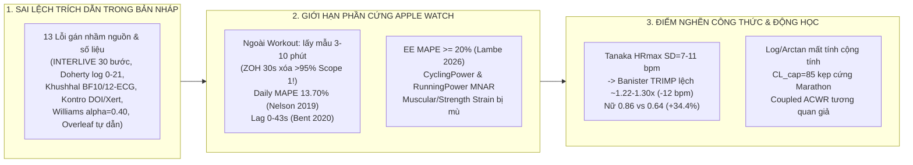

 

# BẢN KIỂM TOÁN TOÀN DIỆN GIỚI HẠN, XÁC THỰC TRÍCH DẪN & ĐIỂM VƯỚNG MẮC KHOA HỌC: APPLE WATCH STRAIN SCORE (`strain_limitation_final.md`) 

> **Phiên bản:** `Final Scientific Audit v2.0 (4-Tier Evidence Taxonomy, Zero-Hallucination Verified)`
> **Vai trò biên soạn:** Sports Physiology & Quantitative Biometrics Research Lead
> **Phạm vi đối chiếu:** Kiểm toán toàn bộ nội dung, công thức, hằng số, trích dẫn và dữ liệu đầu vào trong 2 bản nháp của đồng đội ([`Strain.docx`](file:///d:/Pacen/Strain/Strain.docx) & [`strain-score-overleaf-manuscript.docx`](file:///d:/Pacen/Strain/strain-score-overleaf-manuscript.docx)) và đặc tả hợp nhất [`strain_score_final.md`](file:///d:/Pacen/Strain/strain_score_final.md), đối chiếu trực tiếp với **116 tài liệu** trong thư mục [`D:\Pacen\Strain`](file:///d:/Pacen/Strain) và bảng dữ liệu [`Thống kê chỉ số Apple Heath.xlsx`](<file:///d:/Pacen/Th%E1%BB%91ng%20k%C3%AA%20ch%E1%BB%89%20s%E1%BB%91%20Apple%20Heath.xlsx>).

---

## 0. TÓM TẮT ĐIỀU HÀNH & HỆ THỐNG PHÂN TẦNG 4 MỨC BẰNG CHỨNG (`4-TIER EVIDENCE TAXONOMY`)

| Mức Bằng Chứng |                             Nhãn Phân Loại                             | Tiêu Chuẩn Kiểm Chứng Khoa Học                                                                                                                                                                                                                                                                                                                                                                                                                                                                                                   | Quy Tắc Xử Lý Trong `strain_score_final.md`                                                                                                 |
| :---------------: | :-----------------------------------------------------------------------: | :------------------------------------------------------------------------------------------------------------------------------------------------------------------------------------------------------------------------------------------------------------------------------------------------------------------------------------------------------------------------------------------------------------------------------------------------------------------------------------------------------------------------------------ | :----------------------------------------------------------------------------------------------------------------------------------------------- |
| **MỨC 1** | 🟢 **`[Mức 1 — Chứng minh Định lượng / Kiểm chuẩn AW]`** | Phương trình/thông số chứng minh trực tiếp trong bài báo bình duyệt (`Banister 1991`, `Morton 1990`, `Clarke & Skiba 2013`, `Tanaka 2001`, `Foster 2001`, `Lucia 2003`, `Stagno 2007`, `Manzi 2009`, `Williams 2017a`, `Impellizzeri 2020`, `Montmain 2026`, `Kontro 2026`, `Clemente 2025`, `Stamatakis 2022`) hoặc kiểm chuẩn trực tiếp trên **Apple Watch** (`Lambe 2026`, `Khushhal 2017/2020`, `Nelson & Allen 2019`, `Bent 2020`, `Zhang 2024`, `Uphill 2024`). | **Giữ làm xương sống bất biến**; bắt buộc gắn nhãn `[Device State]` và ghi rõ sai số đo lường (`Bias / LoA / MAPE`).  |
| **MỨC 2** |     🔵 **`[Mức 2 — Có Cơ sở Định tính / Cơ chế]`**     | Đã có bài báo/technical report chứng minh nguyên lý, ngưỡng định hướng hoặc tương tác (ví dụ `Phillips 2025/2026` về `Cardio Load` 24/7, ngưỡng `30% HRR`, giảm trọng số `30–40% HRR`, lọc chuyển động chống stress tâm lý; `Swain & Leutholtz 1997 / Swain et al., 1998` quy đổi `MET ≈ %VO2R ≈ %HRR`; `Williams 2017b` về `ACWR × HRV`), **nhưng chưa công bố đầy đủ mọi tham số đóng**.                                                                                                                    | Giữ **nguyên lý & cấu trúc**; chỉ cô lập phần hằng số cụ thể ở Mức 4 để hiệu chuẩn tại viện nghiên cứu.             |
| **MỨC 3** | 🟡 **`[Mức 3 — Ngoại suy Thiết bị Khác / Patent / Sách]`** | Công thức trích từ 5 Bằng sáng chế WHOOP (`P01–P05`: `{0, 1, 18, 42}`, `arctan 0–21`), sách chuyên khảo (`Edwards 1993` *The Heart Rate Monitor Book*), blog thương mại (`FITIV`, `WHOOP Healthspan 2025`), hoặc kiểm chứng trên `Pixel Watch / Polar / Garmin / ECG chest strap`.                                                                                                                                                                                                                 | Cho phép dùng làm tùy chọn UX (`Phương án 3C, 3D, 4B`) nhưng **cấm trộn làm tiêu chuẩn kiểm chứng của Apple Watch**.    |
| **MỨC 4** | 🔴 **`[Mức 4 — Ngưỡng / Trọng số Tạm Chờ Hiệu Chuẩn]`** | **Cấm dựng step/công thức chính hoàn toàn ở Mức 4** *(đã loại bỏ `ZOH 30s` cho 24/7, `Phạm vi 3`, log `85 AU`, `β_RPE * η_HIIT`, `κ_kcal = 8.5` khỏi `strain_score_final.md`)*. Chỉ giữ các **ngưỡng cắt/hằng số tạm** nằm trên khung `Mức 1–3` (`Cadence ≥ 30 steps/min`, `1.8 MET`, dốc `(HRR% - 30)/10`, $\theta_{\text{cov}} = 0.70$, $T_{\text{wear}}$, $\tau_{\text{bg}} = 10\text{m}$, $C_{\text{scale}}$).                                         | **Stuck Point cốt lõi**: Cô lập thành tham số hiệu chuẩn (**Phần III** trong `strain_score_final.md`), giao viện nghiên cứu / cohort đo đạc thực nghiệm. |

---

## 1. BẢNG KIỂM TOÁN XÁC THỰC TRÍCH DẪN & SAI LỆCH HỌC THUẬT TRONG 2 BẢN NHÁP ĐỒNG ĐỘI

Qua đối chiếu từng chữ giữa [`Strain.docx`](file:///d:/Pacen/Strain/Strain.docx), [`strain-score-overleaf-manuscript.docx`](file:///d:/Pacen/Strain/strain-score-overleaf-manuscript.docx) và văn bản gốc của từng bài báo trong [`D:\Pacen\Strain`](file:///d:/Pacen/Strain), phát hiện **13 lỗi trích dẫn, gán ghép nhầm công thức và sai số liệu nghiêm trọng**:

|   Mã Lỗi   | Tuyên bố / Con số trong `Strain.docx` & `Overleaf`                                                                                                                                                    | Sự thật kiểm chứng từ bài báo gốc (`[Trang / Bảng]`)                                                                                                                                                                                                                                                                                                                                                                                                                                                                                                   | Độ Uy Tín & Phân Loại Nguồn Thực                                                                                                                | Cách Xử Lý Trong `strain_score_final.md`                                                                                                                                                     |
| :-----------: | :----------------------------------------------------------------------------------------------------------------------------------------------------------------------------------------------------------- | :---------------------------------------------------------------------------------------------------------------------------------------------------------------------------------------------------------------------------------------------------------------------------------------------------------------------------------------------------------------------------------------------------------------------------------------------------------------------------------------------------------------------------------------------------------------- | :----------------------------------------------------------------------------------------------------------------------------------------------------- | :------------------------------------------------------------------------------------------------------------------------------------------------------------------------------------------------ |
| **S01** | `Strain.docx` (Mục 1.4, 3.2, 3.7, 4.5) trích dẫn **`strain_score_overleaf.pdf`** như tài liệu tham khảo nền cho thuật toán Banister + 0–21.                                             | Đối chiếu [`strain-score-overleaf-manuscript.docx`](file:///d:/Pacen/Strain/strain-score-overleaf-manuscript.docx) (Mục 6): Đây là **bản thảo tiền bình duyệt do chính nhóm tự viết**, dùng **Edwards TRIMP (`L_bHR`)** và **cấm dùng thang logarit `0–21`**, hoàn toàn trái ngược với Banister + log `0–21` trong `Strain.docx`!                                                                                                                                                                          | ⚠️ **Self-Authored Pre-Peer-Review Draft** (không phải bài báo bình duyệt độc lập).                                                   | Tách rõ `Edwards Strain-HR` thành `Phương án 3C` + `Raw AU 4A`; không tự trích dẫn chéo như nguồn bình duyệt.                                                                |
| **S02** | `Strain.docx` (Mục 3.3 Eq. 2): *"Bộ lọc chuyển động quán tính theo tiêu chuẩn của mạng lưới **INTERLIVE (Johnston et al., BJSM 2021)**: tĩnh tại khi `Cadence < 30 steps/min`."* | Kiểm tra toàn văn [`Ref08_Johnston2021_INTERLIVE_StepCount.pdf`](file:///d:/Pacen/Strain/Ref08_Johnston2021_INTERLIVE_StepCount.pdf): Có **`0` lần nhắc tới `30 steps/min`** hay lọc stress tâm lý! Bài báo chỉ là checklist thiết kế thử nghiệm kiểm chuẩn máy đếm bước chân.                                                                                                                                                                                                                                               | 🔴 **Misattributed Citation** (`Johnston 2021` là `Mức 1` về đếm bước; ngưỡng `30 steps/min` là **`Mức 4 Heuristic`**). | Gỡ trích dẫn `INTERLIVE` khỏi Eq. (2); mở rộng thành `Motion Gating 2A` có `PhysicalEffort MET` & `ActiveKcal` để không xóa nhầm đạp xe/tập tạ.                          |
| **S03** | `Strain.docx` (Mục 3.4 Eq. 4): Gán hàm suy giảm tuyến tính liên tục `w(t) = (HRR% - 30) / 10` (dải `30–40% HRR`) cho **`Khushhal et al. (PLoS ONE 2020)`**.                          | Kiểm tra toàn văn [`Khushhal et al. (2020)`](<file:///d:/Pacen/Strain/Characterising%20the%20application%20of%20the%20progressive%20overload%20principle%20of%20exercise%20training%20within%20cardiac%20rehabilitation%20A%20United%20Kingdom-based%20community%20programme%20-%20PMC.pdf>): Tác giả chỉ tính Banister TRIMP chuẩn (`duration × mean HR × y`), hoàn toàn **không có** hàm `w(t) = (HRR% - 30)/10`! Ý tưởng giảm trọng số `30–40% HRR` thuộc về **Google (`Phillips 2025`)**.                        | 🔴 **Misattributed Formula** (`Phillips 2025` là `Mức 2`; hàm tuyến tính `(HRR%-30)/10` là **`Mức 4 Heuristic`**).          | Gắn đúng nguồn `Phillips 2025` cho nguyên lý giảm `30–40% HRR` và gắn nhãn `Mức 4` cho hàm dốc tuyến tính.                                                                  |
| **S04** | `Strain.docx` (Mục 2.5): *"Khushhal et al. (2020) cho **`BF10 = 71,436`** đối với TRIMP, vượt trội hoàn toàn so với **`sRPE (BF10 = 0.61)`**."*                                | Kiểm tra `Khushhal 2020` p. 1–2 & p. 6: **`BF10 = 0.61` là của `%HRR-CV`**, trong khi **`sRPE-TL` đạt `BF10 = 779,570`** (bằng chứng cực mạnh — thậm chí lớn hơn cả `TRIMP BF10 = 71,436`!), còn `sRPE` đơn lẻ là `BF10 = 1.1`!                                                                                                                                                                                                                                                                                  | 🔴 **Data Misreading Error** (Đọc nhầm hàng bảng thống kê).                                                                               | Sửa lại số liệu chính xác: `TRIMP BF10 = 71,436` vs `sRPE-TL BF10 = 779,570` vs `%HRR-CV BF10 = 0.61`.                                                                                |
| **S05** | `Strain.docx` (Mục 2.5): *"Khushhal et al. (2017) kiểm định Apple Watch so với **điện tâm đồ 12 chuyển đạo (ECG)**, đạt **`ICC = 0.92 – 0.99`**."*                         | Kiểm tra [`Ref05_Khushhal2017_AppleWatchHR_Validity.pdf`](file:///d:/Pacen/Strain/Ref05_Khushhal2017_AppleWatchHR_Validity.pdf) p. 2–5: Thử nghiệm `AW Series 0` ($N=21$ nam) so với dây đeo ngực **Polar S810i** (không phải 12-lead ECG!). Các số `0.97` (đi bộ), `0.92–0.93` (chạy chậm), `0.81–0.86` (chạy nhanh `10 km/h`, `LoA ±19–21 bpm`) là **hệ số tương quan `r`** (còn `ICC` chỉ đo độ đồng nhất giữa Watch trái vs Watch phải).                                                  | 🔴 **Device & Metric Error** (`Polar S810i` $\ne$ `12-lead ECG`; `r` $\ne$ `ICC`).                                                   | Thay bằng dữ liệu kiểm chuẩn chuẩn xác trên Apple Watch thế hệ mới từ `Lambe 2026` (`82` studies, `LoA -6.86..+5.60 bpm` khi tập) và ghi đúng thông số `Khushhal 2017`. |
| **S06** | `Strain.docx` (Mục 3.6 Eq. 8): Gán công thức logarit `21 * log(1 + 9 * min(CL/85, 1)) / log(10)` (`gamma = 9.0, CL_cap = 85.0`) cho **"Doherty & Marco Altini (2025)"**.                     | Kiểm tra [`Ref07_Doherty2025_CompositeHealthScoresWearables.pdf`](file:///d:/Pacen/Strain/Ref07_Doherty2025_CompositeHealthScoresWearables.pdf) p. 7: Doherty & Altini chỉ viết 1 câu mô tả *"WHOOP's Strain Score uses a logarithmic scale of 0–21"*, hoàn toàn **không đề xuất** phương trình này hay bất kỳ `gamma = 9.0, CL_cap = 85.0` nào!                                                                                                                                                                                   | 🔴 **Fabricated Attribution** (Tác giả tự chế công thức rồi gán tên Doherty & Altini).                                                  | Loại bỏ gán ghép tên `Doherty & Altini`; chuyển sang `Phương án 4B (WHOOP P05 Arctan)` làm chuẩn UX và gắn nhãn `Mức 4` cho `4C`.                                          |
| **S07** | `Strain.docx` (Mục 2.3 Bảng 1): Khẳng định **Google Cardio Load (2025)** *"Bị ẩn hệ số `alpha` & trọng số"*.                                                                          | Kiểm tra [`Ref06_Phillips2025_AdaptiveCardioLoadTargets_arXiv2508.11613.pdf`](file:///d:/Pacen/Strain/Ref06_Phillips2025_AdaptiveCardioLoadTargets_arXiv2508.11613.pdf) p. 2 & p. 8: Google **công bố tường minh** $c = 0.64$, $k = 1.92/1.67$, ngưỡng `30% / 40% HRR`, và `CL_Target = Max[RM, EWMA]`! (Google chỉ không ghi hàm dốc số học tại `30–40%` và giá trị `alpha` cụ thể trong Hình 8).                                                                                                                       | ⚠️ **Inaccurate Comparison** (Phóng đại tính đóng của Google `Phillips 2025`).                                                        | Đánh giá trung thực: `Phillips 2025/2026` công bố công thức Banister cốt lõi, chỉ ẩn 2 chi tiết tham số nhỏ.                                                                     |
| **S08** | `Strain.docx` (Mục 3.7 Eq. 10 & Ref `[9]`): Trích **`J. T. Kontro ... PLoS ONE 21(2): e0315421`** cho công thức đạp xe **"Total Strain `SS = P(t)/FTP * k_strain(t)`"**.           | Kiểm tra [`Ref09_Kontro2026_3DImpulseResponse_PLoSONE.pdf`](file:///d:/Pacen/Strain/Ref09_Kontro2026_3DImpulseResponse_PLoSONE.pdf) p. 1: Tác giả đầu là **Hilkka Kontro (`H. Kontro, A. Mastracci, S. S. Cheung, M. J. MacInnis`)**, DOI đúng là **`10.1371/journal.pone.0341721`** (`e0315421` là bài về hệ vi sinh vật ruột của loài giáp xác!), và nội dung bài báo là **Mô hình Đáp ứng Xung 3 Chiều (`alactic, lactic, aerobic`)**, không phải công thức Xert `SS = P(t)/FTP * k_strain(t)`! | 🔴 **Wrong Author, Wrong DOI & Wrong Formula**.                                                                                                  | Sửa đúng tên tác giả `H. Kontro`, DOI `e0341721` và mô tả đúng `3D Impulse-Response Model` (`Phương án 3E`).                                                                |
| **S09** | `Strain.docx` (Mục 3.7 Eq. 11): Gán **`EWMA alpha = 0.40`** cho **`Williams et al. (BJSM 2017)`**.                                                                                       | Kiểm tra [`Ref10_Williams2017_ACWR_EWMA.pdf`](file:///d:/Pacen/Strain/Ref10_Williams2017_ACWR_EWMA.pdf) p. 3: Công thức của Williams là $\lambda_a = 2/(N+1)$, tức **`0.25`** cho 7 ngày và **`0.06897`** cho 28 ngày — không có `alpha = 0.40`!                                                                                                                                                                                                                                                                                 | 🔴 **Parameter Misattribution**.                                                                                                                 | Khôi phục $\lambda_a = 0.25, \lambda_c = 0.06897$ (`Williams 2017a`) và chuyển sang `Uncoupled ACWR` (`Impellizzeri 2020`).                                                           |
| **S10** | `Strain.docx` (Mục 4.2): Cites `Bent et al.` (bỏ sót khỏi Mục 7 References) cho rằng PPG xanh bị suy giảm nặng trên **da tối màu Fitzpatrick V–VI** khi dùng Apple Watch.            | Kiểm tra [`Ref_Bent2020_WearableOpticalHR_Inaccuracy_PMC7010823.pdf`](./Ref_Bent2020_WearableOpticalHR_Inaccuracy_PMC7010823.pdf) pp. 3–5: Không có khác biệt có ý nghĩa thống kê tổng thể theo sắc tố da ($p = 0.634$; Apple Watch 4 có **MAE khi nghỉ là `4.4 bpm`**, trong đó `2.7 bpm` là SD của MAE và `2.7%` là missingness; MAE khi vận động là `4.6 bpm`; tương tác sắc tố da $\times$ thiết bị $p=2.80\times 10^{-5}$ chủ yếu do Biovotion), nhưng phát hiện **độ trễ pha `0–43 giây`** và MDE khi vận động thường cao nhất ở FP5/6. | ⚠️ **Overstatement / Missing Reference** + **Số liệu nhầm SD thành MAE**. | Bổ sung `Bent et al. (2020)` vào danh mục chuẩn và trích dẫn trung thực (`AW4 MAE = 4.4 bpm` nghỉ / `4.6 bpm` tập, độ trễ `0–43s`, không có chênh tổng thể theo sắc tố da). |
| **S11** | `Strain.docx` Ref `[14]`: **`M. Warner ... Journal of Sports Sciences, 44(9), 1102–1111 (2026)`**.                                                                                              | Kiểm tra OpenAlex (`DOI: 10.51224/cik.2026.7780`): Tác giả đầu là **Ashley Warner (`A. Warner, N. Vanicek, A. C. Benson, T. Myers, G. Abt`)**, đăng trên ***Communications in Kinesiology* (2026)**, không phải *J. Sports Sci.* `44(9)`!                                                                                                                                                                                                                                                                                        | 🔴 **Bibliographic Hallucination**.                                                                                                              | Sửa lại chính xác tên tác giả, tên tạp chí và DOI.                                                                                                                                     |
| **S12** | `Strain.docx` (Mục 3.2 & 3.9): Áp dụng `ZOH 30s` cho cả Scope 1 (`24/7`) và viết SQL/Python thiếu xử lý `count/s`, `deletedObjects`, `Midnight Split`, `Union of Workouts`.           | Ngoài buổi tập, Apple Watch đo HR nền chỉ mỗi **3–10 phút/lần** ([`Nelson & Allen 2019`](file:///d:/Pacen/Strain/Accuracy_of_Consumer_Wearable_Heart_Rate_Measureme.pdf)). `ZOH 30s` sẽ vứt bỏ **`> 95%`** thời gian sinh hoạt tự do vào $D_{\text{miss}}$! Đồng thời Excel `Sheet1 R039` quy định đơn vị `count/s` và `R043` có xóa ngược.                                                                                                                                                                | 🔴 **Critical Engineering Contradiction**.                                                                                                       | Tách `ZOH Dual-Regime` (`1A` cho Workout `30s`, `1B` cho `24/7`), sửa bug `BiologicalSex` fallback & đồng bộ xóa ngược (`Mục 6.1`).                                        |
| **S13** | `Strain.docx` (Mục 2.2) & `Overleaf` (Mục 2): Trình bày **Edwards TRIMP (1993)** như công thức sinh lý chuẩn ngang hàng Banister.                                                        | Sách của Sally Edwards (1993) là tài liệu huấn luyện đại chúng (không qua bình duyệt), chia bậc nhảy tuyến tính `1..5` theo `%HRmax` và bỏ qua `RHR` / ngưỡng lactate (`Stagno 2007 p. 3`); nhưng vẫn có độ giá trị hội tụ thực nghiệm với `sRPE` (`Stratakis & Adrović 2026`, $r = 0.86$).                                                                                                                                                                                                                       | 🟡 **`[Mức 3 — Book / Proxy]`** (hữu ích khi thiếu `RHR`).                                                                              | Định vị Edwards `Strain-HR` là **`Phương án 3C`** dự phòng khi khuyết `RHR`, không dùng thay thế `3A` khi đủ dữ liệu.                                              |

---

## 2. ĐIỂM VƯỚNG MẮC VỀ BIẾN ĐẦU VÀO, PHẦN CỨNG APPLE WATCH & LỆCH PHA SINH LÝ (`BƯỚC 0–2`)

### 2.1. Bảng Kiểm Toán Toàn Diện Biến Đầu Vào & Bộ Lọc (`Bước 0–2`)

| Biến / Công đoạn (`HKIdentifier` & Dòng Excel)                                  |                                                                   Phân loại Bằng chứng                                                                   | Cơ sở Đã Có & Sai Số Thực Nghiệm (`[Device State]`)                                                                                                                                                                                                                                                                                                                                                                                                                                                                                                                                                                                                                                                        | Điểm Nghẽn (`Stuck Point`) & Rủi ro Sai lệch                                                                                                                                                                                                                                                                                                                                                     | Quyết định (`Giữ / Tắt / Bỏ`)                                                                                                                 |
| :------------------------------------------------------------------------------------- | :----------------------------------------------------------------------------------------------------------------------------------------------------------: | :------------------------------------------------------------------------------------------------------------------------------------------------------------------------------------------------------------------------------------------------------------------------------------------------------------------------------------------------------------------------------------------------------------------------------------------------------------------------------------------------------------------------------------------------------------------------------------------------------------------------------------------------------------------------------------------------------------------- | :------------------------------------------------------------------------------------------------------------------------------------------------------------------------------------------------------------------------------------------------------------------------------------------------------------------------------------------------------------------------------------------------------ | :---------------------------------------------------------------------------------------------------------------------------------------------------- |
| **`HeartRate`** (`R039`, `count/s -> bpm`)                                 |                   🟢 **Mức 1** (`Lambe 2026`, `Khushhal 2017`, `Uphill 2024`, `Nelson 2019`, `Bent 2020`, `Zhang 2024`)                   | - [`Lambe 2026`](file:///d:/Pacen/Strain/AppleWatchAccuracy2025_LivingSystematicReview_PMC12823594.pdf) (`82` studies): HR khi tập `MB = -0.63 bpm, 95% LoA = -6.86..+5.60 bpm`; thế hệ 3 (`S6+/Ultra`) `LoA = -3.68..+2.59 bpm`.- [`Nelson & Allen 2019`](file:///d:/Pacen/Strain/Accuracy_of_Consumer_Wearable_Heart_Rate_Measureme.pdf): `[AW S3 24h]` Running `MAPE = 3.01%`, Walking `4.64%`, **Daily activities `MAPE = 13.70%, LoA = -33.8..+16.8 bpm, CCC = 0.460`**.- [`Zhang 2024`](<file:///d:/Pacen/Strain/Association%20of%20Smartwatch-Based%20Heart%20Rate%20and%20Physical%20Activity.pdf>): `~99%` mẫu active cách `< 1 phút`, `~99%` sedentary `> 1 phút`. | 1. Lấy mẫu ngoài workout rất thưa (`3–10 phút/lần`), dẫn tới bỏ sót các đợt vận động ngắn `< 2 phút` (`VILPA`, leo cầu thang).2. **`Low Power Mode` tắt đo HR hoàn toàn (`Sheet1 R039`)**; mẫu buổi tập cũ bị nén (`Compaction`).3. Độ trễ PPG `0–43 giây` (`Bent 2020`).                                                                     | **GIỮ LÀM LÕI BẮT BUỘC (`Core`)**, dùng **`1-Min Epoch Dual-Regime` (`1A / 1B`)** và ưu tiên nguồn `Watch*`.            |
| **`Workouts` (`R035`) & `Completeness`**                                   | 🟢 **Mức 1** (`Bent 2020 Eq 10`, `Stamatakis 2022`, `Zhang 2024`) + 🔴 **Mức 4** *($\theta_{\text{cov}}=0.70$, $T_{\text{wear}}$)* | Xác định chính xác $\mathcal{W}_d$, bật đo PPG tần số cao (`1–5s`), và kiểm tra độ đầy đủ `Completeness` (`Bent 2020`) / `Wear-Time` (`Zhang 2024`, `Stamatakis 2022`).                                                                                                                                                                                                                                                                                                                                                                                                                                                                                                              | 1. Cộng đúp khi mở đồng thời `Apple Workout + Strava/NRC`.2. Tập không bấm Workout phụ thuộc `Auto-Workout Detection` vốn trễ hoặc bỏ sót tạ/đạp xe tĩnh.                                                                                                                                                                                                                      | **GIỮ (`Union of Workouts` + `Midnight Split`)**; chuyển Fallback nếu $\text{Completeness} < 0.70$.                                    |
| **`StepCount` (`R030`) & `Motion Gating`**                                 |               🟢 **Mức 1** (`Zhang 2024`) + 🔵 **Mức 2** (`Phillips 2025/2026`) + 🔴 **Mức 4** *(`30 steps/min`)*               | - `Lambe 2026`: AW đếm bước `MAPE 1–21%`.- `Phillips 2025/2026` & `Zhang 2024`: Xác nhận nguyên lý kết hợp HR + chuyển động lọc tĩnh tại / stress tâm lý.                                                                                                                                                                                                                                                                                                                                                                                                                                                                                                                                 | 1. **Điểm mù phi đi bộ:** Đạp xe tại chỗ, chèo thuyền, tập tạ trên ghế, bơi lội có `StepCount ≈ 0` $\implies$ cổng `Cadence ≥ 30` đơn độc sẽ xóa nhầm toàn bộ tải tập nếu quên bấm Workout!2. Dễ nhân đôi `iPhone + Watch` nếu không dùng `.cumulativeSum`.                                                                                   | **BỎ CỔNG ĐƠN KÊNH `2B` LÀM MẶC ĐỊNH**; thay bằng **`Motion Gating 2A`** (`Workout OR Cadence OR MET OR ActiveKcal`).     |
| **`PhysicalEffort` (`R025`, `METs`, `iOS 17+`)**                         |                                    🔵 **Mức 2** (`Swain & Leutholtz 1997 / Swain et al. 1998`) + 🔴 **Mức 4** *(ngưỡng `1.8 MET`)*                                    | Apple ước lượng `METs` tự động khi đeo Watch (`iOS 17.0+`).                                                                                                                                                                                                                                                                                                                                                                                                                                                                                                                                                                                                                                              | Thuật toán chuyển đổi gia tốc/HR sang `MET` của Apple là hộp đen; khuyết hoàn toàn trên `iOS < 17.0` (`iPhone 8/X`).                                                                                                                                                                                                                                                                | **GIỮ LÀM KÊNH BỔ TRỢ** cho `Motion Gating 2A` và `Fallback Cấp 1` khi mất HR.                                                      |
| **`WorkoutEffortScore` (`R033`) & `Estimated...` (`R021`)**              |                          🟢 **Mức 1** (`Foster 1998/2001`, `T09 Liu 2023`, `T15 Tibana 2018`, `T16 Stratakis 2026`)                          | `sRPE-TL` tương quan rất mạnh với `TRIMP` (`Stratakis 2026` $r=0.86, R^2=0.742$; `Khushhal 2020` `BF10 = 779,570`) và bắt được tải kháng lực/yếm khí mà HR bỏ sót.                                                                                                                                                                                                                                                                                                                                                                                                                                                                                                                     | 1. Chỉ có từ `iOS 18.0+`.2. `R033` phụ thuộc việc user tự nhập; `R021` (Watch ước lượng) là hộp đen chưa có kiểm chuẩn độc lập.3. Theo [`Clemente 2025`](file:///d:/Pacen/Strain/The_Correlations_Between_Training_Load_Parameters_.pdf), `sRPE` tương quan thấp hơn với thích nghi `VO2max` dài hạn (`r=0.29` với `VLT`) so với `TRIMP` (`r=0.63`). | **GIỮ LÀM FALLBACK CẤP 2** (khi mất HR buổi tập hoặc tập kháng lực nặng).                                                            |
| **`ActiveEnergyBurned` (`R002`)**                                            |                                                   🟢 **Mức 1** *(đã chứng minh SAI SỐ LỚN)*                                                   | - [`Lambe 2026`](file:///d:/Pacen/Strain/AppleWatchAccuracy2025_LivingSystematicReview_PMC12823594.pdf): `8` nghiên cứu (`n=270`), đa số báo cáo **`MAPE ≥ 20%`**, sai số lớn và bất nhất cả khi tập lẫn lúc nghỉ.- [`Uphill 2024`](file:///d:/Pacen/Strain/Validity_of_Apple_Watch_Garmin_Forerunner_935_and_.pdf): `[AW S5]` EE không đạt ngưỡng `MAPE ≤ 10%` và có thiên lệch tỷ lệ (`proportional bias`).                                                                                                                                                                                                                                                       | Sai số phần cứng quá lớn và không có hệ số quy đổi chuẩn sang `CardioLoad AU`; dễ nhân đôi nguồn & bị nén mẫu.                                                                                                                                                                                                                                                                   | **TẮT HOÀN TOÀN KHỎI LÕI & FALLBACK** (chỉ giữ làm kênh phụ cho `Motion Gating 2A`; nếu mất HR/MET/RPE thì trả `Unmeasured`). |
| **`RunningPower/GCT/VO` (`R028, R075, R077`) & `CyclingPower` (`R010`)** |                                       🔵 **Mức 2** *(cơ học)* + 🔴 **Mức 4** *(`λ_ext = 0.25`)*                                       | Bổ trợ đo tải cơ-thần kinh ngoại biên (`External Load`) khi chạy ngoài trời hoặc đạp xe có cảm biến Bluetooth (`Kontro 2026`, `Apte 2021`).                                                                                                                                                                                                                                                                                                                                                                                                                                                                                                                                                   | **Systematic MNAR:** `CyclingPower` đòi hỏi **Power Meter Bluetooth ngoài** (`> 99%` người dùng không có); `RunningPower/GCT/VO` bằng `NULL` trong gym, chạy máy, bơi, đạp xe.                                                                                                                                                                                       | **TẮT KHỎI MÔ HÌNH PHỔ THÔNG (`λ_ext = 0`)**; chỉ bật ở chế độ chuyên biệt (`Pro Cyclist / Pro Runner`).                     |
| **`VO2Max` (`R044`) & `HRR1` (`R040`)**                                  |                                                🟢 **Mức 1** *(giới hạn AW)* + 🔵 **Mức 2**                                                | Hữu ích để hiệu chỉnh $\tau_2$ và theo dõi thể lực dài hạn (`Han 2022`, `Mandsager 2018`, `Buchheit 2014`).                                                                                                                                                                                                                                                                                                                                                                                                                                                                                                                                                                                      | `VO2Max (R044)` chỉ đo khi đi bộ/chạy ngoài trời có GPS, độ dốc `< 5%`, bị kẹp `[14, 60]` (`Sheet1 R044`) và đánh giá thấp VĐV trình độ cao (`Lambe 2026`); `HRR1 (R040)` nhiễu theo tư thế đứng/ngồi.                                                                                                                                                          | **CHỈ DÙNG LÀM CHỈ BÁO XU HƯỚNG (`Trend-Only`)**, không bắt buộc trong tính `Strain` hàng ngày.                                |

### 2.2. Khoảng Trống Cốt Tử: Cardiovascular Load vs. Muscular / Neuromuscular Load (`Muscular Strain Gap`)

- **Bản chất của Strain V1 & lệch pha tim mạch trong tập kháng lực:** Mọi thuật toán thuần nhịp tim (`Cardio Load 3A`, `Banister 3B`, `Edwards 3C`, `WHOOP Piecewise 3D`) chủ yếu phản ánh áp lực tim mạch – chuyển hóa hiếu khí (`Clemente et al., 2025`, $r=0.63$ với $\Delta\dot{V}\text{O}_{2\max}$), và gặp **giới hạn cấu trúc nghiêm trọng** đối với tập tạ/kháng lực (`Resistance Training`) & các chuỗi bài tập chức năng đa khớp (`[Mức 1 — Scott et al., 2016, Sports Med. 46(5):687–698, Sec. 1–2, pp. 688–689]`):
  - **Tắc mạch cơ học, Valsalva, quãng nghỉ & độ trễ PPG:** Trong các hiệp tập kháng lực nặng, áp lực nội cơ tăng cao gây tắc nghẽn cơ học dòng máu khiến thể tích nhát bóp giữ nguyên hoặc giảm nhẹ (`Lentini et al., 1993`), kết hợp nín thở Valsalva và thay đổi áp lực lồng ngực (`Beckham & Earnest, 2000`) làm nhịp tim phản ứng méo mó; thực nghiệm của [`Falk Neto, Tibana et al. (2020, Front. Physiol. 11:919, Table 2 & pp. 5–6)`](<file:///d:/Pacen/Strain/strain limitation/Session Rating of Perceived Exertion Is a Superior Method to Monitor Internal Training Loads of Functional Fitness Training Sessions Performed at Different Intensities When Compared to Training Impulse.pdf>) ($N=8$) chứng minh `Edwards eTRIMP` thất bại trong việc phân biệt buổi `ALL-OUT` và `RPE6` ($p=0.085$), `Banister bTRIMP` chỉ nhạy rất nhẹ ($p=0.049$, `ES=0.47–0.76`), và cả hai đều **không tương quan với lactate máu**, trong khi **`sRPE` phân biệt rõ** ($p=0.002, \text{ES}=1.82$; tương quan lactate 30 phút $\rho=0.596, p=0.015$). Với bài tập tạ truyền thống có quãng nghỉ kéo dài (`90 s – 5 min`) giữa các hiệp ngắn, kết hợp độ trễ PPG cổ tay `0–43 giây` (`Bent et al., 2020, pp. 4–5`), nhịp tim trung bình cả buổi bị pha loãng và bỏ sót căng thẳng cơ học lên sợi cơ.
  - **Các khía cạnh tải cơ bắp chưa đo được:** (1) `Training Volume` (`Volume Load = Sets × Reps × Weight` — `McBride et al., 2009`; `Scott et al., 2016 Eq. 2`, bỏ sót bài bodyweight `0 kg`, thời gian nghỉ & tốc độ); (2) `Relative Intensity` (`%1RM / RIR / set-RPE` — `Scott et al., 2016 Sec. 2–4`); (3) `Exercise Type` (`Full Squat` cho peak lactate cao hơn `Bench Press` tới `12.5 vs 8.2 mmol/L`, nhưng `BP` mất vận tốc `63.3% vs 46.5%` — `Sánchez-Medina & González-Badillo, 2011 Table 1`); (4) `Muscle Group` (`local RPE` & đau cơ cục bộ từng vùng — `Scott et al., 2016 Sec. 4.1, 5`); (5) `Neuromuscular Fatigue` (`MPV loss` tương quan $r=0.93\text{–}0.97$ với lactate & CMJ loss, nhưng đòi hỏi thiết bị LPT `1000 Hz` + đẩy tối đa — `Sánchez-Medina & González-Badillo, 2011`); và (6) `Session Effort` (`sRPE = RPE × Duration` — `Foster 1998/2001`).
  - **Tầm quan trọng sức khỏe độc lập:** Theo [`Momma et al. (2022, Br. J. Sports Med. 56:755–763, p. 759)`](./bjsports-2021-105061.pdf) (`~60 phút/tuần` liên quan giảm nguy cơ tử vong `RR = 0.82`, bằng chứng quan sát mức `'very low'`) và [`WHOOP Healthspan (2025, Table 1, p. 29)`](./WHOOP_2025_White_Paper_Healthspan__6_.pdf), hoạt động tăng cường cơ bắp tác động độc lập tới sức khỏe dù không tạo `Cardio Load` cao.
- **Khoảng trống lược đồ Apple HealthKit (`Sheet1 R001–R223`) & Giải pháp tách biệt kiến trúc:**
  - Danh mục HealthKit đã kiểm tra có `HKWorkout (R035)`, `HeartRate (R039)`, `PhysicalEffort (R025)`, `ActiveEnergyBurned (R002)` (`MAPE >= 20%`, không thay thế được tải cơ học), `RunningPower/GCT (R028/R075)` *(chỉ khi chạy ngoài trời)*, `CyclingPower (R010)` *(cần cảm biến xe)*, `WorkoutEffortScore / EstimatedWorkoutEffortScore (R033/R021, iOS 18+)` *(cấp toàn buổi)*, **nhưng hoàn toàn chưa có định danh cho `Exercise ID`, `Muscle Group`, `Sets`, `Reps`, `External Weight`, `RIR` hay `Barbell Velocity`**. *(Ghi chú kiến trúc Apple: cảm biến gia tốc thô chỉ truy cập được qua `CoreMotion` trong app chủ động khi ghi workout chứ không nằm trong kho đọc thụ động HealthKit; `Sheet1` là danh mục lược đồ nên không khẳng định tỷ lệ NULL quan sát thực tế từ Excel).*
  - **Quyết định thực tế cho App (xem chi tiết tại `strain_score_final.md` Phần II):** Bổ sung **In-App Resistance Workout Logger** đơn giản (`Exercise ID`, `Muscle Group`, `Sets`, `Reps`, `External Weight (kg)`, `RIR/sRPE`, `Workout Duration`, `Rest Duration`); tính riêng **`Volume Load (kg)`**, **`Weekly Sets per Muscle Group`**, **`Strength Activity Time`** và **`sRPE Load (AU)`**. **Giữ tách biệt tuyệt đối với `Cardio Strain (AU / 0–21)`** và không tự đặt trọng số ghép bài tập khi chưa đủ bằng chứng định lượng.

---

## 3. ĐIỂM VƯỚNG MẮC VỀ CÔNG THỨC, HẰNG SỐ & RANH GIỚI ÁP DỤNG (`BƯỚC 2–4`)

1. **Sai số cá thể của $\text{HR}_{\max}$ (`Tanaka 2001`) khuếch đại hàm mũ trong `Banister TRIMP`:**
   - [`Tanaka et al. (2001)`](file:///d:/Pacen/Strain/Ref03_Tanaka2001_HRmaxRevisited.pdf) báo cáo phương trình $208 - 0.7\times\text{Age}$ có độ lệch chuẩn cá thể **`SD = 7–11 bpm`** ($\pm 2\text{ SD} \approx \pm 14\text{–}22\text{ bpm}$).
   - Kết quả thử nghiệm thực tế trên dữ liệu `WEEE` trong [`strain-score-overleaf-manuscript.docx`](./strain-score-overleaf-manuscript.docx) (Mục 5) chứng minh: cùng 1 buổi tập, chỉ cần thay đổi `HR_max` từ `180` lên `200 bpm` làm điểm `Edwards Strain-HR` sụt từ `39.02` xuống `26.03 AU` (`-33.3%`). Trong công thức hàm mũ `Banister TRIMP` ($0.64\cdot\text{FHRR}\cdot e^{b\cdot\text{FHRR}}$), tính toán lý thuyết cho thấy với `RHR = 60, HR_max = 190 -> 178 bpm` (sai số `-12 bpm`), điểm tải ở `130–170 bpm` bị thổi phồng **`1.22–1.30×`** (`b=1.92`) hoặc **`1.21–1.27×`** (`b=1.67`), và có thể vượt `1.5×` khi sai số lên tới `±2 SD` (`~20 bpm`) hoặc ở người có biên dự trữ hẹp!
2. **Xung đột hệ số giới tính nữ `0.86` (`Clarke & Skiba 2013`) vs `0.64` (`Phillips 2025`):**
   - Dùng `0.86` cho nữ tạo điểm số cao hơn `+34.375%` so với `0.64` ở cùng mức `%HRR`. Tuy nhiên `Phillips et al. (2026)` trên $N=40,000$ người dùng đeo cổ tay cho thấy dùng `0.64` chung cả 2 giới kết hợp $k=1.67$ vẫn cho phân phối tuần hợp lý (`221 ± 156` nữ vs `259 ± 169` nam), đồng thời giải quyết được lỗ hổng nếu người dùng không khai báo giới tính. Điểm lệch `+34.375%` này cần xác nhận lại bằng test lactate thực nghiệm.
3. **Biến thiên cá thể lớn của Ngưỡng Thông khí (`VT1 / LT1`) quanh dải `30–40% HRR`:**
   - [`Gaskill et al.`](<file:///d:/Pacen/Strain/Ventilatory%20Threshold%20Related%20to%20vo2%20reserve,%20Heart%20Rate%20Reserve%20and%20Rating%20of%20Perceived%20Exertion%20in%20a%20Large%20Varied%20Sample.pdf>) ($N=863$) chứng minh mối quan hệ hình chữ U giữa `VO2peak` và `VT%HRR`, còn [`Khushhal et al. (2020)`](<file:///d:/Pacen/Strain/Characterising%20the%20application%20of%20the%20progressive%20overload%20principle%20of%20exercise%20training%20within%20cardiac%20rehabilitation%20A%20United%20Kingdom-based%20community%20programme%20-%20PMC.pdf>) ghi nhận tới **55% bệnh nhân tim mạch có ngưỡng `VAT` nằm ngoài dải `40–70% HRR`**! Vì vậy, ngưỡng cắt `30% HRR` và dốc `(HRR% - 30)/10` chỉ là chuẩn thống kê quần thể (`Mức 2/4`), có thể đánh giá hơi thấp buổi đi bộ nhẹ ở người rất yếu (`VO2peak < 25`) hoặc hơi cao ở VĐV sức bền (`VO2peak > 65`).
4. **Mất tính cộng tính khi nén thang `0–21` & Bẫy bão hòa cứng `CL_cap = 85.0`:**
   - Phép nén `arctan` (`4B`) phá vỡ tính cộng ($\text{Strain}(A+B) \ne \text{Strain}(A)+\text{Strain}(B)$). Đặc biệt, công thức logarit trong `Strain.docx` Eq. (8) kẹp `min(CL / 85.0, 1.0)` khiến bất kỳ ngày nào vượt `85 AU` (chạy bán marathon/marathon có thể đạt `150–350+ AU`) đều chạm trần cứng `21.0` — **đã loại bỏ hoàn toàn** khỏi `strain_score_final.md`. Do đó **chỉ dùng `Raw AU (4A)` cho thuật toán lõi** và dùng `Arctan (4B)` cho hiển thị UX.

---

## 4. ĐIỂM VƯỚNG MẮC VỀ ĐỘNG HỌC DÀI HẠN, `ACWR` & TƯƠNG TÁC VÒNG KÍN (`BƯỚC 5`)

1. **Phê bình Khái niệm & Tương quan Giả tạo của `ACWR` ([`Impellizzeri et al., 2020`](file:///d:/Pacen/Strain/Impellizzeri2020_ACWR_ConceptualIssuesPitfalls.pdf), [`Part 2`](<file:///d:/Pacen/Strain/Training%20Load%20and%20Its%20Role%20in%20Injury%20Prevention-Part%202.pdf>)):**
   - `Coupled ACWR` (chia tuần hiện tại cho trung bình 4 tuần có chứa chính tuần hiện tại) tạo ra tương quan toán học giả tạo và chặn cứng tỷ số $\le 4.0$.
   - Ngay cả `Uncoupled ACWR`, các ngưỡng `0.8–1.3` ("sweet spot") và `≥ 1.5` ("danger zone") từ [`Gabbett (2016)`](file:///d:/Pacen/Strain/Ref11_Gabbett2016_TrainingInjuryPreventionParadox.pdf) chưa được chứng minh quan hệ nhân quả bảo vệ chấn thương trên người dùng phổ thông; sau một tuần nghỉ ốm/du lịch (`Chronic` tụt thấp), quay lại tập bình thường cũng làm `ACWR` vọt lên `> 1.5` giả tạo (`Impellizzeri 2020 p. 5`).
2. **Bất lực của Mô hình Tải Cơ học thuần túy trước Nhiễm trùng & Stress Nội sinh:**
   - Nghiên cứu dọc 2 năm trên VĐV chuyên nghiệp (`PMC13307530` — Widmann 2026) chứng minh khi mắc bệnh nhiễm trùng, `FTP` tụt `-16.4%`, nhưng các đường cong tải (`CTL/ATL/TSB`) lại tăng dương giả tạo vì người bệnh nghỉ tập làm `ATL` giảm! Do đó **bắt buộc kết hợp `ACWR` với `HRV / RHR / Vitals`** (`Williams 2017b`: nguy cơ chỉ tăng khi `ACWR` cao đi kèm `Low HRV`).
3. **Giới hạn Khả năng Dự báo Phục hồi / Thành tích (`Petrov 2026`, `Clemente 2025`, `Rothschild 2024`):**
   - [`Petrov et al. (2026, Table 6)`](file:///d:/Pacen/Strain/T12_Petrov2026_jfmk-11-00369.pdf) theo dõi 169 buổi bơi cho thấy `WHOOP Activity Strain` tương quan mạnh với `Session-RPE Load` ($p = 8.87\times 10^{-17}$) và quãng đường bơi thực tế ($p = 0.0005$), **NHƯNG không tương quan có ý nghĩa thống kê với `WHOOP Recovery (%)` ($p = 0.456$), `HRV` ($p = 0.428$) hay `Sleep duration` ($p = 0.144$)** trước/trong buổi tập!
   - [`Clemente et al. (2025)`](file:///d:/Pacen/Strain/The_Correlations_Between_Training_Load_Parameters_.pdf) (40 nghiên cứu, $N=726$) chỉ ra `HR-based TRIMP` tương quan tốt với thay đổi `VO2max` ($r=0.63$), `VLT` ($r=0.47$) và `OBLA` ($r=0.43$), nhưng các chỉ số tải ngoài và `sRPE` tương quan rất hạn chế với sức mạnh và tốc độ.
4. **Biến động phương sai trong Bộ lọc Kalman (`Kolossa 2017`):** Khi ước lượng tự do nhiễu trạng thái trong mô hình Banister–Kalman (`5.1`), phương sai $\sigma_{x_2}^2$ trong khớp tổng quát Bảng 3 đạt tới `100,013–100,024` nếu không tối ưu hóa có ràng buộc biên ma trận $\mathbf{Q}$ ($\sigma_{x_1}^2 < 1000, \sigma_{x_2}^2 < 10^8$, $|\text{cov}| < 10^6$, Sec. Optimization p. 124).

---

## 5. MA TRẬN ĐỘ PHỦ DỮ LIỆU 3 CẤP (`OVERALL / SEX / AGE × SEX`), QUYẾT ĐỊNH GIỮ–TẮT–BỎ & ĐỀ XUẤT HỢP TÁC VIỆN NGHIÊN CỨU

| Biến / Tham số                                                          | Độ phủ 3 Cấp độ (`Overall / Sex / Age × Sex`) trên Apple Watch                                                                                                                                                                                                                                      | Điểm nghẽn cốt lõi                                                                                                                   | Có thể Bỏ / Tắt không?                                                                                                     | Đề xuất Hợp tác Viện Nghiên cứu                                                                                                                                                                                                                                   |
| :------------------------------------------------------------------------ | :------------------------------------------------------------------------------------------------------------------------------------------------------------------------------------------------------------------------------------------------------------------------------------------------------------ | :---------------------------------------------------------------------------------------------------------------------------------------- | :------------------------------------------------------------------------------------------------------------------------------ | :------------------------------------------------------------------------------------------------------------------------------------------------------------------------------------------------------------------------------------------------------------------------ |
| **`CardioLoad` (`HR R039`)**                                    | **Overall:** [`Phillips 2025 v2 Fig. 4 p. 4`](<file:///d:/Pacen/Strain/compare trimp models/Adaptive Cardio Load Targets for Improving.pdf>) (~`20,000` Fitbit: med **`184 / 214 AU`**); `Phillips 2026` ($N=40,000$ Pixel Watch: **`221±156`** nữ, **`259±169`** nam). **Age × Sex:** Pixel Watch `30–75t` có `CV < 4.5%`; **trên Apple Watch thiếu 100% bảng phân vị chuẩn theo Tuổi × Giới**. | Ngoại suy từ Pixel Watch (lấy mẫu 1-phút liên tục) sang Apple Watch (lấy mẫu nền `3–10 phút`). | **KHÔNG ĐƯỢC BỎ** (là trụ cột lõi của Strain). | Đo đồng thời **Apple Watch + Holter/Polar H10** trong `7–14 ngày` tự do ở `N ≥ 300` người (chia 5 nhóm tuổi $\times$ 2 giới) để đo độ sụt `Coverage` của `Scope 1` và chuẩn hóa phân vị `CardioLoad` theo `Tuổi × Giới`. |
| **`HR_max` (`Tanaka 2001`) & `(A_sex, b_sex)`**               | **Overall & Age:** `Tanaka 2001` phủ `18–81` tuổi ($N=18,712 + 514$). **Sex:** Phân nhánh `1.92 M / 1.67 F` (`Banister 1991`), nhưng **thiếu dữ liệu đối chứng đường cong `%HRR – Lactate` giữa `0.86` và `0.64` trên quần thể Việt Nam / Châu Á**. | `SD = 7–11 bpm` làm lệch hàm mũ TRIMP `~1.22–1.30×` (ở `-12 bpm`) tới `>1.5×` (ở `±2 SD`); lệch `+34.375%` ở nữ.                                                   | **KHÔNG BỎ**, ưu tiên `Observed Peak HR` khi có $\ge 2$ phiên gắng sức tối đa.                              | Thực hiện test lab **`VO2max` + Lactate máu (`LT1/LT2`)** trên **`N ≥ 120–200` người** (Việt Nam, đủ tuổi/giới/thể lực) để hiệu chuẩn $\text{HR}_{\max}$ và hệ số $(A_{\text{sex}}, b_{\text{sex}}, w_{\text{ramp}})$.        |
| **`Motion Gating` (`Steps R030`, `MET R025`)**                | **Overall:** `Lambe 2026` (Steps `MAPE 1–21%`). **Thiếu 100% kiểm chuẩn độ nhạy/đặc hiệu của ngưỡng `30 steps/min` hoặc `1.8 MET` chống stress tâm lý trên Apple Watch.**                                                                                               | `StepCount` triệt tiêu các môn tập không bước chân; Watch ngoài workout không có cờ chuyển động liên tục như Fitbit. | **KHÔNG BỎ** ở `Scope 1`, nhưng phải dùng **`2A` đa kênh (`OR MET/Workout`)** thay cho `Step-only`. | Thử nghiệm đối chứng `N ≥ 60` người qua 3 pha: (a) bài kiểm tra stress tâm lý tĩnh tại (TSST), (b) đạp xe/tập tạ, (c) đi bộ tự do, để tìm ngưỡng tối ưu `(Cadence, MET)` thay cho số `30` tự chế.                                    |
| **`WorkoutEffortScore` (`R033 / R021`)**                        | **Thiếu 100% kiểm chuẩn** cho `EstimatedWorkoutEffortScore (R021)` của Apple; `sRPE` (`Foster 2001`) đã có nhiều bằng chứng `Mức 1` ở người lớn & VĐV.                                                                                                                          | Chỉ có từ `iOS 18.0+`; `R033` dễ bị bỏ qua nếu người dùng lười chấm điểm sau buổi tập.                               | **TẮT khỏi công thức chính**; **GIỮ làm Fallback** khi mất HR hoặc tập kháng lực.                       | Thu thập song song `TRIMP` từ Polar H10, `R033 (User sRPE)` và `R021 (Apple Estimated)` trên các buổi gym/HIIT/chạy để tìm hệ số quy đổi `sRPE -> CardioLoad AU`.                                                                                   |
| **`ActiveEnergyBurned` (`R002`)**                               | **Overall (`Lambe 2026`):** `8` nghiên cứu (`n=270`), `MAPE ≥ 20%` (`Uphill 2024`: `proportional bias`). **Age × Sex:** Thiếu bảng chuẩn theo tuổi trên AW.                                                                                                                  | Sai số phần cứng quá lớn để làm đầu vào tính tải tập chính xác.                                                           | **BỎ KHỎI CÔNG THỨC CHÍNH**; chỉ làm `Fallback Cấp 3` cuối cùng.                                              | Không ưu tiên nghiên cứu hiệu chuẩn biến này vì độ nhiễu nội tại quá cao.                                                                                                                                                                                 |
| **`Running/Cycling Power` (`R028, R010`) & `GCT` (`R075`)** | **Thiếu kiểm chuẩn AW** theo `Tuổi × Giới` (`Lambe 2026`); `CyclingPower` vắng mặt ở `> 99%` người dùng.                                                                                                                                                                            | Systematic MNAR theo môn thể thao & cảm biến ngoài.                                                                                  | **TẮT MẶC ĐỊNH (`λ_ext = 0`)**, chỉ bật cho chế độ `Pro Runner / Pro Cyclist`.                              | Hợp tác câu lạc bộ chạy bộ/ba môn phối hợp ($N \ge 50$) đo `RunningPower + GCT` cùng `CPET / Lactate` để xác định $\lambda_{\text{ext}}$ khi có dấu hiệu mỏi cơ-thần kinh.                                                                 |

---

## 6. RÀNG BUỘC PHÁP LÝ, ĐÁNH GIÁ TIÊU CHÍ NGHIỆM THU & LỘ TRÌNH HIỆU CHUẨN 4 GIAI ĐOẠN

### 6.1. Ràng Buộc Pháp Lý Y Tế & App Store

1. **FDA General Wellness Policy (Cập nhật 01/2026) & EU MDR (2017/745):** Chỉ số `Strain Score` / `Cardio Load` chỉ được phép truyền thông trong phạm vi theo dõi thể lực, lập kế hoạch tập luyện và thúc đẩy lối sống năng động (`Low-Risk General Wellness`). **Cấm tuyệt đối** tuyên bố phát hiện bệnh tim mạch, thiếu máu cơ tim hoặc suy tim từ nhịp tim vận động. Khi `HealthKit` phát sinh `HypertensionEvent (R047)` hoặc `IrregularHeartRhythmEvent (R048)`, chỉ hiển thị lại cảnh báo của Apple và tắt gợi ý tập nặng.
2. **Apple App Store `§5.1.3` & `§5.1.2` (`Server Rules R010–R012`):** Cấm gửi dữ liệu HealthKit tới SDK quảng cáo/analytics; cấm lưu thô lên `iCloud / CloudKit`; yêu cầu xin phép rõ ràng (`Explicit Consent`) nếu gửi dữ liệu sang `AI Coach` bên ngoài.
3. **COPPA & Luật BVDLCN 91/2025/QH15:** Phát hiện tài khoản trẻ em qua `DateOfBirth (R208)` và `AppleMoveTime (R004)`; chặn đồng bộ nếu `< 13` (Mỹ) / `< 16` (VN/EU) mà chưa có xác thực phụ huynh.

### 6.2. Sửa Đổi Tiêu Chí Nghiệm Thu Thực Tế (Khắc Phục Mục Tiêu Bất Khả Thi Trong `Strain.docx` Mục 5.4)

`Strain.docx` Mục 5.4 đặt tiêu chuẩn nghiệm thu **`MAPE nhịp tim từng phút < 5.0%`** và **`Sensitivity Motion Gating >= 95%`**. Đối chiếu với bằng chứng thực nghiệm hiện có:

- Trong điều kiện sinh hoạt tự do 24/7 (`Nelson & Allen 2019`), `Apple Watch` có `MAPE = 13.70%` ở hoạt động hàng ngày (`sitting 7.21%`) do tần suất lấy mẫu thưa. Do đó mục tiêu thực tế nên tách theo phạm vi:
  - **Phạm vi 2 (`Workout`):** `TRIMP ICC ≥ 0.90` và `HR MAPE < 5.0%` so với dây đeo ngực `Polar H10 / ECG` (khả thi trên `Apple Watch Series 6+/Ultra`, chứng minh bởi `Lambe 2026` & `Uphill 2024`).
  - **Phạm vi 1 (`Free-living 24/7`):** `Weekly Cardio Load ICC ≥ 0.85` (chấp nhận sai số `Daily MAPE` rộng hơn ở khung sinh hoạt nền do lấy mẫu gián đoạn), và độ đặc hiệu lọc stress tâm lý tĩnh tại (`Motion Gating 2A`) đạt **`Specificity ≥ 90%`** không làm rơi tải đạp xe/kháng lực.

### 6.3. Lộ Trình Hiệu Chuẩn Khoa Học 4 Giai Đoạn (`4-Phase Strain Validation Roadmap`)

1. **Giai đoạn 1 — Chuẩn Hóa Kiến Trúc Kép & Sửa Lỗi Kỹ Thuật (`Production Readiness`, $N = 0 \to 100$):**
   - Triển khai **`Phương án 3A (Google Cardio Load)`** làm lõi `Raw AU (4A)` + **`Motion Gating 2A` (`OR MET/Workout`)** + **`1-Minute Epoch Dual-Regime (1B)`** + **`Uncoupled EWMA ACWR (5A)`** + **`WHOOP Arctan 0–21 (4B)`** cho lớp UX (kèm tùy chọn **`Edwards eTRIMP 3C`** khi khuyết `RHR`).
   - Vá toàn bộ lỗi `Sheet1` (`count/s`, `.cumulativeSum`, `deletedObjects`, `Midnight Split`, `Union of Workouts`, `BiologicalSex = other`).
2. **Giai đoạn 2 — Thử Nghiệm Phòng Lab Đối Chứng (`Lab Cross-Validation`, $N \ge 120\text{–}200$):**
   - Test gắng sức `VO2max` + Lactate máu (`LT1/LT2`) + thử nghiệm Stress tâm lý (TSST) + đạp xe/tập tạ với **Apple Watch + Holter ECG + Polar H10 + CPET** để hiệu chuẩn $\text{HR}_{\max}$, $(A_{\text{sex}}, b_{\text{sex}})$, dải `30–40% HRR`, và ngưỡng `Motion Gating`.
3. **Giai đoạn 3 — Thử Nghiệm Thực Địa 12–16 Tuần (`Longitudinal Field Validation`, $N \ge 150\text{–}300$):**
   - Theo dõi người dùng chạy bộ, đạp xe, tập tạ và sinh hoạt tự do kết hợp `sRPE` (`R033`) và bảng hỏi `SRSS / Hooper` để hiệu chuẩn `C_scale` (thang `0–21`), hàm quy đổi `sRPE` $\to$ `AU` cho bài tập kháng lực (`Muscular Strain`), và phụ phí `Strain -> SleepNeed`.
4. **Giai đoạn 4 — Thẩm Định Dữ Liệu Lớn & Tối Ưu Hóa `Banister ZOH` (`Big Data Audit`, $N \ge 1,000$):**
   - Chạy `EM + RTS Smoother` (`Montmain 2026 Eq. 17` + `Kolossa 2017`) để cá nhân hóa $(\tau_1, \tau_2)$ và kiểm định tương tác `ACWR × HRV` trên tập dữ liệu dọc ẩn danh.

---

## 7. TÀI LIỆU THAM KHẢO BỔ SUNG (KIỂM TOÁN CARDIO LOAD VS. MUSCULAR LOAD)

1. **Falk Neto, J. H., Tibana, R. A., de Sousa, N. M. F., Prestes, J., Voltarelli, F. A., & Kennedy, M. D. (2020).** Session Rating of Perceived Exertion Is a Superior Method to Monitor Internal Training Loads of Functional Fitness Training Sessions Performed at Different Intensities When Compared to Training Impulse. *Frontiers in Physiology*, 11, 919. — <https://doi.org/10.3389/fphys.2020.00919> · [File nội bộ](<file:///d:/Pacen/Strain/strain limitation/Session Rating of Perceived Exertion Is a Superior Method to Monitor Internal Training Loads of Functional Fitness Training Sessions Performed at Different Intensities When Compared to Training Impulse.pdf>).
2. **McBride, J. M., McCaulley, G. O., Cormie, P., Nuzzo, J. L., Cavill, M. J., & Triplett, N. T. (2009).** Comparison of methods to quantify volume during resistance exercise. *J. Strength Cond. Res.*, 23(1), 106–110. — [File nội bộ](<file:///d:/Pacen/Strain/strain limitation/Comparison of methods to quantify volume during resistance exercise.pdf>).
3. **Sánchez-Medina, L., & González-Badillo, J. J. (2011).** Velocity loss as an indicator of neuromuscular fatigue during resistance training. *Med. Sci. Sports Exerc.*, 43(9), 1725–1734. — [File nội bộ](<file:///d:/Pacen/Strain/strain limitation/Velocity loss as an indicator of neuromuscular fatigue during resistance training.pdf>).
4. **Scott, B. R., Duthie, G. M., Thornton, H. R., & Dascombe, B. J. (2016).** Training Monitoring for Resistance Exercise: Theory and Applications. *Sports Medicine*, 46(5), 687–698. — <https://doi.org/10.1007/s40279-015-0454-0> · [File nội bộ](<file:///d:/Pacen/Strain/strain limitation/Training Monitoring for Resistance Exercise  Theory and Application.pdf>).
