# ĐẶC TẢ TOÁN HỌC & THUẬT TOÁN HỢP NHẤT: APPLE WATCH FINAL STRAIN SCORE (`strain_score_final.md`)

> **Phiên bản:** `Final Unified Specification v2.2 (Audited & Enriched Clean-Room Spec)`
> **Vai trò biên soạn:** Sports Physiology & Quantitative Biometrics Research Lead
> **Cơ sở xây dựng chuẩn sạch:**
>
> 1. **Hệ thống tài liệu bình duyệt (`Mức 1–2`) & Bằng sáng chế / Sách chuyên khảo (`Mức 3`):** Đối chiếu toàn văn trong kho [`Strain/`](./). Không sử dụng bất kỳ nhận định hay hằng số nào thiếu nguồn gốc học thuật làm sườn chính của pipeline; mọi ngưỡng/trọng số tạm thời (`Mức 4`) đều được cô lập rõ để hiệu chuẩn thực nghiệm ở `Phase 2–3`. *(Báo cáo kiểm toán các bản nháp nội bộ trước đó được tách riêng tại [`strain_limitation_final.md`](./strain_limitation_final.md)).*
> 2. **Đồng bộ kiến trúc hệ sinh thái:** Liên kết vòng kín với [`recovery_score_final.md`](<../Sleep, Recovery, Strain/recovery_score_final.md>) (`Bước 5B.0 / 7`) và [`Apple_Watch_Recovery_Score_Mathematical_Design.md`](./Apple_Watch_Recovery_Score_Mathematical_Design.md) (`Stage 3`).
> 3. **Đặc tả phần cứng & dữ liệu đầu vào:** [`Thống kê chỉ số Apple Heath.xlsx`](<../Thống kê chỉ số Apple Heath.xlsx>) (`223` dòng `Sheet1` + `15` dòng `Quy tắc cho server`, cập nhật tới `iOS 27.0`).

---

## 0. HỆ THỐNG NHÃN BẰNG CHỨNG, SƠ ĐỒ KIẾN TRÚC & ĐẶC TẢ ĐẦU VÀO HEALTHKIT

### 0.1. Quy ước Phân tầng 4 Mức Bằng Chứng (`Evidence Tiers`), Loại Tài Liệu & Trạng Thái Thiết Bị (`[Device State]`)

Mọi công thức, ngưỡng cắt và trọng số trong đặc tả này được gắn nhãn nhất quán theo hệ thống **4 Mức Bằng Chứng** tương đồng với [`recovery_score_final.md`](<../Sleep, Recovery, Strain/recovery_score_final.md>), đồng thời phân biệt rõ **loại hình tài liệu** (`Peer-Reviewed Journal`, `Preprint`, `Conference Abstract`, `Patent`, `Book / Chapter`, `White Paper`, `Technical Guideline`):

1. **`[Mức 1 — Chứng minh Định lượng / Toán học / Kiểm chuẩn Apple Watch]`**: Phương trình, cơ chế hoặc số liệu được chứng minh trực tiếp trong bài báo bình duyệt (`[Peer-Reviewed Journal]`: `Morton 1990`, `Clarke & Skiba 2013`, `Tanaka 2001`, `Foster 1998/2001`, `Lucia 2003`, `Stagno 2007`, `Manzi 2009`, `Williams 2017a`, `Impellizzeri 2004/2020`, `Kontro 2026`, `Clemente 2025`, `Stamatakis 2022`, `Momma 2022`, `Shailendra 2022`, `Paluch 2022`, `Lee 2022`, `Nuuttila 2024`, `Stanley 2013`, `Bellenger 2016`), kiểm chuẩn trực tiếp trên phần cứng Apple Watch (`[Peer-Reviewed Journal — Apple Watch]`: `Lambe 2026`, `Khushhal 2017`, `Khushhal 2020`, `Nelson & Allen 2019`, `Bent 2020`, `Zhang 2024`, `Uphill 2024`), hoặc công trình toán học/thực nghiệm tiền ấn bản (`[Preprint]`: `Montmain 2026`, `Stratakis & Adrović 2026`, `Swinton 2021`).
2. **`[Mức 2 — Có Cơ sở Nghiên cứu Định tính / Thứ bậc / Báo cáo Kỹ thuật Chưa Đóng Hết Tham Số]`**: Đã có nghiên cứu chứng minh cơ chế, chiều hướng hoặc khung công thức, **nhưng chưa công bố đầy đủ mọi tham số đóng hoặc chưa qua bình duyệt toàn văn** — tiêu biểu là `[Preprint / White Paper]` (`Phillips et al., 2025, arXiv:2508.11613v2`) & `[Conference Abstract]` (`Phillips et al., 2026, MSSE`, $N=40,000$) chứng minh khung `Cardio Load` 24/7, `30%–40% HRR` down-weighting, lọc chuyển động chống stress tâm lý và `Max[RM, EWMA]` nhưng **ẩn chi tiết hàm dốc tuyến tính & hằng số $\alpha$**; `[Peer-Reviewed Journal]` (`Williams 2017b` chứng minh tương tác `ACWR × Low HRV` trên $N=6$ nhưng chưa chốt công thức phạt; `Swain & Leutholtz 1997` / `Swain et al., 1998` chứng minh tương đương `%VO2R / MET ≈ %HRR` cần thêm `VO2max`).
3. **`[Mức 3 — Ngoại suy Thiết bị Khác / Bằng sáng chế / Sách Chuyên khảo / White Paper Thương mại]`**: Công thức trích từ 5 Bằng sáng chế WHOOP (`[Patent P01–P05]`, như trọng số vùng `{0, 1, 18, 42}` trên `AT/CPT` và nén `arctan` thang `0–21`), `[Commercial White Paper]` (`WHOOP Healthspan 2025 Table 1`), sách huấn luyện (`[Book]`: `Edwards 1993`; `[Book Chapter]`: `Banister 1991`), hoặc kiểm chứng trên thiết bị khác (`Pixel Watch 3`, `Polar`, `Garmin`, `ECG chest strap`).
4. **`[Mức 4 — Ngưỡng / Trọng số Kỹ thuật Tạm Thời / Tham Số Thiết Kế Chờ Hiệu Chuẩn Phase 2–3]`**: Tuyệt đối **không** dùng `Mức 4` để dựng sườn công thức hay bước xử lý mới; `Mức 4` chỉ được phép áp cho các **ngưỡng cắt/hằng số số học hoặc tham số thiết kế tạm thời** đặt trên khung phương pháp đã có cơ sở `Mức 1–3` (ví dụ: $\tau_{\text{gap,workout}} = 30\text{s}$, $\tau_{\text{bg}} = 10\text{ min}$, `Cadence >= 30 steps/min`, `1.8 MET`, `0.03 kcal/kg/min`, dốc tuyến tính `10*(FHRR - 0.30)`, ngưỡng `Completeness < 0.70`, `Wear-Time 10–14h`, `C_scale = 35–45 AU`, `τ1=42 / τ2=7` hoặc `[4,10]`, `α = 0.25–0.40`). Mọi tham số `Mức 4` bắt buộc hiệu chuẩn theo **Phần III**.

---

### 0.2. Sơ đồ Luồng Xử Lý Hợp Nhất 6 Bước (`Master 6-Step Strain Pipeline`)

```mermaid
flowchart TD
    subgraph S0["BƯỚC 0: ĐẦU VÀO HEALTHKIT & ĐỒNG BỘ SERVER (iOS 8 -> iOS 27)"]
        HK["HealthKit Raw Store (Sheet1 R002-R208)<br/>HR (count/s -> bpm), Workouts, Steps, Effort, Energy<br/>+ HKAnchoredObjectQuery deletedObjects (R002/R039/R043/R045)<br/>+ iOS 27 Historical Cutoff Check (Server Rule R004)"]
        PR["Lọc Nguồn & Chống Nhân Đôi<br/>Source Priority (Watch* > 3rd-party)<br/>+ .cumulativeSum cho Steps/ActiveEnergy"]
        HK --> PR
    end

    subgraph S1["BƯỚC 1: 2 PHẠM VI ĐO, HỢP NHẤT BUỔI TẬP, 1-MIN EPOCH & COMPLETENESS GATE"]
        SC["2 Phạm vi Chuẩn hóa (Research-Grounded)<br/>Scope 1: Daily 24/7 (Phillips 2025/2026; Stamatakis 2022)<br/>Scope 2: Workout-Only (Morton 1990; Lambe 2026)"]
        UN["Union of Workouts (Khử trùng thời gian Strava/NRC/Watch)<br/>+ Local Midnight Split + HR Source Priority"]
        ZOH["1-Min Epoch Binning (Nelson 2019; Phillips 2025)<br/>+ Completeness (Bent 2020 Eq 10) & Valid Wear-Time (Zhang 2024; Stamatakis 2022)<br/>1A: Workout-Only | 1B: 24/7 Dual-Regime"]
        PR --> SC --> UN --> ZOH
    end

    subgraph S2["BƯỚC 2: CHUẨN HÓA CƯỜNG ĐỘ & MOTION GATING"]
        HM["HR_max (Observed Peak -> Tanaka 208-0.7*Age)<br/>+ RHR (Nocturnal Median -> HKRestingHR)"]
        INT["Cường độ %HRR (Karvonen 1957) hoặc %HRmax<br/>+ Vùng chuyển tiếp 30-40% HRR (Phillips 2025)"]
        MG["Cổng Chuyển Động (Phillips 2025; Zhang 2024)<br/>2A (Khuyến nghị): is_workout OR Cadence OR MET OR ActiveKcal<br/>2B: Step-Only (iOS <17) | 2C: Workout-Only (Classic TRIMP)"]
        ZOH --> HM --> INT --> MG
    end

    subgraph S3["BƯỚC 3: TẢI PHÚT & TÍCH LŨY NGÀY (CORE LOAD AU)"]
        M3A["3A (Khuyến nghị V1): Google Cardio Load (Phillips 2025/2026)<br/>c=0.64 chung 2 giới, b=1.92 M / 1.67 F, >=30% HRR"]
        M3B["3B: Classic Banister TRIMP (Clarke & Skiba 2013: 0.64 M / 0.86 F)"]
        M3C["3C: Edwards eTRIMP (Edwards 1993; Stratakis 2026: 5 vùng %HRmax)"]
        M3D["3D: WHOOP Piecewise {0,1,18,42} (WHOOP Patents P02/P04/P05)"]
        M3E["3E: Lucia/Stagno/Manzi/Kontro + Fallback (MET Swain & Leutholtz 1997 / Swain 1998; sRPE Foster 2001)"]
        MG --> M3A & M3B & M3C & M3D & M3E
    end

    subgraph S4["BƯỚC 4: ÁNH XẠ THANG ĐO ĐẦU RA"]
        S4A["4A (Lõi Bắt Buộc): Raw Additive AU (Morton 1990; Phillips 2025)<br/>Bảo toàn tính cộng tuyến tính cho ACWR & Banister"]
        S4B["4B (UX Khuyến nghị): WHOOP Arctan 0-21 (Patent P05)<br/>21 * (2/pi) * arctan(L / C_scale)"]
        M3A & M3B & M3C & M3D & M3E --> S4A --> S4B
    end

    subgraph S5["BƯỚC 5: ĐỘNG HỌC DÀI HẠN, ACWR & VÒNG KÍN RECOVERY / SLEEP / BIO-AGE"]
        DYN["Banister-Hill ZOH (g_t, h_t — Montmain 2026 Eq 17)<br/>+ Uncoupled EWMA ACWR (Impellizzeri 2020) vs Max[RM, EWMA]"]
        LOOP["Liên kết Hệ sinh thái Pacen<br/>1) Strain -> SleepNeed<br/>2) ACWR x Low HRV -> M_Strain (Williams 2017b)<br/>3) HR Zones 1-3/4-5 + Strength + Steps -> Biological Age"]
        S4A --> DYN --> LOOP
    end
```

---

### 0.3. Bảng Đặc Tả Toàn Bộ Đầu Vào Apple HealthKit Cho Strain (`Sheet1 R001–R223` & `Quy tắc cho server R001–R015`)

Đối chiếu trực tiếp với [`Thống kê chỉ số Apple Heath.xlsx`](<../Thống kê chỉ số Apple Heath.xlsx>) (`Sheet1 R002–R221` và `Quy tắc cho server R001–R015`):

|     STT     | Nhóm tín hiệu                                | Định danh HealthKit (`HKIdentifier`)                                                                                          |          Dòng Excel (`Sheet1`)          |                  Đơn vị gốc (`Sheet1`)                  | iOS & Phần cứng                                   | Vai trò trong Pipeline Strain                                                                                                                                                                  | Cảnh báo Kỹ thuật, Sai số & Bẫy Dữ liệu (`Sheet1` & `Quy tắc cho server`)                                                                                                                                                                                                                                                                                                                                 |
| :----------: | :---------------------------------------------- | :-------------------------------------------------------------------------------------------------------------------------------- | :----------------------------------------: | :------------------------------------------------------------: | :-------------------------------------------------- | :---------------------------------------------------------------------------------------------------------------------------------------------------------------------------------------------- | :--------------------------------------------------------------------------------------------------------------------------------------------------------------------------------------------------------------------------------------------------------------------------------------------------------------------------------------------------------------------------------------------------------------------- |
| **01** | **Nhịp tim liên tục**                  | `HKQuantityTypeIdentifierHeartRate`                                                                                             |             **`R039`**             | **`count/s`** *(phải $\times 60 \to \text{bpm}$)* | `iOS 8.0+`, Watch mọi đời                      | Tín hiệu cốt lõi tính `%HRR`, `%HRmax`, `CardioLoad`, `eTRIMP`, `WHOOP Strain`.                                                                                                  | ⚠️ **3 bẫy sống còn:** (1) Đơn vị chuẩn HealthKit trong Excel là `count/s`, phải quy đổi sang `bpm`; (2) **Chế độ Nguồn điện thấp (`Low Power Mode`)** tắt đo HR nền; (3) Tùy chọn *"ít đọc GPS và nhịp tim"* làm thưa mẫu trong workout; (4) **Nén mẫu cũ (`Workout Sample Compaction`)** sau vài tháng gộp mẫu chi tiết thành mẫu tổng hợp! |
| **02** | **Buổi tập (`Workouts`)**             | `HKWorkoutTypeIdentifier`(user phải bật khi tập)                                                                             |             **`R035`**             |   `HKWorkout` (`duration`, `activityType`, `energy`)   | `iOS 8.0+`, Watch & App bên thứ 3               | Xác định **Phạm vi 2**, mở khóa cổng `Motion Gating`, phân loại môn (`HIIT/Strength/Run/Cycle/Swim`).                                                                       | ⚠️ **Bẫy nhân đôi nguồn:** Strava, Nike Run Club, Garmin hoặc WHOOP đồng bộ song song với Apple Workout tạo các bản ghi chồng lấn thời gian $\implies$ Bắt buộc chạy phép hợp `Union of Workouts`.                                                                                                                                                                                    |
| **03** | **Nhịp tim nghỉ (`Apple RHR`)**       | `HKQuantityTypeIdentifierRestingHeartRate`                                                                                      |             **`R043`**             |                    `count/min` (`bpm`)                    | `iOS 11.0+`, Watch S1+                            | Giá trị đáy $\text{HR}_{\text{rest}}$ trong công thức Karvonen `%HRR` (ưu tiên `Nocturnal Median HR` từ `R039` trước, `R043` làm Tier 2).                                 | ⚠️ **Cơ chế Xóa ngược (`Retroactive Deletion — Sheet1 R043 & Server Rule R009`):** Apple Watch tính lại và **XÓA mẫu RHR cũ của hôm nay/hôm qua** để ghi mẫu mới. Server bắt buộc dùng `HKAnchoredObjectQuery` xử lý `deletedObjects`.                                                                                                                                     |
| **04** | **Số bước chân**                      | `HKQuantityTypeIdentifierStepCount`                                                                                             |             **`R030`**             |                           `count`                           | `iOS 8.0+`, iPhone & Watch                        | Tham gia `Motion Gating` (lọc stress tĩnh tại) và tải nền `L_basal` (Phương án 3D/5A-3).                                                                                           | ⚠️ **Bẫy nhân đôi & Khiếm khuyết môn tập:** iPhone + Watch cùng ghi bước $\implies$ Bắt buộc đọc qua `HKStatisticsCollectionQuery` (`.cumulativeSum`). Ngoài ra `StepCount = 0` trong đạp xe, chèo thuyền, tập tạ, bơi $\implies$ **Cấm dùng đơn độc** làm cổng lọc!                                                                                           |
| **05** | **Mức gắng sức (`METs`)**            | `HKQuantityTypeIdentifierPhysicalEffort`                                                                                        |             **`R025`**             |                   `kcal/(kg*hr)` (`MET`)                   | `iOS 17.0+`, Watch S4+ *(cần iPhone XS/XR+)*   | Giải quyết bẫy `StepCount = 0`: xác nhận vận động chuyển hóa ($\text{MET} \ge 1.8$) trong `Motion Gating 2A`; fallback quy đổi sang `%HRR` (`Swain & Leutholtz 1997` / `Swain et al., 1998`) khi khuyết HR. | Có tự động khi đeo Apple Watch từ `iOS 17.0+`; giúp phân biệt stress tâm lý ngồi yên ($\text{MET} < 1.3$) với lao động thể chất không bước chân.                                                                                                                                                                                                                                             |
| **06** | **Điểm nỗ lực (`Effort Score`)**    | `HKQuantityTypeIdentifierWorkoutEffortScore` & `EstimatedWorkoutEffortScore`                                                  |       **`R033` & `R021`**       |                `appleEffortScore` (`1–10`)                | `iOS 18.0+`, Watch *(iPhone XS/XR+)*            | Tính tải dự phòng `sRPE` (`Foster 1998`) khi mất HR (ví dụ tháo đồng hồ tập đối kháng/bơi lỏng dây) hoặc hệ số $\beta_{\text{RPE}}$.                                 | `R033` là điểm người dùng tự chấm (`User-rated`); `R021` là điểm Apple Watch tự ước lượng (`Black-box ML`, chỉ có sau buổi tập).                                                                                                                                                                                                                                                           |
| **07** | **Năng lượng hoạt động**            | `HKQuantityTypeIdentifierActiveEnergyBurned`                                                                                    |             **`R002`**             |                            `kcal`                            | `iOS 8.0+`, Watch/iPhone                          | Tải dự phòng `Calorie Fallback` khi mất HR hoàn toàn và hỗ trợ `Motion Gating`.                                                                                                    | ⚠️ **Sai số & Nén mẫu:** `Lambe 2026` & `Uphill 2024` chứng minh sai số EE trên AW rất lớn (`MAPE ≥ 20%`). Dễ bị nhân đôi nếu không dùng `.cumulativeSum`; bị nén mẫu sau vài tháng.                                                                                                                                                                                             |
| **08** | **Công suất chạy & Động lực chạy** | `RunningPower`, `RunningGroundContactTime`, `RunningVerticalOscillation`, `RunningSpeed`, `RunningStrideLength`         | **`R028, R075, R077, R029, R076`** |             `W`, `ms`, `cm`, `m/s`, `m`             | `iOS 16.0+`, Watch SE 2 / S6+ / Ultra             | Tín hiệu cơ-thần kinh ngoại biên tiềm năng khi chạy bộ ngoài trời; **V1 không đưa vào tính điểm tải** ($\lambda_{\text{ext}} = 0$, chuyển nghiên cứu ở **Phần III — Mục 4**).               | ⚠️ **Systematic MNAR:** Chỉ ghi khi chạy bộ ngoài trời (`Outdoor Run`). Chạy máy (`Indoor Run`), gym, đạp xe, bơi `= 100% NULL`.                                                                                                                                                                                                                                                               |
| **09** | **Công suất đạp xe & FTP**            | `CyclingPower`, `CyclingFunctionalThresholdPower`, `CyclingCadence`, `CyclingSpeed`                                       |    **`R010, R009, R008, R011`**    |              `W`, `W`, `count/min`, `m/s`              | `iOS 17.0+`, Watch kết nối cảm biến Bluetooth | Tính tải cơ học đạp xe (`TSS` / `Kontro 3D Impulse-Response` nếu có).                                                                                                               | ⚠️ **Thiếu hụt cực lớn trên đại chúng:** Bắt buộc có **cảm biến Power Meter Bluetooth ngoài** kết nối với Apple Watch (tập bằng iPhone trên iOS 26 không nhận cảm biến!). Hơn `95–99%` người dùng phổ thông không có chỉ số này.                                                                                                                                   |
| **10** | **Nhịp tim hồi phục 1 phút**          | `HKQuantityTypeIdentifierHeartRateRecoveryOneMinute`                                                                            |             **`R040`**             |                    `count/min` (`bpm`)                    | `iOS 16.0+`, Watch S4+                            | Chỉ báo phụ trợ tốc độ tái kích hoạt phó giao cảm sau buổi tập (`HRR1`).                                                                                                        | Chỉ tự động ghi sau khi kết thúc `HKWorkout` đủ dài/nặng; nhạy với tư thế (đứng vs ngồi) ngay sau tập.                                                                                                                                                                                                                                                                                             |
| **11** | **VO2Max ước lượng**                  | `HKQuantityTypeIdentifierVO2Max`                                                                                                |             **`R044`**             |                        `ml/(kg*min)`                        | `iOS 11.0+`, Watch S3+                            | Cá nhân hóa hằng số suy giảm mệt mỏi $\tau_2$ (Banister) và theo dõi thích nghi dài hạn.                                                                                         | ⚠️ **Giới hạn `[14, 60]` & MNAR (`Sheet1 R044`):** Chỉ tính khi đi bộ/chạy/leo núi ngoài trời có GPS, độ dốc `< 5%`. VĐV đạp xe, bơi, gym trong nhà bị `NULL`; VĐV đỉnh cao `> 60` bị kẹp trần.                                                                                                                                                                            |
| **12** | **Nhân khẩu học & Trẻ em**            | `BiologicalSex`, `DateOfBirth`, `AppleMoveTime`                                                                             |       **`R206, R208, R004`**       |                  `Enum`, `Date`, `min`                  | `iOS 8.0+` / `14.5+`                            | Tính `Age` cho `HR_max` (`Tanaka`), phân nhánh `k_sex` (`1.92` vs `1.67`), kiểm tra tuân thủ `COPPA`.                                                                       | ⚠️ **Tín hiệu trẻ em (`Sheet1 R004`):** `AppleMoveTime` tự động bật cho người dùng `< 13 tuổi`. Cần xử lý nhánh `BiologicalSex == other / notSet` an toàn (không gán nhầm mặc định nữ).                                                                                                                                                                                         |
| **13** | **Cờ an toàn Tim mạch (`SaMD`)**     | `HighHeartRateEvent`, `IrregularHeartRhythmEvent`, `LowHeartRateEvent`, `AtrialFibrillationBurden`, `HypertensionEvent` | **`R046, R048, R050, R038, R047`** |                      `Category` / `%`                      | `iOS 12.2–26.2+`                                 | **Cờ bảo vệ an toàn (`Safety Guardrails`)**: Khi có cảnh báo rung nhĩ hoặc tăng huyết áp (`R047`), tắt gợi ý tập nặng `HIIT` / vượt trần.                       | Thuộc nhóm `SaMD` của Apple (đã hỗ trợ tại Việt Nam theo `Server Rule R002`); App chỉ được hiển thị nguyên trạng và điều chỉnh khuyến nghị lối sống an toàn, cấm tự chẩn đoán.                                                                                                                                                                                                      |
| **14** | **HRV (Liên kết Vòng kín)**           | `HeartRateVariabilityRMSSD` (`iOS 27+`), `HeartbeatSeries`, `HeartRateVariabilitySDNN`                                    |       **`R221, R052, R041`**       |                    `ms`, `sec`, `ms`                    | `iOS 11–27+`                                     | Đầu vào kiểm tra phản ứng tự chủ ngày hôm sau (`ACWR × Low HRV` và `Recovery → Target Strain`).                                                                                | `R221` mới trong `iOS 27.0+`; `R041 SDNN` trên `S12/U4` đo cả ban ngày nên cần lọc khung ngủ (`Recovery pipeline`).                                                                                                                                                                                                                                                                                 |

---

### 0.4. Quy Tắc Lọc Nguồn & Đồng Bộ Server Bắt Buộc (`Server Sync Rules R001–R015`)

Từ sheet `'Quy tắc cho server'` (`R001–R015`):

1. **Lọc phần cứng gốc (`Watch* Priority`):** Với `HeartRate` (`R039`), `RestingHeartRate` (`R043`), `PhysicalEffort` (`R025`), ưu tiên nguồn có `sourceRevision.productType` bắt đầu bằng `"Watch"`. Loại bỏ các mẫu nhập tay (`HKMetadataKeyWasUserEntered == true`). Với `StepCount` (`R030`) và `ActiveEnergyBurned` (`R002`), bắt buộc truy vấn qua `HKStatisticsCollectionQuery` với `.cumulativeSum` để Apple tự khử trùng lặp giữa iPhone và Watch.
2. **Đồng bộ Xóa ngược (`HKAnchoredObjectQuery` — `Server Rule R009`):** Apple chủ động xóa/thay thế mẫu cũ trong `3` trường hợp: (i) người dùng xóa trong Apple Health, (ii) Apple tính lại `RestingHeartRate` (`R043`) và `WalkingHeartRateAverage` (`R045`) trong ngày/hôm qua, (iii) Apple **gộp/nén mẫu buổi tập cũ (`Workout Sample Compaction`)** sau vài tháng (`R002, R013, R019, R039`). Backend bắt buộc xử lý mảng `deletedObjects` từ `HKAnchoredObjectQuery` để kích hoạt tính toán lại ngày bị ảnh hưởng.
3. **Phát hiện Cắt lịch sử `iOS 27` (`Server Rule R004`):** Từ `iOS 27`, người dùng có thể giới hạn app chỉ đọc từ một mốc ngày gần đây ($D_{\text{hist}} < 28\text{ ngày}$). Hệ thống phải phân biệt rõ *"trước mốc cắt = không biết"* (không gán `Load = 0` vào mẫu số `Chronic 28d` khiến `ACWR` vọt lên giả tạo!).
4. **Khóa màn hình & Trễ Bluetooth (`Server Rules R006–R008`):** HealthKit bị mã hóa khi iPhone khóa; đồng hồ chỉ giữ ~1 tuần dữ liệu thô và đồng bộ sang iPhone với độ trễ không cố định. Do đó pipeline cập nhật `Daily Strain` chạy tăng dần mỗi khi nhận thông báo `Background Delivery` sau khi iPhone mở khóa, và **chốt sổ ngày $d$** sau `03:00` sáng ngày $d+1$ (để thu hết dữ liệu workout đêm muộn và hoàn tất tách nửa đêm).

---

## BƯỚC 1: PHẠM VI ĐO LƯỜNG, HỢP NHẤT BUỔI TẬP, 1-MINUTE EPOCH & KIỂM SOÁT THIẾU DỮ LIỆU

### 1.1. Hai Phạm Vi Đo Lường Chuẩn Hóa (`2 Research-Grounded Strain Scopes`)

Loại bỏ cách phân chia "Phạm vi 3" không có nguồn gốc học thuật; hệ thống chỉ định nghĩa **02 phạm vi đo lường có cơ sở nghiên cứu trực tiếp**:

1. **Phạm vi 1 — Tải Toàn Ngày 24/7 (`All-Day Free-Living Cardio Load = Structured Workouts + Incidental Activity`):**
   - **Nguồn gốc tổng thể:** `[Mức 2 — Phillips et al., 2025, arXiv:2508.11613v2, Sec. 1.1–1.2 & Sec. 2, pp. 1–4 [Preprint/White Paper]]`, `[Mức 2 — Phillips et al., 2026, MSSE Abstract [Conference Abstract — GoogleResearch_Phillips2026_CardioLoad.txt]]` ($N=40,000$ người dùng, $31.2\text{ triệu giờ}$), `[Mức 1 — Stamatakis et al., 2022, Nature Medicine 28:2521–2529, Abstract & Results, pp. 2521–2524 [Peer-Reviewed Journal]]` ($N=25,241$, `VILPA`), và `[Mức 3 — WHOOP Patent P05 US10182726B2, col. 25, ll. 15–65 [Patent]]`.
   - **Cơ sở sinh lý / thực nghiệm:** Tích lũy tải tim mạch trong trọn ngày địa phương `[00:00:00, 24:00:00)`, bao gồm cả buổi tập có chủ đích và các hoạt động sinh hoạt nền cường độ đủ cao (`>= 30% HRR`, đi bộ nhanh, leo cầu thang, VILPA). Thực nghiệm trên $40,000$ người dùng Fitbit/Pixel Watch của `Phillips et al. (2026, MSSE Abstract)` ghi nhận buổi tập có chủ đích chỉ chiếm **`41.0%`** tổng tải tim mạch tuần ở nữ và **`49.0%`** ở nam — tức hơn một nửa tải tim mạch thực tế đến từ sinh hoạt ngoài buổi tập. Ngoài ra, [`Stamatakis et al. (2022, p. 2522)`](./s41591-022-02100-x.pdf) trên $25,241$ người không tập thể dục có chủ đích (`UK Biobank`) cho thấy chỉ `3` đợt `VILPA` `1–2 phút/ngày` đã liên hệ với giảm tỷ lệ tử vong do mọi nguyên nhân (`HR = 0.62`, `95% CI 0.46–0.84`).
   - **Phân rã & Lưu ý lọc trên Apple Watch:** Thu thập dữ liệu 24h **không** đồng nghĩa cộng mọi nhịp tim nghỉ vào điểm Strain; **Bước 2** áp dụng ngưỡng tối thiểu `>= 30% HRR` (`[Mức 2 — Phillips 2025, Sec. 1.2, p. 2]`) kết hợp `Motion Gating` (`[Mức 2 — Phillips 2025, Sec. 1.2, p. 2]`; `[Mức 1 — Zhang et al., 2024, JMIR 26:e56676, p. 4]`) để loại bỏ nhịp tim tĩnh tại và stress tâm lý.
   - **Giới hạn:** Trên Apple Watch (`R039`), ngoài buổi tập HR chỉ được lấy mẫu thưa (`~10 phút/lần` ở trạng thái nghỉ theo `Nelson & Allen 2019`; `> 1 phút` ở ~99% mẫu tĩnh tại theo `Zhang 2024 p. 4`), và dữ liệu thực nghiệm `41.0% / 49.0%` thuộc hệ sinh thái Pixel Watch/Fitbit (`[Cross-Device Proxy]`).

2. **Phạm vi 2 — Tải Buổi Tập Có Chủ Đích (`Workout-Only Session Load`):**
   - **Nguồn gốc tổng thể:** `[Mức 1 — Morton, Fitz-Clarke & Banister, 1990, J. Appl. Physiol. 69(3):1171–1177 [Peer-Reviewed Journal]]`, `[Mức 1 — Clarke & Skiba, 2013, Adv. Physiol. Educ. 37(2):134–152 [Peer-Reviewed Journal]]`, `[Mức 1 — Lucia et al., 2003, MSSE 35(5):872–878 [Peer-Reviewed Journal]]`, `[Mức 1 — Stagno et al., 2007, J. Sports Sci. 25(6):629–634 [Peer-Reviewed Journal]]`, và nhóm kiểm chuẩn Apple Watch trong vận động `[Mức 1 — Lambe et al., 2026, npj Digit. Med., PMC12823594; Zhang et al., 2024, JMIR 26:e56676, p. 4; Khushhal et al., 2017, Sports Med. Int. Open 1(6):E206–E211; Nelson & Allen, 2019, JMIR Mhealth Uhealth]`.
   - **Cơ sở sinh lý / phần cứng:** Giới hạn chỉ trong hợp các khoảng thời gian buổi tập $\mathcal{W}_d$. Trong trạng thái Workout (Active), Apple Watch kích hoạt đo PPG tần số cao liên tục (`~99%` khoảng cách mẫu `< 1 phút` — `Zhang et al., 2024, p. 4`; `~5s/mẫu` trong chế độ Workout tiêu chuẩn — `Khushhal et al., 2020, p. 4`), mang lại độ chính xác cao nhất trên Apple Watch ([`Lambe et al., 2026`](./AppleWatchAccuracy2025_LivingSystematicReview_PMC12823594.pdf): tổng hợp $82$ nghiên cứu, `N=430,052`, sai số trung bình HR rất nhỏ `MB = -0.63 bpm`, `S6+/Ultra LoA = -3.68..+2.59 bpm`).
   - **Giới hạn:** Bỏ sót hoàn toàn tải vận động ngoài buổi tập (`NEAT / VILPA`, vốn chiếm `51–59%` tổng tải tuần ở người phổ thông theo `Phillips 2026`) và bị mất dữ liệu nếu người dùng quên bấm `Workout`.

---

### 1.2. Tách Ranh Giới Nửa Đêm (`Midnight Split`), Hợp Nhất Buổi Tập (`Union of Workouts`) & Khử Trùng Nguồn HR

- **Nguồn gốc tổng thể:** `[Mức 1 — Quy chuẩn tập hợp thời gian rời rạc chuẩn]` + `[Technical Documentation — Apple HealthKit Framework R035, R039, HKMetadataKeyTimeZone & Server Sync Rules]`.
- **Cơ sở toán học / Hệ thống:** Bảo đảm tính bảo toàn tổng tải ngày (`Partition of Unity`), triệt tiêu cộng đúp bản ghi chồng lấn khi đồng bộ đồng thời nhiều ứng dụng (`Apple Workout + Strava + Nike Run Club`), và giữ đồng nhất nguồn cảm biến nhịp tim ưu tiên phần cứng đồng hồ (`Watch*`).
- **Công thức toán học:**
  1. **Ranh giới ngày địa phương (`Midnight Boundary Split`):**
     $$
     D_d = \left[t_{\text{start},d}, \; t_{\text{end},d}\right) = \left[\text{00:00:00}_{\text{local}}, \; \text{24:00:00}_{\text{local}}\right) \quad \text{theo } \texttt{HKMetadataKeyTimeZone}
     $$
  2. **Hợp nhất buổi tập (`Interval Union`):** Với $\{W_j = [s_j, e_j)\}_{j=1}^M$ là tập bản ghi `HKWorkoutTypeIdentifier` (`R035`), tập thời gian tập luyện hợp nhất trong ngày $d$ là:
     $$
     \mathcal{W}_d = D_d \cap \left(\bigcup_{j=1}^{M} [s_j, \; e_j)\right)
     $$
  3. **Ưu tiên nguồn HR (`HR Source Deduplication`):** Tại các khoảng thời gian chồng lấn của `HeartRate` (`R039`), giữ theo thứ tự ưu tiên: `(1) Apple Watch (sourceRevision.productType prefix "Watch") > (2) Dây đeo ngực Bluetooth (Polar/Garmin BLE) > (3) Nguồn bên thứ ba khác`, loại bỏ mọi bản ghi có `HKMetadataKeyWasUserEntered == true`.
- **Phân rã thành phần:**
  - $D_d$ (`[Technical Rule — HealthKit]`): Ngày địa phương xác định theo múi giờ tại thời điểm ghi mẫu nhằm tách chính xác buổi tập xuyên qua `00:00:00` vào ngày $d$ và $d+1$.
  - $\bigcup_{j=1}^M [s_j, e_j)$ (`[Mức 1 — Lý thuyết tập hợp] & [Technical Rule — Sheet1 R035]`): Đảm bảo mỗi giây $t \in \mathcal{W}_d$ chỉ được tích phân **đúng 1 lần**, khắc phục bẫy trùng lặp đa app.
- **Giới hạn:** Nếu người dùng bay qua múi giờ khác trong cùng ngày, ngày $d$ địa phương có thể dài hơn hoặc ngắn hơn `24 giờ`; cần chốt `Day Bounds` theo từng ngày địa phương liên tiếp và chờ ngưỡng `03:00` sáng hôm sau (`Server Rule`) để thu đủ gói Bluetooth trễ.

---

### 1.3. Chuẩn Hóa `1-Minute Epoch Binning` & Kiểm Soát Thiếu Dữ Liệu (`Completeness & Valid-Day Wear-Time Gate`)

> **Thay đổi chuẩn sạch so với phương pháp ad-hoc `ZOH 30s`:** Thay vì tự đặt luật giữ mẫu `30s` cho cả ngày (làm mất `> 90–95%` dữ liệu nền của Apple Watch), sườn chính của Bước 1.3 được xây dựng trên **04 trụ cột học thuật (`Mức 1–2`)**:
> 1. **`1-Minute Epoch Aggregation`:** `[Mức 1 — Nelson & Allen, 2019, JMIR Mhealth Uhealth, Sec. Methods/Results, pp. 9–10 [Peer-Reviewed Journal]]` & `[Mức 2 — Phillips et al., 2025, arXiv:2508.11613v2, Sec. 1.2, p. 2 & 2026, MSSE [Preprint/Abstract]]` (*"minute-interval heart rate averages"*).
> 2. **Chỉ số đầy đủ mẫu `Completeness / Missingness (%)`:** `[Mức 1 — Bent et al., 2020, npj Digit. Med. 3:18, Sec. Methods, Eq. (10), p. 7 & Results, pp. 3–4 [Peer-Reviewed Journal]]`:
>    $$
>    \text{Missingness (\%)} = 100 - \frac{\text{Actual \# Samples}}{\text{Expected \# Samples}} \times 100 \implies \text{Completeness} = \frac{\text{Actual \# Epochs}}{\text{Expected \# Epochs}}
>    $$
> 3. **Cơ chế phân biệt lấy mẫu Active vs Nonactive trên Apple Watch:** `[Mức 1 — Zhang et al., 2024, JMIR 26:e56676, Results, p. 4 [Peer-Reviewed Journal]]` (`N=662`: `~99%` mẫu active có khoảng cách `< 1 phút`, `~99%` mẫu sedentary `> 1 phút`; `Nelson & Allen 2019`: nền ~`10 phút/lần`).
> 4. **Kiểm soát ngày hợp lệ theo thời lượng đeo (`Valid-Day Wear-Time`):** `[Mức 1 — Stamatakis et al., 2022, Nat. Med. 28:2521–2529, Methods, p. 2529 [Peer-Reviewed Journal]]` (`> 16 giờ/ngày`), `[Mức 1 — Zhang et al., 2024, p. 4]` (tối thiểu `>= 5 giờ/ngày`, trung vị thực tế `14 giờ/ngày` `IQR 13–15h`), và `[Mức 2 — Phillips et al., 2025, Sec. 3.4, pp. 9–10]` (cảnh báo non-wear làm sụt tải ngày và ổn định bằng tổng tuần).

Dựa trên khung `Mức 1–2` đó, pipeline tách **02 phương án** tương ứng với 2 phạm vi:

#### Phương án 1A (Dùng cho Phạm vi 2 — `Workout-Only`) — `1-Minute Epoch` + Cổng `Completeness`

- **Nguồn gốc tổng thể:** Tổng hợp khung `1-minute epoch` (`[Mức 1 — Nelson & Allen, 2019, pp. 9–10]`; `[Mức 2 — Phillips et al., 2025, Sec. 1.2, p. 2]`) và công thức `Missingness` (`[Mức 1 — Bent et al., 2020, Eq. 10, p. 7]`), kết hợp các ngưỡng lọc kỹ thuật tạm thời (`[Mức 4]`).
- **Cơ sở sinh lý / toán học:** Trong buổi tập, cảm biến PPG Apple Watch ghi mẫu liên tục mỗi `1–5s`, do đó trung bình có trọng số thời gian trên từng phút $\Delta t_k = 1\text{ min}$ làm mượt nhiễu nhịp đơn lẻ mà vẫn bảo toàn cấu trúc đáp ứng tim mạch. Không nội suy qua khoảng trống kéo dài (mất tiếp xúc da / tháo đồng hồ) giúp tránh tạo đỉnh HR ảo, thay vào đó đánh giá chất lượng cả buổi qua $\text{Completeness}_{\text{workout}}$ để kích hoạt fallback kịp thời.
- **Công thức toán học:**
  1. Giá trị HR đại diện cho epoch phút $k \in \mathcal{W}_d$ (nếu có mẫu hợp lệ thuộc dải `[30, 230] bpm` và tổng đứt quãng ngắn $\le \tau_{\text{gap,workout}}$):
     $$
     \overline{\text{HR}}_k = \frac{\sum_{i \in E_k} w_i \cdot \text{HR}_i}{\sum_{i \in E_k} w_i}, \qquad \text{Completeness}_{\text{workout}} = \frac{N_{\text{epochs có HR hợp lệ trong }\mathcal{W}_d}}{N_{\text{tổng số phút của }\mathcal{W}_d}}
     $$
  2. Điều kiện kích hoạt Fallback:
     $$
     \text{trigger\_fallback} = \mathbb{I}\!\left(\text{Completeness}_{\text{workout}} < \theta_{\text{cov}}\right)
     $$
- **Phân rã thành phần:**
  - `1-minute time-weighted epoch` (`[Mức 1 — Nelson & Allen, 2019, pp. 9–10]` & `[Mức 2 — Phillips et al., 2025, Sec. 1.2, p. 2]`): Chuẩn hóa lưới thời gian 1 phút làm đầu vào cho hàm `Cardio Load` / `TRIMP`.
  - Công thức $\text{Completeness}_{\text{workout}}$ (`[Mức 1 — Bent et al., 2020, npj Digit. Med. 3:18, Sec. Methods, Eq. 10, p. 7]`): Nghịch đảo tỷ lệ khuyết dữ liệu chuẩn hóa trên lưới epoch (tại nghỉ `AW4` có `Missingness = 2.7%` và `MAE = 4.4 bpm`, khi vận động `MAE = 4.6 bpm`, `pp. 3–4`).
  - Dải lọc nhiễu `[30, 230] bpm`, ngưỡng đứt quãng trong 1 phút $\tau_{\text{gap,workout}} = 30\text{s}$ và ngưỡng kích hoạt Fallback $\theta_{\text{cov}} = 0.70$ (`[Mức 4 — Ngưỡng kỹ thuật tạm thời]`): Chưa có nghiên cứu chuẩn chốt cứng `0.70` cho bài toán Strain; nếu kích hoạt, chuyển sang **Fallback Bước 3E (`MET Swain & Leutholtz 1997 / Swain 1998` $\to$ `sRPE Foster 2001`)**.
- **Giới hạn:** Với các buổi HIIT cực ngắn (`< 5 phút`), 1–2 phút đầu trễ khóa quang học PPG có thể kéo $\text{Completeness}_{\text{workout}} < 0.70$; `Khushhal et al. (2017, Sports Med. Int. Open)` cũng lưu ý độ tin cậy PPG Apple Watch tăng ở cường độ cao nhưng có thể biến động ở pha chuyển tiếp hồi phục.

#### Phương án 1B (Khuyến nghị chuẩn V1 cho Phạm vi 1 — `24/7`) — `1-Minute Epoch Dual-Regime` + Cổng `Valid-Day Wear-Time`

- **Nguồn gốc tổng thể:** Xây dựng trên cơ chế hai chế độ lấy mẫu Active vs Nonactive của Apple Watch (`[Mức 1 — Zhang et al., 2024, JMIR 26:e56676, p. 4]`; `[Mức 1 — Nelson & Allen, 2019, pp. 9–10]`), nguyên lý `24/7 Cardio Load` kết hợp HR và chuyển động (`[Mức 2 — Phillips et al., 2025, Sec. 1.2 & Sec. 3.4, pp. 2, 9–10]`), và chuẩn đeo tối thiểu (`[Mức 1 — Stamatakis et al., 2022, p. 2529; Zhang et al., 2024, p. 4]`).
- **Cơ sở sinh lý / toán học:** Khác với `Workout` lấy mẫu dày (`< 1 phút`), ở trạng thái sinh hoạt tự do Apple Watch tiết kiệm pin bằng cách lấy mẫu nền mỗi `~10 phút` và chỉ tăng tần suất khi gia tốc kế phát hiện vận động (`Zhang 2024, p. 4`: `~99%` mẫu active cách nhau `< 1 phút`, `~99%` mẫu sedentary `> 1 phút`). Nếu dùng ZOH cố định `30s` cho cả ngày sẽ làm rỗng oan dữ liệu sinh hoạt; ngược lại, nếu giữ mẫu vô điều kiện `10 phút` sẽ dễ khuếch đại stress tâm lý thành tải giả. Do đó, Phương án 1B chỉ giữ mẫu gần nhất trong cửa sổ tối đa $\tau_{\text{bg}}$ khi có đồng thời bằng chứng chuyển động cơ học.
- **Công thức toán học:**
  1. Trong buổi tập ($t_k \in \mathcal{W}_d$): Dùng đúng quy tắc Phương án 1A (`1-minute epoch`, không giữ mẫu qua vùng khuyết, tính $\text{Completeness}_{\text{workout}}$).
  2. Ngoài buổi tập ($t_k \in D_d \setminus \mathcal{W}_d$):
     $$
     \widehat{\text{HR}}_k = \begin{cases} \overline{\text{HR}}_k, & \text{nếu phút } k \text{ có } \ge 1 \text{ mẫu hợp lệ} \\ \text{HR}_{\text{nearest}}(t_k), & \text{nếu } |t_k - t_{\text{nearest}}| \le \tau_{\text{bg}} \;\wedge\; \left(\text{StepCount}_k > 0 \;\vee\; \text{MET}_k \ge 1.8\right) \\ \varnothing \;\; (\text{Load}_k = 0), & \text{ngược lại (tĩnh tại hoặc tháo đồng hồ)} \end{cases}
     $$
  3. Thời lượng đeo hợp lệ & Cờ ngày hợp lệ:
     $$
     \text{Valid\_Wear\_Hours}(d) = \frac{1}{60}\sum_{k=1}^{1440} \mathbb{I}\!\left(\text{HR}_k \neq \varnothing \;\vee\; \text{StepCount}_k > 0 \;\vee\; \text{SleepStage}_k \neq \varnothing\right), \qquad \text{is\_valid\_wear\_day} = \mathbb{I}\!\left(\text{Valid\_Wear\_Hours}(d) \ge T_{\text{wear}}\right)
     $$
- **Phân rã thành phần:**
  - Phân tách 2 chế độ Active (`< 1 min`) vs Background (`> 1 min`) (`[Mức 1 — Zhang et al., 2024, p. 4 & Nelson & Allen, 2019, p. 9]`): Cơ sở thực chứng phần cứng Apple Watch.
  - Phối hợp tín hiệu chuyển động để xác thực phút hoạt động nền (`[Mức 2 — Phillips et al., 2025, Sec. 1.2, p. 2]` & `[Mức 1 — Zhang et al., 2024, p. 4]`): Cơ chế chống điểm ảo tĩnh tại.
  - Khái niệm `Wear-time gating` (`[Mức 1 — Zhang et al., 2024, p. 4]`: tối thiểu `>= 5h/ngày`, trung vị thực tế `14h/ngày`, `IQR 13–15h`; `[Mức 1 — Stamatakis et al., 2022, p. 2529]`: `> 16h/ngày`; `[Mức 2 — Phillips et al., 2025, Sec. 3.4, pp. 9–10]`: cảnh báo thiếu đeo làm tụt tải ngày).
  - Tham số kỹ thuật tạm thời $\tau_{\text{bg}} = 10\text{ phút (600s)}$ và ngưỡng gắn cờ $T_{\text{wear}} = 10\text{–}14\text{ giờ/ngày}$ (`[Mức 4 — Ngưỡng tạm]`): `Phillips 2025 Sec. 3.4` chỉ nêu nguyên lý ảnh hưởng của `non-wear` mà không công bố ngưỡng giờ cắt cụ thể; `10 min` bám theo chu kỳ nền `~10 min` của `Nelson 2019` và `10–14h` chờ hiệu chuẩn theo Phần III (Mục 6).
- **Giới hạn:** Một hoạt động đi bộ ngắn `2–4 phút` nằm giữa hai mẫu nền `10 phút` có thể bị đánh giá thấp hoặc bỏ sót nếu Watch chưa kịp kích hoạt đo HR dày; ngoài ra khi bật `Low Power Mode`, Watch tắt đo HR nền `R039`, khiến cả ngày ngoài buổi tập rơi về trạng thái thiếu HR nền (`EC-06`).

---

## BƯỚC 2: CHUẨN HÓA CƯỜNG ĐỘ TIM MẠCH, LỌC NHIỄU TÂM LÝ (`MOTION GATING`) & VÙNG CHUYỂN TIẾP

### 2.1. Xác Định Nhịp Tim Cực Đại ($\text{HR}_{\max}$) & Nhịp Tim Nghỉ ($\text{HR}_{\text{rest}}$)

- **Nguồn gốc tổng thể:** `[Mức 1 — Tanaka, Monahan & Seals, 2001, JACC 37(1):153–156, Sec. Methods/Results, pp. 153–155 [Peer-Reviewed Journal]]`, `[Mức 1 — Gellish et al., 2007, Med. Sci. Sports Exerc. 39(5):822–829, DOI: 10.1097/mss.0b013e31803349c6, Abstract & Results, pp. 822–825 [Peer-Reviewed Journal]]`, `[Mức 1 — Karvonen, Kentala & Mustala, 1957, Ann. Med. Exp. Biol. Fenn. 35(3):307–315, Results & Summary, pp. 308–309, 314 [Peer-Reviewed Journal]]`, và `[Mức 1 — Apple Heart & Movement Study (AHMS), Heart Health Trends, Feb 11, 2026, Fig. 3 / Table 4, p. 5, n=207,609 [Cohort Technical Report]]`.
- **Cơ sở sinh lý / toán học:** Biên độ đáp ứng tim mạch của mỗi cá nhân phải được chuẩn hóa theo dự trữ nhịp tim ($\text{HR}_{\max} - \text{HR}_{\text{rest}}$) để quy đổi về thang phần trăm dự trữ tim mạch $\text{FHRR}(t) \in [0, 1]$ ([`Karvonen et al., 1957`](<file:///d:/Pacen/Strain/compare trimp models/The effects of training on heart rate - a longitudinal study (Karvonen).pdf>); `Banister 1991`). Công thức `220 - Age` kinh điển có thiên lệch đánh giá thấp $\text{HR}_{\max}$ ở người trung niên/cao tuổi, nên `Tanaka et al. (2001)` thực hiện phân tích gộp `351` nghiên cứu (`492` nhóm, $N=18,712$, $r=-0.90$) kết hợp kiểm chuẩn thực nghiệm phòng lab trên $N=514$ ($r=-0.79$) để thiết lập đường hồi quy tuyến tính `208 - 0.7 * Age`; đồng thời [`Gellish et al. (2007)`](<file:///d:/Pacen/Strain/compare trimp models/Longitudinal Modeling of the Relationship between Age and Maximal Heart Rate.pdf>) kiểm chứng dọc `25 năm` trên `908` bài test GXT bằng mô hình hỗn hợp tuyến tính cho phương trình tương đương `207 - 0.7 * Age` (`CI ±5–8 bpm`, `p. 828`).
- **Thứ bậc xác định $\text{HR}_{\max}$ & Công thức chuẩn hóa:**
  1. **Ưu tiên 1 — Đỉnh thực nghiệm đã lọc gai nhiễu (`Verified Observed Peak HR`):** Nếu trong `90` ngày gần nhất người dùng có buổi tập đạt đỉnh HR ổn định (duy trì $\ge 15\text{s}$ trong `HKWorkout`, loại bỏ gai vượt $> 220 - 0.5\times\text{Age}$ hoặc nhảy $> 25\text{ bpm}$ trong $5\text{s}$), dùng $\text{HR}_{\max,\text{obs}} = \max(\text{HR}_{\text{sustained,90d}}, \; \text{HR}_{\max,\text{Tanaka}})$ để tránh cắt trần người cao tuổi hoặc VĐV có đỉnh thực tế cao hơn công thức.
  2. **Ưu tiên 2 — Phương trình `Tanaka et al. (2001)` (đối chiếu nhất quán `Gellish et al., 2007`):**
     $$
     \text{HR}_{\max,\text{Tanaka}} = 208 - 0.7 \times \text{Age} \qquad (\text{tương đồng } \text{HR}_{\max,\text{Gellish}} = 207 - 0.7 \times \text{Age}; \text{ hoặc nhập tay từ CPET/GXT})
     $$
  3. **Thứ bậc xác định $\text{HR}_{\text{rest}}$ (Cách ly nguồn theo Tier):**
     - **Tier 1:** Trung vị HR ban đêm trong cửa sổ ngủ (`Nocturnal Median HR` từ `R039`), đồng bộ nhất quán với pipeline Recovery.
     - **Tier 2:** `HKQuantityTypeIdentifierRestingHeartRate` (`R043`) — bắt buộc đồng bộ `deletedObjects` (`Server Rule R009`).
     - **Tier 3:** Trung bình quần thể theo tuổi & giới ([`AHMS Heart Health Trends, Feb 2026, Fig. 3 / Table 4, p. 5`](<file:///d:/Pacen/Sleep, Recovery, Strain/Biometrics_Baseline_Literature/Heart Health Trends_ New Findings from the Apple Heart and Movement Study – Apple Heart & Movement Study.pdf>), $n=207,609$) nếu người dùng mới chưa có dữ liệu RHR.
  4. **Công thức chuẩn hóa cường độ ([`Karvonen et al., 1957, pp. 308–309`](<file:///d:/Pacen/Strain/compare trimp models/The effects of training on heart rate - a longitudinal study (Karvonen).pdf>); [`Phillips et al., 2025, Sec. 1.2, Eq. 2, p. 2`](<file:///d:/Pacen/Strain/compare trimp models/Adaptive Cardio Load Targets for Improving.pdf>); `Morton 1990, Eq. 1, p. 1172`):**
     $$
     \text{FHRR}(t) = \Delta\text{HR}_{\text{ratio}}(t) = \operatorname{clip}\!\left(\frac{\text{HR}(t) - \text{HR}_{\text{rest}}}{\text{HR}_{\max} - \text{HR}_{\text{rest}}}, \;\; 0.0, \;\; 1.0\right), \qquad p(t) = \frac{\text{HR}(t)}{\text{HR}_{\max}}
     $$
- **Phân rã thành phần:**
  - Phương trình $\text{HR}_{\max} = 208 - 0.7 \times \text{Age}$ (`[Mức 1 — Tanaka et al., 2001, JACC 37(1):153–156, Abstract & Results, pp. 153–154]`): Độ lệch chuẩn ước lượng cá thể `SD = 7–11 bpm`.
  - Xác nhận dọc $\text{HR}_{\max} = 207 - 0.7 \times \text{Age}$ (`[Mức 1 — Gellish et al., 2007, MSSE 39(5):822–829, Abstract p. 822 & p. 825]`): Mô hình hỗn hợp dọc 25 năm (`N=908` GXT), cho thấy hệ số dốc `-0.7/năm` ổn định cả theo tuổi dọc cá thể (`CI ±5–8 bpm`).
  - Chuẩn hóa dự trữ nhịp tim `%HRR` (`[Mức 1 — Karvonen, Kentala & Mustala, 1957, pp. 308–309, 314]`): Chứng minh ngưỡng kích thích hiếu khí tối thiểu bắt đầu từ vùng `> 60–70% HRR`.
  - Độ nhạy hàm mũ TRIMP theo sai số $\text{HR}_{\max}$ (`[Tính toán độ nhạy lý thuyết từ công thức Banister — không phải số liệu trích từ Tanaka 2001]`): Ở ví dụ chuẩn $\text{RHR} = 60\text{ bpm}, \text{HR}_{\max} = 190 \to 178\text{ bpm}$ (sai số `-12 bpm`), trong dải vận động `130–170 bpm` điểm Banister TRIMP (`0.64 * FHRR * exp(b*FHRR)`) bị khuếch đại **`1.22–1.30×`** (`b=1.92`) hoặc **`1.21–1.27×`** (`b=1.67`), và có thể vượt **`1.5×`** nếu sai số lên tới $\pm 2\text{ SD}$ (`~20 bpm`) hoặc biên dự trữ hẹp ở người cao tuổi — xem đối chiếu tại [`strain_limitation_final.md`](./strain_limitation_final.md).
  - Bộ quy tắc `Verified Observed Peak HR` (`90d`, duy trì `15s`, loại gai `> 220 - 0.5*Age`, bước nhảy `> 25 bpm / 5s`): **`[Mức 4 — Quy tắc lọc kỹ thuật / Tham số thiết kế tạm chờ hiệu chuẩn Phase 2–3]`**.
  - Phân vị RHR khởi đầu theo tuổi & giới (`[Mức 1 — AHMS Heart Health Trends, Feb 2026, Fig. 3 / Table 4, p. 5, n=207,609]`): Nam khởi điểm `65.5 bpm` (`18–19t`) giảm dần về `57.8 bpm` (`80–89t`); nữ cao hơn nhẹ ở `66.8 bpm` (`18–19t`), đỉnh `68.9 / 68.3 bpm` (`30–49t`).
- **Giới hạn:** Khi người dùng dùng thuốc chẹn beta (`beta-blockers`, chiếm tới `87%` bệnh nhân phục hồi tim mạch trong [`Khushhal et al., 2020, p. 6`](<./Characterising%20the%20application%20of%20the%20progressive%20overload%20principle%20of%20exercise%20training%20within%20cardiac%20rehabilitation%20A%20United%20Kingdom-based%20community%20programme%20-%20PMC.pdf>)), $\text{HR}_{\max}$ thực bị nén mạnh và phương trình Tanaka/Gellish mất hiệu lực; người dùng buộc phải hiệu chỉnh $\text{HR}_{\max}$ thủ công hoặc chuyển sang `sRPE` (`Phương án 3E`).

---

### 2.2. Các Phương Án Lọc Nhiễu Tâm Lý (`Motion Gating Options`)

> **Cơ sở khoa học chung của Cổng Chuyển Động:** [`Phillips et al. (2025, Sec. 1.2, p. 2)`](./Ref06_Phillips2025_AdaptiveCardioLoadTargets_arXiv2508.11613.pdf) (`[Mức 2 — Preprint/White Paper]`) xác lập rằng nhịp tim tăng cao do căng thẳng tâm lý lúc ngồi yên dẫn tới các kết cục tim mạch tiêu cực chứ không cải thiện thể lực, nên mọi phút tích lũy `Cardio Load` bắt buộc phải có bằng chứng chuyển động đồng thời từ cảm biến/buổi tập. Trên phần cứng Apple Watch, [`Zhang et al. (2024, JMIR 26:e56676, Results, p. 4)`](<./Association%20of%20Smartwatch-Based%20Heart%20Rate%20and%20Physical%20Activity.pdf>) (`[Mức 1 — Peer-Reviewed Journal]`, `N=662`) kết hợp khoảng cách mẫu HR (`< 1 phút` vs `> 1 phút`) và `StepCount` để tách bạch trạng thái hoạt động (`Active`) khỏi tĩnh tại (`Nonactive`). Ngược lại, dùng đơn độc `StepCount` sẽ xóa nhầm các môn không tạo bước chân (đạp xe tại chỗ, chèo thuyền, nâng tạ, bơi lội).

#### Phương án 2A (Khuyến nghị chuẩn V1) — Cổng Chuyển Động Đa Kênh (`Multi-Modal Motion & Effort Gate`)

- **Nguồn gốc tổng thể:** Cơ chế đa kênh từ `[Mức 2 — Phillips et al., 2025, Sec. 1.2, p. 2 & 2026, MSSE Abstract]` + `[Mức 1 — Zhang et al., 2024, JMIR 26:e56676, Results, p. 4]` + `[Technical Documentation — Apple HealthKit R035, R030, R025, R002]`, với các ngưỡng số học tạm ở `[Mức 4]`.
- **Cơ sở sinh lý / toán học:** Hợp logic (`OR`) bốn nguồn xác nhận hoạt động cơ học/chuyển hóa giúp giữ được tỷ lệ phát hiện đúng trên các môn không tạo bước chân (`Cycle/Row/Strength`) trong khi vẫn đóng cổng ($G_{\text{motion}}=0$) khi người dùng ngồi yên bị tăng nhịp tim do stress hoặc caffeine.
- **Công thức toán học:** Tại mỗi phút $t$, cổng $G_{\text{motion}}^{(2\text{A})}(t) \in \{0, 1\}$ là:
  $$
  G_{\text{motion}}^{(2\text{A})}(t) = \mathbb{I}\!\left(t \in \mathcal{W}_d \;\;\vee\;\; \text{Cadence}(t) \ge 30\text{ steps/min} \;\;\vee\;\; \text{MET}(t) \ge 1.8\text{ kcal/(kg}\cdot\text{hr)} \;\;\vee\;\; \frac{\text{ActiveKcal}(t)}{\text{Weight}_{\text{kg}}} \ge 0.03\text{ kcal/kg/min}\right)
  $$
- **Phân rã thành phần:**
  - Nguyên lý yêu cầu bằng chứng chuyển động đồng thời để loại bỏ stress tâm lý (`[Mức 2 — Phillips et al., 2025, arXiv:2508.11613v2, Sec. 1.2, p. 2]`): *Pixel Watch* dùng gia tốc kế trên cổ tay nhưng không công bố ngưỡng g-force cụ thể.
  - Phối hợp `StepCount` + tần số HR tách trạng thái `Active` vs `Sedentary` trên Apple Watch (`[Mức 1 — Zhang et al., 2024, JMIR 26:e56676, p. 4]`): Tương hợp trực tiếp phần cứng HealthKit.
  - Kênh `t ∈ W_d` (`[Mức 1 — HealthKit HKWorkout R035]`): Mọi buổi tập có chủ đích tự động mở cổng.
  - Các ngưỡng cắt số học `Cadence >= 30 steps/min`, `MET >= 1.8 kcal/(kg·hr)` (`PhysicalEffort R025`), `ActiveKcal / Weight >= 0.03 kcal/kg/min` (`R002`): **`[Mức 4 — Ngưỡng kỹ thuật tạm thời]`** chờ hiệu chuẩn thực nghiệm theo **Phần III (Mục 2)**.
- **Giới hạn:** Cần đặc biệt thận trọng với kênh `ActiveEnergyBurned (R002)`: [`Lambe et al. (2026)`](./AppleWatchAccuracy2025_LivingSystematicReview_PMC12823594.pdf) & [`Uphill et al. (2024)`](./Validity_of_Apple_Watch_Garmin_Forerunner_935_and_.pdf) chứng minh `ActiveEnergy` có sai số định lượng cao (`MAPE >= 20%`). Ở `2A`, `R002` chỉ đóng vai trò cờ nhị phân dự phòng mức nhẹ khi thiếu `PhysicalEffort`, **không** đưa giá trị kcal vào hàm tính tải.

#### Phương án 2B (Dự phòng cho `iOS < 17.0` chưa có `PhysicalEffort R025`) — Cổng Bước Chân Kết Hợp Buổi Tập (`Step-Cadence Gate`)

- **Nguồn gốc tổng thể:** `[Mức 1 — Zhang et al., 2024, JMIR 26:e56676, p. 4 [Peer-Reviewed Journal]]` (phân loại `Active/Nonactive` qua bước chân) + `[Mức 4]` (ngưỡng cắt `30 steps/min`).
- **Cơ sở & Công thức:** Loại bỏ điều kiện `PhysicalEffort` không tồn tại trước `iOS 17.0`:
  $$
  G_{\text{motion}}^{(2\text{B})}(t) = \mathbb{I}\!\left(t \in \mathcal{W}_d \;\vee\; \text{Cadence}(t) \ge 30\text{ steps/min}\right)
  $$
- **Phân rã thành phần:** $t \in \mathcal{W}_d$ (`[Mức 1]`), nguyên lý `StepCount` trên Apple Watch (`[Mức 1 — Zhang 2024 p. 4]`), ngưỡng `30 steps/min` (`[Mức 4 — Ngưỡng tạm]`).
- **Giới hạn:** Sẽ triệt tiêu nhầm các buổi tập đạp xe/chèo thuyền/kháng lực nếu người dùng quên bật `Workout` trên `iOS < 17.0`.

#### Phương án 2C (Cho Phạm vi 2 `Workout-Only`) — Cổng Buổi Tập Có Chủ Đích (`Workout-Only Gate`)

- **Nguồn gốc tổng thể:** `[Mức 1 — Morton et al., 1990; Clarke & Skiba, 2013; Lucia et al., 2003; Stagno et al., 2007 [Peer-Reviewed Journal]]`.
- **Công thức:** $G_{\text{motion}}^{(2\text{C})}(t) = \mathbb{I}(t \in \mathcal{W}_d)$.
- **Phân rã thành phần & Giới hạn:** Tín hiệu `HKWorkout (R035)` là tiêu chuẩn sạch nhất (`[Mức 1]`), triệt tiêu 100% stress tĩnh tại nhưng hoàn toàn bỏ qua `51–59%` tải vận động sinh hoạt ngoài buổi tập (`Phillips 2026`).

---

### 2.3. Hàm Trọng Số Vùng Chuyển Tiếp Hiếu Khí (`30%–40% HRR Transition Weighting`)

- **Nguồn gốc tổng thể:** `[Mức 2 — Phillips et al., 2025, arXiv:2508.11613v2, Sec. 1.2 & Fig. 1, pp. 2–3 [Preprint/White Paper]]`, đối chiếu phân ngưỡng hiếu khí `30/40–89% VO2R / HRR` của `ACSM` trong `[Mức 1 — Gaskill, Skinner & Quindry, Med. Sci. Sports Exerc., DOI: 10.1249/MSS.0000000000003220, Abstract & Intro]` ($N=863$); hàm dốc tuyến tính đại số thuộc `[Mức 4]`.
- **Cơ sở sinh lý / toán học:** Dưới `30% HRR` tương ứng vùng nhẹ/nghỉ tĩnh tại (`light intensity floor`), còn vùng chuyển tiếp `30%–40% HRR` được giảm trọng số mượt (`down-weighted`) nhằm tôn trọng ngưỡng khởi phát hoạt động vừa-đến-mạnh (`MVPA`) và ngăn việc cộng hàng nghìn phút dao động nhẹ trong ngày thành điểm tải giả tương đương một buổi tập nặng (`Phillips 2025, Sec. 1.2, p. 2`).
- **Công thức toán học:**
  $$
  w_{\text{ramp}}\!\left(\text{FHRR}(t)\right) = \begin{cases} 0.0, & \text{nếu } \text{FHRR}(t) < 0.30 \\ \dfrac{\text{FHRR}(t) - 0.30}{0.40 - 0.30} = 10 \cdot \left(\text{FHRR}(t) - 0.30\right), & \text{nếu } 0.30 \le \text{FHRR}(t) < 0.40 \\ 1.0, & \text{nếu } \text{FHRR}(t) \ge 0.40 \end{cases}
  $$
- **Phân rã thành phần:**
  - Mốc cắt đáy `30% HRR` (`= 0`) và trần hội tụ `40% HRR` (`= 1`) (`[Mức 2 — Phillips et al., 2025, Sec. 1.2 & Fig. 1, pp. 2–3]`): Được Google công bố trực tiếp cả về ngưỡng cắt lẫn đồ thị tăng dần trên vùng `30%–40% HRR`.
  - Dạng đại số tuyến tính $10 \cdot (\text{FHRR}(t) - 0.30)$: **`[Mức 4 — Hàm nội suy kỹ thuật tạm thời]`** vì `Phillips et al. (2025, Fig. 1, p. 3)` minh họa trực quan đường dốc tăng mượt trong dải `30–40% HRR` nhưng không viết ra phương trình giải tích đóng.
- **Giới hạn:** Ở người có thể lực rất kém (`VO2max` thấp), ngưỡng thông khí đầu tiên (`VT1`) đôi khi xảy ra ngay ở `30–40% HRR` (`Gaskill et al., N=863`), do đó mức dốc tuyến tính tạm thời cần được hiệu chuẩn lại theo đường cong lactate trong **Phần III (Mục 1)**.

---

## BƯỚC 3: CÁC PHƯƠNG ÁN TÍNH TẢI PHÚT & TẢI NGÀY (`DAILY CARDIOVASCULAR & MUSCULAR LOAD OPTIONS`)

Hệ thống chuẩn hóa **05 Phương án** tính xung lực tải vận động thô $L_{\text{day}}$ trong ngày $d$ (giữ nguyên tính minh bạch và khả năng so sánh chéo):

### Phương án 3A (Khuyến nghị chuẩn V1 — Từ `Phillips 2025/2026` & `recovery_score_final.md` `5A-1`) — Google Modified Banister TRIMP (`Cardio Load`)

- **Nguồn gốc tổng thể:** `[Mức 2 — Phillips et al., 2025 v2, arXiv:2508.11613v2, Sec. 1.2, Eq. (1)–(2) & Fig. 1, pp. 2–3; Fig. 4, p. 4 [Preprint/White Paper]]` ([Bản cập nhật v2](<file:///d:/Pacen/Strain/compare trimp models/Adaptive Cardio Load Targets for Improving.pdf>)) và `[Mức 2 — Phillips et al., 2026, MSSE Abstract [Conference Abstract — GoogleResearch_Phillips2026_CardioLoad.txt]]` ($N=40,000$ người dùng Pixel Watch/Fitbit, $31.2\text{ triệu giờ}$; `[Cross-Device Proxy]`), xây trên nền tảng chuẩn hóa dự trữ tim mạch [`Karvonen et al., 1957`](<file:///d:/Pacen/Strain/compare trimp models/The effects of training on heart rate - a longitudinal study (Karvonen).pdf>) (`[Mức 1]`), `[Mức 1 — Stamatakis et al., 2022, Nat. Med. 28:2521–2529]` (`VILPA`) và các tham số kỹ thuật `Motion Gating 2A`, `w_ramp`, `1.795` ở `[Mức 4]`. *(Lưu ý kiểm kê kho: file `Phillips2026_CardioLoadModifiedTRIMP_Abstract.pdf` trong thư mục bị đặt nhầm tên và thực chất là abstract TRACE của Dibben et al.; nội dung thật của Phillips 2026 nằm ở `GoogleResearch_Phillips2026_CardioLoad.txt`).*
- **Cơ sở sinh lý / toán học:** Mô hình Banister TRIMP truyền thống (`Morton 1990`) chỉ áp dụng cho buổi tập có chủ đích, bỏ sót phần lớn hoạt động ngoài buổi tập vốn chiếm **`41.0%`** (nữ) và **`49.0%`** (nam) của tải tim mạch thực tế trong ngày theo `Phillips et al. (2026)` (tức `51–59%` tải đến từ sinh hoạt thường nhật & `VILPA` — `Stamatakis 2022`). Google điều chỉnh công thức Banister trên thang dự trữ tim mạch [`Karvonen (1957)`](<file:///d:/Pacen/Strain/compare trimp models/The effects of training on heart rate - a longitudinal study (Karvonen).pdf>) bằng cách: (i) dùng chung tiền nhân $c = 0.64$ cho cả hai giới (giữ nguyên hệ số mũ `1.92` nam / `1.67` nữ phản ánh đường cong tích lũy lactate máu) để tránh thổi phồng điểm nền của nữ khi tích lũy 24/7, và (ii) cắt bỏ dải `< 30% HRR`, giảm trọng số vùng `30–40% HRR`, đồng thời gắn cổng chuyển động chống nhiễu stress tâm lý.
- **Công thức toán học:**
  Với mỗi khoảng thời gian hợp lệ $\Delta t_k$ (tính bằng phút) thuộc Phạm vi 1 (hoặc Phạm vi 2):

  $$
  \text{CardioLoad}_{\text{day}}^{(3\text{A})}(d) = \sum_{k \in D_d} \Delta t_k \cdot G_{\text{motion}}^{(2\text{A})}(t_k) \cdot w_{\text{ramp}}\!\left(\text{FHRR}_k\right) \cdot \text{FHRR}_k \cdot 0.64 \cdot \exp\!\left(b_{\text{sex}} \cdot \text{FHRR}_k\right)
  $$

  trong đó:
  $$
  b_{\text{sex}} = \begin{cases} 1.92, & \text{nếu } \text{BiologicalSex} = \text{Male} \\ 1.67, & \text{nếu } \text{BiologicalSex} = \text{Female} \\ 1.795 \;\; \left(\text{trung bình } \frac{1.92+1.67}{2}\right), & \text{nếu } \text{BiologicalSex} = \text{Other / NotSet} \end{cases}
  $$
- **Phân rã thành phần:**
  - Hàm nhân mũ $\text{FHRR}_k \cdot 0.64 \cdot \exp(b_{\text{sex}}\text{FHRR}_k)$ (`[Mức 2 — Phillips et al., 2025 v2, Sec. 1.2, Eq. (1), p. 2]`): Rút gọn từ Banister TRIMP (`Banister 1991`; `[Mức 1 — Morton et al., 1990, Eq. (3), p. 1172]`), cố định $c = 0.64$ chung cho cả hai giới, giữ $b_{\text{male}} = 1.92$ và $b_{\text{female}} = 1.67$.
  - Nhánh `BiologicalSex == Other / NotSet -> 1.795` (`[Mức 4 — Nội suy kỹ thuật tạm thời]`): Trung bình cộng $(1.92+1.67)/2$ nhằm tránh gán thiên lệch giới khi trường HealthKit `R206` chưa được khai báo.
  - Khung vùng chuyển tiếp `30%–40% HRR` & yêu cầu bằng chứng chuyển động (`[Mức 2 — Phillips et al., 2025 v2, Sec. 1.2 & Fig. 1, pp. 2–3]`): Cơ sở định tính/ngưỡng nguyên lý có trong báo cáo, nhưng đường dốc đại số tuyến tính $w_{\text{ramp}}$ và các ngưỡng cắt số học trong $G_{\text{motion}}^{(2\text{A})}$ đều thuộc **`[Mức 4]`**.
  - Phân phối tham chiếu thực nghiệm (`[Mức 1/2 — Cross-Device Proxy Fitbit / Pixel Watch]`): Trên tập `~20,000` người dùng Fitbit ([`Phillips et al., 2025 v2, p. 4, Fig. 4`](<file:///d:/Pacen/Strain/compare trimp models/Adaptive Cardio Load Targets for Improving.pdf>)), **trung vị tải tuần đạt `184 AU` ở nữ và `214 AU` ở nam**; trên tập mở rộng $N=40,000$ (`Phillips et al., 2026, MSSE Abstract`), **trung bình ± SD tải tuần đạt `221 ± 156 AU` ở nữ và `259 ± 169 AU` ở nam** và buổi tập có chủ đích chiếm **`41.0%` (nữ) / `49.0%` (nam)**.
- **Giới hạn:** Dữ liệu đối chứng thu trên Fitbit / Pixel Watch (`Cross-Device Proxy`, khác đặc tính lấy mẫu nền ~10 phút của Apple Watch); nhánh kháng lực tĩnh tạo nhịp tim thấp vẫn bị đánh giá thiếu tải cơ bắp; hệ số `0.64` cố định cho hai giới chưa được xác nhận riêng với nhóm VĐV nữ trong tập nặng.

---

### Phương án 3B (Chuẩn Sinh Lý Học Cổ Điển) — Classic Sex-Specific Banister TRIMP (`0.64` Nam / `0.86` Nữ)

- **Nguồn gốc tổng thể:** `[Mức 1 — Morton, Fitz-Clarke & Banister, 1990, J. Appl. Physiol. 69(3):1171–1177, Sec. Methods, Eq. (1)–(3), p. 1172 [Peer-Reviewed Journal]]`, `[Mức 1 — Clarke & Skiba, 2013, Adv. Physiol. Educ. 37(2):134–152, Sec. Modeling, p. 142 & tableS1.xlsx [Peer-Reviewed Journal]]` *(dẫn theo `[Book Chapter — Banister 1991]`)*, và kiểm chuẩn Apple Watch trên lâm sàng `[Mức 1 — Khushhal et al., 2020, PLoS ONE 15(8):e0237197, Sec. Methods & Results, pp. 4–7 [Peer-Reviewed Journal — Apple Watch]]` (`N=30`, `332` buổi tập phục hồi tim mạch, `TRIMP BF10 = 71,436`).
- **Cơ sở sinh lý / toán học:** Hằng số mũ `1.92` (nam) và `1.67` (nữ) xuất phát từ phép khớp thực nghiệm đường cong đáp ứng lactate máu theo phần trăm dự trữ nhịp tim (`Morton 1990, p. 1172`). Lưu ý kỹ thuật quan trọng: `Morton et al. (1990, Eq. 3, p. 1172)` chỉ viết $w(t) = D \cdot \Delta\text{HR}_{\text{ratio}} \cdot \exp(b\,\Delta\text{HR}_{\text{ratio}})$ **không** chứa hệ số `0.64/0.86`; chính cặp tiền nhân hiệu chuẩn giới tính $A_{\text{male}} = 0.64$ và $A_{\text{female}} = 0.86$ được đưa vào từ `Banister (1991)` và chuẩn hóa giảng dạy/tính toán trong `Clarke & Skiba (2013, p. 142)`.
- **Công thức toán học:**
  $$
  \text{TRIMP}_{\text{Banister}}^{(3\text{B})}(d) = \sum_{k \in \mathcal{W}_d} \Delta t_k \cdot \text{FHRR}_k \cdot A_{\text{sex}} \cdot \exp\!\left(b_{\text{sex}} \cdot \text{FHRR}_k\right), \qquad (A_{\text{sex}}, b_{\text{sex}}) = \begin{cases} (0.64, \; 1.92), & \text{Nam} \\ (0.86, \; 1.67), & \text{Nữ} \\ (0.75, \; 1.795), & \text{Other / NotSet (nội suy trung bình)} \end{cases}
  $$
- **Phân rã thành phần:**
  - Mẫu hàm mũ $\Delta\text{HR}_{\text{ratio}} \cdot \exp(b_{\text{sex}}\Delta\text{HR}_{\text{ratio}})$ với $b = 1.92 / 1.67$ (`[Mức 1 — Morton et al., 1990, Eq. (3), p. 1172]`): Nền tảng toán–sinh lý gốc.
  - Cặp hệ số tiền nhân $A_{\text{sex}} \in \{0.64, 0.86\}$ (`[Mức 1 — Clarke & Skiba, 2013, p. 142 & tableS1.xlsx]`, trích dẫn từ `[Book Chapter — Banister 1991]`): Chuẩn kinh điển cho `Phạm vi 2 Workout-Only`.
  - Nhánh `(0.75, 1.795)` cho `Other / NotSet` (`[Mức 4 — Nội suy kỹ thuật tạm thời]`): Tránh lỗi mặc định giới tính.
  - Bằng chứng vận hành thực tế trên Apple Watch (`[Mức 1 — Khushhal et al., 2020, PLoS ONE 15(8):e0237197, pp. 4–7]`): Cho thấy `TRIMP` (`BF10 = 71,436`) phát hiện quá tải tăng dần vượt trội so với chỉ số cường độ trung bình `%HRR-CV` (`BF10 = 0.61`).
- **Giới hạn & Lưu ý đối chiếu:** Ở cùng một mức $\text{FHRR}_k$, hệ số $A_{\text{female}} = 0.86$ cho điểm tải của nữ cao hơn Phương án 3A (`0.64`) đúng **`+34.375%`**; tuyệt đối **không trộn lẫn** 3A và 3B trong cùng chuỗi `ACWR`. Ngoài ra, hàm tích phân theo epoch `1 phút` phản ánh biến thiên cường độ tốt hơn công thức gốc tính trên HR trung bình cả buổi (`Khushhal 2020`), nhưng vẫn bị trễ với các loạt chạy nước rút cực ngắn (`< 30s`) do quán tính tim mạch và bỏ sót hoàn toàn tải ngoài buổi tập.

---

### Phương án 3C (Độc Lập Với `RHR` & Giới Tính) — Edwards `eTRIMP`

- **Nguồn gốc tổng thể:** `[Mức 3 — Edwards, 1993, The Heart Rate Monitor Book [Book — External Reference, không có file gốc trong kho; bảng phân vùng kiểm chứng gián tiếp qua Foster et al., 2001, JSCR 15(1):109–115, Fig. 2, p. 111 & Stratakis & Adrović, 2026]]`, đối chiếu thực nghiệm qua `[Mức 1 — Stratakis & Adrović, 2026, SportRxiv Preprint, Abstract & Results [Preprint]]` ($N=10$ VĐV bóng rổ nam, `24` buổi, Polar H10: `r = 0.86, 95% CI [0.82, 0.89], R² = 0.742, ρ = 0.81` vs sRPE-TL) và `[Mức 1 — Clemente et al., 2025, Sports Med. Open 11:156, Results p. 7 & Fig. 4 p. 13 [Peer-Reviewed Journal]]`.
- **Cơ sở sinh lý / toán học:** Khi thiếu `HR_rest` đáng tin cậy (ví dụ người dùng không đeo Watch khi ngủ) hoặc chưa khai báo giới tính, phân vùng tuyến tính dựa duy nhất trên tỷ số $p(t) = \text{HR}(t)/\text{HR}_{\max}$ và gán trọng số bậc thang `1–5` giúp ước lượng tải trực quan theo thời gian phân bố vùng tim (`Zone 1–5`).
- **Công thức toán học:** Với $p(t) = \text{HR}(t)/\text{HR}_{\max}$ và $T_z(O)$ là tổng số phút hợp lệ ở vùng $z$ (quy ước khoảng nửa mở gắn biên đúng vào vùng cao hơn):

  $$
  L_{\text{Edwards}}^{(3\text{C})}(O) = \sum_{z=1}^{5} z \cdot T_z(O) \quad (\text{Edwards AU}), \qquad w_{\text{Edw}}(p) = \begin{cases} 0, & p < 0.50 \\ 1, & 0.50 \le p < 0.60 \;\; (\text{Zone 1}) \\ 2, & 0.60 \le p < 0.70 \;\; (\text{Zone 2}) \\ 3, & 0.70 \le p < 0.80 \;\; (\text{Zone 3}) \\ 4, & 0.80 \le p < 0.90 \;\; (\text{Zone 4}) \\ 5, & 0.90 \le p \le 1.00 \;\; (\text{Zone 5}) \end{cases}
  $$
- **Phân rã thành phần:**
  - Phân 5 vùng `50/60/70/80/90% HRmax` với trọng số `{1, 2, 3, 4, 5}` (`[Mức 3 — Book: Edwards 1993, dẫn gián tiếp qua Foster 2001 Fig. 2 p. 111 & Stratakis 2026]`): Cho phép báo cáo minh bạch số phút theo vùng cường độ.
  - Bằng chứng hội tụ vs `sRPE` (`[Mức 1 — Stratakis & Adrović, 2026, SportRxiv Preprint]`, $r=0.86, R^2=0.742$): Cần lưu ý đây là **preprint chưa bình duyệt** cỡ mẫu nhỏ (`N=10` trên dây đeo Polar H10).
  - Bối cảnh phân tích gộp (`[Mức 1 — Clemente et al., 2025, Sports Med. Open 11:156, Fig. 4, p. 13]`): Mức tương quan gộp `r = 0.63 (95% CI 0.42–0.77, p < 0.05)` trên `40` nghiên cứu (`N=726`) là **tương quan gộp của TẤT CẢ các loại HR-based TRIMP (Banister, Edwards, Lucia, Stagno, iTRIMP) với thay đổi `VO2max`**, không phải tương quan riêng giữa `Edwards eTRIMP` và `sRPE`.
- **Giới hạn:** Tạo bậc nhảy gián đoạn phi sinh lý tại đúng các mốc `50/60/70/80/90% HRmax` (ví dụ `79.9%` vs `80.0%` nhảy trọng số từ `3` lên `4`), bỏ qua dự trữ nhịp tim cá thể (`HR_rest`) và tăng điểm gần như tuyến tính thay vì hàm mũ như lactate.

---

### Phương án 3D — Mô Hình Phân Vùng Dốc Đứng Theo Bằng Sáng Chế WHOOP (`Piecewise {0, 1, 18, 42}`)

- **Nguồn gốc tổng thể:** `[Mức 3 — WHOOP Patents P05: US10182726B2, col. 25–27 (PDF pp. 43–44); P02: US9750415B2, col. 25–26 (PDF pp. 51–52); P04: US20170188847A1, ¶0147–0151 (PDF p. 43) [Patent]]`; việc thay hai ngưỡng sinh lý `AT/CPT` bằng các mốc `%HRR` cố định `(0.30, 0.50, 0.70)` thuộc `[Mức 4]`.
- **Cơ sở sinh lý / toán học:** Bằng sáng chế WHOOP mô phỏng chi phí chuyển hóa kỵ khí tăng vọt phi tuyến khi vượt qua **ngưỡng kỵ khí (`AT` — Anaerobic Threshold)** và **ngưỡng công suất tới hạn (`CPT` — Cardiovascular Performance Threshold)** bằng bộ trọng số phân đoạn `{0, 1, 18, 42}`. *(Pipeline đã loại bỏ hệ số nhân heuristic $\beta_{\text{RPE}}\cdot\eta_{\text{HIIT}}$ chưa có kiểm chứng học thuật; phần bù kháng lực/thiếu HR được xử lý bằng nhánh `sRPE` chuẩn `Mức 1` ở Phương án 3E).*
- **Công thức toán học:**
  $$
  L_{\text{WHOOP}}^{(3\text{D})}(d) = \sum_{k \in D_d} \Delta t_k \cdot G_{\text{motion}}^{(2\text{A})}(t_k) \cdot m_{\text{WHOOP}}(\text{FHRR}_k), \qquad m_{\text{WHOOP}}(\text{FHRR}_k) = \begin{cases} 0, & \text{FHRR}_k < 0.30 \\ 1, & 0.30 \le \text{FHRR}_k < 0.50 \\ 18, & 0.50 \le \text{FHRR}_k < 0.70 \\ 42, & \text{FHRR}_k \ge 0.70 \end{cases}
  $$
- **Phân rã thành phần:**
  - Bộ trọng số phân đoạn `{0, 1, 18, 42}` (`[Mức 3 — WHOOP Patents P05 col. 26 & P02 col. 25–26]`): Trong văn bản gốc của Bằng sáng chế, trọng số áp dụng là `0` tại `v = 0`, `1` trên `(0, AT]`, `18` trên `(AT, CPT]`, và `42` trên `(CPT, 1]`.
  - Mốc cắt `%HRR` cố định `0.30, 0.50, 0.70` (và đặt `0` dưới `0.30`) (`[Mức 4 — Xấp xỉ kỹ thuật tạm thời]`): Dùng thay thế tạm cho `AT` và `CPT` khi người dùng chưa làm test xác định ngưỡng kỵ khí cá thể.
  - Đối chứng thực nghiệm trên VĐV (`[Mức 1 — Petrov et al., 2026, J. Funct. Morphol. Kinesiol. 11:369]`): Cần thận trọng vì nghiên cứu trên `1` VĐV bơi lội trẻ ưu tú cho thấy WHOOP Strain thương mại phản ánh sự biến thiên liên kết trong cá thể với `sRPE`, nhưng độ nhạy dưới nước vẫn hạn chế nếu mất khóa PPG.
- **Giới hạn:** Bước nhảy biên độ quá gắt (`1 -> 18 -> 42`) tại hai ngưỡng cố định làm điểm ngày rất nhạy nếu $\text{HR}_{\max}$ ước lượng sai lệch `±7–11 bpm` (`Tanaka 2001`), và trọng số là tài sản sở hữu trí tuệ thương mại (`Patent`) chưa công bố chi tiết thử nghiệm đối chứng lactate công khai.

---

### Phương án 3E — Các Phương Án Sinh Lý Cá Thể Hóa, Tải Cơ-Thần Kinh Ngoại Biên & Dự Phòng Khi Khuyết Nhịp Tim

- **Nguồn gốc tổng thể:** Tổng hợp các mô hình chuyên biệt `Mức 1` (`Lucia 2003`, `Stagno 2007`, `Manzi 2009`, `Kontro 2026`, `Foster 1998/2001`, `Lambe 2026`, `Uphill 2024`, `Clemente 2025`, `Apte 2021`) và cơ chế quy đổi `Mức 2` ([`Swain & Leutholtz, 1997; Swain et al., 1998`](<file:///d:/Pacen/Strain/compare trimp models/Relationship between heart rate reserve and VO2 reserve in treadmill exercise.pdf>)).
- **Phân rã chi tiết 03 nhánh chuyên biệt:**
  1. **Lucia `luTRIMP`, Stagno `TRIMP_MOD` & Manzi `iTRIMP` (`[Mức 1 — Peer-Reviewed Journal]` — yêu cầu test lab `VT1/VT2/Lactate`):**
     - `Lucia et al. (2003, MSSE 35(5):872–878, Methods, p. 873)`: $\text{luTRIMP} = 1\cdot T_{<\text{VT}_1} + 2\cdot T_{\text{VT}_1\text{–RCP}} + 3\cdot T_{>\text{RCP}}$.
     - `Stagno et al. (2007, J. Sports Sci. 25(6):629–634, Methods Eq. 1–2, p. 631 & Table I, p. 632)`: Phân 5 vùng `%HRmax` (`65–71, 72–78, 79–85, 86–92, 93–100%`) neo trên `HR_Lac` (Zone 2) và `HR_OBLA` (Zone 4) với đường khớp hàm mũ $w(x) = 0.1225\,e^{3.9434 x}$ (trọng số 5 vùng: `1.25, 1.71, 2.54, 3.61, 5.16`; tương quan thay đổi $\text{VO}_2\max$: `r = 0.80, P = 0.017`).
     - `Manzi et al. (2009, Am. J. Physiol. Heart Circ. Physiol. 296:H1733–H1740, Methods p. H1735)`: `iTRIMP` tính tích phân `5-s` dùng hệ số $y_i$ khớp hàm mũ theo đường cong lactate máu riêng của từng VĐV (`r² = 0.90–0.99` với thích nghi ANS).
     - *Giới hạn:* Không khả dụng đại trà trên người dùng phổ thông vì đòi hỏi xét nghiệm lab CPET / lấy máu mao mạch đo lactate.
  2. **Mô hình Kép Nội–Ngoại Môi (`Dual Internal–External Impulse` — Cho Chạy bộ & Đạp xe có Cảm biến):**
     - Với **Đạp xe có Power Meter (`CyclingPower R010` & `FTP R009`):** Dùng mô hình 3 hệ năng lượng (`Alactic, Lactic, Aerobic`) dựa trên ngưỡng công suất tới hạn (`CP`, `W'`) của [`Kontro et al. (2026, PLoS ONE 21(2):e0341721, pp. 4–6)`](./Ref09_Kontro2026_3DImpulseResponse_PLoSONE.pdf) (`[Mức 1 — Peer-Reviewed Journal]`) — *chỉ kích hoạt cho nhóm người dùng có cảm biến ngoài (`< 1–5%` người dùng phổ thông theo `Sheet1 R009–R010`)*.
     - Với **Chạy bộ ngoài trời (`RunningPower R028`, `GCT R075`):** Phiên bản V1 **không áp dụng phương trình gộp ngoại suy chưa qua kiểm chuẩn** ($\lambda_{\text{ext}} = 0$ để tránh sai lệch `Systematic MNAR` khi chạy máy/gym/đạp xe đều cho giá trị `NULL`), và chuyển toàn bộ việc xây dựng, hiệu chuẩn mô hình tải cơ-thần kinh chạy bộ (dựa trên tổng quan cơ sinh học [`Apte et al., 2021, Front. Physiol. 12:646042`](<./_Biomechanical%20Response%20of%20the%20Lower%20Extremity%20to%20running.pdf>)) sang chương trình nghiên cứu thực nghiệm tại **Phần III — Mục 4**.
  3. **Chuỗi Dự Phòng Có Cơ Sở Khoa Học Khi Khuyết Nhịp Tim (`Missing-HR Fallback Hierarchy`):**
     - **Fallback Cấp 1 (`PhysicalEffort MET R025` — `[Mức 2 — Swain & Leutholtz, 1997, MSSE 29:410–414 & Swain et al., 1998, MSSE 30(2):318–321, Results & Fig. 2, pp. 319–320]`):** ([`Swain et al., 1998` PDF](<file:///d:/Pacen/Strain/compare trimp models/Relationship between heart rate reserve and VO2 reserve in treadmill exercise.pdf>) chứng minh trên $N=50$ đối tượng rằng `%HRR` tương đương `%VO2reserve` với $r = 0.990 \pm 0.002$, hệ số góc `1.03 ± 0.01`, chứ không phải `%VO2max`). Khi mất `HeartRate` nhưng còn `PhysicalEffort` ($\text{MET}_k$), ước tính thay thế $\widehat{\text{FHRR}}_k = \operatorname{clip}\!\left(\frac{\text{MET}_k - 1.0}{\text{MET}_{\max} - 1.0}, \; 0.0, \; 1.0\right)$ (với $\text{MET}_{\max} \approx \text{VO}_2\max / 3.5$) và đưa vào Phương án 3A. *(Giới hạn: Đòi hỏi $\text{VO}_2\max$ [`R044`]; nếu `R044` bị `NULL` hoặc kẹp trần `[14, 60]`, chuyển sang dùng mức ưu tiên dân số hoặc rơi xuống Fallback Cấp 2).*
     - **Fallback Cấp 2 (`Session-RPE` — `[Mức 1 — Foster, 1998, MSSE 30(7):1164–1168 & Foster et al., 2001, JSCR 15(1):109–115, Methods, pp. 110–111 [Peer-Reviewed Journal]]`, kiểm chuẩn trên Apple Watch trong `Khushhal et al., 2020, p. 7` với `sRPE-TL BF10 = 779,570`):** Áp dụng qua `WorkoutEffortScore (R033)` / `EstimatedWorkoutEffortScore (R021)`:
       $$
       \text{Load}_{\text{sRPE},w} = \text{Duration}_{\min,w} \times \text{RPE}_w
       $$

       *(Dùng trực tiếp cho tập kháng lực nặng hoặc khi mất HR; không quy đổi tuyến tính 1:1 sang `Cardio Load AU` mà quy đổi bằng hồi quy cá nhân hóa từ các buổi tập đủ cả `HR` và `sRPE` trong 28 ngày gần nhất. Lưu ý theo [`Clemente et al., 2025, Results, p. 7`](./The_Correlations_Between_Training_Load_Parameters_.pdf): `sRPE` chỉ tương quan yếu với ngưỡng lactate `r = 0.29, p = 0.01` và không tương quan `VO2max` `r = 0.06, p = 0.64`, nên chỉ dùng làm phương án dự phòng hoặc cho tập tạ thay vì thay thế hoàn toàn HR-TRIMP).*
     - **Trường hợp khuyết đồng thời HR, MET và RPE:** Không dùng công thức nội suy giả định từ `ActiveEnergyBurned (R002)` vì [`Lambe et al. (2026)`](./AppleWatchAccuracy2025_LivingSystematicReview_PMC12823594.pdf) & [`Uphill et al. (2024, Eur. J. Sport Sci. 24(5):616–624)`](./Validity_of_Apple_Watch_Garmin_Forerunner_935_and_.pdf) (`[Mức 1 — Peer-Reviewed Journal]`) chứng minh `ActiveEnergy` trên Apple Watch sai số lớn (`MAPE >= 20%`). Thay vào đó gắn nhãn **`Unmeasured / Missing-Load`** và không đưa vào mẫu số/cộng giả tạo.

---

## BƯỚC 4: CÁC PHƯƠNG ÁN QUY ĐỔI THANG ĐO ĐẦU RA (`RAW ADDITIVE AU` VS. `0–21 SCALE`)

> **Nguyên tắc kiến trúc cốt lõi:** Mọi phép nén phi tuyến (`arctan`) đều **phá hủy tính chất cộng tuyến tính** ($\text{Strain}(A + B) \ne \text{Strain}(A) + \text{Strain}(B)$) cần thiết cho tính tổng tuần và mô hình tích lũy tải. Vì vậy, **lõi tính toán dài hạn (`ACWR`, `Banister`, `SleepNeed`) BẮT BUỘC sử dụng Phương án 4A (`Raw AU`)**, còn thang `0–21` (`Phương án 4B`) chỉ là lớp hiển thị giao diện (`UX Display Layer`).

### Phương án 4A (Bắt buộc cho Lõi Thuật Toán & Theo Dõi Chuyên Sâu) — Đơn Vị Tải Cộng Tính Thô (`Raw Additive Cardio Load / eTRIMP AU`)

- **Nguồn gốc tổng thể:** `[Mức 1 — Morton et al., 1990, J. Appl. Physiol. 69(3):1171–1177, Eq. (3)–(5), pp. 1172–1173 [Peer-Reviewed Journal]]` & `[Mức 1/2 — Phillips et al., 2025 v2, arXiv:2508.11613v2, Sec. 3.1–3.2, pp. 4–8 & Fig. 4, p. 4 [Preprint/White Paper]; Phillips et al., 2026, MSSE Abstract [Conference Abstract]]`.
- **Cơ sở sinh lý / toán học:** Tải nội môi phải bảo toàn tính chất tuyến tính cộng dồn để đáp ứng nguyên lý tích chập của mô hình đáp ứng xung lực (`Impulse–Response`) và cho phép tính tổng `7 ngày` / trung bình trượt `4 tuần` mà không bị méo phân phối.
- **Công thức toán học:**
  $$
  \text{Load}_{\text{core}}(d) = L_{\text{day}}(d) \in [0, +\infty)\text{ AU}, \qquad L_{\text{day}}(A \cup B) = L(A) + L(B) \quad (\text{khi } A \cap B = \varnothing)
  $$
- **Phân rã thành phần:**
  - Tính cộng dồn tuyến tính của xung lực tập luyện (`[Mức 1 — Morton et al., 1990, Eq. (4)–(5), pp. 1172–1173]`).
  - Phân phối tham chiếu thực nghiệm tuần (`[Mức 1/2 — Cross-Device Proxy Fitbit / Pixel Watch]`):
    - Trên tập `~20,000` người dùng Fitbit ([`Phillips et al., 2025 v2, p. 4, Fig. 4`](<file:///d:/Pacen/Strain/compare trimp models/Adaptive Cardio Load Targets for Improving.pdf>)): **trung vị tuần đạt `184 AU` ở nữ và `214 AU` ở nam** (*"The median weekly CL is 214 for males and 184 for females"*).
    - Trên tập mở rộng $N=40,000$ người dùng ([`Phillips et al., 2026, MSSE Abstract`](./GoogleResearch_Phillips2026_CardioLoad.txt)): **trung bình ± SD tuần đạt `221 ± 156 AU` ở nữ và `259 ± 169 AU` ở nam**.
- **Giới hạn:** Không bị chặn trên nên người dùng phổ thông khó đọc ngay mức gắng sức tương đối trong ngày (cần kết hợp Phương án 4B ở tầng UX).

### Phương án 4B (Khuyến nghị UX Hiển Thị Thang `0–21`) — Hàm Nén `Arctan` Theo Bằng Sáng Chế WHOOP (`WHOOP Patent P05 Arctan Mapping`)

- **Nguồn gốc tổng thể:** `[Mức 3 — WHOOP Patents P05: US10182726B2, col. 25, ll. 15–65 (PDF p. 43) & P02: US9750415B2, col. 25, ll. 40–65 (PDF p. 51) [Patent]]`, lấy cảm hứng từ thang gắng sức chủ quan `Borg 6–20` (`[External Reference — Book: Borg 1982]`); hàm nén giản lược không dịch tâm và hằng số `C_scale = 35–45 AU` thuộc `[Mức 4]`.
- **Cơ sở sinh lý / toán học:** Khi tải vận động tăng lớn, cảm nhận gắng sức tâm-sinh lý có tính bão hòa logarit/tiệm cận (`law of diminishing returns` / `Borg`). Phép ánh xạ `arctan` nén dải không giới hạn `[0, +∞)` về thang `[0, 21)` liên tục và giữ độ nhạy tốt ở vùng tải trung bình trong khi phân biệt được các nỗ lực cực hạn `18–20+` mà không bị chạm trần cứng sớm.
- **Công thức toán học:**
  $$
  \text{Strain}_{0-21}^{(4\text{B})}(d) = \operatorname{clip}\!\left(21.0 \times \frac{2}{\pi} \arctan\!\left(\frac{L_{\text{day}}(d)}{C_{\text{scale}}}\right), \;\; 0.0, \;\; 21.0\right)
  $$
- **Phân rã thành phần:**
  - Nguyên lý thang `0–21` & họ hàm biến đổi `arctan` (`[Mức 3 — WHOOP Patent P05 col. 25 & P02 col. 25]`): Trong văn bản gốc của Bằng sáng chế, WHOOP sử dụng hàm dịch tâm $f(x, N, p) = 0.5\left(\frac{\arctan(N(x-p))}{\pi/2}+1\right)$ nhân `21` trên biến chuẩn hóa $x \in [0, 1]$.
  - Dạng giản lược $21 \times \frac{2}{\pi}\arctan(L_{\text{day}} / C_{\text{scale}})$ trên miền $L_{\text{day}} \ge 0$ (`[Mức 4 — Biến thể kỹ thuật đơn giản hóa]`): Đảm bảo $L_{\text{day}} = 0 \mapsto \text{Strain} = 0$.
  - Hằng số co giãn $C_{\text{scale}} \approx 35.0\text{–}45.0\text{ AU}$ (`[Mức 4 — Tham số tạm thời chờ hiệu chuẩn Phần III — Mục 3]`): Đưa ngày trung bình `~30 AU` về `Strain ~ 10–12` và ngày marathon `~150–250 AU` tiệm cận `18–20`.
- **Giới hạn:** Không dùng đầu ra `0–21` để cộng hai buổi tập hay tính `ACWR` / `Banister`; trên vùng cao (`> 18`), độ dốc `d(Strain)/dL` giảm rất nhanh nên khó nhận biết sai khác tuyệt đối nếu chỉ nhìn thang hiển thị.

---

## BƯỚC 5: ĐỘNG HỌC DÀI HẠN (`BANISTER ZOH`), TỶ SỐ `ACWR`, MỤC TIÊU THÍCH ỨNG & VÒNG KÍN `RECOVERY / SLEEP / BIOLOGICAL AGE`

### 5.1. Mô Hình Trạng Thái Thể Lực – Mệt Mỏi `Banister ZOH` (`Fitness–Fatigue Impulse–Response`)

- **Nguồn gốc tổng thể:** `[Mức 1 — Morton, Fitz-Clarke & Banister, 1990, J. Appl. Physiol. 69(3):1171–1177, Eq. (4)–(7), pp. 1172–1174 [Peer-Reviewed Journal]]`, `[Mức 1 — Montmain, Couturier & Dray, 2026, arXiv:2609.26506, Sec. 2.3, Eq. (15)–(17), pp. 10–12 [Preprint]]`, `[Mức 1 — Kolossa et al., 2017, Int. J. Comput. Sci. Sport 16(2):117–129, Sec. Optimization, p. 124 & Table 3, p. 123 [Peer-Reviewed Journal]]`, và `[Mức 1 — Swinton et al., 2021, SportRxiv Preprint [Preprint]]`.
- **Cơ sở sinh lý / toán học:** Mô hình hệ thống tuyến tính hai ngăn (`Banister Fitness–Fatigue Model`) mô tả trạng thái thích nghi thể lực $g_d$ (suy giảm chậm theo $\tau_1$) và mệt mỏi cấp tính $h_d$ (suy giảm nhanh theo $\tau_2$) dưới kích thích tải hàng ngày $w_d$. Thay vì dùng sai phân Euler rời rạc hóa gây trôi tích lũy theo bước thời gian, `Montmain et al. (2026, Sec. 2.3, Eq. 15–17)` chứng minh công thức rời rạc hóa giữ bậc không chính xác (`Exact Zero-Order Hold — ZOH`) với chu kỳ lấy mẫu $T = 1\text{ ngày}$.
- **Công thức toán học:**
  Với đầu vào tải thô hàng ngày $w_d = \text{CardioLoad}_{\text{day}}^{(3\text{A})}(d)$ (quy ước chốt sổ cuối ngày $d$; dạng nhân quả giữ từ bước trước `w_{d-1}` tương ứng nguyên văn $\omega(n-1)$ trong `Montmain 2026, Eq. 17, p. 11`):
  $$
  g_d = e^{-1/\tau_1} g_{d-1} + \tau_1\left(1 - e^{-1/\tau_1}\right) w_d, \qquad h_d = e^{-1/\tau_2} h_{d-1} + \tau_2\left(1 - e^{-1/\tau_2}\right) w_d
  $$
- **Phân rã thành phần:**
  - Phương trình trạng thái rời rạc hóa chính xác `ZOH` (`[Mức 1 — Montmain et al., 2026, arXiv:2609.26506, Sec. 2.3, Eq. (15)–(17), pp. 10–12]`): Rời rạc hóa giải tích chính xác hệ phương trình vi phân Banister gốc (`Morton 1990 Eq. 4–7`).
  - Tham số hằng số thời gian mặc định $\tau_1 = 42\text{ ngày}, \tau_2 = 7\text{ ngày}$ (`[Mức 3/4 — Quy ước thực hành CTL/ATL phổ biến]`): **Lưu ý kiểm chứng:** Trong bài báo gốc [`Morton et al. (1990, pp. 1173–1174)`](./Morton1990_ModelingHumanPerformanceInRunning.pdf), tác giả dùng $\tau_1 = 45\text{ ngày}, \tau_2 = 15\text{ ngày}$, còn `Montmain 2026` dùng ước lượng tham số riêng theo VĐV (`N=2`); bộ giá trị `(42, 7)` là quy ước thực hành thể thao phổ biến chứ không phải hằng số cố định trích từ hai bài trên.
  - Đề xuất điều chỉnh $\tau_2 \in [4, 10]\text{ ngày}$ theo `VO2Max (R044)` (`[Mức 4 — Quy tắc lọc kỹ thuật / Tham số thiết kế tạm chờ hiệu chuẩn Phase 2–3]` bằng thuật toán `EM + RTS Smoother` tại **Phần III — Mục 5**; lưu ý kho tài liệu hiện chưa có bài báo gốc về mô hình hằng số thời gian biến đổi theo liều lượng của `Busso 2003`).
  - Kiểm soát ma trận hiệp phương sai nhiễu trạng thái $\mathbf{Q}$ khi chạy lọc Kalman (`[Mức 1 — Kolossa et al., 2017, Int. J. Comput. Sci. Sport 16(2):117–129, Sec. Optimization, p. 124 & Table 3, p. 123]`): **Đính chính chính xác** thay cho mô tả "khóa cứng Q": `Kolossa 2017` tối ưu hóa $\mathbf{Q}$ **dưới các ràng buộc chặn trên và nửa xác định dương** ($\sigma_{x_1}^2 < 1000$, $\sigma_{x_2}^2 < 10^8$, $|\text{cov}| < 10^6$; trong kết quả khớp Bảng 3, $\sigma_{x_2}^2 = 100{,}013\text{–}100{,}024$) để ngăn phân kỳ bộ lọc.
- **Giới hạn:** Để ước lượng đúng các hệ số độ nhạy $(k_1, k_2, \tau_1, \tau_2)$ bằng Kalman/RTS đòi hỏi chuỗi kết quả đo hiệu suất định kỳ (test `3000m` hoặc hiệu năng tham chiếu — `Swinton 2021`), điều ít có sẵn ở người dùng phổ thông; ngoài ra `VO2Max R044` bị kẹp `[14, 60]` và `MNAR` (`Sheet1 R044`).

---

### 5.2. Tỷ Số Tải Cấp Tính / Mạn Tính (`ACWR`) & Mục Tiêu Tải Thích Ứng (`Adaptive Target Load`)

#### Phương án 5A (Khuyến nghị Chuẩn Toán Học) — `Uncoupled EWMA ACWR`

- **Nguồn gốc tổng thể:** `[Mức 1 — Williams, West, Cross & Stokes, 2017a, BJSM 51(3):209–210, p. 209 [Peer-Reviewed Journal]]`, `[Mức 1 — Impellizzeri et al., 2020a, IJSPP 15(6):907–913, p. 909 & Impellizzeri et al., 2020b, J. Athl. Train. 55(9):893–901, pp. 897–899 [Peer-Reviewed Journal]]`; ngưỡng lịch sử $D_{\text{hist}} \ge 21\text{ ngày}$ và $\epsilon_{\text{load}}$ thuộc `[Mức 4]`.
- **Cơ sở sinh lý / toán học:** Trung bình trượt có trọng số hàm mũ (`EWMA`) khắc phục hiệu ứng "vách đá" của trung bình trượt đều bằng cách gán trọng số suy giảm liên tục cho các ngày cũ hơn (`Williams 2017a`). Tuy nhiên, việc đưa chính tuần cấp tính hiện tại $A_d$ vào mẫu số mạn tính $C_d^{(28)}$ tạo ra **tương quan toán học giả tạo (`Mathematical Coupling`)**, nên `Impellizzeri et al. (2020a, p. 909)` yêu cầu tách rời cửa sổ cấp tính và mạn tính trước đó (`Uncoupled`).
- **Công thức toán học:**

  $$
  A_d = \lambda_a w_d + (1 - \lambda_a) A_{d-1} \quad \left(\lambda_a = \frac{2}{7+1} = 0.25\right), \qquad C_d^{(28)} = \lambda_c w_d + (1 - \lambda_c) C_{d-1}^{(28)} \quad \left(\lambda_c = \frac{2}{28+1} \approx 0.06897\right)
  $$

  $$
  \text{ACWR}_{\text{uncoupled}}(d) = \frac{A_d}{\max\!\left(C_{d-7}^{(21)}, \; \epsilon_{\text{load}}\right)} \qquad \left(\text{chỉ kích hoạt khi } D_{\text{hist}} \ge 21\text{ ngày}\right)
  $$
- **Phân rã thành phần:**
  - Tham số phân rã $\lambda_a = 2/(7+1) = 0.25$ và $\lambda_c = 2/(28+1) \approx 0.06897$ (`[Mức 1 — Williams et al., 2017a, BJSM 51(3):209–210, p. 209]`): Chuẩn toán học `EWMA`.
  - Tách rời tử và mẫu số $C_{d-7}^{(21)}$ (`[Mức 1 — Impellizzeri et al., 2020a, IJSPP 15(6):907–913, p. 909]`): Triệt tiêu tương quan nội sinh cùng cửa sổ.
  - Điều kiện tối thiểu $D_{\text{hist}} \ge 21\text{ ngày}$ & ngưỡng đáy mẫu số $\epsilon_{\text{load}}$ (`[Mức 4 — Ngưỡng kỹ thuật bảo vệ chia 0 / khởi động]`): Tránh chia cho `0` ở người ít vận động hoặc tài khoản mới `iOS 27 cutoff`.
- **Giới hạn & Cảnh báo phương pháp luận (`Impellizzeri et al., 2020b, J. Athl. Train. 55(9):893–901, pp. 897–899`):** Kể cả khi tách rời (`Uncoupled`), tỷ số `ACWR` vẫn **không chuẩn hóa tỷ lệ được đúng tử số theo mẫu số** và có thể khuếch đại nhiễu thống kê; do đó **nghiêm cấm diễn giải nhân quả** rằng `0.8–1.3` là vùng an toàn miễn chấn thương (`Gabbett 2016`) hay `> 1.5` chắc chắn gây chấn thương — `ACWR` chỉ đóng vai trò **cờ cảnh báo thay đổi tải đột ngột** kết hợp với `HRV` (`5.3`).

#### Phương án 5B (Từ `Phillips et al., 2025` Eq. 3 — Khuyến nghị Cho Mục Tiêu Tuần Người Phổ Thông) — Google Adaptive Weekly Target (`Max[RM, EWMA]`)

- **Nguồn gốc tổng thể:** `[Mức 2 — Phillips et al., 2025, arXiv:2508.11613v2, Sec. 3.2 Eq. (3), pp. 7–8 & Sec. 3.3–3.4, pp. 9–10 [Preprint/White Paper]]` và `[Mức 2 — Phillips et al., 2026, MSSE Abstract [Conference Abstract — GoogleResearch_Phillips2026_CardioLoad.txt]]`; hằng số thử nghiệm $\alpha \approx 0.25\text{–}0.40$ thuộc `[Mức 4]`.
- **Cơ sở sinh lý / toán học:** Mục tiêu theo từng ngày riêng lẻ chịu dao động tự nhiên quá cao (`CV = 35.2%` trong `Phillips 2026`), gây ức chế tâm lý cho người phổ thông có ngày bận việc. Gom về tổng tải tuần giảm biến thiên xuống **`CV = 23.6%`** (`N=40,000`, 6 tuần — `Phillips 2026`), và toán tử $\max(\text{RM}_{4\text{wk}}, \text{EWMA}_{\text{week}})$ bảo đảm hai tính chất: phản ứng bám kịp khi người dùng tăng khối lượng (`EWMA` tăng trước), đồng thời giữ mức đệm ổn định nếu có một tuần ốm/nghỉ (`RM 4 tuần` chưa sụt ngay).
- **Công thức toán học:**
  $$
  \text{CL}_{\text{Target,week}}(t) = \max\!\left(\text{RM}_{4\text{wk}}(t), \;\; \text{EWMA}_{\text{week}}(t), \;\; \text{CL}_{\min,\text{health}}\right)
  $$

  với $\text{RM}_{4\text{wk}}(t) = \frac{1}{4}\sum_{j=0}^{3} \text{CL}_{\text{week}}(t-j)$ và $\text{EWMA}_{\text{week}}(t) = \alpha\,\text{CL}_{\text{week}}(t) + (1-\alpha)\,\text{CL}_{\text{week}}(t-1)$.
- **Phân rã thành phần:**
  - Phương trình $\text{CL}_{\text{Target}} = \max[\text{RM}, \text{EWMA}]$ (`[Mức 2 — Phillips et al., 2025, Sec. 3.2, Eq. (3), pp. 7–8]`): Công thức gốc đề xuất cho `Pixel Watch`.
  - Mức sàn tối thiểu $\text{CL}_{\min,\text{health}}$ gắn trong hàm `max(...)` (`[Mức 2 — Nguyên lý từ Phillips et al., 2025, Sec. 3.3, p. 9]`): Neo theo khuyến nghị hoạt động thể lực `WHO / Active Zone Minutes` trên `10,000` người dùng `Fitbit` và giai đoạn khởi đầu chưa đủ lịch sử.
  - Hệ số làm mượt $\alpha \approx 0.25\text{–}0.40$ (`[Mức 4 — Tham số thử nghiệm]`): `Phillips et al. (2025, p. 7)` chỉ viết *"for some constant $\alpha$"* và không công bố giá trị cụ thể.
  - Bằng chứng giảm nhiễu mục tiêu tuần (`[Mức 2 — Phillips et al., 2026, MSSE Abstract — Cross-Device Proxy]`): `CV = 23.6%` (tuần) vs `35.2%` (ngày) trên `40,000` người dùng trong `6 tuần`.
- **Giới hạn:** Cần giữ nguyên `CL_min,health` trong 2–4 tuần đầu khởi động (`Phillips 2025, Sec. 3.4, p. 9`) và đồng bộ cảnh báo nếu số ngày đeo hợp lệ (`is_valid_wear_day`) trong tuần quá thấp.

---

### 5.3. Tương Tác Vòng Kín Giữa `Strain` Với `Recovery`, `Sleep` & `Biological Age`

- **Phân rã 04 nhánh liên kết hệ sinh thái:**
  1. **`Strain` $\to$ `Sleep Need` ([`recovery_score_final.md`](<../Sleep, Recovery, Strain/recovery_score_final.md>) Bước 5B.0):**
     - *Nguồn gốc & Mức bằng chứng:* Cơ chế tải vận động làm tăng nhu cầu ngủ thuộc `[Mức 3 — WHOOP Patent P01 US20240252121A1]`; các hằng số cộng thêm **`+0.75 giờ` tối đa** (hoặc **`+0.65 giờ`** ở quy đổi `0–21`) đồng bộ từ `recovery_score_final.md Step 5B.0` thuộc **`[Mức 4 — Tham số thiết kế tạm chờ hiệu chuẩn Phase 2–3]`**.
  2. **`ACWR × HRV` $\to$ `Recovery` (`M_Strain`):**
     - *Nguồn gốc & Mức bằng chứng:* `[Mức 2 — Williams et al., 2017b, J. Sports Sci. Med. 16:443–449, PMC5721172, Abstract & Fig. 3 [Peer-Reviewed Journal]]` ($N=6$ VĐV CrossFit theo dõi `16 tuần`: `ACWR` cao phối hợp `HRV` thấp làm tăng nguy cơ chấn thương/quá tải với `RR = 2.61, 90% CI 1.38–4.93`), kết hợp nền tảng đáp ứng thần kinh tự chủ `[Mức 1 — Stanley et al., 2013, Sports Med. 43:1259–1277; Bellenger et al., 2016, Sports Med. 46:1461–1486; Nuuttila et al., 2024, Sports Med. Open 10:120]`.
     - *Quy tắc & Phần `Mức 4`:* Không bao giờ phạt điểm `Recovery` chỉ vì hôm trước tập nặng (`Strain` cao); chỉ kích hoạt cờ/giảm trần cảnh báo khi `ACWR` tăng đột biến **ĐỒNG THỜI** `Z_HRV(t) < -0.5` (`Low HRV`), vì tập nặng đi kèm `HRV` ổn định/tăng là **thích nghi chức năng tích cực**. Mốc cắt `Z_HRV(t) < -0.5` là **`[Mức 4 — Tham số thiết kế tạm chờ hiệu chuẩn Phase 2–3]`**.
  3. **`Recovery` $\to$ `Recommended Strain` ([`recovery_score_final.md`](<../Sleep, Recovery, Strain/recovery_score_final.md>) Bước 7):**
     - *Nguồn gốc & Mức bằng chứng:* Nguyên lý điều chỉnh tải mục tiêu theo mức hồi phục thuộc `[Mức 3 — WHOOP Patent P05 col. 28 / P02]`; dải hệ số nhân số học **`0.35×`–`1.30×` `CL_Target`** đồng bộ từ `recovery_score_final.md Step 7` thuộc **`[Mức 4 — Tham số thiết kế tạm chờ hiệu chuẩn Phase 2–3]`** (tắt gợi ý tập nặng khi có cờ `HypertensionEvent R047` / `IrregularHeartRhythmEvent R048` / `GUARD_ILLNESS`).
  4. **`Strain Zones & Strength` $\to$ `Biological Age / Healthspan`:**
     - *Nguồn gốc & Mức bằng chứng:* Phân bổ mục tiêu tuần `70–100 min/wk` ở `Zones 1–3`, `7–10 min/wk` ở `Zones 4–5`, `>= 40 min/wk` kháng lực trích từ `[Mức 3 — Commercial White Paper: WHOOP Healthspan 2025, Table 1, p. 29]`; hỗ trợ gián tiếp bởi các đoàn hệ tử vong quan sát `[Mức 1 — Lee et al., 2022, Circulation, DOI: 10.1161/CIRCULATIONAHA.121.058162]` ([`nihms-1812217.pdf`](./nihms-1812217.pdf)), `[Mức 1 — Stamatakis et al., 2022, Nat. Med. 28:2521–2529, p. 2527]` (`VILPA`), `[Mức 1 — Momma et al., 2022, BJSM 56:755–763, p. 759]` (`RR = 0.82` tại `~60 min/wk`, chất lượng bằng chứng `'very low'`), `[Mức 1 — Shailendra et al., 2022, Am. J. Prev. Med. 63(2):277–285]` (`RR = 0.85`), và `[Mức 1 — Paluch et al., 2022, Lancet Public Health 7:e219–e228]` (`daily steps`).
     - *Giới hạn:* Xuất các đầu ra phụ trợ (`HR Zones 1–3 / 4–5`, `VILPA bouts`, `Strength Time`, `Daily Steps`) để nuôi module **Biological Age**, **nhưng lưu ý đây là liên hệ tương quan quan sát dịch tễ (`observational cohorts`), chưa phải chứng minh nhân quả trực tiếp đảo ngược lão hóa sinh học**.

---

## BƯỚC 6: CHUẨN HÓA PIPELINE SERVER, TIMESCALEDB & TUÂN THỦ PHÁP LÝ (`FDA 01/2026`, `APP STORE 5.1.3`)

### 6.1. Chuẩn Hóa Kiến Trúc Backend & Schema TimescaleDB

Khi triển khai backend Python 3.12 + TimescaleDB theo `Sheet1` & `Quy tắc cho server`:

1. **Chuyển đổi đơn vị `HeartRate (R039)`:** Chuẩn hóa `count/s * 60.0 -> bpm` ở tầng iOS client trước khi gửi JSON.
2. **Xử lý `BiologicalSex` khuyết/khác (`other/notSet`):** Dùng hệ số trung bình `1.795` thay vì gán mặc định nhầm về một giới tính.
3. **Tách bảng sự kiện thô (`raw_hr_samples`, `raw_workouts`) trước khi tổng hợp 1-phút:** Để thực thi đúng `Union of Workouts`, `Midnight Boundary Split`, `1-Minute Epoch Dual-Regime` và **tính lại toàn bộ ngày (`Recalculation Pipeline`) khi nhận `deletedObjects` từ `HKAnchoredObjectQuery` (`Server Rule R009`)**.
4. **Thêm cột theo dõi chất lượng & độ tin cậy:** `valid_wear_hours`, `is_valid_wear_day`, `workout_completeness`, `fallback_mode` (`hr_primary | met_fallback | srpe_fallback | unmeasured`) và `is_ios27_cutoff` trong bảng `daily_strain_summary`.
5. **Chính xác hóa nhãn `ACWR`:** Lưu riêng `acwr_uncoupled` (`NULL` khi $D_{\text{hist}} < 21$ ngày) và `weekly_target_cl` (`Max[RM, EWMA]`).

### 6.2. Tuân Thủ Pháp Lý Y Tế Quốc Tế & App Store

1. **FDA General Wellness Policy (Ban hành 2016/2019, cập nhật Tháng 01/2026) & EU MDR (2017/745):** Chỉ số `Strain Score` / `Cardio Load` chỉ phục vụ mục đích theo dõi thể lực, quản lý cường độ tập luyện và duy trì lối sống năng động (`Low-Risk General Wellness Product`). **Nghiêm cấm** đưa ra tuyên bố chẩn đoán tim mạch, phát hiện rung nhĩ/thiếu máu cơ tim hay kê đơn điều trị bệnh lý; nếu nhận cảnh báo `HypertensionEvent (R047)` hoặc `IrregularHeartRhythmEvent (R048)` từ Apple Watch, chỉ hiển thị thông báo gốc của Apple Health và hạ mức khuyến nghị tải tập an toàn.
2. **Apple App Store Review Guidelines `§5.1.3` & `§5.1.2` (`Server Rules R010–R012`):** Cấm tuyệt đối truyền bất kỳ trường HealthKit nào vào SDK quảng cáo/analytics (`AppsFlyer`, `Firebase`, `Mixpanel`); cấm lưu thô lên `iCloud / CloudKit`; yêu cầu xin phép rõ ràng (`Explicit Opt-in`) trước khi chuyển chỉ số sang `AI Coach` bên ngoài.
3. **Bảo vệ Trẻ em (`COPPA` & Luật Bảo vệ Dữ liệu Cá nhân 91/2025/QH15):** Kiểm tra đồng thời `DateOfBirth (R208)` và dấu hiệu `AppleMoveTime (R004)` (tự bật cho `< 13 tuổi`). Nếu `< 13` (Mỹ) / `< 16` (VN/EU), kích hoạt khóa đồng bộ hoặc yêu cầu xác thực phụ huynh.
4. **Tuyên bố Miễn trừ Trách nhiệm Y tế (`Medical Disclaimer`):** Giữ song ngữ Việt–Anh rõ ràng trên UI & Onboarding (*không phải thiết bị y tế, không thay thế tư vấn bác sĩ tim mạch*).

---

## PHẦN II: LIMITATIONS — CARDIOVASCULAR LOAD VS. MUSCULAR LOAD

### 2.1. Bản Chất và Phạm Vi Đo Lường của Strain Score V1

1. **Bản chất thuần tim mạch – hiếu khí (`Cardio Load`) của Strain V1:** Các phương án lõi trong Strain Score V1 (`Cardio Load 3A`, `Banister TRIMP 3B`, `Edwards eTRIMP 3C`) đều tính xung lực tải dựa trên chuỗi nhịp tim ($\text{FHRR}(t)$ hoặc $\% \text{HR}_{\max}$), thời lượng ($\Delta t_k$) và hệ số trọng số hàm mũ hoặc phân đoạn (`[Mức 1 — Morton et al., 1990, J. Appl. Physiol. 69(3):1171–1177, Eq. (1)–(3), p. 1172; Clarke & Skiba, 2013, Adv. Physiol. Educ. 37(2):134–152, p. 142]`; `[Mức 2 — Phillips et al., 2025 v2, arXiv:2508.11613v2, Sec. 1.2, Eq. (1), p. 2]`). Do đó, **Strain V1 chủ yếu phản ánh đáp ứng tim mạch và chuyển hóa hiếu khí (`Cardiovascular / Aerobic Metabolic Strain`)** — phù hợp với bài tập bền/hiếu khí khi nhịp tim tương quan tốt với thay đổi $\dot{V}\text{O}_{2\max}$ (tổng hợp gộp `40` nghiên cứu, $N=726$, $r = 0.63$, `95% CI 0.42–0.77`, $p < 0.05$ trên các biến thể HR-TRIMP `[Mức 1 — Clemente et al., 2025, Sports Med. Open 11:156, Results & Fig. 4, p. 13]`).
2. **Vì sao nhịp tim (`HR`) không đại diện đầy đủ cho tập kháng lực (`Resistance Exercise`):**
   - **Bản chất ngắt quãng & kỵ khí đa biến (`[Mức 1 — Scott et al., 2016, Sports Med. 46(5):687–698, Sec. 1–2, pp. 688–689]`):** Các chỉ số truyền thống dựa vào tiêu thụ oxy hay nhịp tim phát triển cho vận động bền ổn định, không đáp ứng được cho tập kháng lực vì đây là vận động ngắt quãng, chủ yếu dựa vào chuyển hóa kỵ khí và phụ thuộc đồng thời vào loại bài tập, mức tạ, số lần lặp, tốc độ lặp và thời gian nghỉ giữa các hiệp (`Sec. 1, p. 688`). Ngoài ra, "cường độ" thật của một hiệp kháng lực gắn với **nỗ lực tới hạn** (`proximity to failure`) chứ không chỉ `%1RM` (`Fisher et al., 2013` dẫn trong `Scott 2016, Sec. 2, p. 688`) — các biến cơ học-thần kinh này không phản ánh trực tiếp lên cảm biến HR.
   - **Cơ chế sinh lý làm méo đáp ứng nhịp tim: tắc mạch cơ học, nghiệm pháp Valsalva & quãng nghỉ thụ động (`[Mức 1 — Falk Neto, Tibana et al., 2020, Front. Physiol. 11:919, Results Table 2 & Fig. 3, pp. 4–5; Discussion, pp. 6–7]`):** Thực nghiệm đối chứng trên $N=8$ nam có kinh nghiệm `Functional Fitness Training` giữa buổi tập tối đa (`ALL-OUT`) và buổi điều tiết nỗ lực (`RPE6`) chứng minh: `Edwards eTRIMP` **không phân biệt được sự khác biệt tải giữa hai buổi** (`93.1 ± 9.5` vs `84.9 ± 13.7 AU`, $p = 0.085$; phân bố % thời gian trong 5 vùng HR không khác biệt có ý nghĩa, $p = 0.157$), `Banister bTRIMP` chỉ khác biệt nhẹ/sát ngưỡng (`61.1 ± 10.6` vs `55.7 ± 12.4 AU`, $p = 0.049$ trong Bảng 2 [`ES = 0.47`], văn bản ghi $p = 0.045/0.049$, `ES = 0.76`), trong khi **`sRPE` phân biệt rõ rệt** (`91.7 ± 30.4` vs `42.6 ± 14.9 AU`, $p = 0.002, \text{ES} = 1.82$) và chỉ `RPE30` tương quan thuận với lactate máu 30 phút sau tập ($\rho = 0.596, p = 0.015$), còn `eTRIMP` và `bTRIMP` đều **không tương quan có ý nghĩa với lactate** (`p. 5`). Tác giả giải thích hiện tượng HR bị đẩy phẳng/ước lượng sai ở cả hai buổi là do: khi co cơ kháng lực nặng, áp lực nội cơ tăng cao gây **tắc nghẽn cơ học dòng máu (`mechanical occlusion`)** khiến thể tích nhát bóp (`stroke volume`) giữ nguyên hoặc giảm nhẹ (`Lentini et al., 1993` dẫn ở `p. 6`), buộc nhịp tim tăng bù để duy trì cung lượng tim, cộng thêm hiệu ứng **nín thở Valsalva** và biến đổi áp lực lồng ngực khi ổn định thân người (`Beckham & Earnest, 2000`). Ngược lại, trong các buổi tập tạ truyền thống có **quãng nghỉ giữa hiệp kéo dài (`90 s – 5 min`)**, nhịp tim tụt nhanh trong thời gian nghỉ, kéo thấp tải tim mạch trung bình dù căng thẳng cơ học lên sợi cơ rất lớn.
   - **Độ trễ pha cảm biến PPG cổ tay (`[Mức 1 — Bent et al., 2020, npj Digit. Med. 3:18, Results, pp. 4–5]`):** Cảm biến PPG quang học có độ trễ đáp ứng từ **`0–43 giây`** so với ECG và sai số tăng khi thay đổi chuyển động/tư thế đột ngột, làm giảm thêm độ nhạy với các hiệp tập ngắn (`10–30 s`).
3. **Phân biệt `Cardio Load` vs `Muscular Load`:** `Cardio Load` đo lượng hóa áp lực lên hệ tuần hoàn – vận chuyển oxy (ảnh hưởng chủ yếu tới thích nghi $\dot{V}\text{O}_{2\max}$), còn `Muscular Load` (tải cơ học & thần kinh-cơ) phản ánh **lực căng cơ học (`mechanical tension`)**, **tổng công cơ học / khối lượng tạ (`total work / volume load`)**, **vi tổn thương cơ cấu trúc** và **mỏi thần kinh-cơ (`neuromuscular fatigue`)**. Tầm quan trọng sức khỏe độc lập của nhóm vận động này được ghi nhận qua phân tích gộp dịch tễ quan sát (`[Mức 1 — Momma et al., 2022, Br. J. Sports Med. 56:755–763, Results, p. 759]`: giảm tối đa nguy cơ tử vong quanh `~60 phút/tuần` với `RR = 0.82`, nhưng xếp mức bằng chứng `'very low'` do bản chất quan sát; định hướng theo dõi độc lập với cardio cũng được phản ánh trong `[Mức 3 — WHOOP Healthspan White Paper, 2025, Table 1, p. 29]`).

---

### 2.2. Các Khía Cạnh Tải Cơ Bắp Mà Mô Hình Hiện Tại Chưa Phản Ánh

| Thành phần | Ý nghĩa sinh lý & Huấn luyện | Dữ liệu cần thiết | Nghiên cứu gốc hỗ trợ & Kết luận định lượng vs Theo dõi | Mức bằng chứng |
| :--- | :--- | :--- | :--- | :---: |
| **Training Volume** | Tổng khối lượng kích thích cơ học trong buổi/tuần, yếu tố chính thúc đẩy phì đại và thích nghi cơ bắp. | `Sets`, `Reps`, `External Weight (kg)` *(hoặc lực $\times$ quãng đường)* | [`McBride et al., 2009`](<file:///d:/Pacen/Strain/strain limitation/Comparison of methods to quantify volume during resistance exercise.pdf>) (`pp. 106–109`) & [`Scott et al., 2016`](<file:///d:/Pacen/Strain/strain limitation/Training Monitoring for Resistance Exercise  Theory and Application.pdf>) (`Sec. 3.1–3.2, Eqs. 1–4, pp. 689–690`): Hỗ trợ công thức **chỉ số khối lượng bên ngoài (`Volume Load = Sets × Reps × Weight`)**, nhưng chỉ ra không chấm được bài tập `0 kg` (trọng lượng cơ thể), bỏ qua quãng nghỉ & tốc độ; `Total Work` (`J`) chính xác nhất nhưng đòi hỏi force plate + LPT. **Là chỉ số thành phần, chưa phải điểm Muscular Load tổng hợp.** | **`[Mức 1]`** *(VL là công thức volume; TW chỉ thực nghiệm lab)* |
| **Relative Intensity** | Phân biệt buổi tập nặng sát ngưỡng thất bại với buổi nhẹ cùng `Volume Load` (vd. `3×10` vs `10×3` ở `70% 1RM`). | `%1RM` hoặc `RIR / set-RPE` | [`Scott et al., 2016`](<file:///d:/Pacen/Strain/strain limitation/Training Monitoring for Resistance Exercise  Theory and Application.pdf>) (`Sec. 2, 3.2 & 4.1, pp. 688–691`): Chứng minh cần phân tách độ nặng tải (`%1RM`) với nỗ lực thực tế từng hiệp (`set-RPE / RIR`); gợi ý `Eq. 4` dùng `%RM` dự đoán theo Brzycki nếu biết `1RM`. **Hỗ trợ theo dõi cường độ & ngữ cảnh hóa `VL`, không cung cấp công thức tổng hợp đóng khi thiếu `1RM` mọi bài.** | **`[Mức 1]`** *(cho theo dõi ngữ cảnh)* / **`[Mức 4]`** *(nếu nhân hệ số)* |
| **Exercise Type** | Các bài đa khớp khối cơ lớn (`Squat`) gây stress chuyển hóa & hệ thống khác hẳn bài cô lập hay thân trên (`Bench Press`). | `Exercise ID` *(định danh chuẩn bài tập)* | [`Sánchez-Medina & González-Badillo, 2011`](<file:///d:/Pacen/Strain/strain limitation/Velocity loss as an indicator of neuromuscular fatigue during resistance training.pdf>) (`Table 1 & pp. 1728–1731`) & [`McBride et al., 2009`](<file:///d:/Pacen/Strain/strain limitation/Comparison of methods to quantify volume during resistance exercise.pdf>) (`p. 109`): Chứng minh `Full Squat` tạo peak lactate cao hơn rõ rệt `Bench Press` (`tới 12.5 vs 8.2 mmol/L`, $P < 0.001$) nhưng mất vận tốc `MPV` lại ít hơn (`46.5%` vs `63.3%`, $P < 0.001$); bài thân dưới còn phải gia tốc khối lượng cơ thể. **Hỗ trợ phân tầng theo bài tập; `[CHƯA ĐỦ BẰNG CHỨNG]` để đặt trọng số quy đổi giữa các bài.** | **`[Mức 1]`** *(phân biệt đáp ứng)* / **`[CHƯA ĐỦ BẰNG CHỨNG]`** *(trọng số bài)* |
| **Muscle Group** | Mỏi và tổn thương sợi cơ mang tính cục bộ theo từng vùng cơ (`quadriceps, hamstrings, chest...`), quyết định khả năng phục hồi buổi sau. | `Muscle Group` *(nhóm cơ chính/phụ)* | [`Scott et al., 2016`](<file:///d:/Pacen/Strain/strain limitation/Training Monitoring for Resistance Exercise  Theory and Application.pdf>) (`Sec. 4.1 & Sec. 5, pp. 691, 693`, dẫn `Lagally et al., 2002; Montgomery & Hopkins, 2013`): RPE cơ vận động cục bộ cao hơn RPE toàn thân ở dải `30–90% 1RM`; theo dõi đau cơ từng vùng cơ thể giúp điều chỉnh lịch chạy/nâng tạ an toàn. **Hỗ trợ gắn nhãn theo dõi khối lượng & độ mỏi theo vùng cơ, chưa có trọng số ghép đa nhóm cơ.** | **`[Mức 1–2]`** *(theo dõi vùng cơ)* / **`[CHƯA ĐỦ BẰNG CHỨNG]`** *(trọng số gộp)* |
| **Neuromuscular Fatigue** | Phản ánh suy giảm năng lực phát lực, tốc độ co cơ và tích lũy stress chuyển hóa (ammonia / purine degradation) sau hiệp tập. | `Concentric Velocity / Velocity Loss (%)` *(LPT `1000 Hz`)* | [`Sánchez-Medina & González-Badillo, 2011`](<file:///d:/Pacen/Strain/strain limitation/Velocity loss as an indicator of neuromuscular fatigue during resistance training.pdf>) (`Abstract, Table 1, Figs. 2–4, pp. 1725–1732`, $N=18$): `% mất MPV` qua 3 hiệp tương quan rất chặt với mất vận tốc trên tải `V_{1.00 m/s}` ($r=0.91\text{–}0.97$), mất chiều cao nhảy CMJ ($r=0.92$) và lactate ($r=0.95\text{–}0.97$); ammonia tăng vọt phi tuyến khi mất `MPV` vượt `~30% (SQ) / ~35% (BP)`. **Là chỉ báo theo dõi khách quan mức mỏi thần kinh-cơ nếu có cảm biến vận tốc + lệnh đẩy nhanh tối đa; không dùng được cho tập tempo chậm hoặc chỉ đeo Watch.** | **`[Mức 1]`** *(chỉ báo VBT trong điều kiện có LPT & tối đa tốc độ)* |
| **Session Effort** | Cảm nhận gắng sức tổng hợp toàn buổi, tích hợp đồng thời tải ngoài, thời gian nghỉ, tốc độ thực hiện và trạng thái mệt mỏi tích lũy. | `Session-RPE (0–10)` + `Workout Duration (min)` | [`Foster, 1998; Foster et al., 2001`](file:///d:/Pacen/Strain/Ref12_Foster2001_SessionRPE_MonitoringExerciseTraining.pdf); [`Scott et al., 2016`](<file:///d:/Pacen/Strain/strain limitation/Training Monitoring for Resistance Exercise  Theory and Application.pdf>) (`Sec. 4.2, Eq. 5, pp. 691–692`); [`Falk Neto, Tibana et al., 2020`](<file:///d:/Pacen/Strain/strain limitation/Session Rating of Perceived Exertion Is a Superior Method to Monitor Internal Training Loads of Functional Fitness Training Sessions Performed at Different Intensities When Compared to Training Impulse.pdf>) (`Table 2 & p. 5`): **Chứng minh trực tiếp công thức `sRPE Load = sRPE × Duration (min)`** là thước đo **internal load toàn buổi** nhạy vượt trội HR-TRIMP trong Functional Fitness ($p=0.002, \text{ES}=1.82$) và hỗ trợ tính `Monotony / Strain`. Tuy nhiên `sRPE` là đánh giá chủ quan toàn thân (phụ thuộc nhiều vào tổng `VL` khi đẩy gần thất bại — `Genner & Weston 2014` dẫn ở `p. 692`) và không thay thế trực tiếp `Cardio Load AU` hiếu khí (`Clemente et al., 2025, p. 7`: $r=0.06$ với $\dot{V}\text{O}_{2\max}$). | **`[Mức 1]`** *(chỉ số tải nội môi bổ sung độc lập)* |

---

### 2.3. Khoảng Trống Dữ Liệu Trong Apple Health và Tác Động Đến App

Đối chiếu trực tiếp từ danh mục [`Thống kê chỉ số Apple Heath.xlsx`](<../Thống kê chỉ số Apple Heath.xlsx>) (`Sheet1 R001–R223` & `Quy tắc cho server R001–R015`):

| Dữ liệu | Apple Health (`Sheet1 R001–R223`) hiện có | Thiếu gì | Hệ quả đối với App & Thuật toán Strain |
| :--- | :--- | :--- | :--- |
| **Workout Type & Duration** | Có `HKWorkoutTypeIdentifier (R035, iOS 8.0+)`: ghi môn tập (`activityType`), thời lượng, calo/quãng đường tổng. | Không chứa cấu trúc chi tiết bài tập, số hiệp, số lần lặp hay mức tạ bên trong phiên tập kháng lực; chỉ có `Workouts` nếu người dùng (hoặc app thứ 3) chủ động ghi buổi tập. | App chỉ biết thời lượng buổi tập (ví dụ `TraditionalStrengthTraining` 60 phút) để tách **Strength Activity Time**, hoàn toàn không biết khối lượng cơ học thực tế đã nâng. |
| **Heart Rate** | Có `HKQuantityTypeIdentifierHeartRate (R039, count/s -> bpm, iOS 8.0+)` thu tự động khi đeo Watch. | Chịu độ trễ PPG `0–43 s` (`Bent 2020`), bị tắt đo nền ở Low Power Mode (`R039`), mẫu buổi tập cũ bị nén sau vài tháng (`Server Rule R009`), và bị tắc mạch cơ học / Valsalva / thời gian nghỉ làm sai lệch khi tập tạ (`Falk Neto, Tibana et al. 2020`). | Dùng `HR` + `HKWorkout` tạo ra **thiên lệch đánh giá thấp tải kháng lực truyền thống** hoặc đánh giá sai cường độ circuit; tuyệt đối không suy ngược được lực căng cơ học từ nhịp tim. |
| **Sets / Reps** | **Không có định danh** trong danh mục HealthKit đã kiểm tra (`Sheet1 R001–R223`). | Thiếu hoàn toàn cấu trúc đếm hiệp (`Sets`) và số lần lặp (`Reps`) chuẩn hóa trong lược đồ HealthKit đọc từ iPhone/Watch. | Không thể tính ngay cả phương pháp cơ bản nhất là `Repetition Volume` (`Scott 2016 Eq. 1`) nếu không có nhập liệu trong app. |
| **External Weight** | **Không có định danh** trong danh mục HealthKit (`R001–R223`) *(chỉ có `BodyMass R065` là cân nặng cơ thể)*. | Thiếu trường khối lượng tạ ngoài (`kg`/`lb`) gắn cho từng bài tập/hiệp tập. | Không thể tính `Absolute Volume Load` (`Scott 2016 Eq. 2`, `McBride 2009`) từ dữ liệu đọc thụ động Apple Health. |
| **Exercise ID** | **Không có định danh** bài tập đơn lẻ trong HealthKit (`R035` chỉ có nhãn môn tập tổng quát ở cấp `workoutActivityType`). | Không phân biệt được `Squat`, `Deadlift`, `Bench Press` hay `Bicep Curl`. | Không thể phân tầng theo độ lớn khối cơ hay phản ứng sinh lý đặc thù từng bài (`Sánchez-Medina & González-Badillo 2011`). |
| **Muscle Group** | **Không có định danh** nhóm cơ mục tiêu trong `Sheet1 R001–R223` *(nhóm triệu chứng tự ghi chỉ có đau nhức toàn thân `R176` / đau lưng dưới `R183`)*. | Thiếu ánh xạ bài tập tới nhóm cơ chịu tải (`Quadriceps, Hamstrings, Chest, Back...`). | Không thể thống kê tổng khối lượng hay cảnh báo quá tải cục bộ theo từng vùng cơ (`Scott 2016 Sec. 5`). |
| **RIR / RPE** | Có `WorkoutEffortScore (R033)` (user chấm `1–10`) & `EstimatedWorkoutEffortScore (R021)` (Watch ước lượng `1–10`) từ **`iOS 18.0+`**. | Khuyết trên `iOS < 18` (`Server Rule R005`), chỉ chấm ở **cấp toàn buổi** (không có `RIR` hay `set-RPE` từng hiệp), `R033` phụ thuộc việc người dùng chủ động chấm sau buổi tập (bị rỗng nếu bỏ qua), còn `R021` là hộp đen chưa có kiểm chuẩn độc lập. | Có thể tận dụng `R033` (khi có `iOS 18+` & user đã chấm) cho `Session-RPE` toàn buổi, nhưng không đủ độ phân giải từng hiệp (`RIR`) và buộc phải có form nhập `sRPE` trong app cho mọi đời iOS. |
| **Velocity Loss** | **Không có định danh** vận tốc thanh tạ/bài nâng tạ trong HealthKit (`RunningSpeed R029`, `CyclingSpeed R011` chỉ áp cho chạy ngoài trời / cảm biến xe đạp). | Không có luồng đo dịch chuyển – vận tốc đồng bộ pha nâng (`MPV` ở `1000 Hz`) từ HealthKit; truy cập cảm biến gia tốc thô đòi hỏi API ngoài HealthKit là `CoreMotion` trong một app Watch chủ động chạy nền/buổi tập và vẫn chưa thay thế được độ chính xác của `LPT` gắn thanh tạ. | Không thể triển khai chỉ báo mỏi thần kinh-cơ theo `Velocity Loss` (`Sánchez-Medina & González-Badillo 2011`) từ dữ liệu Apple Health thông thường. |

**Phân tách 04 lớp khả năng thu thập dữ liệu & trả lời các bẫy thường gặp:**

1. **Phân loại theo kiến trúc Apple:**
   - **Thu thập thụ động / tự động có sẵn định danh HealthKit:** `HKWorkout (R035)` *(khi bật Workout)*, `HeartRate (R039)`, `PhysicalEffort (R025, iOS 17+)`, `ActiveEnergyBurned (R002)`, `EstimatedWorkoutEffortScore (R021, iOS 18+)`.
   - **Có định danh HealthKit nhưng bị ràng buộc điều kiện ngữ cảnh chặt:** `RunningPower (R028)` & `GroundContactTime (R075)` *(chỉ ghi khi chạy ngoài trời trên AW SE/S6+)*; `CyclingPower (R010)` *(bắt buộc cảm biến Bluetooth gắn xe đạp)*; `WorkoutEffortScore (R033, iOS 18+)` *(cần user tự chấm)*.
   - **Không có định danh tương ứng trong danh mục HealthKit đã kiểm tra (`Sheet1 R001–R223`):** `Exercise ID`, `Muscle Group`, `Sets`, `Reps`, `External Weight`, `RIR / set-RPE`, `Barbell Velocity`.
   - **API ngoài HealthKit vs Nhập liệu chủ động:** Hệ sinh thái Apple vẫn có `CoreMotion` / `WorkoutKit` cho app chủ động thu IMU cổ tay khi ghi workout, nhưng không xuất qua kho đọc thụ động HealthKit; do đó mọi tham số cấu trúc tập tạ ở V1 bắt buộc thu qua **giao diện nhập liệu chủ động trong app** (bên cạnh nhận diện giới hạn hệ thống: `Sheet1` là danh mục định danh & quy tắc thiết bị, nên việc không có cột này phản ánh **khoảng trống lược đồ HealthKit**, không khẳng định tỷ lệ NULL quan sát thực nghiệm nếu chưa log từ user thật).
2. **Vì sao `ActiveEnergyBurned (R002)` không thay thế được Mechanical Load:** `ActiveEnergyBurned` phản ánh ước tính tiêu hao năng lượng chuyển hóa toàn thân và đã được chứng minh sai số rất lớn trên Apple Watch (`MAPE >= 20%` theo `Lambe et al., 2026` & `Uphill et al., 2024`), đồng thời bị Apple gộp/nén khi quá vài tháng (`Sheet1 R002`). Hai buổi tập có thể tiêu hao cùng mức năng lượng nhưng một buổi tập tạ nặng gây căng thẳng cơ học và vi tổn thương cơ lớn hơn hẳn đi bộ nhẹ.
3. **Vì sao `RunningPower (R028)` và `CyclingPower (R010)` không đại diện cho tập tạ:** Theo `Sheet1 R028` và `R010`, `RunningPower` chỉ được ghi khi **chạy bộ ngoài trời**, còn `CyclingPower` đòi hỏi **cảm biến công suất Bluetooth trên xe đạp** — cả hai đều hoàn toàn không ghi nhận công cơ học trong bài tập nâng tạ trong phòng gym.

---

### 2.4. Hướng Bổ Sung Dữ Liệu và Khả Năng Tính Muscular Load

Để khắc phục điểm mù kháng lực một cách thực tế, đơn giản và giữ đúng kỷ luật khoa học, **phương án ưu tiên V1.5/App Logger** là bổ sung **Resistance Workout Logger** ngay trong ứng dụng song song với dữ liệu Apple HealthKit.

#### A. Bảng đề xuất các trường dữ liệu tối thiểu trong App Logger

| Field | Ý nghĩa | Bắt buộc? | Cách thu thập |
| :--- | :--- | :---: | :--- |
| **`Exercise ID`** | Định danh chuẩn bài tập (vd. Squat, Bench Press, Push-up) | **Có** | User chọn từ thư viện bài tập trong app |
| **`Muscle Group`** | Nhóm cơ chính chịu tải | **Nên có** | Tự động ánh xạ từ `Exercise ID` (cho phép user chỉnh nếu cần) |
| **`Sets`** | Số hiệp thực hiện | **Có** | User nhập / tick hoàn thành từng hiệp |
| **`Reps`** | Số lần lặp ở mỗi hiệp | **Có** | User nhập trực tiếp theo hiệp |
| **`External Weight (kg)`** | Mức tạ sử dụng (hoặc ghi `0 kg` nếu bài bodyweight) | **Có** *(nếu dùng tạ)* | User nhập (lưu lịch sử gợi ý từ buổi trước) |
| **`RIR` hoặc `set-RPE` / `sRPE`** | Mức độ gần thất bại (`Reps in Reserve`) hoặc cảm nhận gắng sức (`0–10`) | **Nên có** | User nhập `sRPE` sau buổi tập `~15–30 phút` (hoặc đồng bộ `WorkoutEffortScore R033` nếu có `iOS 18+`); tùy chọn `RIR` nhanh theo hiệp |
| **`Workout Duration`** | Thời lượng buổi tập (phút) | **Có** | Lấy tự động từ `HKWorkout (R035)` hoặc bộ đếm thời gian của Logger |
| **`Rest Duration`** | Thời gian nghỉ giữa các hiệp | **Tùy chọn** | Đồng hồ đếm nghỉ tích hợp giữa các hiệp |

#### B. Đánh giá khả năng tính toán từng thành phần (Chỉ giữ phần được nghiên cứu hỗ trợ trực tiếp)

1. **`Volume Load` — Có công thức chuẩn trực tiếp (`[Mức 1]`):**
   - **Nguồn gốc:** `[Mức 1 — McBride et al., 2009, J. Strength Cond. Res. 23(1):106–110, Methods, p. 107; Scott et al., 2016, Sports Med. 46(5):687–698, Sec. 3.2, Eq. (2), p. 689]`.
   - **Công thức:** Đối với các bài có tạ ngoài:
     $$
     \text{VolumeLoad}_{\text{abs}} = \sum_{e} \text{Sets}_e \times \text{Reps}_e \times \text{ExternalWeight}_{e,\text{kg}} \quad (\text{kg hoặc tấn})
     $$
   - **Quy trình & Giới hạn áp dụng:** Báo cáo độc lập theo **từng bài tập** hoặc **nhóm cơ theo tuần** để người dùng theo dõi xu hướng tăng tiến tải ngoài (`progressive overload`). Tuyệt đối **không dùng `VolumeLoad_abs` để so sánh giữa hai người khác nhau** (vì phụ thuộc sức mạnh tối đa — `Scott 2016, p. 690`), không cộng bài `0 kg` bodyweight vào tổng `kg` nếu không ước lượng khối lượng cơ thể chuyển động (`McBride 2009, p. 108`), và luôn hiển thị kèm ngữ cảnh cường độ tương đối/thời gian nghỉ (`Scott 2016, p. 690`).

2. **`Relative Intensity` (`%1RM` hoặc `RIR / set-RPE`) — Chỉ số phân tầng ngữ cảnh (`[Mức 1]`):**
   - **Nguồn gốc:** `[Mức 1 — Scott et al., 2016, Sec. 2, Sec. 3.2 Eq. (4) & Sec. 4.1, pp. 688–691]`.
   - **Đánh giá:** Khi người dùng có dữ liệu `1RM` tin cậy cho một bài chính, có thể tính thêm `Relative Volume Load` (`Sets × Reps × %1RM`, `Eq. 3`) hoặc phân vùng độ nặng (`%1RM`). Trong đa số người dùng phổ thông không kiểm tra `1RM`, nên giữ **`RIR` / `set-RPE`** làm nhãn ngữ cảnh đi kèm `Volume Load` để phân biệt tập nhẹ tích khối lượng với tập sát ngưỡng thất bại — **không tự nhân hệ số quy đổi chưa qua hiệu chuẩn** vào `Volume Load`.

3. **`Session-RPE Load` — Công thức tải nội môi bổ sung chuẩn trực tiếp (`[Mức 1]`):**
   - **Nguồn gốc:** `[Mức 1 — Foster, 1998, MSSE 30(7):1164–1168; Foster et al., 2001, JSCR 15(1):109–115, Methods, pp. 110–111; Scott et al., 2016, Sports Med. 46(5):687–698, Sec. 4.2, Eq. (5), pp. 691–692; Falk Neto, Tibana et al., 2020, Front. Physiol. 11:919, Methods & Table 2, pp. 4–5]`.
   - **Công thức:**
     $$
     \text{Load}_{\text{sRPE}} = \text{sRPE}_{0\text{–}10} \times \text{WorkoutDuration}_{\min} \quad (\text{sRPE AU})
     $$
   - **Quy trình:** Thu thập một điểm `sRPE` duy nhất khoảng **`15–30 phút` sau khi kết thúc buổi tập** (`Scott 2016, p. 691`, tránh lấy ở phút 5–10 vì bị ảnh hưởng bởi hiệp cuối; tận dụng `R033 WorkoutEffortScore` nếu người dùng chấm trên Watch `iOS 18+`). Có thể dùng chuỗi `Load_sRPE` để theo dõi tải nội môi tổng hợp và tính `Monotony / Training Strain` theo `Foster (1998)` / `Scott (2016, p. 692)` như một **kênh theo dõi riêng cho kháng lực & toàn buổi tập**, không chuyển đổi `1:1` sang `Cardio Load AU`.

4. **`Muscle Group Aggregation` — Tổng hợp dạng đếm hiệp / khối lượng theo từng nhóm cơ (`[Mức 1–2]`):**
   - **Nguồn gốc:** `[Mức 1–2 — Scott et al., 2016, Sec. 4.1 & Sec. 5, pp. 691, 693]` (quản lý tổng khối lượng và đau nhức cục bộ theo từng vùng cơ thể).
   - **Giới hạn & Nguyên tắc:** Chỉ tổng hợp **`Weekly Sets`** và **`Volume Load (kg)` tách riêng cho từng `Muscle Group`** (và `Strength Activity Time` theo tuần đối chiếu vùng `30–60 min/wk` của `Momma et al., 2022`). **`[CHƯA ĐỦ BẰNG CHỨNG]`** để gán trọng số ưu tiên hay hệ số nhân cho từng bài tập (`Squat` vs `Deadlift` vs `Bicep Curl`) hoặc cộng thành một chỉ số `Muscular Load` duy nhất — không tự đặt trọng số heuristic khi chưa có nghiên cứu kiểm chuẩn thực nghiệm.

5. **`Velocity Loss` — Hướng mở rộng tương lai, chưa triển khai ở app hiện tại (`[Mức 1 — Điều kiện thiết bị chuyên biệt]`):**
   - **Nguồn gốc:** `[Mức 1 — Sánchez-Medina & González-Badillo, 2011, MSSE 43(9):1725–1734; Scott et al., 2016, Sec. 6, pp. 693–695]`.
   - **Đánh giá:** Dù `MPV loss` tương quan rất mạnh với lactate ($r = 0.93\text{–}0.97$) và ngưỡng ammonia (`~30–35%`), việc áp dụng đòi hỏi cảm biến đo vận tốc thanh tạ độ chính xác cao (`LPT` / thiết bị VBT đã kiểm chuẩn) và yêu cầu mọi lần lặp phải đẩy với **ý định tốc độ đồng tâm tối đa** (`không phù hợp với tập hypertrophy tempo chậm` — `Scott 2016, p. 695`). Vì vậy chỉ giữ vai trò hướng nghiên cứu mở rộng khi app hỗ trợ kết nối cảm biến VBT ngoài, **không triển khai trong phiên bản app hiện tại**.

> **Nguyên tắc thiết kế kiến trúc bắt buộc (`Separation of Cardio Strain & Muscular Metrics`):** Giữ **Cardio Strain** (`Cardio Load AU` / thang UX `0–21`) và **Muscular / Resistance Metrics** (`Volume Load kg`, `Weekly Sets per Muscle Group`, `Load_sRPE AU`, `Strength Activity Time`) là **các thành phần báo cáo tách biệt** cho đến khi có dữ liệu thử nghiệm thực địa & hiệu chuẩn đa biến tại **Phần III**. Tuyệt đối **không cộng trực tiếp `kg` tạ, `Volume Load` hay `sRPE` vào `Cardio Load AU`** và không tự chế công thức quy đổi `Muscular Load` sang `Strain Score` khi chưa có bằng chứng kiểm định.

---

## PHẦN III: 06 PHƯƠNG PHÁP HIỆU CHUẨN THAM SỐ OFFLINE TRÊN ĐOÀN HỆ (`OFFLINE CALIBRATION`)

Để chuyển toàn bộ các hằng số `[Mức 3/4]` sang thông số chuẩn hóa trên dữ liệu người dùng Apple Watch thực tế:

1. **Hiệu chuẩn đường cong `TRIMP` & ngưỡng chuyển tiếp `30%–40% HRR` (Test Lab CPET + Lactate):** Trên $N \ge 120\text{–}200$ người (chia theo tuổi, giới tính và trình độ thể lực), thực hiện GXT đo `HR_max` thật, `VO2max`, `LT1/VT1`, `LT2/OBLA` để: (i) khớp lại cặp $(A_{\text{sex}}, b_{\text{sex}})$ (giải quyết độ lệch `+34.375%` giữa `0.86` và `0.64`), và (ii) tối ưu hóa hàm giảm trọng số vùng `30%–40% HRR` theo đường cong tích lũy lactate thực tế.
2. **Hiệu chuẩn Cổng Chuyển động `Motion Gating` (Buổi thử nghiệm Stress Tâm lý vs Vận động không bước chân):** Cho đối tượng đeo Apple Watch đồng thời với Holter ECG + gia tốc kế chuẩn trong 3 bối cảnh: (a) bài kiểm tra stress nhận thức/tĩnh tại (nhịp tim tăng mà không vận động), (b) tập đạp xe/chèo thuyền/kháng lực, (c) đi bộ/sinh hoạt tự do. Tối ưu ngưỡng `(Cadence, MET, ActiveKcal)` tối đa hóa `F1-score` & `Specificity` chống stress giả mà không bỏ sót bài tập không bước chân.
3. **Hiệu chuẩn hàm nén UX `0–21` (`C_scale` của `Arctan`):** Đối chiếu phân phối `CardioLoad` hàng ngày trên đoàn hệ lớn ($N \ge 500$ người) với cảm nhận gắng sức chuẩn `Borg 6–20 / sRPE` (`Foster 2001`) qua hồi quy phi tuyến để neo `Strain = 10–12` vào mức "trung bình hàng ngày" và `Strain = 18–20` vào mức "nỗ lực cực hạn".
4. **Hiệu chuẩn Tải Cơ bắp & Tải Cơ-Thần Kinh Chạy Bộ (`Muscular Strain` & `RunningPower / GCT`):** Thu thập dữ liệu gia tốc kế/con quay hồi chuyển tần số cao (`WorkoutEffortScore`, `CoreMotion`) trong các buổi tập gym kháng lực và chuỗi `RunningPower (R028) / GCT (R075)` trong chạy bộ ngoài trời (kèm bài test đối chứng `Apte et al., 2021`), đối chiếu với tổn thương cơ sinh hóa (`CK`), độ đau cơ (`DOMS`) và `SRSS`/`Hooper Index` để xây dựng mô hình hồi quy `LMM / Elastic Net` hợp lệ cho bài tập kháng lực và tải cơ học chạy bộ.
5. **Nhận diện hệ thống `Banister ZOH` bằng `EM + RTS Smoother`:** Chạy `Montmain 2026 Eq. 17` kết hợp `Kolossa 2017` (có tối ưu hóa ràng buộc ma trận $\mathbf{Q}$ với $\sigma_{x_1}^2 < 1000, \sigma_{x_2}^2 < 10^8$) trên chuỗi 12–16 tuần kèm dữ liệu hiệu suất định kỳ (test chạy 3000m / `HR-Running Velocity Index`) để ước lượng $(\tau_1, \tau_2)$ và kiểm định giá trị dự báo của `Uncoupled ACWR` khi kết hợp `HRV`.
6. **Hiệu chuẩn ngưỡng `Completeness` ($\theta_{\text{cov}}$) & `Valid Wear-Time` ($T_{\text{wear}}$) trên Apple Watch:** Thu thập dữ liệu đeo tự do `24/7` song song **Apple Watch + Holter/Polar H10** ($N \ge 300$) để xác định độ dài cửa sổ nền $\tau_{\text{bg}}$, tỷ lệ đầy đủ buổi tập tối thiểu $\theta_{\text{cov}}$ (`1A`) và số giờ đeo tối thiểu/ngày $T_{\text{wear}}$ (`1B`).

---

## PHẦN IV: 08 KỊCH BẢN BIÊN (`EDGE CASES`) & DANH MỤC TÀI LIỆU THAM KHẢO CHUẨN SẠCH

### 4.1. Bảng Quy Tắc Xử Lý 08 Kịch Bản Biên Thực Tế (`Production Edge Cases`)

| Mã Kịch bản | Tình huống thực tế | Phát hiện từ HealthKit | Quy tắc xử lý trong Pipeline Strain |
| :-: | :--- | :--- | :--- |
| **EC-01: Stress Tâm lý Tĩnh tại** | Họp căng thẳng, uống cà phê làm HR tăng `110–125 bpm` khi ngồi yên. | $t \notin \mathcal{W}_d$, `Cadence < 30`, `MET < 1.8`. | `Motion Gating 2A` gán $G_{\text{motion}}(t) = 0 \implies$ `Load = 0`. |
| **EC-02: Tập Đạp xe / Gym Quên Bật Workout** | Đạp xe tại chỗ hoặc nâng tạ quên mở app Workout (`StepCount ≈ 0`). | `StepCount < 30` nhưng `PhysicalEffort (R025) >= 1.8 MET` hoặc `ActiveKcal/kg >= 0.03`. | `Motion Gating 2A` vẫn mở cổng ($=1$) qua kênh `MET / ActiveEnergy`; nếu tập tạ nặng, đề xuất người dùng chấm `WorkoutEffortScore (R033)` để cộng bù `sRPE`. |
| **EC-03: Ghi Trùng Nhiều App Tập (`Strava + Apple Workout`)** | Hai `HKWorkout` chồng lấn cùng một buổi chạy 60 phút. | Giao các khoảng $[s_j, e_j)$ khác rỗng (`R035`). | Áp dụng `Union of Workouts` $\mathcal{W}_d = D_d \cap \bigcup_j [s_j, e_j)$ và lọc ưu tiên HR `Watch*` $\implies$ không bao giờ nhân đôi điểm. |
| **EC-04: Buổi Tập Vắt Qua Nửa Đêm (`23:30 – 00:30`)** | Tập muộn xuyên mốc `00:00:00` địa phương. | `workout.startDate` thuộc ngày $d$, `endDate` thuộc ngày $d+1$. | `Midnight Boundary Split` cắt đôi tại `00:00:00` giờ địa phương theo `TimeZone` mẫu; phần trước nạp vào $d$, phần sau nạp vào $d+1$. |
| **EC-05: Mất Tín Hiệu HR Khi Bơi / Tập Đối Kháng / Lỏng Dây** | Tháo Watch khi đá bóng/võ hoặc mất PPG dưới nước ($\text{Completeness}_{\text{workout}} < 0.70$). | Khuyết HR kéo dài trong Workout hoặc 0 mẫu HR dù có `HKWorkout`. | Không nội suy; tự động chuyển sang `Fallback Cấp 1 (MET Swain & Leutholtz 1997 / Swain 1998)` $\to$ `Cấp 2 (sRPE Foster 2001)` và gắn nhãn `Estimated`; nếu thiếu cả 3, trả `Unmeasured` (không dùng `ActiveKcal`). |
| **EC-06: Bật Low Power Mode hoặc Khuyết `RHR`** | Người dùng bật tiết kiệm pin (`R039` tắt HR nền) hoặc chưa đeo ngủ để có `RHR`. | `HR` nền rỗng; `RHR (R043)` khuyết hoặc vừa bị Apple xóa ngược. | Nếu khuyết `RHR`, dùng `Tier 3 Population Prior (AHMS)` hoặc chuyển nhánh tạm sang `Edwards eTRIMP (Phương án 3C)` không cần `RHR`; đồng bộ `deletedObjects` khi cập nhật `RHR`. |
| **EC-07: `iOS 27` Cắt Lịch Sử & Nén Mẫu Cũ (`Compaction`)** | Người dùng mới cài hoặc bật `Historical Cutoff < 21 ngày` (`Server Rule R004`), hoặc Apple gộp mẫu HR workout cũ (`R039`). | $D_{\text{hist}} < 21\text{ ngày}$ hoặc khoảng trống mẫu workout quá khứ. | Không gán `Load = 0` cho các ngày trước $t_{\text{earliest}}$; khóa cảnh báo `ACWR` đến khi đủ `21` ngày dữ liệu thật; dùng `Weekly Minimum Target` (`Phillips 2025`). |
| **EC-08: Có Cảnh Báo Y Khoa `SaMD` (`AFib / Hypertension`)** | Apple Health ghi nhận `HypertensionEvent (R047)` hoặc `IrregularHeartRhythmEvent (R048)`. | Truy vấn các mẫu `R038, R047, R048` còn hiệu lực. | Vẫn đo thụ động `CardioLoad` tích lũy thực tế để người dùng theo dõi, **nhưng khóa khuyến nghị đẩy tải `HIIT / Vượt ngưỡng`** và hiển thị nhắc tham vấn bác sĩ. |

---

### 4.2. Danh Mục Tài Liệu Tham Khảo Chuẩn Sạch Đã Kiểm Chứng (`Verified Clean-Room Bibliography`)

*(Mọi trích dẫn dưới đây đã được đối chiếu trực tiếp với văn bản gốc trong thư mục [`Strain/`](./); ưu tiên liên kết nguồn chính thức DOI / arXiv / PMC kết hợp đường dẫn tương đối tới bản lưu nội bộ trong kho, và tách riêng các tài liệu tham chiếu ngoài chưa có bản gốc tại cuối danh mục).*

#### A. Tài liệu có bản gốc đã kiểm chứng trong kho (`D:\Pacen\Strain\` & Workspace)

1. **Apple Heart & Movement Study (AHMS). (2026).** Heart Health Trends: New Findings from the Apple Heart and Movement Study (*February 11, 2026*, `Fig. 3 / Table 4`, `n=207,609` participants, `[Cohort Technical Report]`). — <https://appleheartandmovementstudy.bwh.harvard.edu/heart-health-trends-2026/> · [File nội bộ](<file:///d:/Pacen/Sleep, Recovery, Strain/Biometrics_Baseline_Literature/Heart Health Trends_ New Findings from the Apple Heart and Movement Study – Apple Heart & Movement Study.pdf>).
2. **Apte, S., Prigent, G., Stöggl, T., Martínez, A., Snyder, C., Gremeaux-Bader, V., & Aminian, K. (2021).** Biomechanical Response of the Lower Extremity to Running-Induced Acute Fatigue: A Systematic Review. *Frontiers in Physiology*, 12, 646042 (`[Peer-Reviewed Journal]`). — <https://doi.org/10.3389/fphys.2021.646042> · [File nội bộ](<file:///d:/Pacen/Strain/_Biomechanical Response of the Lower Extremity to running.pdf>).
3. **Bellenger, C. R., Fuller, J. T., Thomson, R. L., Davison, K., Robertson, E. Y., & Buckley, J. D. (2016).** Monitoring Athletic Training Status Through Autonomic Heart Rate Regulation: A Systematic Review and Meta-Analysis. *Sports Medicine*, 46(10), 1461–1486 (`[Peer-Reviewed Journal]`). — <https://doi.org/10.1007/s40279-016-0484-2> · [File nội bộ](./bellenger2016.pdf).
4. **Bent, B., Goldstein, B. A., Kibbe, W. A., & Dunn, J. P. (2020).** Investigating sources of inaccuracy in wearable optical heart rate sensors. *npj Digital Medicine*, 3, 18 (`PMC7010823`, `[Peer-Reviewed Journal]`). — <https://pmc.ncbi.nlm.nih.gov/articles/PMC7010823/> · [File nội bộ](./Ref_Bent2020_WearableOpticalHR_Inaccuracy_PMC7010823.pdf).
5. **Bourdon, P. C., Cardinale, M., Murray, A., Gastin, P., Kellmann, M., Varley, M. C., Gabbett, T. J., Coutts, A. J., Burgess, D. J., Gregson, W., & Cable, N. T. (2017).** Monitoring Athlete Training Loads: Consensus Statement. *Int. J. Sports Physiol. Perform.*, 12(Suppl 2), S2-161–S2-170 (`[Peer-Reviewed Consensus]`). — [File nội bộ](./Bourdon2017_MonitoringAthleteTrainingLoadsConsensus.pdf).
6. **Buchheit, M. (2014).** Monitoring training status with HR measures: do all roads lead to Rome? *Frontiers in Physiology*, 5, 73 (`PMC3936188`, `[Peer-Reviewed Journal]`). — <https://doi.org/10.3389/fphys.2014.00073> · [File nội bộ](./Buchheit2014_MonitoringTrainingStatusHR_PMC3936188.pdf).
7. **Clarke, D. C., & Skiba, P. F. (2013).** Rationale and resources for teaching the mathematical modeling of athletic training and performance. *Adv. Physiol. Educ.*, 37(2), 134–152 (`[Peer-Reviewed Journal]`). — <https://doi.org/10.1152/advan.00078.2011> · [File nội bộ](./ClarkeSkiba2013_MathematicalModelingPerformance.pdf) · [tableS1.xlsx](./tableS1.xlsx).
8. **Clemente, F. M., et al. (2025).** The Correlations Between Training Load Parameters and Physical Performance Adaptations in Team Sport Players: A Systematic Review and Meta-Analysis. *Sports Medicine - Open*, 11, 156 (`[Peer-Reviewed Journal]`). — <https://doi.org/10.1186/s40798-025-00952-4> · [File nội bộ](./The_Correlations_Between_Training_Load_Parameters_.pdf).
9. **Doherty, C., Baldwin, M., Lambe, R., Burke, D., & Altini, M. (2025).** Readiness, recovery, and strain: an evaluation of composite health scores in consumer wearables. *Translational Exercise Biomedicine*, 2(1), 2025-0001 (`[Peer-Reviewed Journal]`). — <https://doi.org/10.1515/teb-2025-0001> · [File nội bộ](./Ref07_Doherty2025_CompositeHealthScoresWearables.pdf).
10. **Falk Neto, J. H., Tibana, R. A., de Sousa, N. M. F., Prestes, J., Voltarelli, F. A., & Kennedy, M. D. (2020).** Session Rating of Perceived Exertion Is a Superior Method to Monitor Internal Training Loads of Functional Fitness Training Sessions Performed at Different Intensities When Compared to Training Impulse. *Frontiers in Physiology*, 11, 919 (`[Peer-Reviewed Journal]`). — <https://doi.org/10.3389/fphys.2020.00919> · [File nội bộ](<file:///d:/Pacen/Strain/strain limitation/Session Rating of Perceived Exertion Is a Superior Method to Monitor Internal Training Loads of Functional Fitness Training Sessions Performed at Different Intensities When Compared to Training Impulse.pdf>).
11. **Foster, C. (1998); Foster, C., Florhaug, J. A., Franklin, J., Gottschall, L., Hrovatin, L. A., Parker, S., Doleshal, P., & Dodge, C. (2001).** Monitoring training in athletes with reference to overtraining syndrome (*Med. Sci. Sports Exerc.*, 30(7), 1164–1168); A New Approach to Monitoring Exercise Training (*J. Strength Cond. Res.*, 15(1), 109–115) (`[Peer-Reviewed Journal]`). — [Foster 1998](./Ref_Foster1998_MonitoringTrainingOvertraining.pdf) · [Foster 2001](./Ref12_Foster2001_SessionRPE_MonitoringExerciseTraining.pdf).
12. **Gabbett, T. J. (2016).** The training—injury prevention paradox: should athletes be training smarter and harder? *Br. J. Sports Med.*, 50(5), 273–280 (`[Peer-Reviewed Journal]`). — <https://doi.org/10.1136/bjsports-2015-095788> · [File nội bộ](./Ref11_Gabbett2016_TrainingInjuryPreventionParadox.pdf).
13. **Gaskill, S. E., Skinner, J. S., & Quindry, J. (2023/PMC 2024).** Ventilatory Threshold Related to $\dot{V}\text{O}_{2\text{reserve}}$, Heart Rate Reserve and Rating of Perceived Exertion in a Large Varied Sample (`N=863`). *Med. Sci. Sports Exerc.* (`[Peer-Reviewed Journal]`). — <https://doi.org/10.1249/MSS.0000000000003220> · [File nội bộ](<file:///d:/Pacen/Strain/Ventilatory Threshold Related to vo2 reserve, Heart Rate Reserve and Rating of Perceived Exertion in a Large Varied Sample.pdf>).
14. **Gellish, R. L., Goslin, B. R., Olson, R. E., McDonald, A., Russi, G. D., & Moudgil, V. K. (2007).** Longitudinal Modeling of the Relationship between Age and Maximal Heart Rate (`HRmax = 207 - 0.7*Age`). *Med. Sci. Sports Exerc.*, 39(5), 822–829 (`[Peer-Reviewed Journal]`). — <https://doi.org/10.1097/mss.0b013e31803349c6> · [File nội bộ](<file:///d:/Pacen/Strain/compare trimp models/Longitudinal Modeling of the Relationship between Age and Maximal Heart Rate.pdf>).
15. **Impellizzeri, F. M., Rampinini, E., Coutts, A. J., Sassi, A., & Marcora, S. M. (2004); Impellizzeri, F. M., et al. (2020a, 2020b).** Use of RPE-Based Training Load in Soccer (*MSSE*, 36(6), 1042–1047); Acute:Chronic Workload Ratio: Conceptual Issues and Fundamental Pitfalls (*IJSPP*, 15(6), 907–913); Training Load and Its Role in Injury Prevention, Part 2 (*J. Athl. Train.*, 55(9), 893–901) (`[Peer-Reviewed Journal]`). — <https://doi.org/10.4085/1062-6050-501-19> · [impellizzeri2004](./impellizzeri2004.pdf) · [Impellizzeri2020 IJSPP](./Impellizzeri2020_ACWR_ConceptualIssuesPitfalls.pdf) · [Impellizzeri2020 Part 2](<file:///d:/Pacen/Strain/Training Load and Its Role in Injury Prevention-Part 2.pdf>).
16. **Johnston, W., Judice, P. B., et al. (2021).** Recommendations for determining the validity of consumer wearable and smartphone step count (INTERLIVE network). *Br. J. Sports Med.*, 55(14), 780–793 (`PMC8273687`, `[Peer-Reviewed Journal]`). — <https://pmc.ncbi.nlm.nih.gov/articles/PMC8273687/> · [File nội bộ](./Ref08_Johnston2021_INTERLIVE_StepCount.pdf).
17. **Karvonen, M. J., Kentala, E., & Mustala, O. (1957).** The effects of training on heart rate: a longitudinal study. *Ann. Med. Exp. Biol. Fenn.*, 35(3), 307–315 (`[Peer-Reviewed Journal]`). — [File nội bộ](<file:///d:/Pacen/Strain/compare trimp models/The effects of training on heart rate - a longitudinal study (Karvonen).pdf>).
18. **Khushhal, A., Nichols, S., Evans, W., Gleadall-Siddall, D. O., Page, R., O'Doherty, A. F., Carroll, S., Ingle, L., & Abt, G. (2017).** Validity and Reliability of the Apple Watch for Measuring Heart Rate During Exercise (`AW S0 vs Polar S810i`, `N=21`). *Sports Med. Int. Open*, 1(6), E206–E211 (`PMC6226089`, `[Peer-Reviewed Journal]`). — <https://doi.org/10.1055/s-0043-120195> · [File nội bộ](./Ref05_Khushhal2017_AppleWatchHR_Validity.pdf).
19. **Khushhal, A., Nichols, S., Carroll, S., Abt, G., & Ingle, L. (2020).** Characterising the application of the 'progressive overload' principle of exercise training within cardiac rehabilitation (`N=30`, `332` sessions). *PLoS ONE*, 15(8), e0237197 (`[Peer-Reviewed Journal]`). — <https://doi.org/10.1371/journal.pone.0237197> · [File nội bộ](<file:///d:/Pacen/Strain/Characterising the application of the progressive overload principle of exercise training within cardiac rehabilitation A United Kingdom-based community programme - PMC.pdf>).
20. **Kolossa, D., Bin Azhar, M. A., Rasche, C., Endler, S., Hanakam, F., Ferrauti, A., & Pfeiffer, M. (2017).** Performance Estimation using the Fitness-Fatigue Model with Kalman Filter Feedback. *Int. J. Comput. Sci. Sport*, 16(2), 117–129 (`[Peer-Reviewed Journal]`). — <https://doi.org/10.1515/ijcss-2017-0010> · [File nội bộ](./ijcss_2017_Banister_Kalman.pdf).
21. **Kontro, H., Mastracci, A., Cheung, S. S., & MacInnis, M. J. (2026).** The three-dimensional impulse-response model: Modeling the training process in accordance with energy system-specific adaptation. *PLoS ONE*, 21(2), e0341721 (`PMC12880663`, `[Peer-Reviewed Journal]`). — <https://doi.org/10.1371/journal.pone.0341721> · [File nội bộ](./Ref09_Kontro2026_3DImpulseResponse_PLoSONE.pdf).
22. **Lambe, R., Baldwin, M., O'Grady, B., Schumann, M., Caulfield, B., & Doherty, C. (2026).** The accuracy of Apple Watch measurements: a living systematic review and meta-analysis (`82` studies, `N=430,052`). *npj Digital Medicine*, `PMC12823594` (`[Peer-Reviewed Journal]`). — <https://doi.org/10.1038/s41746-025-02238-1> · [File nội bộ](./AppleWatchAccuracy2025_LivingSystematicReview_PMC12823594.pdf).
23. **Lee, D. H., Rezende, L. F. M., Joh, H.-K., Keum, N., Ferrari, G., Rey-Lopez, J. P., Aune, D., et al. (2022).** Long-Term Leisure-Time Physical Activity Intensity and All-Cause and Cause-Specific Mortality: A Prospective Cohort of US Adults. *Circulation*, 146 (`[Peer-Reviewed Journal]`). — <https://doi.org/10.1161/CIRCULATIONAHA.121.058162> · [File nội bộ](./nihms-1812217.pdf).
24. **Lucia, A., Hoyos, J., Santalla, A., Earnest, C., & Chicharro, J. L. (2003).** Tour de France versus Vuelta a España: Which Is Harder? *Med. Sci. Sports Exerc.*, 35(5), 872–878 (`[Peer-Reviewed Journal]`). — <https://doi.org/10.1249/01.MSS.0000064999.82036.B4> · [File nội bộ](./Ref_Lucia2003_TourDeFrance_Vuelta_TRIMP.pdf).
25. **Manzi, V., Castagna, C., Padua, E., Lombardo, M., D'Ottavio, S., Massaro, M., Volterrani, M., & Iellamo, F. (2009).** Dose-response relationship of autonomic nervous system responses to individualized training impulse (`iTRIMP`) in marathon runners. *Am. J. Physiol. Heart Circ. Physiol.*, 296, H1733–H1740 (`[Peer-Reviewed Journal]`). — <https://doi.org/10.1152/ajpheart.00054.2009> · [File nội bộ](./manzi-et-al-2009-dose-response-relationship-of-autonomic-nervous-system-responses-to-individualized-training-impulse-in.pdf).
26. **McBride, J. M., McCaulley, G. O., Cormie, P., Nuzzo, J. L., Cavill, M. J., & Triplett, N. T. (2009).** Comparison of methods to quantify volume during resistance exercise. *J. Strength Cond. Res.*, 23(1), 106–110 (`[Peer-Reviewed Journal]`). — [File nội bộ](<file:///d:/Pacen/Strain/strain limitation/Comparison of methods to quantify volume during resistance exercise.pdf>).
27. **Momma, H., Kawakami, R., Honda, T., & Sawada, S. S. (2022).** Muscle-strengthening activities are associated with lower risk and mortality in major non-communicable diseases. *Br. J. Sports Med.*, 56, 755–763 (`[Peer-Reviewed Journal]`). — <https://doi.org/10.1136/bjsports-2021-105061> · [File nội bộ](./bjsports-2021-105061.pdf).
28. **Montmain, J., Couturier, P., & Dray, G. (2026).** New perspectives for the fitness fatigue model: systems control theory (`Exact ZOH Eq. 17`). `arXiv:2609.26506` (`[Preprint]`). — <https://arxiv.org/abs/2609.26506> · [File nội bộ](./Montmain2026_ControlTheoryFFM_arXiv2609_26506.pdf).
29. **Morton, R. H., Fitz-Clarke, J. R., & Banister, E. W. (1990).** Modeling human performance in running. *J. Appl. Physiol.*, 69(3), 1171–1177 (`[Peer-Reviewed Journal]`). — <https://doi.org/10.1152/jappl.1990.69.3.1171> · [File nội bộ](./Morton1990_ModelingHumanPerformanceInRunning.pdf).
30. **Nelson, B. W., & Allen, N. B. (2019).** Accuracy of Consumer Wearable Heart Rate Measurement During an Ecologically Valid 24-Hour Period (`Apple Watch 3 vs ECG`). *JMIR Mhealth Uhealth* (`[Peer-Reviewed Journal]`). — [File nội bộ](./Accuracy_of_Consumer_Wearable_Heart_Rate_Measureme.pdf).
31. **Nuuttila, O.-P., Seipäjärvi, S., Kyröläinen, H., & Nummela, A. (2024).** Morning versus nocturnal heart rate and heart rate variability responses to intensified training in recreational runners. *Sports Med. - Open*, 10, 120 (`[Peer-Reviewed Journal]`). — <https://doi.org/10.1186/s40798-024-00779-5> · [File nội bộ](./GR01_Nuuttila2024_SportsMedOpen_s40798-024-00779-5.pdf).
32. **Paluch, A. E., Bajpai, S., Bassett, D. R., et al. (2022).** Daily steps and all-cause mortality: a meta-analysis of 15 international cohorts. *The Lancet Public Health*, 7(3), e219–e228 (`[Peer-Reviewed Journal]`). — [File nội bộ](./PIIS2468266721003029.pdf).
33. **Petrov, Á., Barthalos, I., Arany, D., Petrov, I., et al. (2026).** Within-Athlete Associations Between WHOOP Activity Strain, Coach-Prescribed Training Objectives, and Session-RPE in an Elite Junior Swimmer. *J. Funct. Morphol. Kinesiol.*, 11(3), 369 (`[Peer-Reviewed Journal]`). — <https://doi.org/10.3390/jfmk11030369> · [File nội bộ](./T12_Petrov2026_jfmk-11-00369.pdf).
34. **Phillips, J. P., Roggen, D., Speed, C., & Harle, R. (2025 v2); Phillips, J. P., Roggen, D., Cho, Y., & Harle, R. (2026).** Adaptive Cardio Load Targets for Improving Fitness and Performance (`arXiv:2508.11613v2`, `Fig. 4, p. 4`, `[Preprint / White Paper]`); Cardio Load in exercise and everyday life (*MSSE 2026*, `[Conference Abstract]`). — <https://arxiv.org/abs/2508.11613> · [Phillips 2025 v2 (`compare trimp models`)](<file:///d:/Pacen/Strain/compare trimp models/Adaptive Cardio Load Targets for Improving.pdf>) · [Phillips 2025 PDF (gốc)](./Ref06_Phillips2025_AdaptiveCardioLoadTargets_arXiv2508.11613.pdf) · [Phillips 2026 TXT](./GoogleResearch_Phillips2026_CardioLoad.txt). *(Lưu ý kiểm kê: file `Phillips2026_CardioLoadModifiedTRIMP_Abstract.pdf` trong kho chứa abstract TRACE của Dibben et al.; bản thật của Phillips 2026 nằm tại `GoogleResearch_Phillips2026_CardioLoad.txt`).*
35. **Sánchez-Medina, L., & González-Badillo, J. J. (2011).** Velocity loss as an indicator of neuromuscular fatigue during resistance training. *Med. Sci. Sports Exerc.*, 43(9), 1725–1734 (`[Peer-Reviewed Journal]`). — [File nội bộ](<file:///d:/Pacen/Strain/strain limitation/Velocity loss as an indicator of neuromuscular fatigue during resistance training.pdf>).
36. **Scott, B. R., Duthie, G. M., Thornton, H. R., & Dascombe, B. J. (2016).** Training Monitoring for Resistance Exercise: Theory and Applications. *Sports Medicine*, 46(5), 687–698 (`[Peer-Reviewed Review]`). — <https://doi.org/10.1007/s40279-015-0454-0> · [File nội bộ](<file:///d:/Pacen/Strain/strain limitation/Training Monitoring for Resistance Exercise  Theory and Application.pdf>).
37. **Shailendra, P., Baldock, K. L., & Li, L. S. K. (2022).** Resistance Training and Mortality Risk: A Systematic Review and Meta-Analysis. *Am. J. Prev. Med.*, 63(2), 277–285 (`[Peer-Reviewed Journal]`). — <https://doi.org/10.1016/j.amepre.2022.03.020> · [File nội bộ](./PIIS0749379722001763.pdf).
38. **Stagno, K. M., Thatcher, R., & van Someren, K. A. (2007).** A modified TRIMP to quantify the in-season training load of team sport players. *J. Sports Sci.*, 25(6), 629–634 (`[Peer-Reviewed Journal]`). — <https://doi.org/10.1080/02640410600811817> · [File nội bộ](./stagno2007.pdf).
39. **Stamatakis, E., Ahmadi, M. N., Gill, J. M. R., et al. (2022).** Association of wearable device-measured vigorous intermittent lifestyle physical activity (`VILPA`) with mortality (`N=25,241`). *Nature Medicine*, 28, 2521–2529 (`[Peer-Reviewed Journal]`). — <https://doi.org/10.1038/s41591-022-02100-x> · [File nội bộ](./s41591-022-02100-x.pdf).
40. **Stanley, J., Peake, J. M., & Buchheit, M. (2013).** Cardiac parasympathetic reactivation following exercise: implications for training prescription. *Sports Medicine*, 43(12), 1259–1277 (`[Peer-Reviewed Journal]`). — <https://doi.org/10.1007/s40279-013-0083-4> · [File nội bộ](./stanley2013.pdf).
41. **Stratakis, K., & Adrović, D. (2026).** Association Between Session RPE and Edwards' TRIMP as Indicators of Internal Load in Elite Male Basketball Players (`r=0.86, R^2=0.742`). *SportRxiv Preprint* (`[Preprint]`). — [File nội bộ](./T16_StratakisAdrovic2026_SportRxiv791.docx).
42. **Swain, D. P., & Leutholtz, B. C. (1997); Swain, D. P., Leutholtz, B. C., King, M. E., Haas, L. A., & Branch, J. D. (1998).** % Heart rate reserve is equivalent to % $\dot{V}\text{O}_2\text{reserve}$, not to % $\dot{V}\text{O}_{2\max}$ (*Med. Sci. Sports Exerc.*, 29, 410–414); Relationship between % heart rate reserve and % $\dot{V}\text{O}_2\text{reserve}$ in treadmill exercise (*Med. Sci. Sports Exerc.*, 30(2), 318–321) (`[Peer-Reviewed Journal]`). — [Swain et al. (1998) PDF](<file:///d:/Pacen/Strain/compare trimp models/Relationship between heart rate reserve and VO2 reserve in treadmill exercise.pdf>).
43. **Swinton, P. A., Stephens Hemingway, B., Rasche, C., Pfeiffer, M., & Ogorek, I. (2021).** Traditional and contemporary approaches to mathematical fitness-fatigue models in exercise science (Part 2). *SportRxiv Preprint* (`[Preprint]`). — <https://doi.org/10.31236/osf.io/5qgc2> · [File nội bộ](./Swinton2021_FitnessFatiguePart2_SportRxiv.pdf).
44. **Tanaka, H., Monahan, K. D., & Seals, D. R. (2001).** Age-predicted maximal heart rate revisited (`208 - 0.7*Age`). *J. Am. Coll. Cardiol.*, 37(1), 153–156 (`[Peer-Reviewed Journal]`). — [File nội bộ](./Ref03_Tanaka2001_HRmaxRevisited.pdf).
45. **Uphill, A., et al. (2024).** Validity of Apple Watch, Garmin Forerunner 935 and GENEActiv for estimating energy expenditure during CQB training (`N=50`). *Eur. J. Sport Sci.*, 24(5), 616–624 (`[Peer-Reviewed Journal]`). — <https://doi.org/10.1002/ejsc.12080> · [File nội bộ](./Validity_of_Apple_Watch_Garmin_Forerunner_935_and_.pdf).
46. **WHOOP Inc. (2017–2025).** U.S. Patents `US20240252121A1` (`P01`), `US9750415B2` (`P02`), `US11574722` (`P03`), `US20170188847A1` (`P04`), `US10182726B2` (`P05`) (`[Patent]`) & *WHOOP Healthspan White Paper (2025)* (`[Commercial White Paper]`). — [P01](./P01_WHOOP_US20240252121A1.pdf) · [P02](./P02_WHOOP_US9750415B2.pdf) · [P03](./P03_WHOOP_US11574722.pdf) · [P04](./P04_WHOOP_US20170188847A1.pdf) · [P05](./P05_WHOOP_Strain_US10182726.pdf) · [Healthspan 2025](./WHOOP_2025_White_Paper_Healthspan__6_.pdf).
47. **Williams, S., West, S., Cross, M. J., & Stokes, K. A. (2017a); Williams, S., Booton, T., Watson, M., Rowland, D., & Altini, M. (2017b).** Better way to determine the acute:chronic workload ratio? (*Br. J. Sports Med.*, 51(3), 209–210); Heart Rate Variability is a Moderating Factor in the Workload-Injury Relationship of Competitive CrossFit Athletes (*J. Sports Sci. Med.*, 16(4), 443–449, `PMC5721172`) (`[Peer-Reviewed Journal]`). — <https://doi.org/10.1136/bjsports-2016-096589> · <https://pmc.ncbi.nlm.nih.gov/articles/PMC5721172/> · [Williams 2017a](./Ref10_Williams2017_ACWR_EWMA.pdf) · [Williams 2017b](./Williams2017_HRVWorkloadInjuryCrossFit_PMC5721172.pdf).
48. **Zhang, Y., Wang, X., Pathiravasan, C. H., Spartano, N. L., et al. (2024).** Association of Smartwatch-Based Heart Rate and Physical Activity With Cardiorespiratory Fitness Measures in the Community: Cohort Study (`Framingham eFHS Apple Watch`, `N=662`). *J. Med. Internet Res.*, 26, e56676 (`[Peer-Reviewed Journal]`). — <https://doi.org/10.2196/56676> · [File nội bộ](<file:///d:/Pacen/Strain/Association of Smartwatch-Based Heart Rate and Physical Activity.pdf>).
49. **Apple Inc. & FDA (2019–2026).** *HealthKit Framework Documentation*, *App Store Review Guidelines §5.1.2–5.1.3*, & *FDA General Wellness Policy for Low Risk Devices* (`[Technical Documentation / Regulatory Guidance]`). — [HealthKit Doc](./Ref15_Apple_HealthKit_Identifiers_Doc.md) · [App Store 5.1](./Ref15_Apple_AppStore_Guidelines_5_1_Health.md) · [FDA 2019](./Ref13_FDA2019_GeneralWellnessGuidance.pdf).

#### B. Tài liệu tham chiếu sách / chương sách bản quyền *(công thức đã kiểm chứng gián tiếp qua các bài báo bình duyệt trong kho)*

- **Banister, E. W. (1991).** Modeling Elite Athletic Performance. In *Physiological Testing of the High-Performance Athlete* (2nd ed., pp. 403–424). Human Kinetics (`[Book Chapter]`). *(Kiểm chứng chuẩn công thức qua Morton et al., 1990 & Clarke & Skiba, 2013).*
- **Borg, G. A. V. (1982).** Psychophysical bases of perceived exertion. *Med. Sci. Sports Exerc.*, 14(5), 377–381 (`[Peer-Reviewed Journal]`). *(Kiểm chứng thang gắng sức 6–20 qua Foster et al., 2001 & WHOOP Patent P05).*
- **Edwards, S. (1993).** *The Heart Rate Monitor Book*. Fleet Feet Press (`[Book]`). *(Kiểm chứng bảng phân 5 vùng `%HRmax` qua Stagno et al., 2007, Foster et al., 2001 & Stratakis & Adrović, 2026).*
